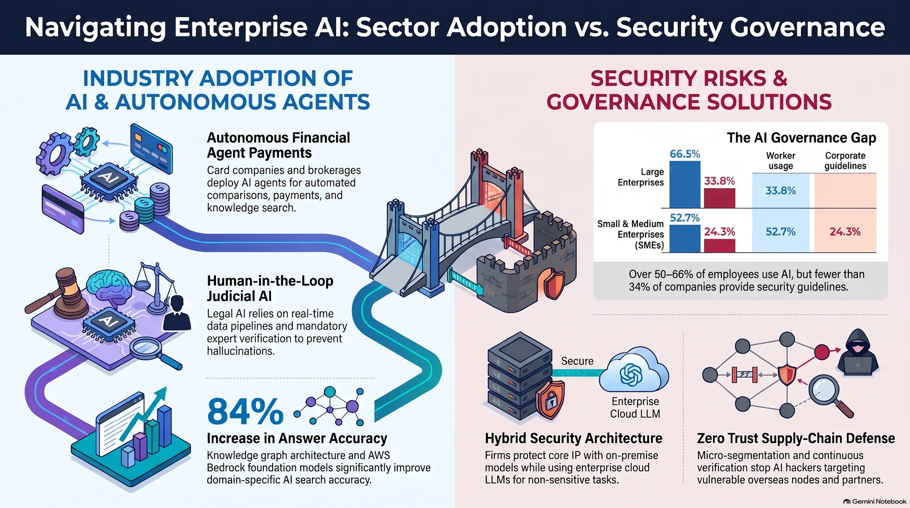
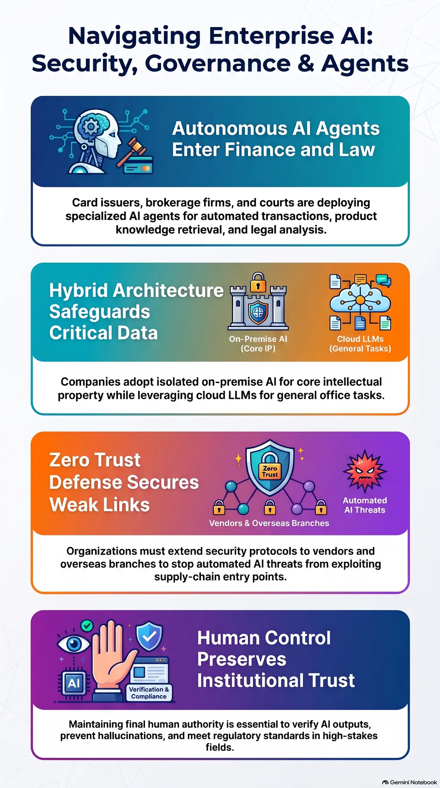

In a Hyundai Card test environment, an AI agent is processing a currency transfer for a virtual overseas subsidiary. Inside its authority, it moves on its own. When it crosses that line, an officer has to press approve or reject. It is a small experiment. But the question the experiment is answering is not small. From now on, when AI buys on your behalf, it becomes a matter of who pays, and who is responsible when something goes wrong. And this is not abstraction. It is what the Korean card industry is actually verifying right now.

The axis running through this morning's news was sovereign AI and security. Supply-chain stabilization talks, the confidential-leak dilemma, AI hackers targeting the supply chain. In the middle of that axis, there is one place where money has actually started to flow. Agent payments. This morning's stories all end up asking the same point. Where will AI run, and who will control it? That is exactly the point.

This morning's digest carries the stories of the four major card companies. BC Card, KB Kookmin Card, Shinhan Card, Hyundai Card. The partners differ, but the experiment all four are running is the same. There is one common denominator. Testing whether an agent can actually touch money.

In the past month, Korea's four major card companies entered the same experiment at the same time. BC Card signed an MOU with AI startup Pickle on the 17th for agentic-pay technology verification and commercialization, and is checking whether the service can be built in line with the relevant laws and regulations. KB Kookmin Card is verifying AI-agent payment integration in a test environment with S-Polaris. Shinhan Card actually tested an agent making reservations and payments in a merchant environment on Hopa, Mastercard's global mobility platform. It is the second test after completing the first AI-agent-pay real transaction between Mastercard and a Korean card company in March. Hyundai Card is verifying currency exchange and transfers between virtual overseas subsidiaries with JPMorgan's Kinexis.

## Who Stands on the Payment Rails

The common point of the four experiments is clear. The agent does not stop at the recommendation screen; it actually moves money. The industry calls this agentic commerce. A market where the agent directly executes purchase and payment. Mastercard already published its 2026 AI payment protocol (the agent-pay family), and card networks and banks in each country have entered a first-mover race over the standards and authority structure for agent-initiated transactions. The competition runs on two fronts at once. The technical standard called the protocol, and the authority structure that decides how far an agent can transact by itself.

The question is no longer whether an agent can buy. It is entirely about who stands on the payment rails between the agent and the merchant. Card companies are after the revenue model of payment convenience and repeat-purchase lock-in. AI startups and blockchain infrastructure companies are after the seat of agent execution and identity-verification technology. The moment the agent becomes the principal of a transaction, the value chain of the payment industry itself is being reorganized. The card company's role is moving from the settlement rails between buyer and merchant to the rails between agent and merchant.

<!-- nlm-visual -->

*Infographic generated by NotebookLM from the sources.*

## The Bait Is Lock-In

Why are card companies moving this fast? The answer is inside the phrase "lock-in effect." When an AI that knows when, what, and how often you buy can pay directly, the moment recurring purchases start paying themselves, the switching cost jumps. As long as the repeat buyer is the stickiest customer, the entrance into that customer's wallet is the battlefield. The more agentic commerce, where the agent goes beyond recommendation all the way to purchase and payment, expands, the less a card company can afford to lose that entrance.

So this verification is being run as security-system verification at the same time as payment verification. The card industry lists transaction-authority scoping and security verification as pre-commercialization tasks. An agent that receives the card must show that it can only pay within its authority, and that it leaves a trace on every transaction. In content generation, a mistake can be redone; in payment, a mistake is immediate financial loss. Whether an audit trail exists is the line that separates an AI incident from an ordinary event. On the customer side the change is concrete too. Instead of the path of entering card details and moving through a checkout screen, the agent handles purchase through payment in one flow. The size of the convenience is exactly the size of the authority that must be controlled.

## Preparing Enterprises Is Bigger Than Payment

Payment is only the first front. The moment an agent handles money, what comes next is subscriptions, business travel, purchase orders, and insurance. Every company is entering the period when it must ask how much to entrust to its agents, and how to manage them after entrusting. Before the card companies' tests reach commercialization, companies must set up their own agent-operations governance first.

The gap where management lags behind adoption speed is confirmed in numbers. In a Korea Chamber of Commerce and Industry survey, generative AI usage among large-company employees is 66.5%, and 52.7% for SMEs. By contrast, only 33.8% of large companies and 24.3% of SMEs have internal guidelines. 70.4% of SMEs have no adoption roadmap at all. People are already using it; the rulebook is being written right now.

Large companies are hardening a hybrid approach into their operating standard. Core confidential work runs on in-house, on-prem dedicated AI; general work runs on external LLMs where input data is not used for retraining. SK AX operates a two-tier structure of a VDI-based closed AI playground and an AI landing zone for customer projects, and Hyundai Autoever has built a four-tier security system that auto-classifies data into general, internal, confidential, and national core technology. Governance infrastructure is already being built inside large companies. After the incident in which Samsung DS employees entered source code into an external AI, the point was raised that corporate control systems lag behind usage speed. SMEs without dedicated staff, by contrast, can only increase their dependence on cheap guardrails and agent-visibility platforms. The authority and audit infrastructure that card companies are testing will become a required item in every company's agent adoption.

## The Spec Is Written in the Test Environment

That rulebook is being used in production verification. Mirae Asset Securities' way of running product-knowledge AI search with AWS is an example. About 13,000 financial products and disclosure documents are connected into a knowledge graph, and multi-AI agents divide the search and answer-writing work. Information the system does not hold is clearly reported as not held, and prompt attacks and harmful content are pre-checked by guardrails. Even when a model is swapped, quality is re-verified through the Financial Security Institute process. Designated as an innovative financial service in March, passed the Financial Security Institute generative AI security assessment in July, started internal operation in August, and customer service opens in the first half of next year. It is a case that walked the regulatory roadmap for pushing agents into production in the financial sector exactly as laid out. By October 20, more than 450 employees had used it for over 2,000 compound queries, and answer quality improved about 84% compared with the March pre-verification. In the words of CEO Joo Se-min, data comes before the model. The production recipe for regulated industries is hardening in the order of model verification, data verification, and agent verification.

The same sentence is coming out of the judiciary as well. The courts announced in February 2026 the construction of their own AI platform and a pilot of a generative-AI-based trial-support system, and the topic has since moved from adoption to securing trust. Ahn Ki-soon, head of the Legal AI Research Institute at Law & Company, advised that in judicial AI handling fundamental rights, accuracy is the top priority, and that human command and control should be written into the operating procedure as a basic principle so that the final verification of AI answers is done by the user. Legal AI is expected to evolve within 3 to 5 years from question-answer assistance into autonomous AI agents that set execution plans and direct sub-tools. What finance uses, what the courts use, and what card companies use are one and the same spec. That is what it means.

The same pattern is appearing in the card companies' tests as well. AI agents that employees build themselves shuttle constantly between internal systems and external APIs and become new security blind spots, and the visibility of data flows across MCP and external tool-calling paths plus pre-approval verification of skills have risen as core tasks (Yoo Sang-yoon, CEO of Aim Intelligence). The attacking side is moving too. In an AI threat-tracking report on November 17, Google Threat Intelligence Group (GTIG) and Mandiant declared that autonomous multi-agent attack frameworks have crossed the threshold of AI threat activity. They also pointed to the appearance of automated vulnerability-exploit pipelines and new monetization methods such as LLMJacking. Attack paths have moved from the headquarters perimeter to the supply chain. A hijacked overseas-subsidiary VPN account penetrating all the way into the headquarters intranet is the structure. The National AI Strategy Committee launched a national cyber-resilience task force, broadening the policy direction toward keeping core functions and recovering fast even after an intrusion. The fact that the attackers also have agents that move within their own authority is what separates past hacking from now.

The infrastructure that protects the defending agent and the infrastructure that tracks the attacking agent are, in the end, the same thing. That is the point today's card-company tests teach.

## Conclusion: The Payment Standard War Is Only the Prologue

Looking at this month's card-company verification through the lens of an enterprise agent platform, the conclusion is simple. What the four companies are using in the test environment is the spec needed to run agents. Authority-scope definition, human approval or rejection when exceeded, full-process audit, identity verification, closed test environment. This is not a payment spec. It is an agent-governance spec.

ThakiCloud's Paxis is the official Agent-Native Cloud product (v1.1 GA), and it already carries this spec as first-class resources. Skills, Tools, Policies, and Audit Logs are all resources managed independently on this platform. Autonomy is governed in four stages from L0 to L3; when an agent reaches for work above its own stage, a policy gate engages and an audit log is left. Execution happens in an isolated sandbox, external systems connect through MCP connectors, and verified skills are shared inside the organization through the skill market. CostRouter, which picks a model to match cost and performance per task, is attached as well. Deployment is possible on sovereign or on-prem K8s, on ai-platform.

That sentence in the Hyundai Card test procedure, automatic handling within authority and officer approval or rejection when exceeded, is the thread of this spec. Card companies are writing the draft of the agent-governance standard in their first job, which is payment. What happens to the companies that finish the same standard first is self-evident. The card companies' test environment is a preview. When agent workflows stretch into subscriptions, travel, and purchase orders, the companies whose governance is already in place keep their speed as is. The payment-rails standard war between Mastercard and the card companies is only the prologue. The real main story is the enterprise agent-governance standard war. The side that can answer which agent executed which skill under which authority, and what moved as a result, sets the standard of the agent economy where money moves.

<!-- nlm-visual -->

*Infographic generated by NotebookLM from the sources.*

## References

This post was written by synthesizing the following news.

- ITBizNews, [Mirae Asset Securities, Teaming with AWS, Begins Operating Its 'Product Knowledge AI Search' Service](https://www.itbiznews.com/news/articleView.html?idxno=232306)
- Youth Daily, [AI Auto-Payment Brings the 'Lock-In Effect'... Card Industry Takes 'Quick Steps' on AI Agent Verification](https://www.youthdaily.co.kr/news/article.html?no=230148)
- Edaily, ["Trust Is Life" for Judicial AI... Real-Time Information and Strengthened Auto-Verification Technology Are the Key](https://www.edaily.co.kr/News/Read?newsId=01193926645648672&mediaCodeNo=257&utm_source=naver&utm_medium=referral&utm_campaign=news_syndication&utm_content=original_article)
- Korea Economist, [Want to Use AI but Fear Leaks, Want to Block It but Fear Losing Out... The Industry's Dilemma](https://economist.co.kr/article/view/ecn202611160054)
- Korea Economist, [Is Locking Down the Headquarters Enough?... AI Hackers Targeting Overseas Subsidiaries and Partners](https://economist.co.kr/article/view/ecn202611180003)
