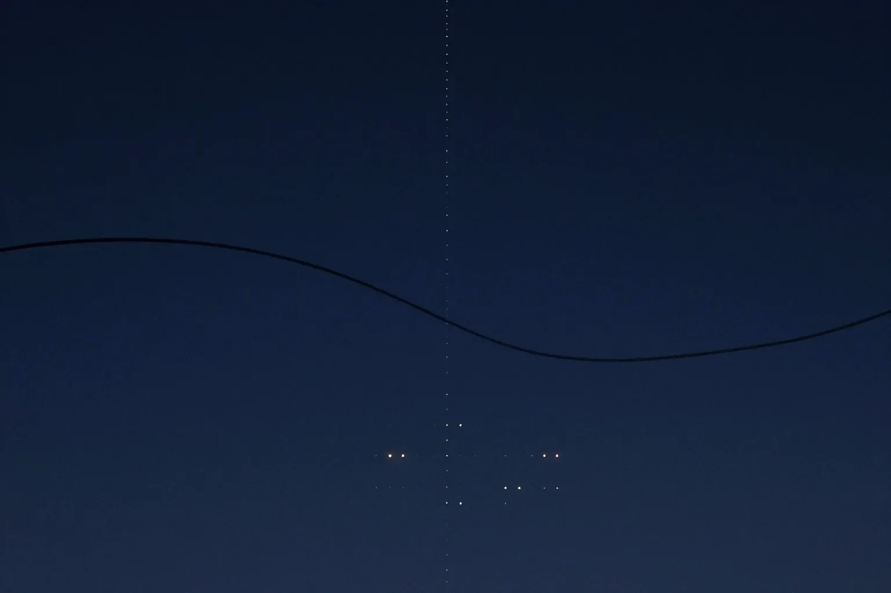
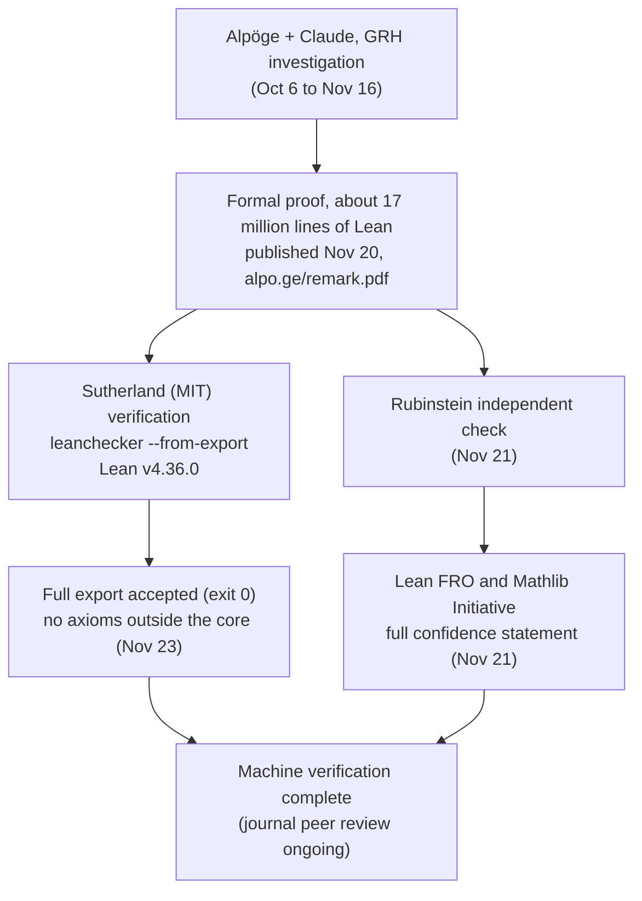
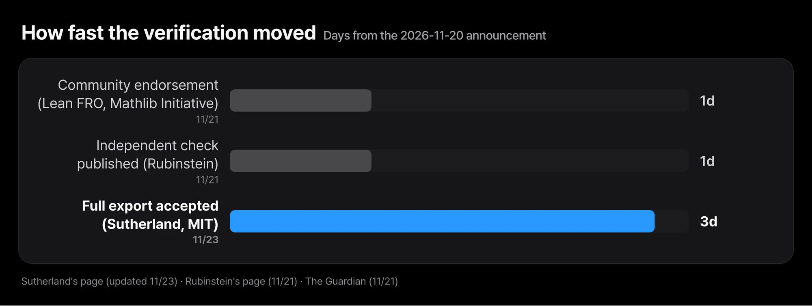
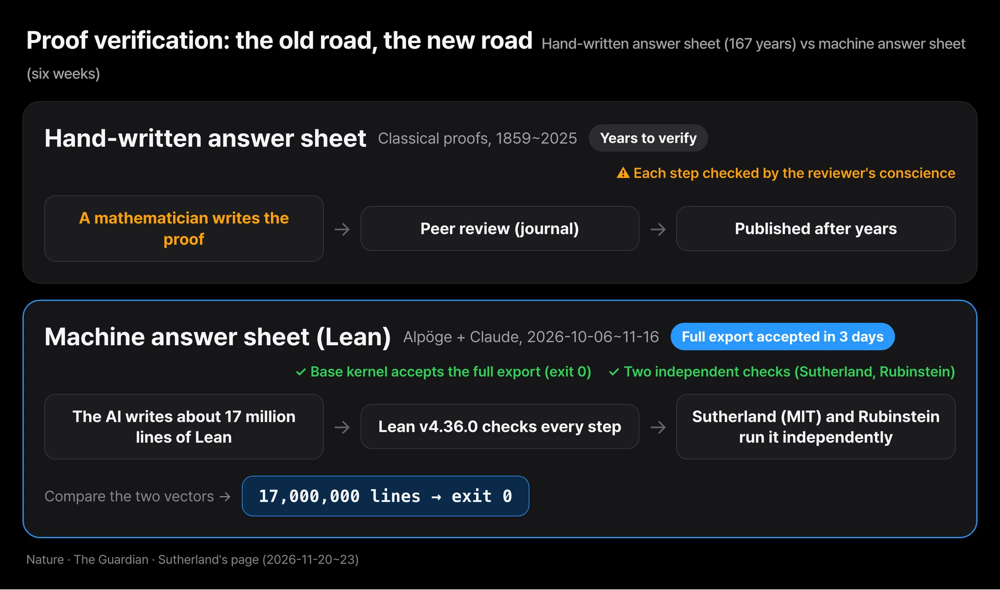
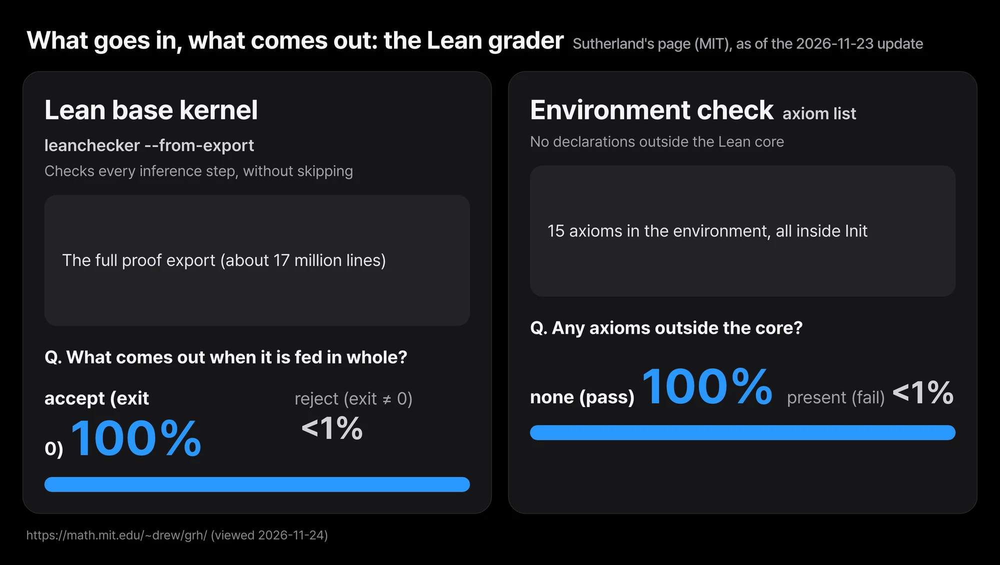

*Figure 1. An abstract rendering of the critical line and a lattice of primes. The point of this post is not the mathematical detail, but the process of machine-verifying a 17-million-line proof, and how far its meaning extends.*

This post is written for developers without a math background, people working in the AI industry, and ThakiCloud's prospective customers and job candidates. It is about how the Riemann Hypothesis, the signature unsolved problem of mathematics, open for 167 years, came to be called solved within days.

The core conclusion first. The proof is called verified not because people read it, but because a machine checker named Lean verified all 17 million lines of it.

That is the first time it has happened at the scale of a 167-year-old open problem, and it signals that the unit of trust in knowledge work is moving from human review to machine verification.

On November 20, 2026, Levent Alpöge, a mathematician at the AI company Anthropic, posted a formal announcement (remark.pdf) on his personal site (alpo.ge). Nature summarized his opening line like this.

> "I believe I have, working with Claude, discovered a proof of the Riemann Hypothesis."

Claude is a large language model developed by Anthropic.

A day after the announcement, on November 21, the Lean FRO (the Lean project's operating committee) and the Mathlib Initiative issued a public statement. They expressed full confidence that Alpöge's proof of the Riemann Hypothesis is correct, and congratulated him on the achievement.

The Guardian reported the same day that two teams, Sutherland's group at MIT and independent researcher Rubinstein, were verifying the proof.

## In plain terms

A proof is an exam answer sheet, and Lean is the machine that grades it.

A mathematician writes the answer by hand. No matter how brilliant the answer is, it counts as verified only after a grading machine recomputes every line and stamps it correct. The Riemann Hypothesis proof this time was fed into the grader as a 17-million-line machine-readable answer sheet (the Lean formalization).

Sutherland's team ran the grader, and the base kernel (Lean v4.36.0) accepted the full export.

The grader does not get tired, does not lose care in the boring parts, and will not pass if even one of the 17 million lines is wrong. We use the answer sheet and grader metaphor to the end of this post.

## What happened: the announcement and verification timeline

The timeline first. Development of the Lean proof ran from October 6 to November 16, five days before the formal announcement, about six weeks of work. Alpöge reached this proof while using Claude to investigate the Generalized Riemann Hypothesis (GRH).

| Date | Event | Confirmer or source |
|------|-------|---------------------|
| 2026-11-20 | Formal announcement (alpo.ge/remark.pdf) | Alpöge (Anthropic) |
| 2026-11-20 | Verification files published | Sutherland (MIT) |
| 2026-11-21 | Full confidence statement | Lean FRO, Mathlib Initiative |
| 2026-11-21 | Independent verification published | Rubinstein |
| 2026-11-21 | Two teams are verifying, reported | The Guardian |
| 2026-11-22 | Most checks passed, two remaining | Sutherland's page |
| 2026-11-23 | Correction: the 250,000-page figure was a joke | Alpöge (X post) |
| 2026-11-23 | Full export accepted (Lean v4.36.0) | Sutherland (updated 23:45 UTC) |

*Figure 2. The flow from announcement to verification. The grader was run in two independent places (Sutherland, Rubinstein), and the grading verdict (exit 0) and the community statement (full confidence) came through different paths.*

*The community statement and the independent check came one day after the announcement; MIT's full export acceptance came in three days. (Figure 3)*

The last row is the one that matters. Sutherland's team ran the Lean base kernel's leanchecker command over the full export of the proof and confirmed exit 0, acceptance. They also confirmed that no axioms were declared outside the Lean core. All 15 axioms in the environment sit inside the Init module, a pure state.

In formal verification, this is the state where the grader has read every line of the answer sheet without skipping.

There is an operational detail worth noticing. The verification page itself records that the checks were run with Claude Code. The side operating the grader is also an AI. But the kernel that decides pass or fail is deterministic. An AI proposes, and a deterministic machine disposes.

This division of labor is already standard at the front line of mathematics, which is what makes the event important for people who build software.

## The Riemann Hypothesis: the 167-year-old problem

The Riemann Hypothesis is a conjecture posed by Bernhard Riemann in 1859. It connects the rule that governs the distribution of prime numbers with the location of the zeros of the Riemann zeta function, the most central claim in analytic number theory. In plain terms, it is the hypothesis that there is a hidden rule behind the rhythm at which primes appear.

Why did it take 167 years? The tools for attacking the problem were extremely limited. A hand-written answer (a classical proof) demanded deep analytic techniques, and the checking of each step was left to the mathematician's own conscience. In 2000, the Clay Mathematical Institute named the problem one of the Millennium Prize Problems, with a prize of $1,000,000.

Every answer that came along before this one existed only in an unverified state.

One step closer to the hypothesis tightens the error bound of the prime counting function. A large share of the results in analytic number theory and in cryptography that use the distribution of primes stack their estimates on top of this hypothesis. It is not a number used directly in daily practice, but it is the underlayer of many results.

What makes this proof different is the form itself. It is not a hand-written answer but a 17-million-line machine-readable answer sheet. The grader (Lean) does not ask whether the proof is elegant. It asks only whether each step follows logically from the previous one. That is the part the mathematicians who watched the verification process call historic.

*The old verification path (human review, years) next to this one (AI answer sheet, machine checking, days). (Figure 4)*

## The other proofs from the same period

This event is not complete if you frame it as one AI proof appearing. TechCrunch's headline on the same day read that an AI claimed a solution to the 167-year-old Riemann hypothesis, and a human did too. Quanta Magazine's update reported that while mathematicians raced to verify the AI proof, a human proof emerged.

Nature's piece was titled around mathematicians being astounded by the AI and human-written proofs of the iconic hypothesis. A human proof, worked on for years, came into view around the same time, and the two are being checked in parallel.

Another recent AI attempt comes from OpenAI. On September 30, 2026, a preprint titled The Quasi-Riemann Hypothesis: A Zero-Free Half-Plane Re(s) > 7/8 was released. It is a weaker but concrete result: the zeros of the zeta function do not cross a certain line to the right. It too has been formalized in Lean.

The formalization establishes, for the Riemann zeta function and every Dirichlet L-function, a zero-free half-plane with θ = 7/8, uniformly over all positive moduli and all characters, and sets the same bound for finite-order Hecke L-functions over Q(√-3).

The mathematician Thomas Bloom assessed that Alpöge's proof is more algebraic than OpenAI's analytic approach. Within three months, two AI attempts by two companies, and a human proof, all in the same room. Frontier mathematics now being worked on simultaneously by several AIs is not a prediction. It is the current state.

## The math community's reaction: enthusiasm and skepticism

The reactions split into two camps. Fields Medalist James Maynard called the proof, if correct, a historic milestone. Brian Conrey, known for his work on L-functions, said it is a monumental moment in human history, and the biggest thing he thinks has ever happened in mathematics.

Filippo Nuccio, in a discussion room (Zulip), described the proof as containing, in substance, all the number theory produced in the last 50 years, across every branch of the discipline.

Terence Tao posted the day of the announcement (November 20) a piece titled Unforced Euler singularity, unforced Navier-Stokes singularity, and the Generalized Riemann Hypothesis, examining how the GRH relates to open problems in fluid mechanics. Given that Tao is known for writing up major events the same day, the post itself is a measure of the event's weight.

The skeptical side is equally clear. Andrew Granville pointed at the clarity of the four-page proof sketch Alpöge released, and at its timing, one day after Anthropic's IPO. Scott Aaronson put the phrase stochastic parrots in his title, placing a question mark on the agent that actually did the reasoning. Science's report carried the question of whether humans can understand the answer.

The thing to pin down is that this split is not about believing or doubting. Verification by the grader (the formal check) is, in substance, done. The debate is concentrated on whether humans can understand it, and on the clarity of the presentation. A 17-million-line answer sheet cannot be read by hand.

Whether the proof can be simplified enough for a human to understand is the remaining open problem.

## What it means for software developers: the economics of trust in AI output

The core of the event fits in one line. No matter how brilliant the answer is, it becomes a fact only after it passes verification.

We do this every day in software. Test suites and CI are answer sheet graders, but weak ones. They look only at what you show them. Lean is close to the strongest grader, because it checks every inference step one by one. The reason formal verification stayed a niche is that writing machine-readable answer sheets was too hard for humans.

The answer to that difficulty did not come as humans writing better sheets. It came as AIs starting to write them.

Alpöge's team wrote 17 million lines in six weeks. A human mathematician could not write that volume, nor verify it. What humans do is set up the grader, run it, and check the environment. In knowledge work, the unit of trust is moving from human review to machine verification.

Formal verification is not a new technique. In 2005, Gonthier's Flyspeck team completed a formal proof of the four color theorem in Coq, and in 2015, Hales and colleagues finished the verification of the Kepler conjecture (the densest packing of spheres). But those answer sheets were written by human hands, and the machine checked them.

This time, the AI wrote the answer sheet itself. The grader is the same; the hand that wrote the sheet has changed.

This is not a metaphor about AI. It is an operating model. The checks were run with Claude Code, and the verdict came from a deterministic kernel. The stronger the AI that proposes, the more important the machine that disposes becomes. The point where verification cost, not generation cost, starts to drive the economics.

Writing (17 million lines) is done by the AI, and the verdict (exit 0) is given by the machine.

*Feed the full proof export into the grader (Lean v4.36.0 base kernel) and it returns accept (exit 0), with a clean check that no axioms sit outside the core. (Figure 5)*

## Implications for ThakiCloud products

The reason this event matters to agent platform operators is that it shows the unit of proof for AI output has moved from human review to machine verification.

Paxis treats agent behavior as first-class resources: Skills, Tools, Policies, and Audit Logs. The Riemann Hypothesis event confirms that this design premise was right. For an agent's output, from the code it writes to the decisions it makes, to earn trust, it needs a form a machine can verify even when it is too long for a human to read.

Paxis's policy gates and audit logs are the operating version of this division of labor. Passing the grader in mathematics corresponds to passing a policy gate and leaving an audit record in Paxis. Declaring in advance which verification gate an output must pass, and recording every passing, is the operational side of formal verification.

One line from the Metis side as well. Frontier model capability reaching the stage of proving a 167-year-old open problem, beyond code generation, means the use cases for model catalogs and serving infrastructure have widened. The slower a domain is to verify, the more important the serving and cost management that run models in front of it becomes.

## Limits and counterarguments

Saying the proof has been verified is correct. Saying it is finished is not yet. The standard for solved is the confidence statement from the grader community (the Lean FRO and the Mathlib Initiative), and academic journal peer review is still in progress. Sutherland's page was last updated at 23:45 UTC on November 23, and as of November 22, two checks were still running.

The verification process itself has not fully closed.

Separate caution is needed. The initial report that a prose rendering of the proof would run to 250,000 pages was later corrected by Alpöge himself as a joke. The lesson is that even when the proof itself is verified, the claims around it need separate verification. Alpöge also predicted that the scope of the proof could be massively simplified ahead.

The current 17-million-line answer sheet is verified, but it may not be the final form. And the question Science raised, whether humans can understand the answer, remains open. An answer sheet that passes the grader but cannot be read by a human is not yet accumulated knowledge, in the mathematical sense.

## In closing

The fastest part of this event was not the proof but the verification. The grader checked 17 million lines, the statement of full confidence came in one day, and the acceptance of the full export came in three days.

The slowest part was understanding. Nobody has read the proof in full yet, and whether it can be read is the remaining open problem.

If you take one thing, take this. The unit of trust for AI output is moving from human review to machine verification. The question is no longer "is this output good?" but "which grader can verify this output, and where is the record of the verdict kept?"

The design of a platform that manages agents starts from exactly that question, and Paxis answers it with policy gates and audit logs.

The Riemann Hypothesis was a 167-year-old question about the rhythm of primes. This time, the answer sheet that resolved it was not read by human eyes. An answer sheet that is verified without being read is the milestone of this event, and it is the starting point.

## Sources

The following are the URLs actually checked while writing this post.

- Levent Alpöge formal announcement (PDF): <https://alpo.ge/remark.pdf>
- Nature (Davide Castelvecchi, 2026-11-20): <https://www.nature.com/articles/d41586-026-03812-7>
- The Guardian (José Olivares, 2026-11-21): <https://www.theguardian.com/technology/2026/nov/21/anthropic-riemann-hypothesis-solved-claude-ai>
- Andrew Sutherland (MIT) verification page: <https://math.mit.edu/~drew/grh/>
- Michael Rubinstein independent verification: <https://mrubinst.github.io/grh-lean-verification/>
- Terence Tao blog (2026-11-20): <https://terrytao.wordpress.com/2026/11/20/unforced-euler-singularity-unforced-navier-stokes-singularity-and-the-generalized-riemann-hypothesis/>
- Scientific American (Joseph Howlett, 2026-11-20): <https://www.scientificamerican.com/article/anthropic-mathematician-claims-to-prove-riemann-hypothesis-most-famous-problem-in-all-of-math/>
- OpenAI quasi-Riemann Hypothesis document: <https://github.com/openai/math/blob/main/lean/docs/003.md>
- Wikipedia, "Riemann hypothesis", Alpöge formal proof section (viewed 2026-11-24): <https://en.wikipedia.org/wiki/Riemann_hypothesis>
- Alpöge X post (250,000-page correction, 2026-11-23): <https://x.com/__alpoge__/status/2124987173439209561>
