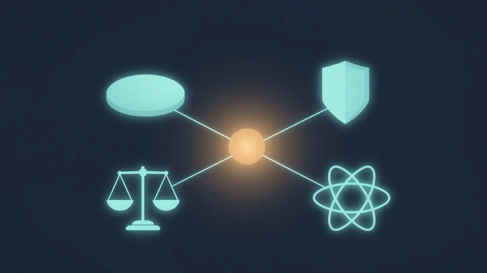
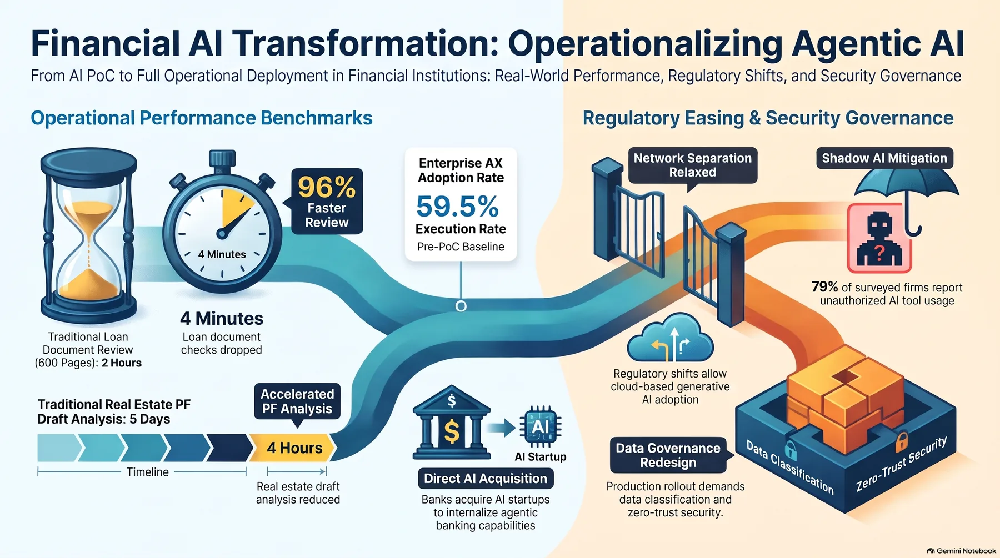
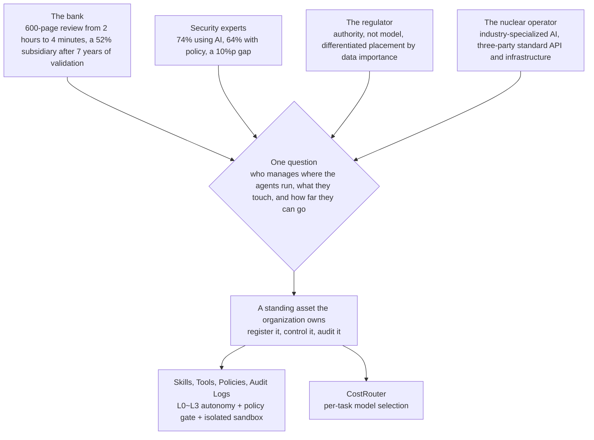
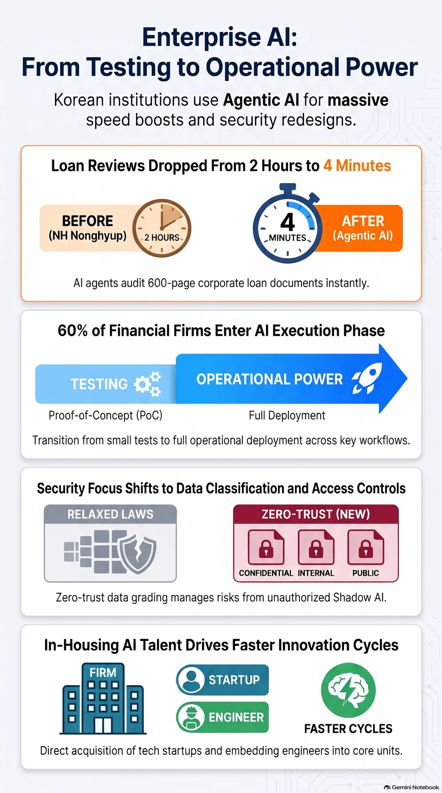

One bank bought a startup. What it wanted was the people and the way the technology is made. NH Nonghyup Bank absorbed Agile Soda, an AI startup it has worked with since a 2019 open innovation program, as a 52% subsidiary. After 7 years of three-stage validation, this is the first acquisition of an AI development organization in the banking industry. Read it as a talent acquisition story? No. Read it together with the numbers that came out of that bank's loan desk in the same week, and the context changes.

Until now, AI in the financial industry was mostly a story of experiments. This week brought stories of execution. A loan document review that took up to 2 hours now takes 4 minutes. The documents run to 600 pages, and errors that used to surface only in the audit stage are now prevented in advance. The real question this acquisition is trying to answer is a separate one. When a desk gets 30 times faster, what should the organization that keeps producing agents like that do? I will read today's Korean AI news through that question. The answers sit side by side in four places: a bank, security experts, the financial regulator, and a nuclear power operator. Four places, one question.

*A visual metaphor for the article's key idea. The bank, security experts, the regulator, the nuclear operator. Four answers, one question.*

## The desk that went from 2 hours to 4 minutes

The change at Nonghyup Bank's loan desk has moved past the demo stage. Drafting the real estate PF business viability analysis went from 5 business days to about 4 hours. A card prepayment chatbot, automated processing of investment product trade documents, and watchlist filtering all run in the same layer. The significance of the errors blocked in advance is not only a matter of time. Because the function of the audit stage moved to an earlier stage, the structure of the loan process itself is changing. When the documents for a single loan can reach 600 pages, a review mistake is a matter of asset soundness, not a matter of time, and the figure of 4 minutes matters more because of that weight.

The core is the production system. Of 39 AI utilization proposals from employees, 10 projects became agent MVPs that actually run. Forward-deployed engineers (FDEs) are stationed to connect those ideas to code. Nonghyup Bank calls this its always-on AI consulting room. It is a system where a practitioner's idea and working code stay connected at all times, without breaking across project cycles. What this shows is that agents are no longer a test but a production process that receives proposals and produces output on a daily basis.

The bank has set 2030 "AI full banking" as its goal. The competition has already started. Shinhan Bank introduced a generative AI-based loan review support agent in March 2026, and the Korea Development Bank is pushing for loan review automation with a financial analysis AI agent. The industry calls this flow agentic banking. In the second half of 2026, the axis of financial IT moved from the question of whether to use AI to the question of how to make AI a standing job. That is because the target is not support work but core work such as lending, PF, and audit. Money Today rates this experiment as having worked.

<!-- nlm-visual -->

*Infographic generated by NotebookLM from the sources.*

## What 7 years of validation and 52% mean

Korean banks have a structural limit. The Banking Act restricts holding voting shares above 15% of another company, and on top of that the inertia of SI dependence has kept AX mostly at the level of buying external solutions or outsourcing development. Because the bank buys the tool, but the capability to make the tool stays on the vendor's side. Nonghyup Bank brought in the exception clause for fintech investment and chose a different path.

Lending is a business of decisions, and a wrong decision is not a matter of loss but a matter of capital. That is why financial validation is slow, and this validation took 7 years. The door opened with a 2019 open innovation program, and it went through three stages of validation. The result is a 52% subsidiary. It brought in the FDE system known from Palantir and OpenAI, placing engineers who know the field to convert employees' ideas into code continuously. In the old pattern, everything ended at the moment the tool was bought. The vendor's roadmap became the bank's roadmap, and the speed of change was decided by the other party's priorities. The new pattern is the reverse. The bank holds the production function itself, and the FDE system works as the gear that regularly turns employees' proposals into operational assets.

What was bought this week is not a single product but the way a product is born. A single product can be bought anytime, but the way is not there unless bought. That is why this acquisition is called the "first" in the banking industry. The choice to cross the wall of shareholding limits through the door of the exception clause and bring the capability in-house is not common in the Korean financial sector.

## The 10 percentage point gap: 74% use it, 64% are setting it up

The speed signal is the same at other companies. Only the preparation lags. The second session of the "2026 Industrial Security Conference" held on the 24th by the National Intelligence Service and the Ministry of Trade, Industry and Energy at the Grand InterContinental Parana in Seoul was on the theme of "AI innovation and AI security, the two axes of corporate competitiveness." There, a May survey of 38 member companies of the Korea Academy of Industrial Security came out. 74% are using AI company-wide or in the majority of departments. Companies that have had at least one instance of shadow AI, or unauthorized AI use, reach 79%, and those preparing AI utilization policy and controls stop at 64%. The 10 percentage point gap between 74% and 64% is not a gap of awareness but a gap of the time it takes to build the system.

That is, employees use it first, and the rules come after. In industries with high risk of technology leakage and export controls, this is not a simple IT security problem but is directly tied to national industrial security and economic security. According to a report by The Economist, the conference designated shadow AI as the front line of core technology leakage paths. A panel discussion with the LG Business Research Institute, HS Hyosung, SK AX, Hwawoo, and Kim & Chang sitting side by side produced a concrete work list. It is to create an AI security standard table, organize the list of AI agents added to existing business systems, and document the basis and procedures of AI inputs. Kim Mok-jeong, senior manager at Hyundai eVerTree, added data grade classification and the practical construction of sovereign AI.

The experts' advice went one step further. The role of security is not to stop AI, but to be the foundation that makes AI innovation sustainable. They say that to do that, usage criteria and operating systems must be established at the same time. Utilization is already a fact, and governance is now an engineering task.

## The regulator's question: not the model but authority

The Financial Services Commission's answer comes out a bit more specifically. The Financial Services Commission is running a task force to fully lift the network separation regulation, and cites the AI response as one of the reasons for the easing. It is because agents need to reach into internal business systems that network separation became a regulatory topic. There are 169 network separation exception designations for financial companies, of which 45 have been commercialized. Simple model changes are now possible with only written confirmation, without re-designation. According to the KT financial AX report, 59.5% of Korean financial institutions have entered the AX execution stage from pilot to company-wide rollout.

However, the diagnosis by Digital Daily is different. The deciding variable is not the model's performance but the data standards that have accumulated by business over decades between the core accounting systems and the information systems, the storage of unstructured data, and above all the design of authority. How far should the access rights of an AI agent that queries the DB at any time and moves between multiple systems be given. Because a large part of the IT budget is tied up in maintaining aging systems, the cost of rebuilding the data center with GPU, storage, and network is hard to calculate separately.

The direction the regulator points to is a dual structure. It is not a full cloud migration but a differentiated placement by data importance. Sensitive customer credit information stays in internal infrastructure, and de-identified data and business support AI go to the cloud. That is the structure. Looking at the budget outlook, this story does not end with model adoption. Next year's financial AI budget is expected to be poured more into data governance, infrastructure, and reorganization of the operating system than into model licenses. Because the roughly 40% of institutions stuck at company-wide rollout will also make this redesign the key to the solution.

## Nuclear power asks the same question

The movements of high-reliability industries are lined up in parallel. On the 24th, Korea Hydro & Nuclear Power (KHNP) held a results sharing session for its in-house generative AI "Hi Nuri" at its Gyeongju headquarters. It is a nuclear-specialized platform that has learned vast amounts of business materials including nuclear operation. The more national core infrastructure where security and accuracy come first, the clearer the flow of moving from using a general-purpose LLM as-is to an industry-specialized AI trained on its own data.

Korea Hydro & Nuclear Power signed a three-party MOU with KEPCO KDN and Naver Cloud. KEPCO KDN handles business system linkage and standard APIs, Naver Cloud handles demonstration and education of AI agent development solutions, and Korea Hydro & Nuclear Power handles AX strategy and task discovery. That is the placement. It can be seen as a standard case of public-private AI collaboration in which a public IT specialist company, a private cloud, and a demand company divide the roles. Naver Cloud has already published an "Administrative AI Agent" verified by major ministries and has expanded public AX on all fronts, so the three-party MOU sits within that flow. It announced 10 excellent cases selected through an in-house competition, and also plans to start a joint project including an expansion of the AI platform infrastructure in the first half of 2027.

In places where safety and regulation come first, generative AI and agents are entering the business system as more than a general-purpose office tool. That is a signal that overlaps with the bank. The stronger the demand for data sovereignty and closed networks, the more the demand moves to a combination of in-house specialized models and agent orchestration.

## The moment agents become organizational assets

Today's four signals point to the same place. The bank's answer was to buy the team, the security experts' answer was lists and documentation, the regulator's answer was authority design by data grade. The nuclear operator's answer was a three-party standard API and infrastructure. All four are doing the same thing. The thing that agents must be treated not as a one-time purchase but as a standing resource that the organization owns. The question that overlaps is one. Who manages where the agents born this way run, what they touch, and how far they can go. Because the way that question is answered is what will determine whether the speed of 4 minutes can be maintained.

*Figure. The bank, security experts, the regulator, the nuclear operator. The one question all four answers point to, and the operating structure that answers it.*

ThakiCloud's Paxis is the agent-native cloud built on exactly this premise. Skills, Tools, Policies, and Audit Logs are all first-class resources, and the organization registers, controls, and audits them. Autonomy also goes from L0 to L3, defining the authority range per business, and the policy gate blocks actions that cross the range before execution. Isolated sandbox execution is a stage that verifies before opening. MCP connectors and the skill market turn the "organizing the agent list" task that the panel handed down and the "standard API" task of nuclear power from document work into platform functions. The sovereign, on-premises K8s execution environment follows the dual placement direction of finance as-is, and per-task model selection, CostRouter, is also an answer to the reality of a budget tied up in maintenance. In compliance businesses like lending and audit, this record is itself the basis of trust.

The bank took 7 years to validate one thing. That agents are not things to buy but standing jobs to own. A 4-minute desk will soon appear at other banks too. Whether the 10 percentage point gap narrows or widens will be decided by where to place the agents born in the next 7 years. On the system? On the spreadsheet?

<!-- nlm-visual -->

*Infographic generated by NotebookLM from the sources.*

## References

This post was written by synthesizing the news below.

- Digital Daily, ["What financial AI needs after the lifting of network separation... the more urgent thing than the model"](https://www.ddaily.co.kr/page/view/2026112418390464562)
- Money Today, [Nonghyup Bank's 600-page loan document review "2 hours → 4 minutes"... the AI experiment worked](https://www.mt.co.kr/future/2026/11/25/2026112405074054984)
- Tour Korea News, [Korea Hydro & Nuclear Power shares in-house generative AI "Hi Nuri" results... KEPCO KDN, Naver Cloud](https://www.tournews21.com/news/articleView.html?idxno=149235)
- The Economist, ["AI is essential; usage criteria and operating systems must be introduced" (2026 Industrial Security Conference)](https://economist.co.kr/article/view/ecn202611240157)
