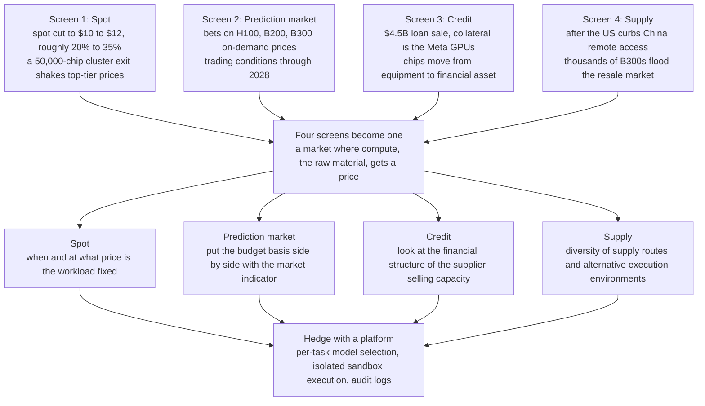

GPU compute now has a market price. Four numbers sat side by side in this morning's news: $10 and $12, $4.5 billion, and 2028. They say it. A price that moves up and down between buyers and sellers. Just as the day an industry's oil gets listed on an exchange is confirmed by the oil price, the same market opened for the AI industry. There is a bigger meaning. In an era where agents work continuously, the fact that the raw material of that work is a market means cost has become a variable. It also means the cost of intelligence is starting to shift its center of gravity from model fees toward the spot price of a raw material.

*The core concept of the post visualized. The four screens of spot, prediction market, credit, and supply converge into a single screen: the market for compute.*

## Spot: One Customer's Move Makes the Price

SpaceX cut the spot rental price for small Blackwell GPU clusters to $10 to $12 per GPU hour. It had previously been around $15 to $15.5. The cut is roughly 20% to 35%. According to reporting that cites SemiAnalysis, behind the cut is Anthropic's exit from a 50,000-chip cluster. One large customer's move alone was enough to shake the cash price of top-tier chips this much.

It was the small clusters, the distributed supply known as spot, that moved first. The more surplus capacity is released onto the market, the more one tenant's exit becomes the very act of setting the price. When a customer leaves, its capacity does not disappear. It stays on the market until it finds a new customer at a lower price, pulling the floor price down. That is why the spot price of top-tier chips is not a number you look at once and move on. It is a number that moves with customers' entrances and exits. More important than the size of the cut is that it reacted this strongly to a customer's move.

The weight of the word "spot" is here. Spot is like weather. Morning and evening differ depending on the volume you use right now, and the contracter always stands in the middle of a bet. An agent workload consumes compute around the clock at a steady rate. The moment you expose that consumption to spot prices, execution cost is no longer a budget but a variable. Even with the same agent and the same workflow, if the market price moves, the month's execution cost changes.

## Prediction Markets: Betting on Prices Through 2028

The freshest signal in today's digest is Polymarket's announcement. The platform opened a public market that prices on-demand compute for Nvidia's H100, B200, and B300, with trading conditions running through 2028. It was also reported that the platform now offers a predicted price for compute.

It also means something that the three chip names sit side by side. The H100 is a workhorse already pushed back a generation, and the B200 and B300 are the current top-tier chips. Prices are set on a single sheet from the old generation to the current one. The horizon is longer. It means compressing years of demand and supply outlook into the form of a price. The price of capacity becomes a public indicator the whole market can see. And the object is on-demand compute. That also means a market price is being attached to the most liquid layer.

What a prediction market does is simple. It binds the beliefs of many bettors into a single price. An individual supplier's price list is that company's own calculation, and a prediction market is the expectation of the whole market. The moment you see the two side by side, the standard for judging "is this price cheap or expensive" changes. Caution is also needed. When everyone expects the same direction, one unexpected supply news item can shake the price even more.

It also means compute is moving past "the price a vendor sets" toward "the price the market agrees on." Just as the oil market has Brent spot and futures contracts, AI now has its own reference price and its bets on the future. It matters from a company's standpoint. When setting next year's budget, you no longer need to wait for a single supplier's price list; you can use the whole market's price expectation as an indicator. To the question "how much will prices fall compared to this year," now the market's answer comes alongside the supplier's brochure. Companies gain a device for comparison. If the price the market expects is lower than the supplier's price list, that is a signal the list still has room to negotiate.

## Credit and Supply: Chips That Become Collateral and Get Sold Again

The side that borrows money is also changing. CoreWeave's banks are organizing the sale of a $4.5 billion loan, which could start as early as next week. The collateral is the GPUs used at Meta. The moment compute capacity is accepted as loan collateral, the chip has crossed from equipment to a financial asset.

Once it is an asset, it gets liquidated, and once liquidated, supply becomes sensitive to price. In a neocloud business that buys chips and sells capacity, chips being collateral means the chip has become a number on an asset ledger. The thicker that ledger gets, the more directly the mood in capital markets ties to the fate of each supplier. It has also become an object for raising capital. The risk of a compute business thereby widens from operational risk to funding risk. And speed is the core. The fact that the sale could start soon shows that capital has begun to move one step ahead of hardware procurement.

The same day's news has a scene of supply actually moving. After the US restricted China's remote access, an unusual volume of Nvidia GPUs flooded the resale market. Among them, cutting-edge B300 chips number in the thousands, and sellers are trying to divert the hardware's original flow elsewhere. The fact that not just the chips but the remote-access channel itself came under restriction means the constraint on supply routes is happening at a broader level. When chips heading for their original destination come out onto the resale market by the thousands, buyers attach to them again and that price shakes the price in the original supply plan. One line of regulation bends the supply line, and bent supply shakes the price. While this cycle repeats, how much, where, and how stably compute can be used remains an open question for companies.

## Efficiency Pulling the Floor Down, Demand Rising to the Sky

While the structure of prices becomes visible, the forces moving the price itself appear in the same news. Anthropic reported that after moving the Claude Messages API from Python to Rust, CPU usage per request dropped by about 70% and memory by more than 80%. It did not change the model or the algorithm. It changed the foundation of the serving layer that receives a request and passes it to the model. For a service used by people, the serving layer's CPU and memory are a trivial cost. But for an agent service that receives requests continuously, this cost is a large part of the unit cost. When the supplier-side cost drops this much, the market price has room to follow. It is an event where the floor of price gets lowered.

Demand keeps rising in the opposite direction. Google Research's Cogentic agent wrote six mathematics papers on Gemini 4 without human intervention, and these papers address problems that have gone unsolved for decades. Hard problems require long reasoning. Long reasoning burns compute. OpenAI published a preprint showing that the GPT-6 family can design the structure and sequence of new proteins with general reasoning and code, without a dedicated bio model. Perplexity released Time Machine for the Search API and Context API, letting developers query and read the web as it was on a specific date up to 365 days ago. In the end, it is a phase where the force lowering the floor of price and the force raising the ceiling move at the same time.

Three things overlap. The unit of output moves from a single token to a paper, general-purpose models reach into specialized domains, and the depth of context an agent can read widens from the present to the past year. Whether protein design or the web as it was 365 days ago, the wider the domain an agent can work in, the wider the surface on which compute is used. It becomes a continuous structure. The raw material of an industry with continuous demand always gets a price list.

## Moving the Four Screens to the Enterprise

The four scenes become a checklist when moved into enterprise operations. First, spot. When is the compute for our agent workload fixed, and at what price. If the volume exposed to spot is large, a customer change at one supplier is a change in our cost. Second, prediction markets. Where do you place the basis for next year's budget. With only a single supplier's brochure, there is no standard to judge a reasonable price. Now that the whole market's price expectation is starting to be used as an indicator, the two bases must sit side by side. Third, credit. You now need to look at the financial structure of the supplier selling capacity. In a world where chip-collateralized loans are sold onto the market, a supplier's funding line is the continuity of our service. Fourth, supply. The diversity of supply routes and alternative execution environments become a basic premise of operations. The four screens end up being one screen. The screen of a compute market.

*Figure. The four screens of the day's news (spot, prediction market, credit, supply) converge into one screen, the market for compute, and the enterprise meets that volatility with a checklist and a platform hedge.*

## The Question Left for Enterprises: A Platform That Handles Volatility

The picture today's news shows can be summed in one line: compute has spot, prediction markets, and collateralized loans. It is the same structure oil had. The question left for enterprises is how to run agent workloads in this volatility. At exactly this point, you can recall ThakiCloud's agent-native cloud, Paxis v1.1 GA.

The product treats Skills, Tools, Policies, and Audit Logs as first-class resources, and runs autonomy together with L0 to L3 governance, policy gates, and audit logs. An agent running around the clock must be able to leave a record of what was executed through which route and who approved it, in an environment where supply is shaken by regulation and market prices are a betting object. What is needed when market prices move is predictability. CostRouter picks a model per task and manages cost so that even the same agent workload is matched to a cheaper execution route. In an environment where GPU procurement routes narrow, isolated sandbox execution and sovereign, on-premises K8s (ai-platform) deployment become a safety net, and MCP connectors and the skill market keep execution capability from being tied to a single supplier.

As a refinery hedges with futures against oil price volatility, a company hedges with a platform. The essence of today's news is not that AI got cheaper. It is that a market was born for AI's oil. An industry that gets a market always first creates the price, and the people who know how to handle the price.

## References

This post was written by synthesizing the following news.

- HuggingNews, [Nvidia Chip Sellers Seek Buyers for Thousands of B300 GPUs After US Curbs China Remote Access](https://huggingnews.com/ai/nvidia-chip-sellers-seek-buyers-for-thousands-of-b300-gpus-after-us-curb-b4b9a324)
- HuggingNews, [Google AI Agent Autonomously Writes 6 Math Papers Solving Decades-Old Problems](https://huggingnews.com/ai/google-ai-agent-autonomously-writes-6-math-papers-solving-decades-old-pr-7adfc7d9)
- HuggingNews, [Polymarket Launches Public Market for Nvidia GPU Compute Prices Through 2028](https://huggingnews.com/ai/polymarket-launches-public-market-for-nvidia-gpu-compute-prices-through-eae8bfe3)
- HuggingNews, [OpenAI GPT-6 Models Design Protein Shapes and Sequences Without Specialized Bio Models](https://huggingnews.com/ai/openai-gpt-6-models-design-protein-shapes-and-sequences-without-speciali-35e844cd)
- HuggingNews, [Anthropic Cuts API CPU Use 70% in Migration From Python to Rust](https://huggingnews.com/ai/anthropic-cuts-api-cpu-use-70percent-in-migration-from-python-to-rust-9150aacc)
- HuggingNews, [CoreWeave Banks Prepare $4.5B Loan Sale Secured by Meta GPUs](https://huggingnews.com/ai/coreweave-banks-to-sell-45b-loan-backed-by-meta-gpus-e33eb0d3)
- HuggingNews, [SpaceX Cuts Blackwell GPU Spot Prices as Anthropic Exits 50,000-Chip Cluster](https://huggingnews.com/ai/spacex-cuts-blackwell-gpu-spot-prices-as-anthropic-exits-50000-chip-clus-bffc316b)
- HuggingNews, [Perplexity Time Machine Lets Developers Search Web as It Was Up to 365 Days Ago](https://huggingnews.com/ai/perplexity-time-machine-lets-developers-search-web-as-it-was-up-to-365-d-5f850073)
