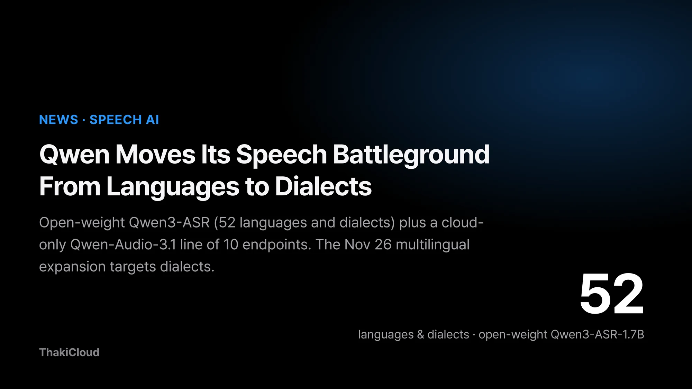
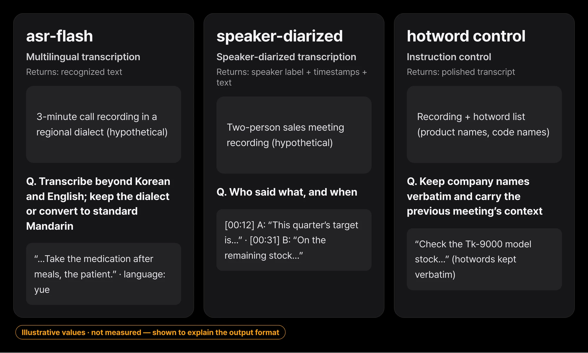
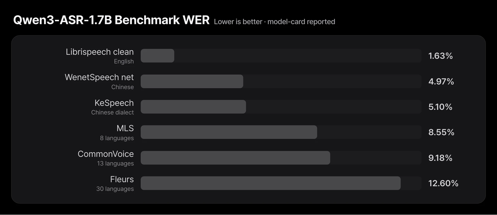
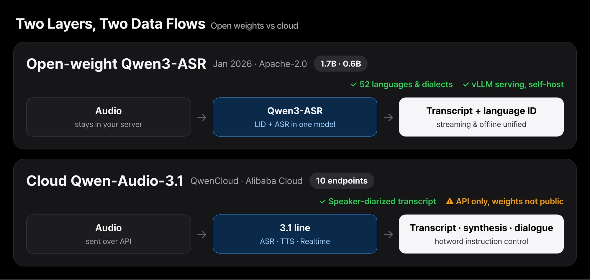

*The speech channel, abstracted: waves passing through a grid of booths.*

*Qwen's two-layer speech strategy and this week's announcement. The 52 languages and dialects are the open-weight Qwen3-ASR-1.7B baseline.*

If you are a developer or product team wiring a voice channel into an agent, you will know why this week's one-line announcement from Alibaba matters. "New multilingual capabilities are here for Qwen-Audio-3.1! Especially for Chinese dialects." On the surface it reads like a language-coverage update. Step back one and you see speech models repositioning inside the AI industry. This post organizes the two layers of Qwen's speech strategy: Qwen3-ASR, which carries 52 languages and dialects in open weights, and the Qwen-Audio-3.1 line, a cloud-only stack of 10 endpoints. And it looks at why the new front is "dialects," not "languages."

## In plain terms: the interpretation booths at an international summit

Treat a speech model like the simultaneous-interpretation booths at an international conference. The number of languages it supports is the number of booths it runs. The Qwen3-ASR family runs 30 language booths plus 22 regional booths inside China. Chinese carries Northeast, Sichuan, Minnan, and Cantonese pronunciations within the same language, and if you cannot hear those regional forms, that market stays closed. That is why "how many dialects" follows "how many languages."

There is one more thing on the booth. The request note handed to the interpreter before the meeting. The Qwen-Audio-3.1 technical report describes instruction control: "hierarchical hotword customization" and "historical-context conditioning." Hand the booth a note that says "keep the company name and product names exactly as written" or "carry the previous meeting's context," and it returns a polished record that reflects that note. It records who spoke, too. Speaker-diarized transcription returns speaker labels, timestamps, and recognized text as one unit.

This post keeps the booth analogy. Open weights are like hiring the interpreter in-house; the cloud line is like booking a booth. This week's announcement is news that the booked-booth service added more language booths and regional booths.

## The 3.1 line, built up as 10 endpoints since September

The Qwen-Audio-3.1 line is not a single model; it is a bundle of service endpoints. Per QwenCloud's official changelog, nine endpoints landed between September and November. The earliest is realtime-plus (September 20), which adds eight system voices and a 262,144-token context. The next day, September 21, four asr-flash variants (file, streaming, message, filetrans) arrive together. The asr-flash-message variant lists Korean among its optimized languages, alongside Indonesian, Japanese, Thai, Filipino, Vietnamese, and Malay. Dialects can be transcribed as spoken or converted to standard Mandarin text; the user chooses.

October brought TTS and bidirectional realtime. tts-plus (October 21) supports streaming synthesis and free-style instruction following; tts-next (October 22) covers single-speaker, multi-speaker dialogue, and podcast formats. realtime-flash (October 27) is a duplex speech conversation model that takes both text and audio and speaks both back. The most recent is live (November 23): the voice model keeps talking with the user while a background model handles the task.

The November 26 announcement is a multilingual expansion of this whole line. Alibaba says it put a strong focus on Chinese dialects. Secondary coverage carries the specific numbers: ASR at 59 languages plus 8 dialects, TTS at 65 languages, realtime at 53 languages [estimate]. The primary source for the numbers is an image attached to the tweet, which I could not verify at the time of writing; the exact counts await official disclosure. The direction, however, is clear: coverage widened across all three endpoints, ASR, TTS, and realtime, at once.

## What the technical report adds: a record of who said what

The technical report, published on arXiv on October 20 (Qwen-Audio-3.1-ASR Technical Report), explains what the line adds over 3.0-ASR. Forty-eight authors, 31 pages. Three core capabilities.

First, speaker-diarized transcription. It returns speaker labels, timestamps, and recognized text as one structured output. In the changelog's words, "industrial-grade multi-person dialogue role-based transcription." That is the difference between a meeting record and meeting minutes. A record that knows who said what is immediately usable for downstream work such as task assignment and decisions.

Second, instruction control. Historical-context conditioning, hierarchical hotword customization, and native transcription polishing are the contents. One instruction can carry the previous meeting's context, pass hotwords hierarchically, and polish the raw transcript into a clean form. The same structure as the interpretation booth receiving a request note before the meeting.

Third is general audio understanding, which widens the scope. Beyond transcription: audio, speech, and music captioning; temporal grounding; sound event detection; audio QA and multiple-choice reasoning. Deployment variants are four: asynchronous file transcription, low-latency streaming, interactive voice input, and non-streaming recognition. The report names 30 languages and 16 Chinese dialects as this baseline. The November 26 expansion is the layer placed on top of it.

*Three things Qwen-Audio-3.1-ASR returns: dialect transcription choices, speaker labels plus timestamps, and hotword instructions (values are format examples).*

## The open-weight side kept moving: 52 languages, 22 dialects

While the cloud side was being built, the open-weight side took a step too. The Qwen3-ASR family (January 2026) is a bundle: two all-in-one models (1.7B, 0.6B) that handle language identification and speech recognition in a single model, plus a 0.6B non-autoregressive forced-alignment model. The license is Apache-2.0, so commercial use is allowed.

Coverage is 52 languages and dialects. The 30 language booths include Korean, Japanese, and Indonesian; the 22 regional booths inside China span the dialects of 18 provinces (Anhui, Dongbei, Fujian, and more) plus two Cantonese accents, Wu, and Minnan. Language-identification accuracy is 97.9% for the 1.7B and 96.8% for the 0.6B. Offline and streaming are unified in one model, and the target audio goes beyond ordinary speech, to songs with background music.

Benchmark numbers are the model card's reported values. Librispeech clean 1.63, WenetSpeech net 4.97, the Chinese-dialect bench KeSpeech 5.10, 8-language MLS 8.55, 13-language CommonVoice 9.18, 30-language Fleurs 12.60. The forced aligner's boundary error (AAS) averages 42.9ms, and on the vLLM backend the 0.6B reaches 2000x throughput at a concurrency of 128. Running a multilingual ASR that covers 52 languages on your own server is no longer a "nice to have" stage.

*Qwen3-ASR-1.7B benchmark WER (model-card reported values, not reproduced). As the language count grows, WER climbs. That shape is the cost structure of multilingual ASR.*

Laid side by side with our own model, the picture sharpens. Where Qwen3-ASR spreads wide across 52 languages, Thaki-ASR-KO-1.7B, published by ThakiCloud, digs deep into a single language, Korean. Both sit on Hugging Face under Apache-2.0. The open-weight speech market is growing in the shape where "wide coverage" and "one-language depth" become separate choices.

## Why dialects: the market inside the same language

This week's announcement led with dialects rather than languages because of the structure of the Chinese market. Chinese is the largest single-language market in the world, and the widest inside. The list of 22 regional booths that Qwen3-ASR covers is, in effect, a list of regional customers. The asr-flash changelog listing the rhythm of classical poetry and song expression among optimization targets is a cultural-content issue, not a transcription-accuracy issue. Markets that demand transcription of regional broadcasts, dialect drama, and heritage archives are hard for general-purpose models to enter.

From the viewpoint of enterprise voice workflows, dialects mean "the range where real customer conversations happen." Call centers, factories, public-service lines. Speakers do not all use the standard form. Dialect coverage is real customer coverage. Layer hotword customization and speaker-diarized transcription on top, and the transcript output moves from "a record to read" to "a record you can use."

Another signal sits inside the language list. The asr-flash-message variant names Korean as an optimized language, and the 30 open-weight languages include Korean too. Covered and deeply optimized are different questions, but the fact that Korean appears by name in both layers is a signal that the Korean market is inside the frame.

## The two layers, side by side

| | Open weights (Qwen3-ASR) | Cloud (Qwen-Audio-3.1 line) |
|---|---|---|
| Weights | ✅ Apache-2.0, downloadable | ⚠️ API only, not public |
| Scale | 1.7B · 0.6B | Not public (flash·plus·next) |
| Coverage | 52 languages & dialects (30+22) | 30 languages on the 3.0 baseline; Nov 26 expansion [estimate] |
| ASR features | LID 97.9%, streaming + offline unified | Speaker diarization, hotword instructions, dialect→Mandarin conversion |
| TTS | Qwen3-TTS (open source) | tts-plus·next, multi-speaker dialogue, podcast |
| Realtime | None | Duplex 262K context; live (conversation + background task) |
| Deployment | vLLM, 2000x throughput @128 (0.6B) | QwenCloud · Alibaba Cloud API |

*Two layers, two data flows. The same Qwen speech technology, split by where the audio passes.*

The two layers are not competitors. The open-weight side lays the floor of the developer ecosystem; the cloud side monetizes features like TTS and duplex realtime. What remains for the user is a data-flow choice. In environments where audio must not leave the server, the open-weight pair is the answer. If you need multi-speaker dialogue, podcasts, or a voice channel that keeps talking while work runs in the background, the cloud line is the only option for now.

## ThakiCloud's voice is on-prem

ThakiCloud is running the voice front in parallel. Thaki-ASR-KO-1.7B is a Korean ASR trained in-house and published on Hugging Face. It is a different approach from Qwen3-ASR's "52-language cover": it digs deep into one language, Korean, and is designed to be served on the platform the company operates. The speech-serving stack (VoxCPM2, Qwen3-TTS, Qwen-ASR, Whisper) runs on the Metis platform, and a multilingual TTS comparison experiment (Korean, English, Chinese, Japanese, Arabic) is in progress, measuring naturalness, emotion, and power draw per language.

Qwen's two-layer structure is a useful frame for this work. The fork between "open-weight coverage" and "cloud features" sits in the same place as the on-prem versus cloud choice for a voice channel. Voice is the PII-densest channel. The audio of call centers, public services, and medical inquiries often has "it does not leave the building" as a precondition. In such environments, the mere fact that 52-language open weights exist becomes the basis of the decision. The cloud line's speaker diarization and instruction control are a list worth tracking in case they appear in open form. In Paxis, voice is a first-class channel for agents, and the model standing behind that channel decides the agent's autonomy.

## The gaps behind the numbers

Three cautions. First, the exact language counts of the November 26 expansion rest on secondary coverage [estimate], and no benchmarks for the new capabilities were included in the announcement. How much the coverage widened awaits official disclosure. Second, the dialect list is China-centric. The 22-dialect coverage is a signal about the Chinese domestic market and does not translate directly into regional-variant coverage for other countries. Third, the cloud line's TTS and duplex realtime still have no open-weight alternative; API dependence and cost have to be planned together. Conversely, the open-weight ASR is at 1.7B, an edge scale, and a larger open ASR has not appeared yet.

## To wrap up

Qwen's speech strategy has solidified into two layers. Open weights carry 52 languages and dialects under Apache-2.0; the cloud stacks up 10 endpoints. This week's multilingual expansion moved the front from "how many languages" to "which dialects, and at what depth of features." The checklist for teams building a voice channel is short: does the audio leave the building, which dialect do the speakers use, and does the record need to know who said what. The first answer picks the layer; the other two decide whether that layer's features are enough.

## References

- Alibaba_Qwen, [Qwen-Audio-3.1 multilingual capabilities announcement tweet (2026-11-26)](https://x.com/Alibaba_Qwen/status/2125798914490249411)
- Qwen-Audio-3.1-ASR Technical Report, [arXiv:2610.28711](https://arxiv.org/abs/2610.28711)
- QwenCloud, [Model changelog](https://docs.qwencloud.com/changelog/models)
- Qwen, [Qwen3-ASR-1.7B model card](https://huggingface.co/Qwen/Qwen3-ASR-1.7B)
- Qwen3-ASR Technical Report, [arXiv:2601.21337](https://arxiv.org/abs/2601.21337)
