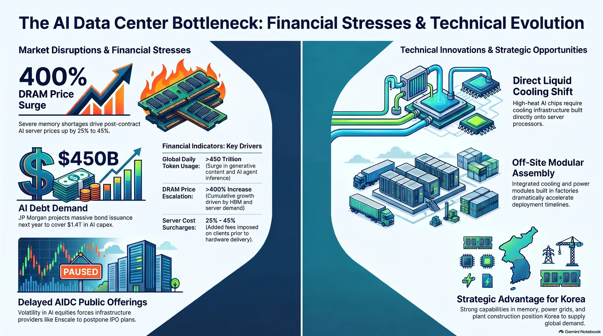
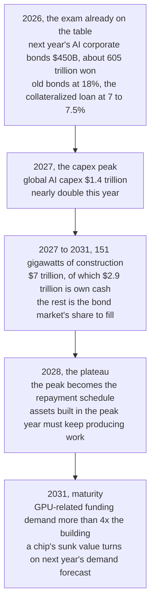
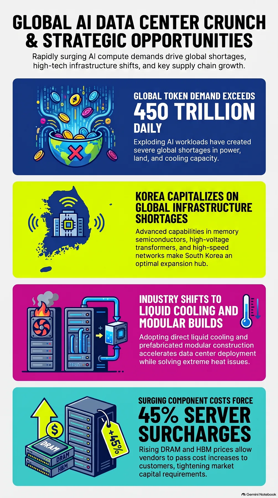

## An 18% Yield, and Next Week's 6.5 Trillion Won Loan

If a company's bonds maturing in 2031 are trading at an 18% yield, what does that mean? It means the bond market has priced in that company's default risk at above 70%. According to a JPMorgan forecast reported by eDaily on the 26th, investment-grade corporate bonds to be issued by AI companies next year total $450 billion, roughly 605 trillion won. On top of that come $65 billion in leveraged finance and $25 to 35 billion in asset-backed financing. This is the point at which AI infrastructure has become an industry that can no longer be designed without the bond market.

*The core concept of the post visualized. Capex climbing to its 2027 peak and continuing into a long plateau from 2028, with the money borrowed in between becoming a repayment schedule.*

Right at the edge of this forecast, CoreWeave steps onto its first test. Next week, backed by its GPU supply contract with Meta, it plans to raise a $4.5 billion loan, roughly 6.5 trillion won, at an annual rate of 7 to 7.5%. The Meta contract as collateral lets the new money come in with an expected investment-grade rating. Yet the same company's older bonds trade at 18%, and its 5-year CDS premium is at a record high. Inside one company, the price of new, collateralized money and the price of old, uncollateralized money have opened up by more than 10 percentage points. Think of CDS as the premium on default insurance, and a record high means even that insurance can no longer be sold cheaply. The two price tags say one thing. New money is still coming in, but old money is being repriced.

<!-- nlm-visual -->

*Infographic generated by NotebookLM from the sources.*

## The Peak Is 2027, the Exam Is 2028

JPMorgan's numbers reduce to a simple shape. Global AI capital spending nearly doubles from this year to $1.4 trillion, about 1,883 trillion won, in 2027, then plateaus from 2028. Building data centers of 151 gigawatts from 2027 to 2031 will cost $7 trillion, of which hyperscalers' own cash covers $2.9 trillion. The rest is the bond market's share to fill.

The $2.9 trillion figure is also worth pausing on. The part where hyperscalers put in their own cash is still solid, but the industry as a whole is being told to build with far more borrowed money than that. The moment the sector crosses the limit of its own money, the rules of borrowed money take over.

The meaning of the plateau here is easy to misread. It is not a stop. Because investment halts at a given level, the principal and interest on the money borrowed in the meantime must be met by assets built in the peak year continuing to produce work. The peak hit in 2027 becomes the repayment schedule from 2028 onward.

The direction of the money is shifting too. The focus of financing is moving from the data center building to the GPUs inside it. JPMorgan expects GPU-related funding demand in 2031 to be more than four times the demand for the building itself, the power shell. A building is concrete, so it holds as collateral. A chip's sunk value turns on next year's demand forecast alone. That is why the bond market cannot but be tense.

A smaller signal is visible too. The same report noted that new US semiconductor rules have halted AI loans tied to Chinese firms, widening uncertainty in Asian markets. The money coming in is getting picky about direction, not just size.

*Figure. The structure behind 'the 2028 exam is already on the 2026 desk': the funding schedule from the 2027 peak through the 2028 plateau to 2031 maturity, and the share the bond market must fill in between.*

## The Exam Question the Capital Market Switched

Yonhap News reported on the 26th that even Enscale, once a leading name in AI data center IPOs, has slowed its IPO preparation and is considering staying private. The account is that the capital market financing environment for neocloud firms, which have built data centers at scale on the back of debt, is deteriorating fast. Enscale, finding it hard to hold a target valuation of more than double the $14.6 billion from its March round, is in a position where even an IPO deferral is on the table. When the IPO, the capital market's exam room, is blocked, companies get pushed into the bond market's exam room of corporate bonds and loans. Even the Anthropic IPO, counted as a major name, was observed trading below its offering price on the 24th, and the diagnosis is that investor sentiment toward AI infrastructure has cooled sharply across the board.

CoreWeave is the symbol of this cooling. Even as results improve, it keeps plunging on the strength of its debt and CDS, picking up the nickname "the AI data center barometer." The ones who feel the cold wind of AI data center IPOs first are the companies that had planned debt-based GPU cluster expansion. They are now reduced to raising money as bonds, not equity, at prices that already reflect the 2028 plateau.

What changed is the exam question. The question up to last year was how much you built. This year's question is who will buy it. Enscale's CEO said compute demand is still not met, and in the same market the door of money is closing. That contradiction, demand still exists but financing is slowing, is the exact shape of today's capital market. Debt does not count GPUs; it sees only the revenue they bring.

## The Invoice Has Already Arrived on the Buyer's Desk

If the supplier side is being scored by the bond market, the buyer side is being squeezed by the invoice. The Seoul Economic Daily reported that in the AI server market, a 45% price increase notice came out the moment a contract was signed. With AI equipment demand far outstripping supply, customers in a hurry to secure compute cannot refuse the increase, and supplier bargaining power has strengthened further. Q3 DRAM market revenue grew 369% year over year, and next year's HBM average selling price is expected to rise 121%. As global trading firms rush to build their own data centers, customers stand on the side that must take the increase notice. It also means a company that used to buy compute has started building it. A scene that foreshadows the end of the era of treating compute as someone else's asset.

For Korean companies, the point to watch here is the phrase "after the contract." Once price volatility risk becomes standardized after the contract is closed, organizations that planned AI infrastructure on a fixed budget take on a cost control failure risk. If GPU server and cloud computing procurement costs spike, that increase is passed through to the end customer's AI service price. The 45% you took today becomes the reference value for the number you will take next year.

A guest column by Song Young-woong, head of the AI Policy Research Institute at SK Telecom, points to a different bottleneck. Global daily token consumption has already passed 450 trillion. But AIDC supply is held up not by GPUs but by non-GPU factors such as power capacity and cooling equipment. Power density per rack has passed 100 kilowatts, reaching the limit of air cooling, and direct liquid cooling is hardening into the standard. Machinery Equipment News reported that even a single 1GW site needs 990,000 square meters of land plus substantial power and water, making it urgent to cut construction time through modular builds.

Korea is among the few countries that has the full AIDC value chain. From memory semiconductors to data center construction, ultra-high-voltage power equipment, and high-speed communication networks. The keyword in the headline Money Today carried was "AIDC shortage, an opportunity for Korea." The debate is expanding to the idea that Korea's construction will fill the gap in supply. The government designated AI data centers as one of three mega projects and decided to pour 150 trillion won from the National Growth Fund, behind which follow power equipment, ESS, cooling, plant construction, and local tax revenue and employment.

In the United States the money is wobbling; in Korea the concrete is hardening. While the exam of the financing structure proceeds on one side, physical construction continues on a different clock.

## Then What Should a Company Count

Lay the pieces so far side by side and one sentence shows up. Three signals, the bond market, the server invoice, and AIDC construction, all point the same way. The unit price of compute is rising, and the window for using compute effectively for free is starting to close. In 2027 the cost of compute is repriced, and in 2028 the capex plateau demands interest repayment. In this structure, the rational choice for a company is not to buy more GPUs. The question is how much provable work you can pull out of the compute you already have.

First is cost. In a world where the 45% increase notice on server renewals has become reality, which model does which work is no longer a purchase option but a budget line. The judgment of handing work that used to run on the largest model to the smallest model that can handle it has to become routine. The ability to do the same work on cheaper compute is what creates the room to push back on the increase notice at the renewal table.

Second is proof. The bond market asks infrastructure firms "who will buy it," and inside the company the AI team is asked "how did you spend this money?" An answer you cannot see in the logs is not an answer. Instead, the delegation boundaries of the agents that handle bookings, payments, and documents, and where they stopped, must be traceable. The difference between saying "we did the work with AI" and putting on the table "at this point the AI recommended and at this point a person confirmed" is the gap of governance as a whole.

Third is options. In a market where the barometer stock keeps plunging, the CIO's question is not "GPUs are expensive" but "can I move this execution onto my own infrastructure?" Sovereign cloud, on-premise data centers, network-isolated execution environments. Discussion of these options is rising one notch at a time onto the corporate decision table. The more global neocloud financing wobbles, the higher the value of "an execution environment I control" rises in relative terms.

## The Exam Is Proving the Work

In this picture, ThakiCloud's coordinates are clear. Paxis is ThakiCloud's agent-native cloud, and it is a formal product that shipped at v1.1 GA. The three questions today's news poses translate into Paxis capabilities. Per-task model selection, CostRouter, is the cost line. Which work was handled by which model stays in the budget. Policy gates and audit logs are the proof line. It becomes an execution environment where the delegation and execution of the agent's work can be reproduced from the logs. The isolated sandbox is the safe execution line, and the sovereign, on-premise K8s deployment approach is the options line. Skills, Tools, Policies, and Audit Logs are treated as first-class resources, and autonomy is tuned from L0 to L3 according to governance. MCP connectors and the skill marketplace are the way agents shake hands with tools.

Next week is the first grading for this exam. Depending on what price tag CoreWeave's $4.5 billion loan receives for its collateral and rate, the credibility of the 2027 construction plan will be reset. The exam question does not ask about the capability of compute but about the accounting of work. What work, by which model, produced how much value. That is the meaning: this answer becomes the evidence that supports both infrastructure interest rates and corporate budgets. While the bond market grades infrastructure, the company has to grade its own work. For compute built in the peak year to have legitimacy, the work can only be counted when it is measured in provable units.

<!-- nlm-visual -->

*Infographic generated by NotebookLM from the sources.*

## References

This post was written by synthesizing the news below.

- eDaily, [JPMorgan "605 trillion won in AI corporate bonds next year"... CoreWeave's loan facing the test right away](https://www.edaily.co.kr/News/Read?newsId=01705606645649656&mediaCodeNo=257&utm_source=naver&utm_medium=referral&utm_campaign=news_syndication&utm_content=original_article)
- Money Today, ["AIDC shortage, a chance for Korea... will bring growth and balanced development"](https://www.mt.co.kr/tech/2026/11/26/2026112519400481125)
- Seoul Economic Daily, [Contract done and suddenly asked to pay more... the AI server market in an uproar over a 45% increase notice...](https://www.sedaily.com/article/20119091?ref=naver)
- Machinery Equipment News, [AI data center cooling and modular transition... pushing cleanup of machinery equipment standards](https://www.kmecnews.co.kr/news/articleView.html?idxno=52965)
- Yonhap News, [AI data center IPOs slowing... Enscale also considering "staying private"](https://www.yna.co.kr/view/AKR20261126017700009?input=1195m)
