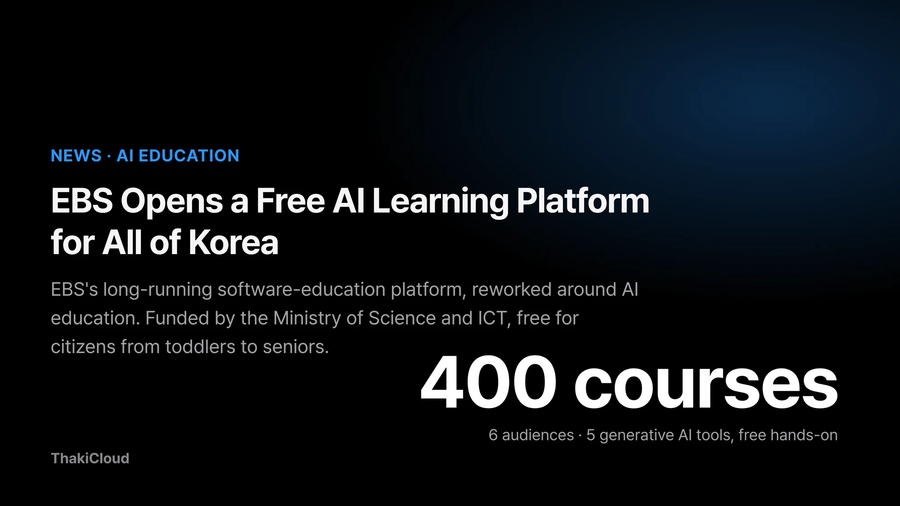
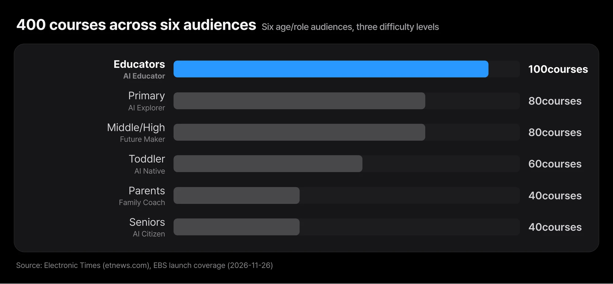
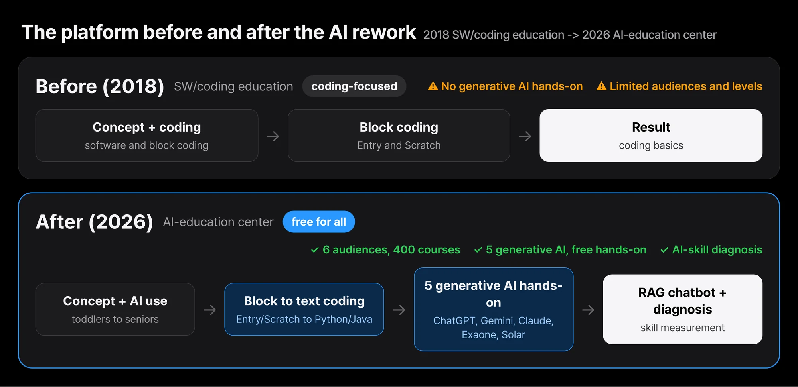
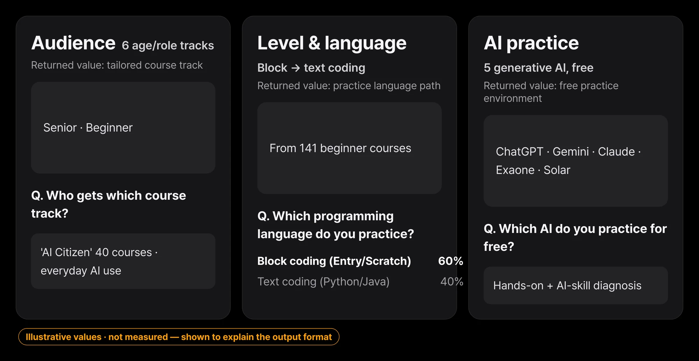

If you follow AI policy or an institution's digital transformation, don't read EBS's launch as a routine education-service item. On November 26, EBS formally opened **AI이솦**, a revamp of its software-education platform centered on AI education. Built with Ministry of Science and ICT (MSIT) funding so that all citizens can use it for free, it lets users practice five generative AI tools and spans six audiences from toddlers to seniors across 400 courses. The thing to take from this free entry point is that it creates demand. This post reads where that demand bends into an infrastructure question, from a ThakiCloud perspective.

*EBS AI learning platform at a glance: six audiences, 400 courses, five generative AI tools free.*

## Six audiences, filled with 400 courses

The platform reworks the software and coding education service EBS has run since 2018, now around AI education. It is split into six audiences: "AI Native" for toddlers, "AI Explorer" for primary students, "Future Maker" for middle and high students, "Family Coach" for parents, "AI Educator" for teachers, and "AI Citizen" for seniors. There are 400 courses in total: 100 for educators, 80 for primary, 80 for middle/high, 60 for toddlers, and 40 each for parents and seniors. By difficulty, the 400 split into 141 beginner, 142 intermediate, and 117 advanced, roughly even across the three levels.

*Course counts by audience. Educators lead with 100; primary and middle/high have 80 each; toddlers 60; parents and seniors 40 each. Source: Electronic Times.*

That the educator track is the thickest is worth noticing. The platform is aimed not only at people who use AI but at the teachers who design and guide that learning. If teachers cannot work with AI, students' AI education stays blank. Under the name "national AI competency education," the goal reaches past individuals consuming AI to individuals who teach AI and propagate it across an organization.

## Why a public broadcaster became the supplier of national AI education

EBS is a public broadcaster that has run this software and coding education platform since 2018. It started with coding and this time extended into AI education. The reason a public broadcaster is the first supplier of national AI education comes down to budget and access. Built with MSIT funding so all citizens can use it free, the structure lets people reach the same quality of AI education regardless of region or income. While paid education markets quickly add AI courses, the public building a free baseline is a recurring theme in the conversation about AI education gaps. This platform aims at the widest audience of those baselines, covering all six from toddlers to seniors.

*Before and after the rework: audiences, practice, and diagnosis expand, and five generative AI tools come in as free hands-on.*

## Letting users practice five generative AI tools for free

The most visible part is that users can practice five domestic and foreign generative AI tools for free: ChatGPT, Gemini, and Claude, plus LG's Exaone and Upstage's Solar from Korea. The learning does not stop at explaining concepts; it has users actually work with a generative model to solve everyday problems. A practice path runs from block coding (Entry, Scratch) to text coding (Python, Java) to building a RAG-based chatbot. Nine interactive, game and simulation, experiences are included as well. As learners move from beginner through intermediate to advanced, the center of practice shifts from "someone who uses AI" toward "someone who builds and connects AI."

*Input and output of the platform. Pick an audience and a level, and a tailored course track plus a free AI practice environment come back.*

Including two domestic models in the free practice is a signal. Learners study AI with foreign models but get real practice with domestic ones, building the habit of working with AI no matter which model they use. If the goal is literacy that is not tied to a specific model, practicing all five together fits that goal.

## A platform that also diagnoses

The platform also ships diagnosis, evaluation, and management features that check a learner's own AI use. A RAG-based chatbot is a practice where learners connect knowledge to build an AI.

The feature worth pausing on is the diagnosis. A platform that only teaches is different from one that measures a learner's competency. If the competency can be measured, that record can be read again later inside an institution's personnel, training, and organization systems. A path opens where the AI-use record built at this free entry point flows into an institution-internal competency metric.

## Where national AI demand becomes an infrastructure question

This free entry point that EBS opens is the demand side. It gets citizens to learn and use AI. But when that demand moves inside an institution, the supply-side question appears. For schools, government, and companies to actually run AI on their own data, a public cloud or a foreign API is not always enough. Learning data, student personal information, and institutional documents have to stay inside a certain environment, which creates the requirement to control AI serving on your own infrastructure.

ThakiCloud's Metis is the K8s-based AI serving platform that handles exactly this supply side. It serves models in on-premises and sovereign environments and manages cost and multi-tenancy. EBS's entry point, which grows national AI literacy, and Metis's serving, which actually runs that demand inside an institution, are the two sides of the same axis. As the layer where agents automatically process work is added, Paxis treats the economics and audit trail of that execution as first-class resources. The demand created by free learning eventually comes back as the supply question: who runs the AI, in what environment, and how efficiently.

## In closing

EBS's platform is a free AI learning entry point aimed at all citizens. It was built with MSIT funding, fills six audiences with 400 courses, lets users practice five generative AI tools for free, and includes competency diagnosis. From December 11 to 13, you can experience it in person at the DDP Art Hall. While this free entry point grows demand, the point where that demand will require supply infrastructure to actually run AI inside an institution is the real question this launch leaves behind.

## References

- Electronic Times (etnews.com), [EBS opens a free national AI learning platform](https://www.etnews.com/20261126000525) (2026-11-26)
- EBS, launch announcement (2026-11-26)
