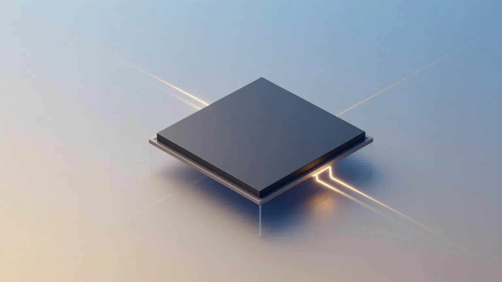
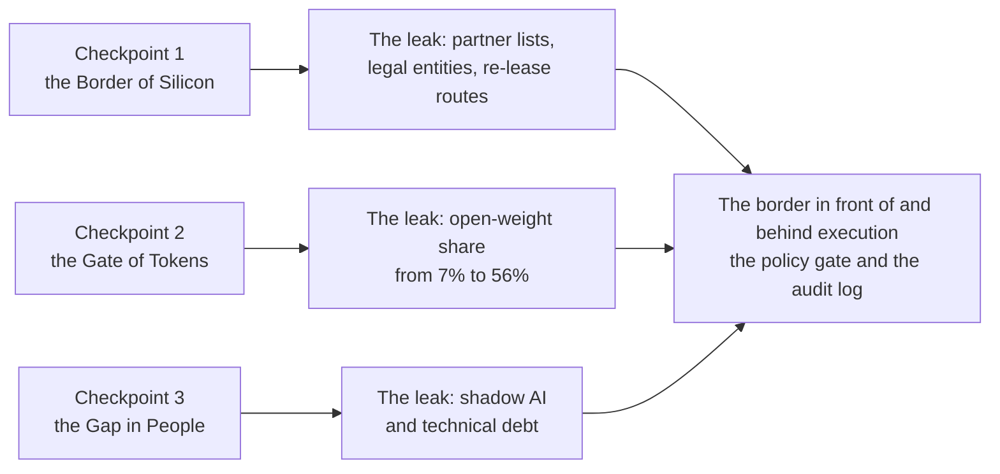

*An abstract image of today's three news stories: the border sits on the object, the chip, and the leak flows through the behavior.*

## Two Companies on the Same Partner List

A joint investigation by the US security research organization C4ADS and CBS News found that at least two China-owned companies had been buying Nvidia's most advanced AI semiconductors in bulk. Both are based in the United States. The one called Recloud AI sits in California and has been on Nvidia's preferred partner list, buying high-performance chips with priority. The one called Aivres was formerly a subsidiary of Inspur Group. When the US federal government put Inspur on the blacklist in 2023, it changed only its name, and the investigation found that it still registers on Nvidia's website as an elite computing partner, the highest tier, up to this day. The CEO of Recloud AI's parent company reportedly received a degree in national defense mobilization from the People's Liberation Army's Command College. Some of these companies are also believed to have re-leased or sold AI semiconductors to China through Southeast Asian firms. The outcome was confirmed in November of this year, after all of this was made public, when the US government issued a multi-layered sanctions package: halting server shipments in four Southeast Asian countries, blocking remote access, and making prior export licenses mandatory. In one line, the investigation says the object of control is not the chip but the list and the legal entity that travel with the chip. Preferred partner, elite partner, re-lease contract. The moment these three words come into being, the nationality of the chip blurs. That is why the US government laid its sanctions in layers rather than a single tier. To catch one chip, you have to follow every document that chip has passed through. The warning from the investigation is that the list is itself a document. Documents can be rewritten. While the wall was going up, the bricks were leaving out the back door.

## Checkpoint 1, the Border of Silicon

Export control is, in effect, the most physical form of boundary wall. You can block a port, inspect a container, and put a company on a blacklist. But what the C4ADS investigation shows is that holes open in the control structure itself. The partner list, the legal entity name, the re-lease route. A single regulation cannot catch these three. The difference in approach that Asia Economy points out reaches the same place. China budgets and pushes state-led investment across the entire semiconductor industry, while Korea's industry runs on the private capex of Samsung Electronics and SK Hynix, and government support concentrates on indirect tools such as tax incentives and loans. The recently created domestic production tax credit is called the Korean version of the IRA, but the real question is what it feels like on the ground. The core point of the article is that if power or water cannot be secured to match a fab's operating schedule, capacity expansion is physically blocked. The memory side is also a battlefield where the peak-out thesis and the shortage thesis collide. Daily Korea reported that SoftBank is considering an acquisition of SK Hynix, and while TrendForce lowered its outlook for next year's DRAM and NAND revenue on the grounds of order cuts from Chinese big tech, global investment banks such as Goldman Sachs are pushing a peak scenario. At the center stands HBM. This memory, which sets the limit of AI compute, stays at the very top of what must be secured, even in the middle of the peak debate. Korea is both a beneficiary and a victim of stronger export control. The stricter the standard, the greater the uncertainty for domestic businesses trying to secure high-performance chips legally. In the reshuffle of the supply chain, where SK Hynix's and Samsung Electronics' memory businesses sit, and where Korean companies stand in TSMC's foundry ecosystem, are cited as the key variables. The fact that investment appetite for AI cloud infrastructure routed through Southeast Asia shrinks as export control tightens is, for domestic data center operators, an opportunity and a warning at the same time. The higher the wall, the more the strategy for securing supply inside the wall becomes the competitive edge.

## Checkpoint 2, the Gate of Tokens

If chips have gotten a border, the models that run on top of them have no border. The gate is opening instead. Fortune Korea asked whether expensive models are really necessary and answered with data. As AI agents spread, token usage reaches five times that of chatbots, and cost efficiency has emerged as the key competitive factor. According to Vessel data, open-weight models' share of token processing jumped from 7% to 56% in eight months. That is evidence that model performance in the field is converging to a similar level. In the same period, Chinese companies such as DeepSeek, Alibaba, Moonshot AI, and Z.ai are leading the open-weight market, and the United States is reviewing a mandatory disclosure regime for the use of Chinese-made AI models, citing geopolitical risk. Nvidia and Thinking Machines have also responded by releasing open-weight models. While the wall around chips goes up, the gate around models opens. Companies are moving away from dependence on a particular country or supplier toward a multi-vendor strategy that mixes models to fit the work. The moment an agent handles the work, the total volume of tokens that passes through per request changes. In the band where performance is similar, price becomes the architecture, and the criterion for choosing the architecture has shifted from the name of the country or the supplier to the token cost of handling that work. For Korea, the implication is double. Data sovereignty and cost reduction make the motivation for open-weight self-hosting twice as strong, while the harder US pressure for mandatory disclosure, the more regulatory risk there is in putting Chinese-made AI into global supply chains. In finance, the public sector, and defense, running open-weight models on in-house infrastructure where data does not go out is becoming a precondition rather than an option.

## Checkpoint 3, the Gap in People

The third leak is the hardest to stop because it is the least visible. The subject is a person. That is why the headline of the report carried by Digital Today is "From People to Generative AI." The route of technology leakage has changed. Before, a person moved toward the outside. Now, information moves the moment a person types a sentence on a screen. AI adoption inside companies spreads not through formal review that spends budget, but through software updates, configuration changes, and voluntary adoption by employees. This is so-called shadow AI. Gartner diagnoses that existing security solutions struggle to stop shadow AI, and recommends that even when a vendor adds an AI feature by update, it should be elevated to the same level of control as a new AI adoption. The AI usage control solution market is valued in the billions of dollars; that is the size of this flow. Fifty-six percent of CIOs and IT risk officers answered that if software and AI supply chain risks materialize, the impact will be "severe or fatal." The semiconductor industry already carries the heaviest burden, since it is the sector with the most overseas leakage targets. On top of the earlier leak of 18nm DRAM talent toward CXMT, a new route, external generative AI, has opened. The article describes how Samsung Electronics' designation of executive-level technology management owners and its splitting of permissions, TSMC's restriction of recipe access at the unit of work, and ASML's equipment kill switches are spreading as industry standards. The most vulnerable side is small and mid-sized suppliers. The number of cases caught is 64, roughly double that of large corporations. The view from the attacker side is handled by another Digital Today article. NCSC analyzed that, more than individual zero-days, the "technical debt" built up over years of deferred patches and upgrades has become the concentrated target of AI attacks. The defense industry entered a phase of competition by scale with CrowdStrike's $43.9 billion acquisition of Zscaler. That means an AI-versus-AI posture, which assumes both attack and defense are AI, is taking hold. Attackers use AI to raise the speed of vulnerability discovery and exploit development, and on the defense side, AI model developers are entering the security market in large numbers. What has accumulated, what has been left alone. The point of the technical debt warning is that this gate opens first.

## The Border Is in the Wrong Place

Put the three leaks side by side and one pattern shows up. The rule follows the object; the leak follows the execution. Export control goes after the chip, the mandatory disclosure regime goes after the model, and shadow AI policy goes after the tool. But what actually moves data and makes judgments is no longer the object but the execution. Before, controlling the server room meant controlling the information. Now, an agent chooses tools, calls APIs, and moves data along its own workflow. What the same chip runs, what the same model sends out, and what leaks through the convenience of the same employee are all decided by "under what rules it executes." Korea's position is especially interesting here. It is a beneficiary of the chip wall, and at the same time it is running the border debate of enacting the Defense AI Act on a sovereign AI line, while the gate of behavior inside companies is still open. The wall of the chip and the wall of the law are already in place; only the gate of behavior is still at the blueprint stage. The question is not whether to build a higher wall but where to draw the border. If the object is the border, it is a wall. If execution is the border, it is a log. And this log is not a record made after the fact. It is the question of what is allowed right in front of the execution and what is left right behind it. Only when the border sits in front of and behind the execution can the object's wall do its job as the object's wall.

*The three checkpoints go after the object, but the leak follows the execution. The border sits in front of and behind execution: the policy gate and the audit log.*

## So Where Do We Draw the Border

The border that controls execution already has a product form. Paxis is ThakiCloud's agent-native cloud and a formal product released as v1.1 GA. The four that make the field where an agent works, Skills, Tools, Policies, and Audit Logs, are first-class resources, not side features. Autonomy is tuned from L0 to L3 according to governance, and the policy gate blocks what cannot be approved. Every execution is reproduced in the audit log, and in an isolated sandbox, failure does not spread. MCP connectors and the skill market set how agents and tools come together. The higher the autonomy, the more these four resources are worth. The closer an agent is to L3, the more "execution without a policy gate" becomes the same phrase as "uncontrolled execution." The three borders of today fit exactly onto these capabilities. The border of silicon corresponds to sovereign, on-premises K8s deployment. Even on a closed network where data does not leave, the agent works as is, and the answer to shadow AI is not to block it but to replace it with an approved in-house execution environment. The gate of tokens corresponds to CostRouter's per-task model selection. It is the layer that translates the price competition that opened from 7% to 56% into the operating condition of which work runs on which model. The gap in people corresponds to the policy gate and the audit log. The moment the answers of what was done and under what rules it was done remain as a record, the leak becomes a log, not a gap. Build the wall with the chip; draw the border with the log. In an era where execution is autonomous, the place to draw the border is not the edge of the object but right in front of and behind the execution. The terrain that today's three news stories point to is exactly there.

## References

This post was written by synthesizing the following news.

- Etoday, [Nvidia Sells Chips in Bulk to China-Owned Silicon Valley Firm](https://www.etoday.co.kr/news/view/2653687)
- Fortune Korea, [Do We Really Need the Expensive Model? Why Companies Are Turning to Chinese AI](https://www.fortunekorea.co.kr/news/articleView.html?idxno=54889)
- Newstomato, [Naver and Kakao Expand Defense AX Business, Accelerating the Physical AI Buildout](http://www.newstomato.com/ReadNews.aspx?no=1322006&inflow=N)
- Asia Economy, [China Runs on the State, Korea on Indirect Support: Will the Chip Field Actually Feel It](https://view.asiae.co.kr/article/2026112610514336816)
- Daily Korea, [SoftBank Also Eyes SK Hynix: The HBM Scramble Continues Even on a Peak-Out Theory](https://daily.hankooki.com/news/articleView.html?idxno=1429460)
- Digital Today, [[Security Hot Issue] Accumulated "Technical Debt" Becomes the Target of AI Attacks, National Agencies Hacked](https://www.digitaltoday.co.kr/news/articleView.html?idxno=718588)
- Digital Today, [From People to Generative AI: The Chip Industry on High Alert Over Technology Leak Routes](https://www.digitaltoday.co.kr/news/articleView.html?idxno=718428)
