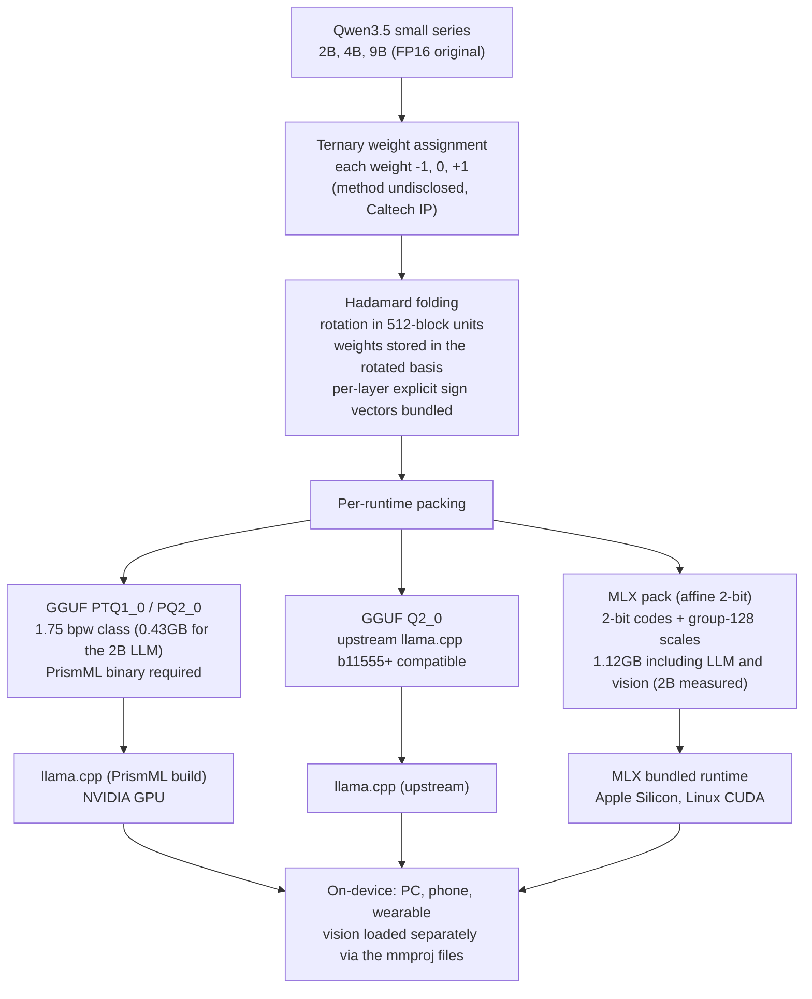

*A visual metaphor for the article's key idea.*

## Why Read This

If your team has to ship a low-bit model to on-device or edge environments, or you are an infrastructure or platform engineer weighing precision routing to raise the density of a multi-tenant serving fleet, this model card is the decision material. The conclusion comes first. **The Bonsai 2 small series (2B, 4B, 9B) announced by PrismML on 2026-10-15 is a Qwen3.5-based ternary (-1, 0, +1) low-bit model line that reports 90 to 95 percent retention over the original across agent, math, code, and vision workloads at 0.43 to 2GB of capacity. ThakiCloud verified the public weights at the bit level, and the ternary structure claim holds. The models genuinely generate.** The compression method is still undisclosed, and loading requires the official bundled runtime that handles the Hadamard rotation. Both were confirmed by direct measurement.

<!-- nlm-visual -->

*Infographic generated by NotebookLM from the sources.*

## In Plain Terms

Think of a restaurant receipt. Imagine one where each line carries only a plus, minus, or zero mark instead of the exact amount. If every page of 128 lines has a single unit price written on it, the total can be reconstructed to nearly the same figure as the original receipt. The ternary weights of Bonsai 2 are exactly that receipt. Each weight takes one of three values, -1, 0, or +1, and every 128 weights share one FP16 scale. That is how a 2B model that takes several GB in FP16 ends up at 0.43GB.

The point of this receipt is not that it was written carelessly. The marks are arranged to minimize the gap against the original total, and the arrangement method itself is not public (Caltech IP). This receipt story comes back in the Limitations and Wrap-Up sections below.

## Overview

PrismML has been shipping the "Bonsai" low-bit model line under a single policy since July. The 1-bit and ternary Bonsai 27B, 8B, 4B, and 1.7B models came out on July 14, and the Bonsai 2 27B flagship was added on September 17. The Bonsai 2 small series (2B, 4B, 9B) covered here is the October 15 release, based on Qwen3.5. The license is Apache 2.0, and the prism-ml organization on Hugging Face provides two formats for each size: GGUF (for llama.cpp) and mlx-2bit (for Apple Silicon). The vision projector (mmproj) ships as separate files (Q8_0, BF16), and the context length is 262K tokens (measured from the HF card).

The positioning is on-device AI. PCs, smartphones, and wearables are named as the target classes, and measured throughput is published for the RTX 4090, M5 Pro, M5 Max Pro, and iPhone 18 Pro Max. Darkbloom lets you try the 9B model in the cloud, with 250 million tokens for the first 100 users.

In July, ThakiCloud independently verified the first-generation Bonsai weights at the bit level and confirmed that the 1-bit models operate as genuinely near-lossless (the previous post, linked in the Sources section). This post carries that work over to the small series, and this time it went further and ran measured generation.

## What Is This Model

Ternary encoding represents each weight with one of three values, -1, 0, or +1. A value carries log2(3), about 1.585 bits, and one FP16 scale per 128 weights (0.125 bits) is attached, so the effective size is about 1.71 bits. That is where the more-than-9x reduction versus FP16 comes from. The published sizes are 0.43GB for the 2B, 0.95GB for the 4B, and 2GB for the 9B.

The structure is the Qwen3.5 small series unchanged, and like the first generation it is post-training compression rather than retraining. Reading the config of the public 2B MLX pack directly: 24 layers, hidden size 2048, and a hybrid attention layout mixing Gated DeltaNet linear attention with full attention. The parameters come to about 1.88B for the language model and about 2.24B including the vision tower, consistent with the total field on the HF card (1,881,825,088) and this measurement (1,880,096,768). The vision tower is stored unquantized in FP16 (per the official loader's documentation).



One structural property deserves a note. The language weights are not stored in the original coordinate system. They are stored in a basis rotated, or folded, by a Hadamard transform applied in 512-block units, and the runtime rotates the activations with the corresponding transform before running the 2-bit quantized matmul. Each layer's explicit sign vector is bundled inside the file (hadamarda.json plus per-module sign tensors, 151 in total), and skipping this transform breaks the output. That is exactly why the official README states not to load the files as ordinary affine Qwen checkpoints.

## Reported Benchmark Results

PrismML published retention rates against the Qwen3.5 original (FP16) as the baseline, across 19 benchmarks in 6 skill sets. The retention by group:

| Skill set | 2B | 4B | 9B |
|---|---|---|---|
| Agent and tool use | 95.5% | 90.0% | 92.4% |
| Math | 107.8% | 99.3% | 98.2% |
| Instruction following | 121.5% | 106.0% | 100.0% |
| Code | 115.0% | 100.7% | 100.1% |
| Knowledge and reasoning | 82.9% | 90.9% | 93.0% |
| Vision | 89.0% | 91.3% | 92.5% |

Three points are worth reading carefully. First, the retention for math, code, and instruction following exceeds 100 percent. In detail, the 2B scores 80.74 on GSM8K against the original's 65.96 (122.4%), 48.00 versus 34.33 on IFBench (139.8%), and 50.00 versus 45.12 on HumanEval+ (110.8%). Do not read this as "quantization made the model better." The defensible interpretation is a signal from evaluation conditions (prompt, decoding settings, evaluation noise) or from variance on small samples. It is the same reservation applied to the first-generation numbers in the July post.

Second, the axes with the largest loss are knowledge depth (GPQA Diamond: 67.7%, 81.8%, 84.7%) and multi-turn agents (Tau2Bench: 4B 75.8%, 9B 85.7%). Third, every one of these numbers is a supplier self-measurement, and no independent reproduction exists yet.

## ThakiCloud Independent Verification

The reader in mind is the infrastructure engineer deciding whether to adopt a low-bit runtime. Four things were measured.

**1) The standard path fails.** Loading `prism-ml/Ternary-Bonsai-2-2B-mlx-2bit` with the standard mlx-lm produces:

```
ModuleNotFoundError: No module named 'mlx_lm.models.prism_hadamard_qwen35'
ValueError: Model type prism_hadamard_qwen35 not supported.
```

This is not a simple missing-model-class error. The weights are stored in the rotated basis, so without a runtime that knows the corresponding transform, the file itself cannot be read.

**2) Bit-level structure verification.** All 151 packed modules in the public files (1.88B weights) were unpacked independently. The four levels of the 2-bit code space (0, 1, 2, 3) distributed 33.7%, 32.6%, 33.7%, and 0.0%. The fourth level (2x the scale) is not used anywhere. The actual weight values are therefore exactly the ternary set {-s, 0, +s}, and the "ternary" claim holds at the bit level. The structural checks also passed: every bias across the 151 modules is exactly the negative of its scale (-scale), and every scale is a finite value.

**3) Actual generation.** The official loader for the vision pack takes the mlx-vlm path, so generation was run on the text-only route by combining the bundled Packed runtime (encoded Hadamard plus MLX 2-bit quantized matmul) with the mlx-lm Qwen3.5 text model. Versions match the official requirements.txt (mlx 0.32.0, mlx-lm 0.31.3). Results:

- English produced coherent responses, and the 17 x 24 arithmetic check came back exactly 408.
- Speed: on an M4 Pro (48GB), generating the arithmetic answer (11 output tokens, including the prompt prefill) took 0.12 seconds of wall time, roughly 89 tokens per second. This is a plain Python decoding loop, so the figure is a lower bound and conservative compared with the official report (310 tok/s for the 2B on M5 Max Pro).
- Korean: the single Korean smoke sample came back malformed (it answered a 2+2 question with a nonsensical Korean sentence instead of the number). One sample is not a benchmark, so this is recorded only as a one-sample observation that small-model Korean output is still unstable.

**4) Runtime matrix.** Per the official documentation.

| Format | Load path | Notes |
|---|---|---|
| GGUF PQ2_0 / PTQ1_0 | PrismML binary | ternary (PTQ1_0), 2-bit (PQ2_0); not upstream |
| GGUF Q2_0 | upstream llama.cpp b11555+ | standard-build compatible variant |
| MLX pack (mlx-2bit) | bundled runtime | Apple Silicon, Linux CUDA officially supported |

The implication is clear. Independent verification (perplexity, category benchmarks) requires either their build or a path that replicates the bundled runtime logic, as done here. If an unpacked (FP16 re-materialization) release appears, like the Bonsai first generation, the full verification pipeline can be re-run immediately.

## ThakiCloud Product Implications

**ai-platform lens (infrastructure and serving).** A 0.43 to 2GB footprint changes the batch unit of multi-tenant serving. A 2B-class LLM is sidecar material that can sit next to an inference endpoint, and a 9B model fits on a single mid-range card with vision included. In on-prem and sovereign deployments with constrained hardware budgets (self-hosting requirements of public and regulated industries), the segment where "a 9B-class model on a mid-range card" holds now exists. If 27B-class NVFP4 high-density serving (B200) and the low-bit small series coexist in one pool, the precision routing spectrum per workload widens. Agent and tool-calling workloads are exactly the axes where retention loss is largest, so these models fit as the bottom tier of that range, taking simple inference, classification, and summarization.

**Paxis lens (agents and edge).** The 2B and 9B models running at 34 to 120 tok/s on a phone is the economics of a privacy-first local agent. A configuration where the prompt never leaves the device is directly usable for regulatory response and offline workflows, and short agent loops (tool calls, state checks, summaries) are close to real time even at these speeds. Paxis is built to handle such local models inside sandboxed isolated execution and to route every action through policy gates and an audit log, so control does not loosen when combined with on-device low-bit models.

The judgment from the July post carries over in one line. The relationship in which low-cost serving (ai-platform) creates the economics of agents (Paxis) has moved closer this time, now expressed as the number 0.43GB.

## Limitations and Counterarguments

First, all benchmark numbers are supplier self-measurements. The independent reproduction reached only the level of this structural verification and smoke generation. The full verification of per-category retention (agent 90 to 95 percent, and so on) must wait for their runtime build or an unpacked release.

Second, retention above 100 percent is not evidence of improvement. It has to be read as a signal of evaluation conditions and sample variance, and the moment an adoption decision leans on these numbers, it teaches the wrong lesson that quantization makes a model better.

Third, the runtime dependency is real friction. The standard loader cannot read the files, the method is sealed, and even the bundled runtime needs mlx-vlm for the vision pack. The announced "0.43GB model" figure also depends on the baseline. In this measurement the MLX pack came to 1.12GB, with the 1.88B LLM stored in 2 bits plus an F16 vision tower. Any adoption review must state the runtime and format baseline alongside the size.

Fourth, the lossy axes are clear. Knowledge depth (GPQA 67.7%, 81.8%, 84.7%) and multi-turn agents (Tau2Bench 75.8%, 85.7%) have the lowest retention, so the practical boundary of the 2B and 4B is simple inference, classification, and summarization, not deep tool chains.

Fifth, the license is Apache 2.0, but the base is a Qwen3.5 derivative. The license inheritance relationship of the base model needs to be checked before commercial redistribution (the same reservation as in the July post).

## Wrap-Up

The receipt experiment has arrived at the small model class. The claim that a receipt with one unit price per page and a plus, minus, or zero per line reconstructs more than 90 percent of the original total was confirmed in the public files themselves, not in the announcement material. Across all 151 modules and all 1.88B weights, the fourth level appears nowhere, and the model genuinely generates.

Three takeaways for the reader. If you are reviewing placement on edge or low-spec nodes, pilot with the 2B (0.43GB) and re-measure retention on your own workload. If you want to raise multi-tenant density, put this series in as the bottom option of workload-tier precision routing rather than as a wholesale replacement. And the right sequence is to repeat the independent verification in full once an unpacked release or the official runtime build is available.

The one-line conclusion: **Nine times smaller only counts as verified if it actually runs, and this time it had to run. The structure is confirmed; the quality is still the supplier-reported value.**

<!-- nlm-visual -->

*Infographic generated by NotebookLM from the sources.*

## Sources

- PrismML official announcement: [Bonsai 2 Family](https://prismml.com/news/bonsai-2-family)
- PR Newswire (2026-10-15): [PrismML Expands Bonsai 2 Family with 2B, 4B, and 9B Models for On-Device AI](https://www.prnewswire.com/news-releases/prismml-expands-bonsai-2-family-with-2b-4b-and-9b-models-for-on-device-ai-302910593.html)
- Official download docs: [docs.prismml.com/download/models](https://docs.prismml.com/download/models)
- Hugging Face models: [prism-ml/Ternary-Bonsai-2-2B-mlx-2bit](https://huggingface.co/prism-ml/Ternary-Bonsai-2-2B-mlx-2bit) / [prism-ml/Ternary-Bonsai-2-2B-gguf](https://huggingface.co/prism-ml/Ternary-Bonsai-2-2B-gguf)
- Hugging Face collection: [Bonsai 2 Small](https://huggingface.co/collections/prism-ml/bonsai-2-small)
- Previous post (2026-07-16, Bonsai 27B 1-bit and ternary anatomy plus independent reproduction): [previous post (2026-07-16)](https://thakicloud.com/tech-blog/en/llmops/bonsai-27b-ternary-1bit-quantization/)
- Related tweet (2026-10-16): https://x.com/hjguyhan/status/2110945241838805183
