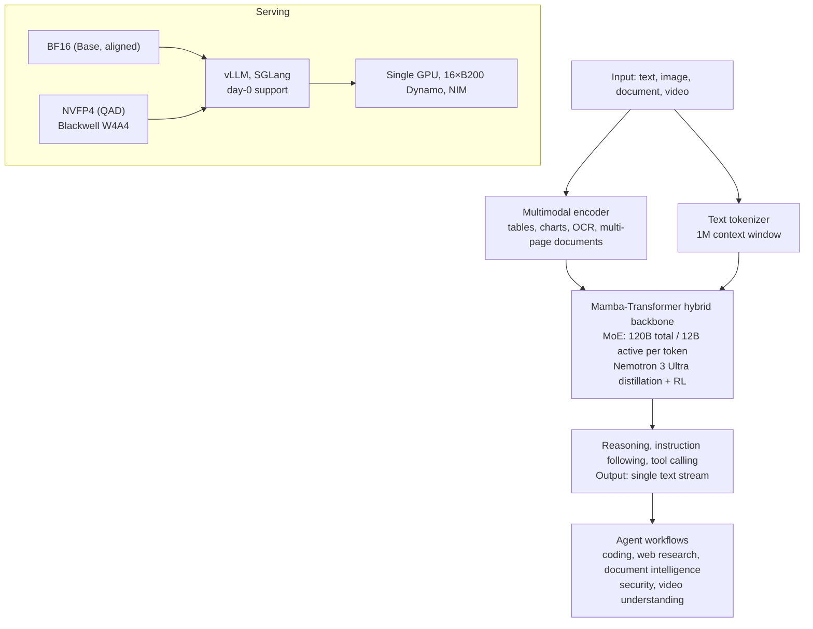

*A visual metaphor for the article's key idea.*

## Why Read This

For platform engineers who look at serving, cost, and SLO of agent workloads together, and for teams choosing which open model to put under the control plane in an Agent-Native Cloud, this model card is the decision material. The conclusion first. **Nemotron 3.5 Super VL, released by NVIDIA on 2026-10-15, is a "for specialized agents" model that packs a 120B MoE activating only 12B per token, a Mamba-Transformer hybrid, 1M context, and text, image, document, and video understanding plus tool calling into a single open checkpoint.** The NVFP4 quantized version and day-0 serving support on vLLM and SGLang were announced alongside it. Much of the published numbers are self-reported or partner (vendor) reported, so this post records the source and the comparison baseline of each figure.

<!-- nlm-visual -->

*Infographic generated by NotebookLM from the sources.*

## In Plain Terms

Let's compare it to a large general hospital. The hospital employs all 120 specialists, internal medicine, surgery, ophthalmology, radiology, and so on (120B total parameters). But when a patient arrives, only 12 specialists are actually on duty (12B active per token). You pay only for the 12 on duty, while the knowledge is that of a hospital with all 120 in the building, so the classic trade-off, "a smaller hospital means less knowledge", does not hold. The MoE structure of Nemotron 3.5 Super VL is this hospital.

Two more things are layered on top. The hospital chart holds a patient's entire lifetime of records in full (1M token context), and the front desk (multimodal encoder) reads not just the intake form but also video, films, and surgical records. We bring this analogy back in the serving economics and limitations sections.

## Overview

NVIDIA released Nemotron 3.5 Super VL on 2026-10-15 ([developer blog](https://developer.nvidia.com/blog/nvidia-nemotron-3-5-super-vl-powers-specialized-agents-with-multimodal-reasoning/), [NVIDIA blog](https://blogs.nvidia.com/blog/nemotron-3-5-super-vl/)). The same day, the serving infrastructure side announced day-0 support from [vLLM](https://vllm.ai/blog/2026-10-15-nemotron-3-5-super-vl-vllm) and [SGLang/LMSYS](https://lmsys.org/blog/2026-10-15-nvidia-nemotron-3-5-super-vl). The positioning is "data center to desktop". Data center specialized agent workflows are the primary target, and the family reaches down to desktop class alongside the smaller Nemotron line (Nano Omni and others).

It is a model distilled from Nemotron 3 Ultra. Per the release material, post-training went through distillation with the SkewReverse loss, multi-teacher on-policy distillation (MOPD), and RL based on NeMo RL and NeMo Gym. Open data was released alongside. About 2.8T Indic (languages of India) tokens across 22 languages, produced with IIT Madras and AI4Bharas, 40 vision-language datasets, and datasets for agent tool use, financial reasoning, instruction following, long context, and fairness are public on Hugging Face.

The license is OpenMDW 1.1, the model-specific permissive license released by the Linux Foundation in May 2026, which NVIDIA will apply across the Cosmos, Isaac, GR00T, Ising, and Nemotron families ([Linux Foundation announcement](https://www.linuxfoundation.org/press/linux-foundation-releases-openmdw-1-1-nvidia-adopts-openmdw-for-cosmos-isaac-gr00t-ising-and-nemotron-ai-model-families)). That it is a new license rather than Apache-2.0 is one line of the adoption decision (see the limitations section below).

## What Is This Model

The architecture core is three layers.

**First, 120B/A12B MoE.** A mixture-of-experts structure where only 12B of the 120B total parameters are active per token. Decoding cost stays close to the active 12B, while the knowledge belongs to the 120B pool.

**Second, Mamba-Transformer hybrid.** A hybrid backbone mixing attention layers with Mamba-style state-space layers. The clue is that in the serving optimization discussion, Mamba recurrent state is treated separately, and that prefix caching was announced to preserve both attention state and Mamba state. The hybrid structure is closely tied to the repeated computation cost of long context, and is the design that backs the 1M context claim.

**Third, multimodal in, text out.** Text, image, document (multi-page, tables, charts, OCR), and video understanding in a single checkpoint, with text as the output. The point of the announcement is that no separate VLM pipeline (captioning model + language model) needs to be stitched together. Maximum context is 1M tokens (per the HF repository; read it apart from the 100K benchmark in the serving section below).

The variants are Base BF16, post-trained (aligned) BF16, and NVFP4. NVFP4 is composed of 4-bit weights + 4-bit activations (Blackwell) and 4-bit weights + 16-bit activations (others), produced through quantization-aware distillation (QAD).



The use the announcement emphasizes: "specialized always-on agents". Not a general chatbot, but a model aimed at multi-step workflows in areas like coding, web research, document intelligence, cybersecurity, and video understanding. That is why every partner case below is a domain-specialized agent.

## Reported Benchmark Results

These are the reported values from the NVIDIA developer blog. The comparison models are listed alongside.

| Benchmark | Nemotron 3.5 Super VL | Compared against | Notes |
|---|---|---|---|
| CharXiv (chart understanding) | 80.8 | Nemotron 3 Nano Omni 63.0 | 84.0 if Python code execution is allowed |
| Hermes Bench | 63.44 | Nemotron 3 Ultra 56.33 | Against a same-generation large model |
| LangChain Evals | 87.05 | Nemotron 3 Ultra 84.30 | Tool calling focused |
| OCRBench v2 | Top of the open model tier | (no detailed number) | Document OCR |
| SWE-bench, Terminal-Bench | Above Nemotron 3 Super | (no detailed number) | Coding agent |
| Indic family (5 sets including MILU 1.5) | Top of the comparison group | (no detailed number) | Tied to the 22-language open data |

Per-domain gains from post-training were also announced. Compared to Base: document intelligence +15%, security attack defense +41%, financial receipt extraction +9%, science experiments +30%, medical insurance claims +44%. The variance across domains is large, with security and medical jumping the most. This is the numeric picture of the "specialized agent" positioning.

Partner-reported figures (vendor credits) are kept separate.

| Partner | Use case | Reported figure |
|---|---|---|
| Scale AI | Vendor credit assessment agent | 40x reduction in inference cost, 5x reduction in latency |
| Ramp | Receipt to JSON | 50% increase in throughput, 10x reduction in latency |
| AI21 | Threat intelligence | 41% improvement in accuracy |

Three reading criteria only. The comparison for CharXiv (Nano Omni) is a different line smaller than this model, and the comparison for Hermes and LangChain (Ultra) is a same-family large model. In other words, the comparison baselines inside the table are not uniform, and the 40x and 10x figures are partner (and simultaneously NVIDIA customer) reports. "Up to 5x agent task throughput versus comparable open models" and "4x faster task completion versus large open models" (on B200) are also supplier-side framing.

## Serving and Deployment

There are two day-0 serving paths.

```bash
# vLLM
pip install vllm
vllm serve nvidia/NVIDIA-Nemotron-3.5-Super-VL-120B-A12B-NVFP4   # NVFP4 variant (OpenAI-compatible API)
```

```bash
# SGLang
pip install sglang
python3 -m sglang.launch_server --model-path nvidia/NVIDIA-Nemotron-3.5-Super-VL-120B-A12B-NVFP4
# or Docker: lmsysorg/sglang:latest
```

It is also registered in the NIM (build.nvidia.com) catalog. Serving optimization techniques were announced alongside. An open speculative decoding called LiLiCorr (draft tokens are verified jointly) reported up to 2.3x faster token generation on DGX Spark, and separate boosted training for MTP (multi-token prediction) was mentioned. Prefix caching preserves both attention state and Mamba state, which targets the repeated context cost of long agent sessions. The scale figure: on Dynamo 16×B200, with a constraint of 50 tok/s per user, it accommodates up to 8x more users and reported first token latency down 85%.

Let's do the memory arithmetic once. The full 120B of the MoE goes into memory regardless of activation. In BF16, weights alone are about 240GB; in NVFP4 (4-bit weights), about 60GB, which fits a single Blackwell card (180GB) by that calculation ([estimate] a simple parameter-based conversion; in practice more is needed, including activations and the KV cache). Once you know the "single GPU" serving story is the NVFP4 variant's story, the announcement framing fits exactly.

## ThakiCloud Product Implications

**ai-platform lens (infrastructure, serving).** ThakiCloud's ai-platform serves open-weight models on B200, H200, and H100 fleets, and NVFP4 is the first-choice precision option of those fleets.

Nemotron 3.5 Super VL fits in three places. First, the NVFP4 day-0 variant immediately becomes a candidate for Blackwell density serving. The structure of putting the full 120B in 4-bit on a single card and running at the decoding cost of the active 12B maps directly to multi-tenant density and unit-price calculations. Second, the Mamba hybrid plus prefix caching changes the KV cost structure of long agent sessions (workloads with large reusable context). It creates an option to absorb the real demand of "agent tenants with long context" in a GPU pool scheduled by Kueue. Third, in on-prem and sovereign deployments, the offer of "a data center grade agent model as open weights" stands.

**Paxis lens (agent platform).** Paxis is ThakiCloud's Agent-Native Cloud and the control plane of agent workflows. Nemotron 3.5 Super VL is a model made literally for "specialized always-on agents", so the coupling point from the Paxis perspective is direct. Tool calling (LangChain Evals 87.05) is the basic operation of the agent loop, document intelligence (receipts, insurance claims, vendor credit) is a business workflow domain, and 1M context bundles long-running agent sessions and large document sets into a single task. Paxis treats Skill, Tool, Policy, and Audit Log as first-class resources, so the tool calls and actions this model emits are placed to pass straight through the policy gate and the audit log. It is the problem of choosing "which model for which domain agent" via precision and cost routing, and this model becoming one cell of that routing table.

## Limitations and Counterarguments

First, the sources of the numbers are mixed. CharXiv, Hermes, and LangChain are NVIDIA's own measurements; 40x, 10x, and 50% are partner (vendor credit) reports; and the "up to 5x and 4x" framing is also a supplier-side comparison. In the adoption decision, these three must not be weighted equally, and re-measurement on your own workload is the premise.

Second, the comparison baselines are not uniform. CharXiv is compared against the smaller Nano Omni, Hermes against the same-family Ultra, and SWE-bench and the Indic family have no number attached to the "above, top tier" description. Read it as "within the Nemotron family, and versus comparable open models", not "versus frontier".

Third, 1M is the window; the long-form benchmarks cited are on a 100K context basis. A 1M window does not mean quality is held at 1M, so long document and session workloads need separate validation of the region above 100K.

Fourth, the memory arithmetic must confirm the "single GPU" premise. A 120B total MoE demands the full weights in memory even with 12B active. NVFP4 is the Blackwell-based story, and BF16 assumes multi-card (or a lower-precision variant).

Fifth, the license is OpenMDW 1.1, not Apache-2.0. Permissive, but new, so the terms need to be checked before commercial redistribution and before distributing derived models (including in-house post-training).

Sixth, "document and video understanding" being multimodal is the scope of the input modalities; the structural limit that output is a single text stream stands as is. Do not expect outputs like video generation or voice.

## Wrap-Up

Let's close with the general hospital analogy. A "hospital dedicated to specialized agents" has come out as open weights: 120 specialists employed with only 12 on duty (MoE 120B/A12B), a records room that holds the lifetime chart in full (1M context), and a front desk that reads video and films too (multimodal in). With NVFP4 it also ships a 4-bit version, so it fits in the on-duty room (serving) of a single Blackwell card.

Three takeaways for readers. If you serve agent workloads, pilot the NVFP4 variant with vLLM and re-measure the substance of the 5x and 40x framing in your own tool calling suite and document intelligence cases. If you pick models in a control plane like Paxis, register this model as the open option in the "domain-specialized always-on agent" cell, and validate the long-form region above 100K and the OpenMDW 1.1 terms first. And when reading the numbers in the tables, always check the comparison target alongside (Nano Omni or Ultra, partner report or not). One-line conclusion: **the structure of a hospital with 120 specialists standing at the cost of 12 on duty has been opened, and whether that hospital enters our serving pool as one card is answered by re-measurement.**

<!-- nlm-visual -->

*Infographic generated by NotebookLM from the sources.*

## Sources

- NVIDIA developer blog (2026-10-15): [Nemotron 3.5 Super VL powers specialized agents with multimodal reasoning](https://developer.nvidia.com/blog/nvidia-nemotron-3-5-super-vl-powers-specialized-agents-with-multimodal-reasoning/)
- NVIDIA blog: [Nemotron 3.5 Super VL](https://blogs.nvidia.com/blog/nemotron-3-5-super-vl/)
- Hugging Face models: [nvidia/NVIDIA-Nemotron-3.5-Super-VL-120B-A12B-Base-BF16](https://huggingface.co/nvidia/NVIDIA-Nemotron-3.5-Super-VL-120B-A12B-Base-BF16) · [nvidia/NVIDIA-Nemotron-3.5-Super-VL-120B-A12B-NVFP4](https://huggingface.co/nvidia/NVIDIA-Nemotron-3.5-Super-VL-120B-A12B-NVFP4)
- vLLM day-0: [Nemotron 3.5 Super VL support](https://vllm.ai/blog/2026-10-15-nemotron-3-5-super-vl-vllm)
- SGLang/LMSYS day-0: [NVIDIA Nemotron 3.5 Super VL](https://lmsys.org/blog/2026-10-15-nvidia-nemotron-3-5-super-vl)
- OpenMDW 1.1: [Linux Foundation announcement](https://www.linuxfoundation.org/press/linux-foundation-releases-openmdw-1-1-nvidia-adopts-openmdw-for-cosmos-isaac-gr00t-ising-and-nemotron-ai-model-families) · [full license text](https://openmdw.ai/license/1-1/)
- Related tweet (2026-10-16): https://x.com/hjguyhan/status/2110945143658590478
