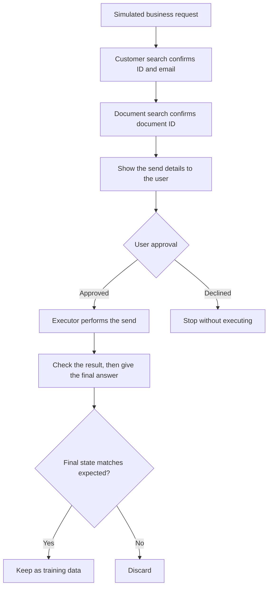

This post is for developers and platform owners who want to put a conversational assistant on top of internal business systems. The short version: business execution records whose answers can be checked by a machine were enough to teach a small model useful tool-use skills.

ThakiCloud is releasing the result as a research preview. It is a small model focused on one job in Korean enterprise work: pick the tool, fill in the values, get confirmation, and report the result. It is not meant to replace large models. It is one data point on how much work a small model can safely take on.


*An image of a small model that handles well-defined work precisely.*

## In plain terms

Think of a shipping label. To send a package you have to fill in the recipient, the address and the phone number exactly. If a field is blank, you do not make up an address; you go back and ask the sender. If the item is valuable, you confirm the details once more before handing it over. After it ships, you check the tracking page before telling anyone "it has arrived."

A tool call works the same way. Even a single request like "Send the quote to customer Kim Minsu" has several fields on the label. Are there two customers with that name? Which quote? Is it okay to send? If the send fails, the assistant must not say it succeeded. One small slip ends up as a document sent to the wrong customer, or as a completion record for work that never finished.

KoToolAct-4B is a model that practiced filling in that label, and only that. It does not write long reports or synthesize material across many systems. Its job is to fill in a fixed form with no blanks, confirm what needs confirming, and report only what the lookup returned.

## What the model is

KoToolAct-4B is Qwen3.5-4B with LoRA SFT. It emits tool calls natively and handles multi-turn conversations. The maximum input is 8,192 tokens, and it was trained and evaluated in non-thinking mode, without long reasoning traces. The license is Apache-2.0 and the release stage is Research Preview.

What the model learned comes down to five habits. First, it picks the right tool among customer search, calendar lookup, task creation and document search. Second, it fills values such as customer IDs, dates, namespaces and VM IDs correctly. When information is missing, it asks instead of inventing a value. When a tool description says approval is required, it asks the user before executing. Finally, it answers only from what the tools returned.

The model does not decide permissions. Whether this user may perform this action has to be checked by the application around the model. The model is a clerk who fills out labels well; the counter's rules are enforced by the system.

## Why 4B and not 27B

A 27B-class model is valuable for multi-step planning, reading complex documents, and pulling together several systems. But not every task needs that scale. For routine requests such as "Show me tomorrow's schedule," "Change the assignee," or "Tell me the pod status," what matters is understanding what each tool means and filling in its values correctly.

Here is what we hope a small model brings. It uses less memory, so it fits on small GPUs and local machines. It can run on its own inside a closed network with no external API. With enough request volume, the cost per decision may also drop. These are expectations, not verified results.

There are reasons in the other direction too. If a 27B model is already resident, running a separate 4B model may cost you more, not less. The benefit depends on traffic, concurrency and hardware. And we did not compare KoToolAct-4B against 27B under the same conditions. This post does not claim that 4B beats 27B. It records whether a small model for routine tool execution is feasible.

## Data whose answers were checked by an executor

The training data was not copied from a 27B model's answers. We built a simulated enterprise environment and a deterministic tool executor, and kept only execution records whose correctness the executor could confirm. In label terms, the only labels used as teaching material were ones that were actually accepted and whose tracking matched.

The environment spans six business domains. In CRM, the model finds customers and changes deal status. In email, it searches, drafts and sends. In calendar, it lists, creates, updates and deletes events. In task management, it creates tasks, completes them and reassigns them. In documents, it searches, opens details and sends. In IT operations, it lists pods, scales Deployments and restarts VMs. There are 20 tools and 29 scenario types in all.



Reference records are produced by the flow above. The executor really changes the state of a simulated database and compares the final state with the expected one. We did not include only the easy cases. There are namesakes, missing times, dates that disagree with the weekday, missing permissions and mail server failures. Kubernetes timeouts, calendar conflicts, nonexistent resources and requests that cannot be handled are in there as well.

The scale is 3,200 training episodes, which unfold into 8,209 SFT training turns. We kept 400 development evaluation episodes and 400 sealed evaluation episodes separate. Names, companies, ID ranges and phrasing templates do not overlap between training and evaluation. Even tool names are spelled differently. A tool called `search_customers` in training appears under a different name in evaluation. The generator's structure, however, is shared. So this split alone does not show that the model works in real environments.

## Training was short

Training was a single LoRA SFT run. There was no reinforcement learning such as GRPO or DPO, and no distillation from a 27B model. Adapters went on the attention layers, the Gated DeltaNet linear projections and the MLPs, and the vision encoder was frozen. The run took 2 epochs and 1,008 steps on one B200, about 1.8 hours of pure training time.

Loss was applied only to the response tokens the model must write itself. A tool result is context to read, not an answer for the model to produce. A clerk reads the tracking page; a clerk does not write it.

## What changed: three scenes from the sealed test

The three scenes below are actual conversation logs from the sealed evaluation.

The first scene (test-00129) is a label with no recipient. The user asked for one email draft with the subject "견적 회신 드립니다" ("Replying with the quote") and the body "확인 부탁드립니다." ("Please take a look."). No recipient was given. The base Qwen3.5-4B invented an address, "이경호@platform.com", and created the draft. KoToolAct-4B asked back, "받는 사람 이메일 주소를 알려 주시겠어요?" ("Could you tell me the recipient's email address?"). After getting an answer, it created the draft for kyungho.jang@greentec.kr. When a required value is missing, it does not make one up; it gets the value first and then executes.

The second scene (test-00031) is a handover that needs confirmation. The user wrote, "12월 8일 잡혀 있는 협력사 미팅 취소 부탁해요." ("Please cancel the partner meeting on December 8."). The base model called the delete tool right away, and the executor blocked it because approval was required. KoToolAct-4B first looked up the event. Then it asked, "2026-12-08 14:00~15:30 '협력사 미팅' 일정(EV-82480)을 삭제할까요? 참석자에게 취소 알림이 갑니다." ("Shall I delete the 'Partner meeting' event (EV-82480) on 2026-12-08, 14:00 to 15:30? Attendees will get a cancellation notice."). It deleted the event only after approval.

Knowing how to call a tool and knowing whether to call it now are different skills. This scene shows the difference. Note, though, that "Attendees will get a cancellation notice" was not in the tool result. The model card's limitations section lists it as an unsupported statement. And enforcing approval is the executor's responsibility, not the model's.

The third scene (test-00333) is a tracking check that failed once. The user asked for the status of the audit-log pods in the dev environment, and the first lookup timed out. The base model did not retry and told the user to ask again later. KoToolAct-4B looked again. It got back audit-log-74d43-4587 in Pending with 11 restarts and audit-log-fc099-e9cc in Running with 9 restarts. It then explained both that it had retried and what it found. This is a transient error on a read-only lookup. Actions that change state, such as sending, deleting or paying, need their own retry rules and duplicate-execution guards.

## Performance

The sealed evaluation is 400 simulated Korean business episodes. Every condition was measured with the same llama.cpp runtime, the same Chat Template, the same evaluation data and the same deterministic grader. BF16 in the table refers to the model with the LoRA merged in.

| Metric | Base Qwen3.5-4B (BF16) | KoToolAct-4B (BF16) | KoToolAct-4B (Q4_K_M) |
|---|---|---|---|
| Task success (%) | 48.50 | **91.00** | 89.25 |
| Correct tool on first action (%) | 70.75 | **100.00** | 100.00 |
| Argument accuracy (%) | 80.39 | **97.51** | 97.24 |
| Asking back (%) | 23.08 | **100.00** | 100.00 |
| Confirmation before execution (%) | 20.75 | **100.00** | 100.00 |
| Result faithfulness (%) | 86.21 | **96.55** | 94.83 |
| False successes caught by the grader (count) | 4 | 0 | 0 |
| Schema violations (count) | 7 | 0 | 0 |

At BF16, task success rose by 42.5 percentage points. The paired bootstrap 95% confidence interval runs from 37.5 to 47.75 points. The Q4_K_M build scored 1.75 points below BF16. A 100% in the table means every case of that kind in this evaluation set was handled. It does not mean the model makes no mistakes on real work.

There is an error the table does not capture. On requests to modify work without permission, the model invented an assignee name that was not in the tool result in 13 of the 400 episodes. The grader counted those 13 as successes. The cause was that the training references used internal information from the simulated database that the model could never see. It is as if the label templates had an address written in that the customer never gave.

Counting those 13 as failures, task success becomes 87.75% for BF16 and 86.00% for Q4_K_M. These are post-hoc reference values, and we did not retroactively change the official scores. But to be clear: with this error included, Q4_K_M does not meet the 89% bar we set in advance.

The evaluation data has defects of its own. When asked for a "customer number," the model answered with the customer ID, but the answer key accepted only a phone number. Some references also shortened an event title relative to what the user said. We left these items in rather than removing them after the fact.

## One 2.71GB file

For distribution we used the standard llama.cpp Q4_K_M quantization. Building a new quantization method was not the goal, so we chose a proven standard. In GGUF terms, the merged BF16 model is about 8.42GB and the Q4_K_M file is 2.71GB (2,708,804,320 bytes). That is roughly 67.8% less storage.

The quality loss stayed small. Perplexity rose slightly from 8.21 to 8.40, and the mean KL divergence was about 0.03. The task success gap is the 1.75 points mentioned above. File size is not runtime memory. Running the model also needs room for the KV cache and buffers.

## Running it yourself

The simplest path is to download the GGUF file and serve it with llama.cpp. The Chat Template is embedded in the GGUF.

```bash
pip install -U huggingface_hub
hf download ThakiCloud/KoToolAct-4B-GGUF KoToolAct-4B-Q4_K_M.gguf --local-dir .
llama-server -m KoToolAct-4B-Q4_K_M.gguf --jinja -c 8192 --port 8080
```

Training and evaluation used `enable_thinking=false` and temperature 0. We recommend the same settings when you call it. The model works in Korean, so the example request is in Korean.

```bash
curl http://localhost:8080/v1/chat/completions \
  -H "Content-Type: application/json" \
  -d '{
    "messages": [
      {"role": "system", "content": "한국어 업무 어시스턴트입니다. 오늘은 2026-10-19입니다. 제공된 도구만 사용하세요. 도구 결과에 없는 내용은 추측하지 마세요."},
      {"role": "user", "content": "2026년 10월 20일 일정 확인해 줘."}
    ],
    "tools": [{
      "type": "function",
      "function": {
        "name": "calendar_list_events",
        "description": "지정한 날짜의 일정을 조회합니다.",
        "parameters": {
          "type": "object",
          "properties": {"date": {"type": "string", "description": "YYYY-MM-DD"}},
          "required": ["date"]
        }
      }
    }],
    "tool_choice": "auto",
    "temperature": 0,
    "chat_template_kwargs": {"enable_thinking": false}
  }'
```

The system prompt says: you are a Korean business assistant, today is the given date, use only the provided tools, and do not guess anything that is not in a tool result. The user asks to check the schedule for that day.

What the model returns is a tool call request, not an executed action. The application has to validate the function name and arguments, run the real tool, and feed the result back as a `role=tool` message.

For Transformers, download the merged BF16 flagship repository. Its weights are byte-for-byte identical to the BF16 GGUF used in the sealed evaluation across all 426 language model tensors. We confirmed this with a full comparison.

```python
import torch
from transformers import AutoModelForImageTextToText, AutoTokenizer

repo = "ThakiCloud/KoToolAct-4B"
tok = AutoTokenizer.from_pretrained(repo)
model = AutoModelForImageTextToText.from_pretrained(
    repo, dtype=torch.bfloat16, device_map="auto"
)

prompt = tok.apply_chat_template(
    messages, tools=tools, add_generation_prompt=True,
    enable_thinking=False, tokenize=False,
)
inputs = tok(prompt, return_tensors="pt").to(model.device)
out = model.generate(**inputs, max_new_tokens=512, do_sample=False)
```

With vLLM you can serve it via `vllm serve ThakiCloud/KoToolAct-4B --enable-auto-tool-choice --tool-call-parser qwen3_coder`. Our evaluation, however, was not run on vLLM. If you move to it, check a few items against known answers first.

We also release the LoRA adapter for reproduction. Load it with `PeftModel.from_pretrained(base, "ThakiCloud/KoToolAct-4B-LoRA")` on Qwen/Qwen3.5-4B at revision `851bf6e806efd8d0a36b00ddf55e13ccb7b8cd0a`. The adapter-on-base path was not evaluated separately under the same conditions as the merged model.

## Where to use it

The first fit is an enterprise work assistant. CRM, calendar, document and task management APIs are connected as tools, and the application manages permissions and approvals. The model fills out the label; the system enforces the counter's rules.

The second is IT operations support. Read operations such as pod lookups are relatively simple to wire up. Scaling, restarts and deletions should go through a separate approval policy. The model has not been validated for production Kubernetes operations.

The third is closed networks and small hardware. A single GGUF file runs with no external API. Actual performance and memory depend on hardware and context length.

The fourth is a division of labor with a larger model. A routing layer up front sends routine tasks to KoToolAct-4B and tangled multi-step tasks to a 27B-class model. Either way, the request then passes permission, approval and result checks before it reaches enterprise systems. Paxis, the work automation platform ThakiCloud is building, could look at this kind of split in the future. If every work step passes through a policy gate and an audit log, routine steps become candidates for a small model. This model, however, is not integrated into any product yet. We have not verified cost savings against 27B either. The core point is telling apart the work a small model can take from the work that needs a large one.

## Before you run it in production

If you put it into a live service, some rules must hold outside the model. Validate tool schemas, and isolate permissions and tenants. Collect approval through a mechanism independent of the model. Do not report completion before the real state is confirmed. For state-changing actions, idempotency and retry rules are the safer choice.

Re-check relative dates against a reference date and time zone. You also need a filter that blocks names, amounts or statuses that do not appear in tool results. Relative date errors and unsupported assignee names were actually observed in evaluation. So we do not recommend letting this model execute sensitive work on its own.

Finally, keep in mind that training and evaluation came from the same generator. We could not get results on BFCL, a general tool-calling benchmark, because of an evaluation harness error. So we make no claim about general tool-calling performance. This model is a Research Preview.

## What we learned

With 3,200 verifiable scenarios and about 1.8 hours of LoRA SFT, the model improved substantially over the base. Recorded B200 usage for development, evaluation and quantization was about 3.9 GPU-hours. The failed BFCL jobs, whose run time was not recorded, are not included.

What we taught was work habits, not knowledge. We taught when to call a tool, which values to fill in, when to ask back and which actions need confirmation. The model also learned how to respond to failures and what evidence justifies saying a task is done.

We also saw the risk of synthetic data clearly. The model learns the generator's small defects as they are. The 13 assignee names are one example. If the evaluation generator and the grader share the same assumptions, they cannot catch that defect. Good synthetic data builds each answer only from information the model can actually see. And it lets you check execution results independently of the reference answer.

## What we released

The release comes in three forms. Usage, full metrics and limitations are in each model card.

| Repository | Format | Purpose |
|---|---|---|
| [ThakiCloud/KoToolAct-4B](https://huggingface.co/ThakiCloud/KoToolAct-4B) | Merged BF16 | Flagship model for Transformers and vLLM, canonical model card |
| [ThakiCloud/KoToolAct-4B-GGUF](https://huggingface.co/ThakiCloud/KoToolAct-4B-GGUF) | Q4_K_M GGUF | Local llama.cpp and closed-network use |
| [ThakiCloud/KoToolAct-4B-LoRA](https://huggingface.co/ThakiCloud/KoToolAct-4B-LoRA) | PEFT adapter | Reproduction |

All three repositories are grouped in the [KoToolAct collection](https://huggingface.co/collections/ThakiCloud/kotoolact-korean-enterprise-tool-calling-4b-6ad5aca34339527205450afe).

This release is not a claim that we have built a general-purpose agent. It is one result showing that focused training on specific work can turn a small model into a useful execution model. A small model does not need to do everything. If one model fills out labels precisely, the large model can be saved for work that really needs it.

*Source of measurements: sealed evaluation results measured on ThakiCloud's in-house B200 with the same llama.cpp runtime and deterministic grader.*
