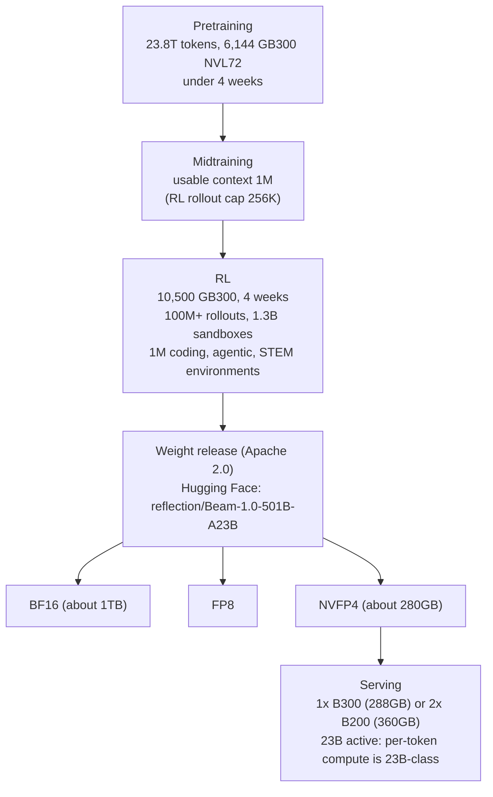

*Not a large hospital with 501 examination rooms, but a consultation where only 23 specialists take part at a time. An abstract rendering of the sparse MoE structure.*

## Why Read This

If you are an infrastructure or platform engineer evaluating whether to put a large open model on your GPU fleet for multi-tenant serving, this model card is the decision material. The conclusion comes first. **Beam (501B-A23B), released by Reflection AI under Apache 2.0 on October 16, is a credible entry point into the Western open-weight frontier. But "3 to 4x less compute" is a vendor-reported inference efficiency claim, not a measured deployment cost.** Independent evaluation notes that raw capability trails Kimi K3 and GLM 5.3, and that the context cap, pricing, and safety report are all still outstanding.

## In Plain Terms

Imagine a large hospital staffed by 501 specialist doctors. When a patient arrives, all 501 do not see them. A router calls only the 23 specialists relevant to the symptoms. The hospital's total capacity is enormous, but the cost per consultation is that of 23 people. Beam is exactly that hospital. 501B total parameters, 23B active per token. The building (weights) is large, and the consultation (inference) is light. We return to this hospital analogy in "Serving and On-Premises Requirements" and "Limitations and Counterarguments" below.

## Overview

Reflection AI is a US open-weight AI company founded in 2024 in Brooklyn. Both founders, Misha Laskin (CEO) and Ioannis Antonoglou (CTO), are former Google DeepMind researchers. Antonoglou is a DeepMind founding engineer who contributed to AlphaGo and MuZero and led RLHF training for Gemini. The company carries the slogan "Western open-weight frontier" and builds open-weight models alongside software agents for AI development assistance. NVIDIA participated in its 2025 funding round, and the fact that the entire Beam training ran on NVIDIA GB300 systems is confirmed by the "Welcome Beam!" post from @NVIDIAAI (RT dated October 18).

Beam is the company's first model. It was announced on October 5 and its weights landed on Hugging Face on October 16. According to the company, Beam is the first of a series, and training for follow-up models is already underway. The positioning is a "workhorse" for coding, reasoning, and agentic workloads.

The timing is part of the story. With Chinese open models (DeepSeek, Qwen, GLM) pushing the frontier on the axis of "same capability for less," a team with Western capital and Western references has entered the same axis. Reflection writes the "Western frontier" card as its own slogan, with NVIDIA attached on both the training hardware (GB300) and the investment side.

## What Is This Model

Beam is a sparse Mixture-of-Experts (MoE) with 501B total parameters and 23B active per token. In the hospital analogy: the building has 501 examination rooms, but each patient is seen in 23 of them at a time.

The official blog discloses the training scale in detail. Pretraining consumed 23.8 trillion tokens on 6,144 NVIDIA GB300 NVL72 systems in under four weeks. Reinforcement learning followed on 10,500 GB300s for four weeks, with over 100 million rollouts, 1.3 billion sandboxes, and one million coding, agentic, and STEM environments. Peak concurrency of 110K rollouts and 170K sandboxes was reported.

Context is the headline of this release: 1M tokens. RL rollouts ran up to 256K tokens, and midtraining pushed the usable context to 1M. Whether that "1M" is the same number as the actual API cap is discussed in the "Limitations" section.

The weights shipped in three formats: BF16 (about 1TB), FP8, and NVFP4 (about 280GB). They are under the Apache 2.0 license in the reflection organization on Hugging Face, and the API runs as early access at platform.reflection.ai.

## Reported Benchmarks

All figures below are vendor-reported. Anchoring on the official blog (score refresh of October 8), the coding-verification rows are SWE-bench Verified 80.9, Terminal-Bench v2.1 80.1, SWEBench Multilingual 78.0, and SWE-bench Pro v1 65.5. The harder agentic-coding rows are DeepSWE v1.1 at 44.4, SWE-bench Pro v2-Hard at 77.2, and SWE Atlas Codebase QnA at 34.6.

Math and reasoning sit at the top of the field: AIME 2026 97.8, GPQA Diamond 90.5, with HLE (no tools) at 36.2 and SciCode at 49.7. Long-context utilization: LongBench v2 65.5, AA-LCR 79.3, IFBench 79.7. Web-agent rows: BrowseComp (with context management) 77.4, DeepSearchQA 80.1, tau3 banking 38.0, MCP Atlas 78.7, AutomationBench (public) 37.0.

Per-quantization scores were published by the official Hugging Face blog (October 16). This is the table that matters most from a serving perspective.

| Benchmark | BF16 | FP8 | NVFP4 |
|---|---:|---:|---:|
| DeepSWE v1.1 | 43.3 | 43.0 | 42.7 |
| SWE-bench Pro v2-Hard | 76.5 | 78.4 | 78.6 |
| Terminal-Bench v2.1 | 80.1 | 78.9 | 78.2 |
| SWE-bench Verified | 81.6 | 80.2 | 80.7 |
| AIME 2026 | 97.7 | 98.0 | 97.5 |
| HLE (with tools) | 51.1 | 51.1 | 51.1 |
| GPQA Diamond | 90.6 | 90.3 | 89.3 |
| LongBench v2 | 67.5 | 67.6 | 67.2 |

There is no row where NVFP4 loses badly. SWE-bench Pro v2-Hard and AIME are even slightly higher in NVFP4 than BF16. A format that fits in 280GB holding quality nearly flat is the kind of result that lets you use NVFP4 as the default assumption in serving-cost math.

Independent evaluation (DataCamp, October) places the same vendor-reported numbers side by side with competing models.

| Benchmark | Beam | GLM 5.2 | GLM 5.3 | Kimi K3 | DeepSeek V4.1 Flash |
|---|---:|---:|---:|---:|---:|
| Terminal-Bench v2.1 | 80.1 | 81.0 | 88.2 | 88.3 | 90.6 |
| DeepSWE v1.1 | 44.4 | 44.0 | 61.0 | 68.0 | 74.2 |
| SWE-bench Pro v2-Hard | 77.2 | NR | 84.3 | 88.2 | NR |
| HLE | 36.2 | 40.5 | 42.3 | 46.9 | NR |
| AIME 2026 | 97.8 | 99.2 | NR | NR | NR |
| GPQA Diamond | 90.5 | NR | 91.7 | 93.5 | NR |
| BrowseComp | 77.4 | NR | NR | 91.2 | NR |
| DeepSearchQA | 80.1 | NR | NR | 95.0 | NR |

The pattern is consistent. Verification-style coding (SWE-bench Verified 80.9) is competitive. The harder agentic-coding rows (DeepSWE v1.1 44.4 versus Kimi K3 68.0 and DeepSeek V4.1 Flash 74.2) show a large gap. Reasoning (HLE 36.2) trails GLM 5.2, Qwen 3.8-Max, and Kimi K3. Web-search utilization (BrowseComp 77.4 versus 91.2, DeepSearchQA 80.1 versus 95.0) is the largest gap of all. The independent assessment's verdict: "a credible open-weight entry, but not something to plan around yet."

## Serving and On-Premises Requirements

What sets the consultation bill at the hospital is the "23B active" number. Per-token compute is in the class of a 23B dense model, so the inference cost structure is set by the staff on duty (23B), not the size of the building (501B). The weight footprint is about 280GB in NVFP4.

The deployment notes on the Hugging Face blog name B200 (180GB) and B300 (288GB) as candidate hardware. NVFP4 at 280GB does not fit one B200. It fits one B300 (288GB) or two B200s (360GB). BF16 (about 1TB) exceeds four B200s (720GB), so in practice FP8 or NVFP4 are the deployable formats.

The KV cache story is favorable as well. Per the HF blog notes, the cache for long-context runs stays around 36GiB with the 23B-active structure, roughly a sixth of the 208GiB class for dense models. The hospital has 501 examination rooms, but the waiting room (KV cache) is sized for 23.

A caveat attaches to the "3 to 4x less inference compute" claim. It is an efficiency comparison on reasoning tests, and it excludes prompt processing (prefill), the extra attention cost of long context, and serving overhead. DataCamp calls it "not a measured deployment cost" and notes that the comparison method naturally favors sparse models like Beam. Adoption decisions need re-measurement in your own serving environment.

## ThakiCloud Product Implications

**ai-platform lens (serving, quantization).** ThakiCloud's ai-platform already runs NVFP4-quantized endpoints in production (Qwen3.8-27B NVFP4, resident serving on B200). Beam NVFP4 (about 280GB) fits a two-B200 configuration, and the quantization pipeline does not need to be rebuilt to add a 500B-class open model to the catalog. The threshold for adding a 500B-class open model has come down to "can we serve NVFP4." The density gain from 23B active belongs to the batch unit of multi-tenant serving: you hold 501B-class knowledge while the per-request inference budget stays in the 23B class, and the concurrent requests per card go up. The order of work is clear. First a serving probe (throughput and latency in your own environment), then NVFP4 versus BF16 quality re-measurement, and finally the catalog decision.

**Paxis lens (agent workloads).** Beam targets coding and agentic work, which lines up with Paxis agent tool-call loops and codebase QnA. The weak axes need a look first, though. SWE Atlas Codebase QnA (34.6) and web-search utilization (BrowseComp 77.4 versus Kimi K3 91.2) are below competing models, and those are exactly the capabilities Paxis agents use often. The coherent placement is not a "replacement" for existing agent models but a workhorse candidate for coding and verification rows that can be A/B tested in parallel.

## Limitations and Counterarguments

First, every benchmark number is a vendor self-report. There is no independent reproduction yet, and DataCamp's analysis is a side-by-side of vendor figures. Second, the efficiency claim excludes prefill, long-context attention, and serving overhead, so "3 to 4x less compute" must not be converted directly into deployment cost. Third, 1M context is a nominal value. RL training ran to 256K, and per DataCamp's check the API beta total cap is 262,144 tokens with a 131,072 output cap. A hospital that advertises a 1M-square-meter building still books appointments in 262K rooms at a time. Fourth, per-token pricing is unpublished, and safety evaluation results are promised in a technical report rather than released. Fifth, in raw capability the company itself concedes Kimi K3 is ahead, and independent evaluation confirms the gap on the harder coding rows (DeepSWE v1.1 44.4 versus 68.0) and reasoning (HLE 36.2 versus 46.9). CritPt is 15.6, about half of Kimi K3's 23.4. Staffing 501 specialists does not mean strength in every disease. The question is which departments are strong, and the current answer is "verification-style coding and math are strong, deep agentic and web search are weak."

## Wrap-Up

The biggest signal from the Beam release is that "efficiency" has entered open-weight competition. After Chinese open models took the "capability" axis, Reflection entered with "the same capability at 3 to 4x less compute," a claim on the efficiency axis. For a platform like ThakiCloud that bills inference cost as a service price, the efficiency axis is exactly the axis to watch. In hospital terms, Beam is a building with a large footprint and fast consultations. It does not treat every disease well. You confirm which departments are strong, then book the consultation there.

Three takeaways for the reader. If you are reviewing a coding or agentic workhorse, put Beam NVFP4 on the shortlist and re-measure in your own serving environment. Do not plan on vendor figures. If you are buying inference, per-token pricing is unpublished, so the API is still early access. Bundle the gap between the nominal 1M context and the actual cap, along with the safety report, as "limitation" until the technical report lands.

One-line conclusion: **The claim that 501B of knowledge can be served at 23B of compute has arrived as Apache 2.0 weights. Deployment cost, however, is a measured value, not a claim.**

## Sources

- Reflection AI official blog: [Introducing Beam](https://reflection.ai/blog/introducing-beam) (2026-10-05, score refresh 10-08)
- Hugging Face official blog: [Reflection Beam](https://huggingface.co/blog/reflection-beam) (2026-10-16)
- Hugging Face models: [reflection/Beam-1.0-501B-A23B](https://huggingface.co/reflection/Beam-1.0-501B-A23B) · [FP8](https://huggingface.co/reflection/Beam-1.0-501B-A23B-FP8) · [NVFP4](https://huggingface.co/reflection/Beam-1.0-501B-A23B-NVFP4)
- DataCamp independent evaluation: [Reflection AI Beam](https://www.datacamp.com/blog/reflection-ai-beam)
- NVIDIA AI post RT (2026-10-18): [x.com/hjguyhan/status/2111792912770175430](https://x.com/hjguyhan/status/2111792912770175430) (RT of @NVIDIAAI)
- Reflection AI: [reflection.ai](https://reflection.ai)
