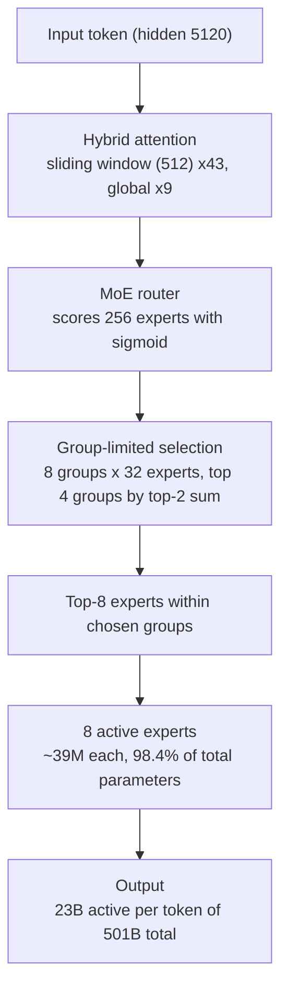

## Why read this

For the engineers who run GPU farms or are deciding today whether to serve a frontier-class model on-prem. The conclusion first: **Beam's value is not its benchmark ranking. It is the economics of "501B total, 23B active per token," and the shape of an NVFP4-quantizable model that vLLM supports from day zero is precisely the profile we serve on Metis and Telox every day.** The benchmark numbers themselves are still Reflection AI's self-reports, and that matters too.

## Overview

Reflection AI announced **Beam 1.0**, its first open-weight model, on October 5, and released the weights on October 16 under **Apache 2.0**. NVIDIA's official channel marked the launch with a "Welcome Beam!" retweet, and reports say NVIDIA has invested $800M in Reflection, lifting its valuation to roughly $25B.

Beam is a **501B-parameter** sparse Mixture-of-Experts model that activates **23B parameters per token**, with a **1M-token** context window. It targets coding, reasoning, and long-horizon agentic workloads.

The combination matters for a simple reason. "Frontier-class total parameters, 20B-range active" is an economics where inference cost sits on the line of a dense 23B model while expressivity reaches toward 500B. An open-weight frontier model in that profile, with numerics all the way down to NVFP4, is about as new as it gets.

## What the model is

The structure comes from the model card and the Hugging Face release.

- **52 layers**: 3 dense layers (SwiGLU MLP) and 49 MoE layers
- **256 experts per MoE layer**: each expert is a SwiGLU MLP (intermediate 2,560) of roughly 39M parameters, and 98.4% of all parameters live in experts
- **Group-limited routing (top-8)**: the router scores all 256 experts with a sigmoid, splits them into 8 groups of 32, picks the top 4 groups by the sum of each group's top-2 scores, then activates the top-8 experts inside those groups
- **Hybrid attention**: 43 sliding-window layers (512-token window, RoPE) interleaved with 9 global-attention layers (every 6th layer plus the final one, no positional encoding). Hidden size 5,120

The hybrid of sliding-window and global attention is the key device that keeps KV cache from exploding at 1M context. Most layers see only 512 tokens, so the KV cost of long context stays far below a dense model's, and the global layers look at the full span when it matters.

### MoE routing flow

The path a single token takes through a MoE layer:

*The group-limited top-8 MoE routing path that keeps 23B of 501B active per token*

### Training history

Reporting says pretraining ran on **6,144 NVIDIA GB300 NVL72 GPUs for under four weeks**, and the RL stage scaled to **10,500 GB300 GPUs for four weeks**. Putting more than 10K GPUs into a single RL stage is rare even among open-weight models, and it is the source of the "coding and agentic optimized" positioning.

## Benchmarks (self-reported)

The numbers below are Reflection AI's own. The model has not yet appeared on third-party evaluation platforms (Artificial Analysis, tau-bench), so independent verification is still pending.

| Benchmark | Score | Notes |
|---|---|---|
| SWE-bench Verified | 81.6% (BF16) | agentic coding |
| AIME 2026 | 97.8% (FP8: 98.0%) | math reasoning |
| GPQA Diamond | 90.5% | grad-level science reasoning |
| HLE (no tools) | 36.2% (BF16 36.0, NVFP4 34.8) | Humanity's Last Exam |

Third-party analysis (DataCamp) reports Beam matches GLM-5.2 on reasoning while using 3-4x less inference compute, and trails Kimi K3 on agentic coding. With the self-reported caveat attached, "these numbers at 23B active" is Beam's real proposal.

## Serving and deployment

Beam is the fastest-connecting model to the serving stack.

- **vLLM day-zero support**: the official vLLM blog posted "Serving Reflection Beam on vLLM from Day 0" on October 16, with reasoning parsing and NVIDIA Blackwell optimizations. A public recipe (reflection/Beam-1.0-501B-A23B on recipes.vllm.ai) ships with it
- **Three numerics**: Hugging Face hosts `reflection/Beam-1.0-501B-A23B` (BF16), `-FP8`, and `-NVFP4` side by side
- **GB200 serving**: a TokenSpeed partnership supports GB200-based serving from launch

The memory math falls straight out of the parameter count. 501B in BF16 (2 bytes) is about 1.0TB, in FP8 about 500GB, in NVFP4 about 250GB for the weights alone (no overhead). For reference, ThakiCloud's B200 node is 8x192GB, 1.5TB per node. **The BF16 original fits a single B200 node, and FP8 leaves headroom.** Note that this is the "own it in a datacenter" kind of open, not "run it on a consumer GPU."

The practical cost of serving 1M context is the KV cache. The hybrid attention structure relaxes it substantially, but pinning `max_model_len` to what the workload actually needs and sizing `max_num_seqs` to node VRAM is still required. We are not publishing performance numbers here. Real serving numbers are territory we measure and write up separately.

## ThakiCloud product implications

### ai-platform lens (serving and infrastructure)

Beam is the profile Metis serverless and Telox GPUaaS take best. The 501B total is the number on-prem customers throw up when they say "self-hosting," and the 23B active is the promise that the number does not land on the inference bill. FP8 and NVFP4 builds shipped with a vLLM recipe mean a multi-tenant serving stack can pick numerics per node. In a Kueue-scheduled farm, the fact that Beam BF16 fits one B200 node lowers the floor of reservation and allocation math.

### Paxis lens (agents)

"Long-horizon agentic positioning plus 1M context" overlaps the workflows Paxis handles. When an agent makes dozens of tool calls inside one context, context length is the ceiling on task lifetime. A 1M window gives agent workers "the length a session does not break," and 23B active keeps the per-hour cost of that session below a dense model. Beam reconfirms the structure where cheap serving creates agent economics.

## Limits and counterarguments

Four points, honestly.

1. **Self-reported benchmarks.** Until third-party verification lands, 81.6% and 90.5% must be read as "official numbers," and the comparisons must be read inside Reflection's frame.
2. **Quantization sensitivity.** HLE (no tools) dropping 36.0 to 34.8 at NVFP4 puts a condition on "just switch to NVFP4." For reasoning-sensitive work, FP8 is the safe line.
3. **The memory wall.** 501B total parameters press against the limit of a single datacenter node (1.5TB). BF16 serving spends most of node VRAM on weights, leaving scraps for KV and batching. An 80GB H100/H200 farm effectively requires FP8 or NVFP4.
4. **Reproduction cost.** A 10,500-GB300 RL stage is far from the usual meaning of "open weights, anyone can reproduce." Taking the weights and rebuilding the model are different problems.

## Takeaway

Beam 1.0 shows the open-weight frontier converging on three vertices: sparse, quantizable, day-zero inference-engine support. The questions left for a serving team are not the benchmarks, they are three: **which numeric do you run on your fleet, is one node enough, and is the inference-engine recipe in place.** Beam answers all three as of today. If you have Blackwell nodes, start with the FP8 recipe. If an on-prem customer wants NVFP4, judge the HLE 1.2p gap as an acceptance question only. We will reinforce this post with third-party verification as it lands.

### Sources

- [Introducing Beam (Reflection AI official blog)](https://reflection.ai/blog/introducing-beam)
- [Reflection Beam 1.0 model card (Hugging Face)](https://huggingface.co/reflection/Beam-1.0-501B-A23B)
- [Serving Reflection Beam on vLLM from Day 0 (vLLM official blog)](https://vllm.ai/blog/2026-10-16-reflection-beam)
- [DataCamp Beam analysis](https://www.datacamp.com/blog/reflection-ai-beam)
- [NVIDIA official RT (X)](https://x.com/hjguyhan/status/2111792912770175430)
