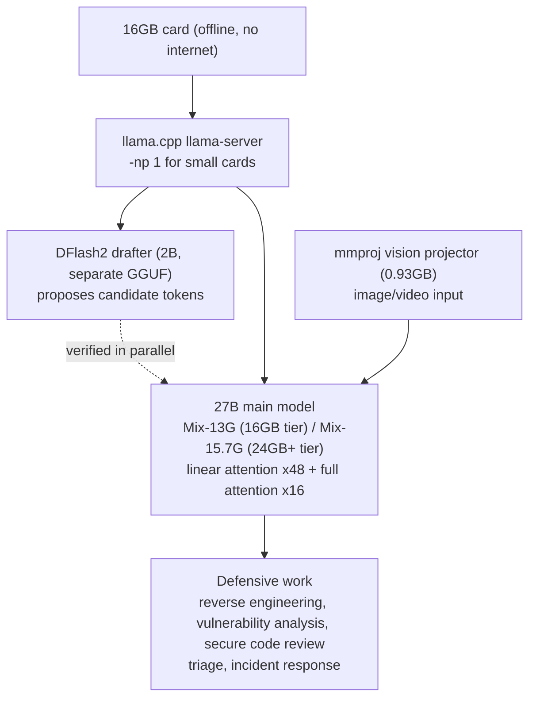

## Why read this

This is for the engineer deciding today whether a local model goes into an on-prem security line, or whether cyber-defense workloads join an edge serving plan. Verdict up front: **the value of OrcaCyber Nano 1.0 is in the form, a 27B defense-specialized model that fits on a 16GB card.** That form puts a first local 27B defense specialist on the table for environments where the corpus cannot leave the building. At the same time, the "emergency release" label means the weights shipped before the cyber-specific evaluation was done, so the numbers need care.

## Overview

OrcaRouter announced the open-weight release of **OrcaCyber Nano 1.0** on October 20 with the words "Emergency release." It is the first model of the Nano line in the OrcaCyber series (Nano, Zero, Ultra). Zero 1.0 came out September 17 and Zero 1.5 on October 10. Nano came last, yet it carries the "emergency" word.

Per the announcement, the release was pulled forward because the cyber-specific evaluation had not finished. The dedicated evals are planned for a separate publication later. A security-specialized model shipped its weights before it had run the full defensive benchmark set.

OrcaRouter runs an OpenAI-compatible LLM gateway of the same name. Its Hugging Face org (orcarouter) holds 31 models, most of them quantized or uncensored variants of other companies' models (the Qwen3.8-27B-Uncensored family, DeepSeek-V4-Flash-Vision-Uncensored, and so on). OrcaCyber is the series it ships under its own name. The OrcaCyber site (orcacyber.ai) describes the line as a "cyber harness for defenders" and marks it as "Private testing." The OrcaRouter cyber page opens with the line "models and defenses for security teams."

Why a security-specialized open-weight model at all? The answer is already in the release posture. Defensive security work carries the constraint that the corpus stays inside the building. Code, configuration files, incident logs, exactly the material that cannot go to an external API. A local model that runs offline on your own hardware is the only form that fits that constraint.

## What the model is

The facts, from the model card (`orcarouter/OrcaCyber-Nano-1.0`):

- **27B dense**: no MoE, all parameters active on every token
- **262,144-token context**: 256K
- **VL hybrid**: text plus image/video in, text out. A separate vision projector (mmproj) file ships with it
- **Architecture class `Qwen3_5ForConditionalGeneration`**: 64 layers, hidden 5,120, of which 48 are linear attention and 16 are full attention
- **License `qwen`**, access is gated (agree to the terms before downloading)
- Base model officially unconfirmed. The announcement text is cut off at "Based," and community speculation (a 27B Qwen-family base) went without an official answer

A 27B dense model on a 16GB card does not work under ordinary arithmetic. 27B in BF16 is about 54GB of weights, and 8-bit (Q8) is still about 27GB. The card's answer has three parts. First, mixed-precision GGUF builds that shrink the weights themselves (13G, 15.7G). Second, speculative decoding: a 2B DFlash2 drafter plus an MTP (multi-token prediction) head. Third, hybrid attention: 48 linear-attention layers whose state does not grow with context, combined with 16 full-attention layers whose state does.

The first part is the question of size. The second and third are the question of how the small thing runs. The second sets the speed, the third sets the context budget. A linear-attention layer keeps a fixed-size recurrent state per layer instead of a KV cache proportional to sequence length. The KV cost of a 262K context is therefore confined to the 16 full-attention layers. That is the structural reason "262K context on a 16GB card" is even a sentence.

The local cyber-defense stack is diagrammed below.

*The offline local defense stack: the drafter proposes candidate tokens and the 27B main model verifies them (speculative decoding). The vision projector ships as a separate file.*

## Serving and deployment

The files that actually ship in the card's repository are four GGUFs.

| File | Size | Role on the card |
|---|---|---|
| AI-Defense-Mix-15.7G.gguf | 15.70GB | best-quality build (MTP head included) |
| AI-Defense-Mix-13G.gguf | 12.99GB | for 16GB cards (MTP drafter included) |
| AI-Defense-DFlash2-Q8_0.gguf | 2.06GB | DFlash2 speculative drafter |
| mmproj-...-F16.gguf | 0.93GB | vision projector (image input) |

The card's memory guidance has two tiers: the 16GB card runs the 13G build, the 24GB+ card runs 15.7G plus the DFlash2 drafter plus vision. A note says to drop the llama-server default of 4 slots to 1 with `-np 1` on small cards.

Read "16GB" with the premise that context is short to medium. Weights plus drafter already occupy most of the card, and the KV budget for the full 262K context is far smaller. Hybrid attention does cut the KV growth rate with context, but "fits on a 16GB card" and "runs 262K on 16GB" are different claims. The card makes the former.

No inference provider deploys this model. The card states plainly that it "isn't deployed by any Inference Provider," and the only distribution channel is downloading the GGUF and running it yourself. This is a model that is local by nature, not one that can be called over an API. At the time of writing: about 18,600 monthly downloads and 135 likes, a solid adoption signal for a gated repository.

One independent community measurement is worth noting. The community benchmark platform llm-bench.io recorded roughly 44 tokens/sec peak from a single-GPU run of the 13G build. It is a vendor-external number, with settings unspecified. Enough as a speed reference range.

## Benchmarks (self-reported)

The numbers on the card, which carries the line "Benchmark harness, settings and full result tables are being finalized."

| Benchmark | Score | Kind |
|---|---|---|
| MATH-500 | 98.60 | math reasoning |
| GSM8K | 97.50 | math reasoning |
| AIME 2025 | 96.23 | math reasoning |
| HumanEval+ | 93.29 | code |
| LiveCodeBench | 92.23 | code |
| GPQA Diamond | 88.28 | science reasoning |
| MBPP+ | 84.66 | code |
| IFEval | 82.81 | instruction following |
| SWE-bench | 78.40 | agentic coding |
| Terminal-Bench 2.1 | 72.50 | agentic terminal |
| IFBench | 56.33 | instruction following |
| BigCodeBench | 49.82 | code |

All self-reported. No third-party platform listing yet, so independent re-verification remains open.

Read the table for what is missing. A card for a cyber-defense model carries zero cyber-specific numbers. Its best evidence is general agentic coding: SWE-bench 78.40, Terminal-Bench 72.50. By contrast, the same card introduces the series' Zero 1.5 as "98.01% pass@1 on CyberGym Level 1, 1M context, function calling, OpenAI-compatible API." The cyber numbers live on the Zero line, not Nano. OrcaRouter's X posts also claim parity with GPT-5, GLM-5.3 Flash, and DeepSeek V4 Flash, vendor claims as well.

This is where the "emergency release" label describes itself most honestly: the weights shipped before the numbers most relevant to the model's own positioning had been published. The gap between the OrcaCyber site's slogan, "Proven, not guessed," and the actual release posture is for the reader to weigh.

## ThakiCloud product implications

### ai-platform lens (serving, infrastructure)

OrcaCyber Nano 1.0 is the profile ThakiCloud's on-prem and edge business receives most directly.

**On-prem defense line.** The constraint that the corpus stays inside the building is a condition of the work for security workloads, not a nice-to-have. In an on-prem (Aegis) deployment, that constraint is strongest around code corpora and incident logs. An offline GGUF 27B is the first "defense-specialized" option that can sit next to them. The hybrid attention structure also makes the long-context KV budget math more favorable on constrained hardware than a plain dense 27B.

**The 16GB tier is edge.** metis-edge owns the question of which model fits which hardware, and a 13G GGUF that fits a 16GB card is a first concrete candidate in the "27B-class, one consumer card" format. GGUF/llama.cpp is an edge runtime that coexists with the vLLM/transformers path, and the two-tier (16GB / 24GB+) build structure answers the quantization question, how to shrink to the hardware, in product form.

**Speculative decoding is already in our production.** The DFlash2 scheme is the speculative decoding method ThakiCloud runs in production on its B200 serving stack, paired with NVFP4. The OrcaCyber card shows the scheme descending from datacenter-only into a "2B drafter plus 16GB card" form. The MTP head baked into the builds is a device in the same family.

### Paxis lens (agents)

Calling the site a "cyber harness for defenders" means the product is the control plane around the model, not the model alone. The OrcaRouter cyber page bundles the pieces: agent firewall, guardrails, code-review merge gate, compliance packs.

That is the shape of Paxis's domain. Paxis is ThakiCloud's Agent-Native Cloud, a control plane that treats skills, tools, policies, and audit logs as first-class resources. A defense agent that runs a local model in an isolated sandbox, doing reverse engineering and vulnerability analysis with zero external connectivity, is exactly the shape where Paxis's sandbox isolation and policy gates are most needed. The OrcaRouter bundle of firewall, guardrails, and merge gate is market evidence that governing agent behavior is becoming a security requirement.

Put together, one sentence: local serving at 16GB-class cost (ai-platform) makes the internet-disconnected defense agent (Paxis) executable. The unit serving cost of a local model sets how many defense agents a team can run offline.

## Limits and counterarguments

**The cyber evaluation is absent.** A model that shipped in "emergency" state is a model whose most relevant numbers have not been published. Until the dedicated evals land, "cyber-defense specialized" can only be read as a vendor positioning claim.

**Base unconfirmed, license unreviewed.** The announcement cuts off at "Based," and the only architectural fact is the `Qwen3_5ForConditionalGeneration` class. The same org's earlier model (Qwen3.8-27B-Uncensored) used the same class, which makes the guess strong, but the base remains officially unconfirmed. With the license tagged `qwen`, the commercial-use conditions of the Qwen-family license need to be checked in procurement documents. Gated access (agree before download) is part of the same question. "Open-weight" is a fact. "Usable unconditionally" is not.

**Every number is self-reported.** SWE-bench 78.40 and Terminal-Bench 72.50 read as top-tier even among large models. But the harness is "being finalized" and independent re-verification has not happened. Until it does, the numbers are reference values inside the vendor's frame, not grounds for comparison against other models.

**Read it with the business posture.** OrcaRouter is a gateway/router business (24 repositories in its GitHub org, a 1,400+ API connector). The open-weight release is very likely the hook into the cyber harness (firewall, guardrails, compliance packs). For a team that uses the model without the harness, standalone weight-quality verification remains open.

**The premise behind "16GB."** It holds for short-to-medium context. Real triage and incident-response work runs longer contexts than a demo. Re-doing the memory math on your own hardware is a premise, not an option.

## Wrap-up

OrcaCyber Nano 1.0 leaves three things, plus a signal, with teams.

For on-prem security teams, a first option in the "27B-class, local, defense-specialized" category. The form (offline GGUF, two tiers at 16GB / 24GB+, vision) fits the constraint that the corpus cannot leave the building. Before it goes on the line, though: wait for the cyber-specific evaluation to publish, and finish the license review first.

For serving engineers, a worked case of hybrid attention plus speculative decoding. The arithmetic that puts 27B dense on 16GB holds when 48 of the 64 layers are linear attention and a 2B drafter is attached. The next wave of "laptop 30B" models will likely follow the same arithmetic.

For the ThakiCloud team, a measurement target. Once the license review clears, we plan to measure the 13G build's tokens/sec, KV budget by context length, and DFlash2 drafter acceptance rate on our H100 node, and update this post with the results.

And the "emergency release" itself is the signal to keep. Shipping the weights before the cyber numbers were finished says the demand for a local model that defends without touching the internet arrived before the evaluation infrastructure did. If you are on a security team evaluating local models, the one checklist item to add from this post: when the dedicated evaluation publishes, check again whether the numbers hold the positioning.

### Sources

- [OrcaCyber Nano 1.0 model card (Hugging Face)](https://huggingface.co/orcarouter/OrcaCyber-Nano-1.0)
- [OrcaRouter X emergency release announcement](https://x.com/OrcaRouter/status/2111871993532580058)
- [OrcaRouter X performance post](https://x.com/OrcaRouter/status/2111877229340934579)
- [OrcaCyber site](https://www.orcacyber.ai)
- [OrcaRouter Cyber page](https://www.orcarouter.ai/cyber)
- [OrcaCyber Zero 1.5 model page](https://www.orcarouter.ai/models/orca/orcacyber-zero-1.5)
- [RT of this release (X)](https://x.com/hjguyhan/status/2112442528469512462)
