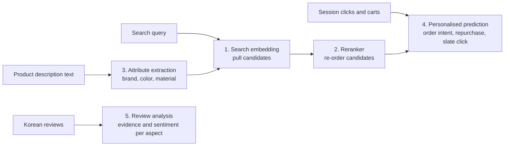

This post is for developers and data teams who want to add AI features to an online shop. Shop AI is not one model. Finding products, ordering them, tidying product data, predicting what a shopper does next and reading reviews are each a different model's job.

ThakiCloud has published eight models that cover these five slots in public repositories. All were trained on public data, and each model card reports a comparison against a strong baseline on the same data. This post ties the eight together into one flow and explains where each one plugs in. Every number here is taken from the model cards.

## In plain terms

Think of a neighbourhood bookshop. Say a customer asks for "a short novel for a rainy day." The clerk first pulls an armful of likely books off the shelves. Then, turning the request over again, the clerk puts the best match on top.

To recommend a book, details such as format, publisher and page count need to be in order. An experienced clerk also has a rough sense of whether this customer will head to the till today or come back next week. Finally, the clerk reads the reader notes tucked into each book and mentions, "People say the ending is a letdown."

The eight commerce models split this clerk's job. Pulling books off the shelf, ordering them, copying down book details, sizing up the customer and reading the note cards are each one model. Instead of one person doing everything, each slot gets a model that is good at it.

## Where the eight models sit



The flow has five slots. The search embedding pulls candidates out of tens of thousands of products, and the reranker re-orders them. The attribute model reads product descriptions and pulls out fields such as brand or color for search and filters. Three prediction models score sessions for the chance of an order, a repurchase or a click. The review model finds aspect evidence spans and sentiment in Korean reviews.

| Slot | Repository | Training data | Language | Result vs comparison baseline |
|---|---|---|---|---|
| Search | [Commerce-Search-EmbeddingGemma-2](https://huggingface.co/ThakiCloud/Commerce-Search-EmbeddingGemma-2) | Amazon ESCI | English | pool nDCG@10 0.6045 → 0.6256 |
| Order | [Commerce-Rerank-Qwen3-8B](https://huggingface.co/ThakiCloud/Commerce-Rerank-Qwen3-8B) | Marqo-GS-10M | English | nDCG@10 0.6089 → 0.6968 |
| Order | [Commerce-Rerank-Qwen3-8B-LoRA](https://huggingface.co/ThakiCloud/Commerce-Rerank-Qwen3-8B-LoRA) | Same as above | English | Reproduction adapter for the model above |
| Attributes | [Commerce-Attribute-Qwen3.5-4B](https://huggingface.co/ThakiCloud/Commerce-Attribute-Qwen3.5-4B) | Amazon Berkeley Objects | English | F1 0.640 → 0.928 |
| Prediction | [Commerce-OrderIntent-OTTO-LGBM](https://huggingface.co/ThakiCloud/Commerce-OrderIntent-OTTO-LGBM) | OTTO sessions | Language-independent | PR-AUC 0.3601 → 0.4128 |
| Prediction | [Commerce-Repurchase-OTTO-LGBM](https://huggingface.co/ThakiCloud/Commerce-Repurchase-OTTO-LGBM) | OTTO sessions | Language-independent | AUC 0.6243 → 0.6861 |
| Prediction | [Commerce-Slate-Click-FINN-LGBM](https://huggingface.co/ThakiCloud/Commerce-Slate-Click-FINN-LGBM) | FINN.no Slate | Language-independent | MRR 0.4421 → 0.4630 |
| Reviews | [Commerce-Review-KO-RoBERTa-Large](https://huggingface.co/ThakiCloud/Commerce-Review-KO-RoBERTa-Large) | AI-Hub aspect-based sentiment | Korean | Joint F1 0.6820 → 0.8267 |

All eight repositories are grouped in the [Commerce FM collection](https://huggingface.co/collections/ThakiCloud/commerce-fm-korean-shopping-mall-models-6ad32c59e6f5788209ce7770). The baseline in each row is the strongest comparison that card reports. The metric differs from model to model, so do not compare numbers across rows.


*Each panel uses its own metric. Hatched bars are baselines, blue bars are the released models. Values are copied from each model card.*

## 1. Pulling from the shelf: product search embedding

Commerce-Search-EmbeddingGemma-2 is an embedding model that places English queries and product text in the same 768-dimensional space. Only the text part of [EmbeddingGemma 2](/tech-blog/en/owm/embeddinggemma-2-multimodal-embedding/) was fine-tuned, on the Amazon ESCI training split. The image and audio parts are byte-identical to the original.

It was measured with 2,073 queries against one index holding all 40,397 products of the ESCI dev split. Full-index nDCG@10 rose from 0.60 for the original to 0.63. The gain is 2.11pp, with a 95% confidence interval above zero. Under the same conditions Qwen3-Embedding-8B scored 0.57 and keyword search BM25 scored 0.46. With roughly 270 million text parameters, it beat an 8-billion-parameter model.

```python
from sentence_transformers import SentenceTransformer

model = SentenceTransformer("ThakiCloud/Commerce-Search-EmbeddingGemma-2")
model.max_seq_length = 1024
q = model.encode(["waterproof running shoes wide fit"], prompt_name="query", normalize_embeddings=True)
d = model.encode(["Trail Runner GTX. brand: Acme. color: black. Waterproof membrane, wide toe box"],
                 prompt_name="document", normalize_embeddings=True)
print(q @ d.T)
```

Always pass `prompt_name="query"` for queries and `prompt_name="document"` for products. Leaving them out lowers quality. The limits are clear. It was trained and evaluated in English only. Finding text from images actually got worse (down 5.4pp in R@1). If you need image search, use the original model.

To search product images with Korean queries, use a separate small query encoder. The K4 encoder described in [Running EmbeddingGemma 2 Small](/tech-blog/en/tutorials/eg2-edge-usage-guide/) fills that slot.

## 2. Re-ordering: the reranker

The armful of books pulled from the shelf is roughly sorted at best. Commerce-Rerank-Qwen3-8B takes one query and a list of candidate product titles and scores each candidate. It is Qwen3-Reranker-8B trained with LoRA on the Marqo-GS-10M shopping ranking data and then merged into bf16 weights.

On a sealed test of 19,647 queries never seen in training, opened once, nDCG@10 rose from 0.61 to 0.70. The gain is +8.79pp, with a 95% confidence interval of +8.60 to +8.98pp. On the dev split, all three seeds beat the five public reranker settings that were compared.

```python
from huggingface_hub import hf_hub_download
import importlib.util

p = hf_hub_download("ThakiCloud/Commerce-Rerank-Qwen3-8B", "inference.py")
spec = importlib.util.spec_from_file_location("inference", p)
mod = importlib.util.module_from_spec(spec); spec.loader.exec_module(mod)

rr = mod.CommerceReranker("ThakiCloud/Commerce-Rerank-Qwen3-8B")
rr.rerank("waterproof trail running shoes men", [
    "Men's Gore-Tex Trail Running Shoe, Waterproof",
    "Women's Road Running Shoe, Breathable Mesh",
    "Shoe Waterproofing Spray 300ml",
], top_k=3)
```

Scores order candidates within one query; they are not probabilities. On one B200, scoring about 50 candidates per call took 145ms per query. Mind the training target. The model learned Google Shopping's display order, not human relevance labels. It can therefore inherit whatever that order rewards, including popularity or ads. It sees product titles only and was checked in English only.

[Commerce-Rerank-Qwen3-8B-LoRA](https://huggingface.co/ThakiCloud/Commerce-Rerank-Qwen3-8B-LoRA) is the adapter before merging. Use it to reproduce training or to load the model as an adapter. The median cosine between the merged weights minus the base and the adapter deltas was close to 0.99. The published numbers were measured on the merged model, though, and the adapter path was not evaluated separately.

## 3. Copying down the details: attribute extraction

Search and filters only work when product data is in order. Commerce-Attribute-Qwen3.5-4B is a LoRA adapter for Qwen3.5-4B. It reads English product text and extracts nine attributes: brand, color, material, style, model name, pattern, item shape, fabric type and finish type.

Its rule is to copy. Every value must be copied verbatim from the text, and `null` comes back when the text does not state it. 99.99% of returned values were substrings of the input, and each value comes with its position in the text.

On a test of 7,916 Amazon Berkeley Objects listings, F1 was 0.93. A baseline that finds the longest match from a dictionary of training values scored 0.64. The original model with the same prompt scored 0.47. The rate of inventing absent values was 3.4%, below 18.1% for the dictionary baseline and 23.7% for the original.

```python
from huggingface_hub import snapshot_download
import sys

path = snapshot_download("ThakiCloud/Commerce-Attribute-Qwen3.5-4B")
sys.path.insert(0, path)
from inference import CommerceAttributeExtractor

x = CommerceAttributeExtractor(adapter=path)
text = "Trail Runner GTX Men's Running Shoe, Black, Waterproof Mesh Upper | Wide toe box"
out = x.extract(text, attrs=["brand", "color", "material", "style"], category="shoes")
```

The card states the limits plainly. About 71% of test items are phone-case listings. Without them, F1 is 0.90 against 0.67 for the baseline. These are same-distribution results, checked in English only. By design, it does not infer things such as a color from an image.

## 4. Sizing up the customer: order intent, repurchase and slate click

Three models share the clerk's instinct. All three are LightGBM models trained on CPU. They do not propose new architectures; they are reference models that put hand-built features on a proven algorithm.

**Commerce-OrderIntent-OTTO-LGBM** looks at the first 3 to 10 events of a session and gives the probability of an order within 24 hours. It was trained on session data from OTTO, a German online retailer. On a sealed test of 1,089,902 sessions, PR-AUC was 0.41. Logistic regression on the same features scored 0.36, and a constant baseline using the positive rate scored 0.11. On the dev split, none of the three neural model types trained alongside it beat it.

```python
import sys
from huggingface_hub import snapshot_download

path = snapshot_download("ThakiCloud/Commerce-OrderIntent-OTTO-LGBM")
sys.path.insert(0, path)
from inference import OrderIntentModel

m = OrderIntentModel(path)
t = 1_661_100_000
sessions = [{"session": 1, "events": [
    {"aid": 1460571, "ts": t, "type": "clicks"},
    {"aid": 1460571, "ts": t + 40, "type": "carts"},
    {"aid": 108125, "ts": t + 300, "type": "clicks"},
]}]
print(m.predict_sessions(sessions))
```

**Commerce-Repurchase-OTTO-LGBM** gives the probability that a session which has already ordered once orders again within 7 days. It uses 14 purchase-history features and 15 browsing-behaviour features. Pooled over three cutoff days, AUC was 0.69, above 0.62 for the classic repurchase models BG/NBD and Pareto/NBD. It beat BG/NBD in all nine cells of 3 cutoffs by 3 seeds.

Use this model for ranking. BG/NBD has better probability calibration (calibration error 0.03 vs 0.01). The gain comes from the browsing features. With purchase-history features alone, it was about equal to or slightly below BG/NBD.

**Commerce-Slate-Click-FINN-LGBM** ranks the items shown on one screen by what the user will click. It is a learning-to-rank model trained on data from FINN.no, a Norwegian online marketplace. On 19,922 held-out users, MRR was 0.46, about 2.1pp above ranking by click-through rate (0.44). It fills the reward-model slot of a slate bandit. The data logs no display propensities, so it does not estimate the value of a new recommendation policy.

All three share one caveat. Item statistics are tied to OTTO or FINN.no item ids. Feed ids from another shop and those features switch to their "never seen" values. Accuracy in that case was not measured. Treat them as a tested feature recipe, not drop-in models. The right use is to rebuild the item statistics from your own logs and retrain. We make no claim that they fit Korean shops.

## 5. Reading the note cards: Korean review analysis

Of the eight models, only Commerce-Review-KO-RoBERTa-Large works on Korean directly. For each review it points to evidence spans copied verbatim from the text and labels them with one of 112 aspect categories and a positive, negative or neutral sentiment. Categories include price, size, durability and scent. Because outputs always point to positions in the review, a downstream answer can show the evidence sentence instead of a paraphrase.

All of `klue/roberta-large` was fine-tuned on the AI-Hub aspect-based sentiment dataset. It was compared with a 27B instruction model used zero-shot on a sealed test of 18,858 reviews, split so that no product overlaps. Joint F1 rose from 0.68 to 0.83. The rate of unsupported claims fell from 9.1% to 6.1%. This model scored higher on every metric measured.

```python
from huggingface_hub import hf_hub_download
import importlib.util

p = hf_hub_download("ThakiCloud/Commerce-Review-KO-RoBERTa-Large", "inference.py")
spec = importlib.util.spec_from_file_location("inference", p)
mod = importlib.util.module_from_spec(spec); spec.loader.exec_module(mod)

m = mod.ReviewABSA("ThakiCloud/Commerce-Review-KO-RoBERTa-Large")
m.predict(["배송은 빨랐는데 사이즈가 생각보다 작아요"], ["여성의류"])
```

The standard `token-classification` pipeline does not decode the output correctly. Use the repository's `inference.py`. The second argument is the product's main category, and the 20 accepted values are listed in `meta.json`. The example input is a Korean review ("Shipping was fast, but the size runs smaller than expected") with the main category "women's clothing."

Much of the gain comes from learning this corpus's span-boundary and category conventions. A zero-shot model cannot know those rules. So we do not claim the same gap on reviews from other shops or other annotation schemes. Implicit aspects with no span in the text are not extracted either. The license is CC BY-SA 4.0, so models built from these weights must be released under the same terms.

## Where to use them

The most natural fit is English product search. A two-stage setup works right away: the search embedding pulls candidates and the reranker re-orders the top of the list. If the catalog has sparse descriptions, attribute extraction can first fill in fields for filters.

The three prediction models are best used as starting points. Take the feature definitions and code published on the cards and retrain them on your own shop's logs. Order intent maps to cart-abandonment responses, repurchase to ranking returning customers, and slate click to ordering recommendation lists.

The Korean review model fits review summaries or support answers that must show their evidence. When saying "many reviews say the size runs small," it lets you show the actual review sentences alongside.

From the point of view of Paxis, the work automation platform ThakiCloud builds, these models are parts for commerce work steps. One can picture small dedicated models taking repeated steps such as tidying product data, checking review evidence and picking target customers. These models are not integrated into any product yet, however. For now they are open research results and reproducible starting points.

## Shared limitations

First, language. Search, reranking and attribute extraction were trained and evaluated on English data only. How well they fit Korean shops was not measured. The review model is the only one that handles Korean directly.

Second, data distribution. Most results are wins over baselines on a test from the same distribution. There is no evidence that the same gap holds on other catalogs, annotation schemes or countries. The prediction models in particular have item ids tied to their datasets.

Finally, the scope of comparison. Each card compares against public baselines or simple baselines on the same data. None was compared with models fine-tuned by other teams or with commercial APIs. So we make no state-of-the-art claim.

## Wrapping up

It is hard for one bookshop clerk to do every job well. Give separate people the shelves, the ordering, the note-taking, the customer reading and the note cards, and each gets a standard you can check. The eight models released here fill those five slots, each with a result that beat its baseline. How far each slot has been checked is written on the model cards, nothing hidden.

*Source: ThakiCloud's own measurements as published on each Hugging Face model card.*
