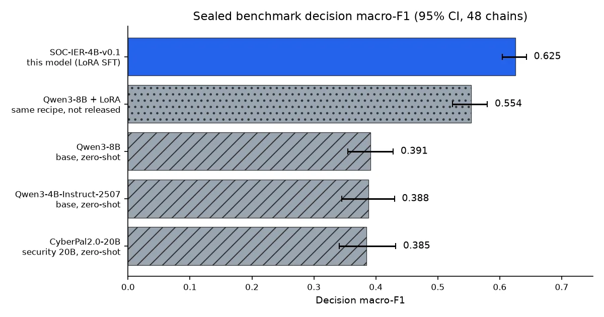
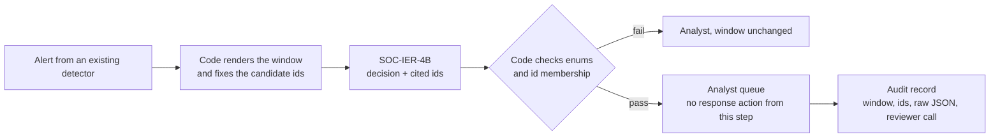

This post is for security operations analysts and the people who run detection systems. The small model we are releasing answers one question. Does the short stretch of records in front of you actually contain evidence of an attack?

The model receives a record of what happened on a server over a few dozen seconds, along with a numbered list. It returns a decision together with the numbers of the records it used as evidence. The prompt only allows citing numbers from the list, and on the sealed benchmark no model, tuned or untuned, cited a number outside it. ThakiCloud is releasing it for research. It is not a model for automatic blocking. It is a model that sits next to an analyst and points at the evidence.

## In plain terms

Think of going through a credit card statement to find fraudulent charges. Every line on the statement has a number. To report fraud to the card company, you point at lines by number: "this one and this one look wrong." You cannot report a charge that is not on the statement.

You also should not call fraud on a single ordinary line. One purchase at the corner store is just groceries. A run of overseas online purchases at 3 a.m., though, is exactly the evidence you need. And sometimes there are lines where you honestly cannot tell either way.

This model has practiced only this kind of statement reading. One statement is one telemetry window. A line number is an event ID. The model picks one of "evidence present", "ordinary activity" or "cannot tell", and writes down only the line numbers that support its answer.

## What the model is

The model is called SOC-IER-4B-v0.1. Its input is host events such as process executions, DNS, HTTP and network flows. Each event carries a number of the form `[ev_...]`. The output is a single JSON object holding an incident category, a list of supporting event numbers, a decision and a short rationale of at most 60 words.

There are three decisions: `SUPPORTED`, `INSUFFICIENT` and `UNKNOWN`. Incident categories are seven types, such as credential compromise, data exfiltration and container compromise, plus `none`. Take a window where a customer database is packed with tar, an unfamiliar domain is looked up, and curl uploads the bundle. The model learned to answer that those three lines are evidence of data exfiltration.

The base model is Qwen3-4B-Instruct-2507. We applied LoRA SFT with thinking mode disabled. The license is Apache-2.0. Prompts were trained and evaluated in English only.

## What it learned from

The training set has 603 examples. 483 come from an in-house cyber range, a test environment we built ourselves that contains no customer or production data. The remaining 120 are auxiliary windows rebuilt from the public dataset witfoo/precinct6-cybersecurity.

No human labeled the answers. The range's attack script knows what it did and when, so the decisions and evidence numbers come from that record. Each attack window is paired with an ordinary window from the same host. In statement terms, the model learned by looking at a month with fraud next to a normal month.

Training took about 14 minutes on one H100 NVL. The recipe follows the one published on the CyberSecQwen-4B model card, with epochs cut from 10 to 3 because the dataset is small.

## Sealed benchmark results

The evaluation set was opened only once, after model selection was finished. It holds 48 independent incident chains and 239 windows. The chains come from an attack family absent from training. Every model was measured with the same prompts, the same parser and the same decoding.

The baselines are the untuned base model (Qwen3-4B-Instruct-2507), Qwen3-8B, the same 8B trained with the same recipe (internal, not released) and the security-specialised CyberPal2.0-20B. Every untuned model ran zero-shot on the same inputs.


*Sealed-benchmark decision macro-F1 with 95% confidence intervals. Values are copied as-is from the model card.*

| Model | Setting | Decision macro-F1 [95% CI] | Decision acc | Evidence recall | Evidence precision | False-SUPPORTED | Incident miss | Phantom ids |
|---|---|---|---|---|---|---|---|---|
| **SOC-IER-4B-v0.1** | LoRA SFT | **0.625** [0.604, 0.643] | 0.916 | 0.895 | 0.929 | 0.064 | 0.061 | 0 |
| Qwen3-4B-Instruct-2507 | base, zero-shot | 0.388 [0.345, 0.430] | 0.603 | 0.532 | 0.615 | 0.688 | 0.070 | 0 |
| Qwen3-8B + LoRA (not released) | same recipe | 0.554 [0.524, 0.580] | 0.812 | 0.706 | 0.743 | 0.088 | 0.219 | 0 |
| Qwen3-8B | base, zero-shot | 0.391 [0.355, 0.428] | 0.573 | 0.263 | 0.347 | 0.352 | 0.447 | 0 |
| CyberPal2.0-20B | base, zero-shot | 0.385 [0.341, 0.432] | 0.565 | 0.565 | 0.641 | 0.336 | 0.465 | 0 |

The result holds for this task and this benchmark only. The section after next spells out what the comparison does not say.

## What training changed, and what it did not

Compared with its own base, training changed three things. False alarms fell the most. The base 4B model called 68.8% of ordinary windows attack evidence, and after training that fell to 6.4%. Pointing at evidence improved as well. Evidence recall rose from 0.532 to 0.895, and evidence precision from 0.615 to 0.929. Decision accuracy went from 0.603 to 0.916.

Incident miss barely moved, from 0.070 to 0.061. That gap is about the size the card says cannot be interpreted. So the gain is not catching more attacks. It is no longer calling ordinary activity an attack, while citing the right lines.

The phantom-id column is 0 for every row, including the untuned models. Citing only listed numbers is therefore a property of the prompt contract on this benchmark, not something training added. It still matters in practice, because the schema used in evaluation deliberately left evidence ids unconstrained.

Decision macro-F1 averages the F1 of the three decisions. As explained below, no model ever got `UNKNOWN` right. That puts the practical ceiling of this metric near 2/3, and 0.625 should be read with that in mind.

The development set points the same way. On 12 chains and 70 windows from the training capture, with chains kept apart from training, the model scored 0.618 [0.590, 0.648], against 0.387 for the base and 0.422 for CyberPal2.0-20B. So the gain is not an artefact of a single split.

It also stands out that the 4B beat the 8B trained with the same recipe. The 8B missed 21.9% of attack windows, while the 4B missed only 6.1%. This is the result of one experiment, though, and we did not analyse why.

## What this comparison does not say

CyberPal2.0-20B is a security-specialised 20B model. We ran it zero-shot, on our output format, over telemetry windows it was never trained for. The table does not say that CyberPal2.0-20B is a weak security model. In fact its false-alarm rate of 33.6% is about half that of the base Qwen models.

What the table says is narrower. With only 603 task examples, a 4B model moved out of the band shared by the untuned models (0.385 to 0.391), and the confidence intervals do not overlap. We want to be clear that the result holds for this task and this benchmark only.

## Why the merged weights can be trusted

Merging a LoRA into 16-bit weights can quietly change the model, because the change a LoRA adds is small relative to 16-bit resolution. So we compared the merged model with the original base plus adapter on the same 309 windows. The seven pass criteria were fixed before any result was seen.

The first merge, saved in bf16, failed. Its incident-category agreement was 94.8%, just short of the 95% threshold. That merge is not published. The second was merged in fp32 and cast to fp16 once before saving. It passed all seven criteria.

Under greedy decoding the fp16 merge matched the adapter's decision on all 309 windows. Incident-category agreement was 98.1% and evidence-set agreement 99.7%. Its sealed three-run majority result was identical to the adapter's. That is why the numbers measured with the adapter are reported as the merged model's numbers. Reading the fp16 weights as bf16 can bring back the loss seen in the first merge, so we recommend leaving `dtype="auto"`.

The merged weights are still not bit-identical to base plus adapter. If you re-quantize or re-cast them, measure again instead of assuming these numbers carry over.

## Running it yourself

The model expects exactly the system prompt and input rendering used in training. The user turn is a header line, one `[id] key=value …` line per event, the candidate id list and a closing sentence. If the format changes, the decision values and the number-citing rule can drift. The commands below come from the model cards and the repository's `inference_example.py`, pinned to the revisions published on 2026-11-01.

| Repository | Revision (main, 2026-11-01) |
|---|---|
| ThakiCloud/SOC-IER-4B-v0.1 | `9593f0cc3567e59d5dcd03d8656f5bbcb2acb232` |
| ThakiCloud/SOC-IER-4B-v0.1-LoRA | `64d28306809312d67d983c42617daeda74341197` |
| Qwen/Qwen3-4B-Instruct-2507 (base for the adapter) | `cdbee75f17c01a7cc42f958dc650907174af0554` |

The quickest check is the example script. It holds the verbatim system prompt and a synthetic window, runs the model with the evaluation decoding and prints whether the answer keeps the contract.

```bash
pip install "transformers>=4.51" torch peft    # peft is needed only for --lora
hf download ThakiCloud/SOC-IER-4B-v0.1 inference_example.py \
  --revision 9593f0cc3567e59d5dcd03d8656f5bbcb2acb232 --local-dir soc-ier
python soc-ier/inference_example.py --merged   # merged fp16 weights, no PEFT at runtime
python soc-ier/inference_example.py --lora     # pinned base + adapter, the configuration the numbers were measured in
```

The last line of output is `contract: OK`, or the list of problems found. The check covers the schema keys, the enum values and any evidence id outside the candidate list.

Evaluation used vLLM structured output. The block below reuses the prompt and example window from the same script, so it runs as is. The schema pins the decision and incident category values but deliberately leaves evidence ids open, which is what makes phantom ids measurable.

```python
# pip install vllm==0.28.0   (the version the card's numbers were measured with)
import importlib.util, json
from huggingface_hub import hf_hub_download
from vllm import LLM, SamplingParams
from vllm.sampling_params import StructuredOutputsParams

REV = "9593f0cc3567e59d5dcd03d8656f5bbcb2acb232"
path = hf_hub_download("ThakiCloud/SOC-IER-4B-v0.1", "inference_example.py", revision=REV)
spec = importlib.util.spec_from_file_location("soc_ier_example", path)
ex = importlib.util.module_from_spec(spec); spec.loader.exec_module(ex)   # defines SYSTEM_PROMPT, USER_PROMPT, check()
messages = [{"role": "system", "content": ex.SYSTEM_PROMPT}, {"role": "user", "content": ex.USER_PROMPT}]

SCHEMA = {"type": "object", "additionalProperties": False,
          "required": ["incident_category", "supporting_evidence_ids", "decision", "rationale"],
          "properties": {"incident_category": {"type": "string", "enum": ["credential_compromise", "data_exfiltration", "container_compromise",
                                                                           "service_account_abuse", "supply_chain_loader", "discovery_sweep",
                                                                           "network_block_correlation", "none"]},
                         "supporting_evidence_ids": {"type": "array", "items": {"type": "string", "maxLength": 24}, "maxItems": 16},
                         "decision": {"type": "string", "enum": ["SUPPORTED", "INSUFFICIENT", "UNKNOWN"]},
                         "rationale": {"type": "string", "maxLength": 480}}}

llm = LLM(model="ThakiCloud/SOC-IER-4B-v0.1", revision=REV, dtype="auto", max_model_len=8192)   # resolves to float16; do not force bfloat16
sp = SamplingParams(temperature=0.3, top_p=0.95, max_tokens=320, structured_outputs=StructuredOutputsParams(json=SCHEMA))
answer = json.loads(llm.chat([messages], sp)[0].outputs[0].text)
print(answer, "contract:", ex.check(answer) or "OK")
```

The schema cannot enforce the id rule, so your own code has to. For your own windows, check membership against the candidate list you rendered.

```python
def phantom_ids(answer, candidate_ids):
    allowed = set(candidate_ids)
    return [i for i in answer["supporting_evidence_ids"] if i not in allowed]
# a non-empty result means the answer must not be used; send the window to a person unchanged
```

Every number on the card comes from three sampled runs at temperature 0.3, top_p 0.95 and at most 320 tokens, with the majority vote taken on `decision`. Greedy decoding also works and was used for the merge check.

```python
from collections import Counter
runs = [json.loads(llm.chat([messages], sp)[0].outputs[0].text) for _ in range(3)]
decision = Counter(r["decision"] for r in runs).most_common(1)[0][0]
```

To reproduce the measured configuration exactly, use the adapter through vLLM's LoRA path in bf16. This is the adapter card's snippet, with the adapter revision pinned. It reuses `messages` and `sp` from above.

```python
from vllm.lora.request import LoRARequest
from huggingface_hub import snapshot_download

adapter = snapshot_download("ThakiCloud/SOC-IER-4B-v0.1-LoRA", revision="64d28306809312d67d983c42617daeda74341197")
llm = LLM(model="Qwen/Qwen3-4B-Instruct-2507", revision="cdbee75f17c01a7cc42f958dc650907174af0554", dtype="bfloat16",
          max_model_len=8192, enable_lora=True, max_lora_rank=64)
print(llm.chat([messages], sp, lora_request=LoRARequest("soc-ier", 1, adapter))[0].outputs[0].text)
```

The adapter repository also holds `train_report.json`, with the training configuration and loss curve, and the sha256 of the adapter file. Serve each artifact in the dtype it was measured in. That means fp16 (`dtype="auto"`) for the merged weights and bf16 for base plus adapter. Keep `max_model_len` at 8,192, the value the card evaluated with.

## What it cannot do yet

It never got `UNKNOWN` right. The F1 for that decision was 0 for this model and for every model we compared. The training data had only 9 examples of it. In statement terms, even on a line where it should say "I don't know", it picks either fraud or normal. In v0.1, treat `UNKNOWN` as an unsupported decision.

A 6.4% false-alarm rate is not small either. Roughly one ordinary window in sixteen gets called attack evidence. In a real SOC that becomes a cost paid in analyst time. That is why it is one of the two targets for the next version.

Please also keep in mind that evaluation happened inside the same range. Attack families differ between training and evaluation, but sensors, hosts and benign background activity do not. Whether it works on other EDR or eBPF schemas, or on real production traffic, has not been checked. One evaluation window is 0.4% of the set, so differences of a few points are hard to interpret.

The fact that labels come from the attack script is a limitation too. An analyst might reasonably judge individual windows differently. Evaluation covered windows of at most 16 candidate events, about 2 to 3 thousand tokens, with `max_model_len` 8,192. Longer windows were not tested.

## Where to use it

The first place is analyst assistance. If the model first points at which lines in an alerted window support the attack hypothesis, the analyst can check those lines first. The final call stays with a person.

The second is shadow evaluation. You attach it next to an existing detection pipeline and only record its decisions for comparison. How it behaves on production telemetry is not yet verified. We suggest doing that verification in exactly this setting.

We do not recommend uses such as automatic blocking or isolation that act on the model's output alone. The weights are public, and once downloaded they run on your own GPU with Transformers or vLLM, so inference needs no call to an external API.

## Paxis and Metis: what exists today and what is a design

What exists today is the two Hugging Face repositories above. SOC-IER-4B is not part of any ThakiCloud product yet. It is not shipped inside Paxis, our work automation platform, and it is not offered as a model on Metis, our inference platform.

What follows is a design, not a shipped feature. Paxis passes every execution step through policy gates and audit records. A model that points at evidence by number could become material for recording "why this action is being taken" in that kind of structure. A triage step built that way would look like this.



*Design illustration only. None of these steps is a Paxis feature today.*

On the serving side, the merged repository is the unit that would fit an inference platform such as Metis. It needs no adapter plumbing, keeps fp16 and should stay inside the evaluated envelope. A quantized variant would count as a new model that has to be measured again. For another case of a small model taking on routine work, see the [KoToolAct-4B release post](/tech-blog/en/owm/kotoolact-4b-korean-tool-execution/).

## What we released

| Repository | Format | Purpose |
|---|---|---|
| [ThakiCloud/SOC-IER-4B-v0.1](https://huggingface.co/ThakiCloud/SOC-IER-4B-v0.1) | merged fp16 | Run directly, for Transformers and vLLM. Includes `inference_example.py` and the Korean card [`MODEL_CARD.ko.md`](https://huggingface.co/ThakiCloud/SOC-IER-4B-v0.1/blob/main/MODEL_CARD.ko.md) |
| [ThakiCloud/SOC-IER-4B-v0.1-LoRA](https://huggingface.co/ThakiCloud/SOC-IER-4B-v0.1-LoRA) | PEFT adapter | Reproduction. Includes [`train_report.json`](https://huggingface.co/ThakiCloud/SOC-IER-4B-v0.1-LoRA/blob/main/train_report.json), the adapter sha256 on the card, `inference_example.py --lora` and a Korean card |

The training and evaluation data are not released. The range telemetry contains host names, addresses and scenarios from our own test environment. The auxiliary windows derived from WitFoo can be rebuilt from the public source.

Reading the whole statement and naming the culprit is still the analyst's job. This model only goes as far as telling you, by number, which lines to look at first. Your own code should still confirm that every cited number is on the list.

*Source: sealed-benchmark and development-set results published on the SOC-IER-4B-v0.1 model card, measured with vLLM 0.28.0 on the same inputs on one H100 NVL (the 20B comparison model on one H200 NVL). The fine-tuned model was measured as base plus adapter in bf16 through vLLM's LoRA path. The merged fp16 weights carry those numbers because they passed the merge equivalence check.*

## Update log

**2026-11-01**

- The id rule is no longer credited to training. The sealed table shows 0 phantom ids for every model, including the untuned baselines.
- Added the `Decision acc` and `Phantom ids` columns from the model card to the sealed table, a section on what training changed, and the development-set result.
- Unified the macro-F1 to the card's 0.625 (an earlier sentence rounded it to 0.63).
- Completed the run instructions: install, the example script, the full vLLM block with imports and schema, the adapter route through vLLM, an id-membership check and pinned revisions. Clarified that the majority vote is taken on `decision`.
- Removed the unsourced claim that the model is easy to run in an air-gapped network. Replaced it with what is true: inference with the downloaded weights needs no external API call.
- Separated what exists today from design ideas for Paxis and Metis, added a merge re-measure note and the `max_model_len` 8,192 limit, and stated that the published numbers were measured on base plus adapter.
