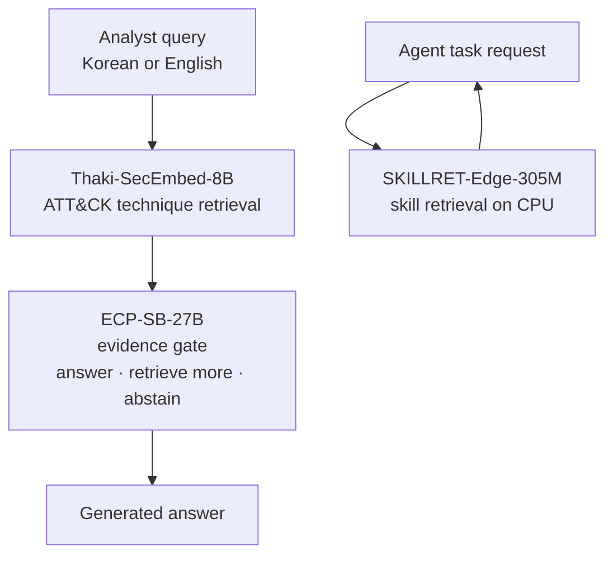

This post is for teams that have to search security documentation inside a closed network, stop a RAG system from answering without evidence, or pick an agent skill on a CPU box. The three models released here each take one of those jobs.

One thing first. Two of the three did not clear the bar we wrote down before training started. ThakiCloud did not delete that result. It sits at the top of each model card, and the model shipped anyway. Read the numbers below and decide for yourself whether to use them.

## The short version

A student's score depends on who writes the exam. Set the paper from the workbook used in class, and the students from that class do well. Have a teacher from another school write it, and the result is more honest.

Model evaluation works the same way. If the generator that produced the training queries also produces the test queries, a higher score is hard to read as a better model. So ThakiCloud writes the release bar down before training and does not move it after the results arrive. Of these three models, one cleared that bar and two did not.

## Where each model sits

The left branch is the path a security question travels. The embedding pulls the relevant documents, and the gate decides whether that evidence is enough to answer at all. The right branch is an agent choosing which of thousands of skills to run, and it needs no GPU.

## One adapter, two verdicts

Thaki-SecEmbed-8B-Preview is a LoRA adapter on Qwen3-Embedding-8B that retrieves MITRE ATT&CK technique documentation. Training used public data only, the ATT&CK STIX corpus.

The release decision rests on the left pair. On a 583-query preregistered held-out set, nDCG@10 was 0.686 against the base model's 0.670, but the confidence interval included zero. The verdict was no clear difference, and we claim no improvement. Three independently trained seeds landed between 0.676 and 0.705, a spread about as wide as the released adapter's distance from its base. That is why the claim was dropped.

The right pair was measured after release. Blind-B is a 2,025-query benchmark whose queries were written by teacher models other than the one used in training, and whose answers are decided in code by ATT&CK STIX relations. There the gap was 0.694 against 0.550, with a confidence interval far from zero. The two readings are not a contradiction but two sides of one story. Questions written by the training generator did not separate the models. Questions written independently did. Since this run came after the release decision, it does not overturn the preregistered verdict.

There is a cost as well. General retrieval was checked on four public sets, and FiQA-2018, a financial question-answering set, fell from 0.650 to 0.610. That is short of the 10% catastrophic threshold we preregistered, but it is a statistically clear drop. For financial documents, prefer the base model.

## We wrote down that the gate is not a safety control

ECP-SB-27B-Research is a package that loads Qwen3.8-27B once on a single H200 and serves two APIs from it. One is ordinary generation. The other is an evidence gate that decides, after retrieval and before generation, whether to answer, retrieve more, or abstain. The base weights are not copied here. The repository holds four seeds of LoRA weights, the action and sufficiency heads, and each seed's sealed threshold.

The deployment check passed. Measured against unmodified vLLM serving the same base model under identical flags, generation-only traffic stayed inside the bound, and 256 gate decisions under mixed traffic matched the offline reference exactly. The p99 logprob criterion, though, passed by a margin of 0.00000286. A pass is a pass, but there was no room in it, which is why the card does not claim that generation under mixed traffic is identical to the base model. Six of 64 prompts differed, and the cause was not attributed.

The bar that was missed is a different one. The pooled unsupported-answer rate was 6.5% where the target was 5%, and it ranged from 0.047 to 0.093 across seeds. So the card says not to use this gate as a safety control. It is a research deployment, not a production certification.

| Check | Result |
|---|---|
| Base weights loaded once, single GPU process | Pass |
| Generation API and gate API both answer | Pass |
| Gate decisions under mixed traffic, 256 items | Pass, 0 changed |
| Generation under mixed traffic identical to base | Not shown, 6 of 64 differ |
| Production safety | Not certified, 6.5% against a 5% target |

## The one that passed runs on CPU

SKILLRET-Edge-Arctic-305M is a 305M embedding model that retrieves agent skills. It is distilled from an 8B teacher and runs on CPU as ONNX FP32. The preregistered gate asked it to hold English quality while raising Korean, and it cleared both. On the public test split, English nDCG@10 was 1.07 points above the 0.6B reference, and Korean was 11.99 points above the low-bit comparator.

What decides where you can put it is latency and memory rather than quality.

| Host | Threads | This model, ORT FP32 p50 | Peak RSS | 0.6B Q4_1 on llama-server p50 | Peak RSS |
|---|---|---|---|---|---|
| AMD EPYC 9355 | 1 | 133.8 ms | 2.0 GB | 1,973 ms | 3.58 GB |
| AMD EPYC 9355 | 4 | 47.7 ms | 2.1 GB | 582 ms | 3.58 GB |
| Apple M4 Pro | 1 | 36.0 ms | 3.0 GB | 2,073 ms | 3.58 GB |

This table compares two serving configurations, not two sets of weights. The right-hand side is an HTTP server holding 16 slots, so most of that memory is KV and compute buffers. It does not show that the quantization method is slow. Also, there is no INT8 build. Dynamic INT8 and static QDQ INT8 both failed the quality gate, so only FP32 ships. The ONNX file is 1.23 GB, which makes this a fast CPU retrieval model rather than a phone-sized one.

## What to know before serving

SecEmbed is an adapter, so it loads alongside the base model, and the primary dimension is 4096. Truncated dimensions were not trained with MRL, so measure them yourself before relying on them. ECP-SB was verified on vLLM 0.28.0 only. The 0.31 port is planned and unverified, and the gate branch runs for every scheduled token, so it is not free. SKILLRET-Edge is the simplest of the three. Prefix queries with `query: `, call it through ONNX Runtime, and read the output, which the graph has already L2-normalized.

All three are Apache-2.0, and every external dataset used in training carries a public licence. That is what makes them droppable into a closed network as they are.

## Why publish the misses

The first question security and finance customers ask is not how good the number is but who measured it and how. Publishing only the passes leaves that question unanswered. Writing the bar first and refusing to move it afterwards buys fewer bragging lines, and the numbers last longer.

Paxis, ThakiCloud's work-automation platform, runs every agent action through a policy gate and an audit log. A judgment that stops when evidence is thin belongs at the front of that structure, and a skill retriever belongs where thousands of skills are narrowed to the one to run now. None of these three models ships inside a product yet. The third one answering in 47.7ms on CPU matters most for on-premises and air-gapped deployments, where the skill-selection step can run without a single GPU.

## What gets measured next

For ECP-SB, the vLLM 0.31 port comes with reusing the forward pass so a shared prefix is not computed twice. The unsupported-answer rate will be measured again in a separate independent evaluation. A missed target gets a newer measurement, not an edited old one.

For SKILLRET-Edge, the next steps are multilingual coverage and smaller students. A 22M student compressed to 22.7MB in INT8 is the current target, and a post-training quantization comparison across four embedder families is being written up as a paper.

SecEmbed stays a Preview. Blind-B has now been used once, so it serves as a regression benchmark rather than a blind set. The next verdict needs a new blind set, and reducing the FiQA regression is the homework before that.

## What was released

| Repository | Format | Status |
|---|---|---|
| [ThakiCloud/Thaki-SecEmbed-8B-Preview](https://huggingface.co/ThakiCloud/Thaki-SecEmbed-8B-Preview) | LoRA adapter | Preview, preregistered verdict is no clear difference |
| [ThakiCloud/ECP-SB-27B-Research](https://huggingface.co/ThakiCloud/ECP-SB-27B-Research) | Seed weights and manifest | Research deployment, not production certified |
| [ThakiCloud/SKILLRET-Edge-Arctic-305M](https://huggingface.co/ThakiCloud/SKILLRET-Edge-Arctic-305M) | ONNX FP32 and PyTorch | Passed its preregistered gates |

Write the evaluation down first and read the result second, and good news and bad news end up weighing the same. What this release was meant to protect is that order, not the three scores.

*Measurement sources: the evaluation tables published in each model's Hugging Face card. The ECP-SB deployment check ran on one H200-NVL with vLLM 0.28.0, and the SKILLRET-Edge CPU numbers were measured on an AMD EPYC 9355 and an Apple M4 Pro.*
