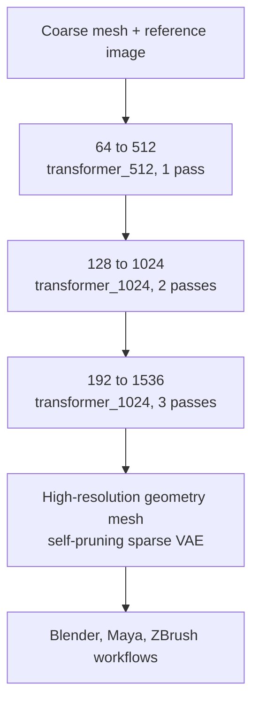

## Why read this

If your team runs a 3D asset pipeline, or you are the platform engineer serving image-to-3D workloads, this post is for you. The conclusion first: Hi3D V1.0 (formerly Sparc3D) is an open-source image-to-3D geometry refinement model that leads with production validation, and its 2-million-asset training set plus the technical report's 90 percent 3D-print slicing pass rate make it one of the strongest open numbers in this category. It is geometry-only, it requires an NVIDIA GPU, and the release carries no benchmark splits or training code. Judge the numbers below before deciding to use it.

## Overview

Hi3D published V1.0 as open source around October 27. The development name was Sparc3D, and the product name settled on Hi3D with the release. The stated purpose of the release covers research, development, and production. Inference code, weights, and documentation live in `hi3d-official/Hi3Dv1.0` on GitHub, weights are downloadable from `hi3d-official/Hi3Dv1.0` on Hugging Face, and an online demo runs on Hugging Face Spaces (`ilcve21/Sparc3D`).

To place Hi3D on the map of 3D generation models: models that produce full 3D from text, models that produce point clouds or meshes from images, and models that refine already-existing coarse geometry to high resolution are different jobs. Hi3D V1.0 specializes in the third job, geometry refinement. Workflows without a coarse mesh have an `image_to_mesh` path, but the strength is the refinement stage where a reference image and existing geometry come in together.

The model already has a history of commercial use. With Hi3D V3.0 running as a paid service, V1.0 came down to open source as the "production-validated" version. Per the announcement, V1.0 was validated in real production workflows against multi-view quality, local details, and geometric usability, and the training dataset grew from 500,000 assets in the original Sparc3D setup to approximately two million 3D assets, with additional training data at 1536 sparse-grid resolution.

The technical report states that 90 percent of generated 3D models pass 3D-print slicing. The public repository contains no splits or comparison meshes for that slicing validation. The fact that this is an inference-validation-only release is addressed again in the limitations section.

## What Hi3D is

Hi3D V1.0's job is geometry refinement. It takes a coarse mesh and a reference image and produces high-resolution geometry. It is not the "text-to-3D" family that creates a whole object from a photo; it is one stage of an "image-to-3D refinement" pipeline that refines existing geometry together with a reference image. The repository ships two demos: `image_to_mesh.py` (mesh from image) and `refine_mesh.py` (mesh refinement).

The input contract is specific. A coarse mesh and a reference image come in as a pair, and the reference image is the evidence that decides what surfaces and details the mesh should have. The output mesh is normalized to a unit maximum radius and does not preserve the input's absolute size, so if you want assets matched to real-world scale, a scale conversion stage has to be added to the pipeline. Batch size is 1, and parallel batch inference is not supported by the structure.

The structure is based on a self-pruning sparse VAE. The answer to why sparse is volume arithmetic. A dense 1536 grid would have to process more than 3.6 billion voxels, and the region the object actually occupies is a tiny fraction of that. The sparse VAE prunes the empty voxels itself (self-pruning) and spends compute and memory only on the region actually in use. Refinement proceeds in stages.



The default support grid splits into three stages. It climbs from 64 to 512, 128 to 1024, and 192 to 1536, with 1, 2, and 3 refinement passes applied respectively. The 1536 stage is computed on a sparse extraction grid, not a dense tensor. If the input is too coarse, it can adapt to a coarser support grid, and it returns an error if the target resolution is not met.

The output is geometry only. No textures, materials, or vertex colors. The output mesh is normalized to a unit maximum radius, so the input's absolute size and scale are not preserved. These two points mean a separate stage must be prepared when placing it in a pipeline.

## License and commercial terms

The license splits into two layers. The Hi3D-owned and approved portions are governed by the "Hi3D Open License Agreement Version 1.0," and the original and third-party portions keep the existing Apache-2.0 and MIT terms.

Commercial use is permitted under the agreement. Two conditions attach. If monthly active users exceed 200,000 or monthly revenue exceeds USD 1,000,000, notice must be given within 60 days. Integrated products must carry a "Powered by Hi3D 1.0" label. For an open-source model it is unusually concrete commercial contract structure, and you should confirm these conditions fit your company policy before adopting.

## Local deployment and usage

The system requirements are the most practical constraint of this model.

| Item | Requirement |
|---|---|
| OS | Linux |
| Python | 3.10 |
| GPU | NVIDIA, compute capability 8.0 or newer |
| CUDA | 12.0 to 12.5 |
| CPU inference | no path |

The measured stack is Python 3.10.12, PyTorch 2.5.0+cu124, CUDA toolkit 12.4.131, and a 96GB NVIDIA H20. The 1536 stage was validated only on that GPU, and peak memory on smaller cards is not confirmed. H20-class is the safe baseline: compute capability 8.0 or newer runs, but you must measure the memory headroom yourself.

The install commands are written as-is in the repository documentation.

```bash
git clone https://github.com/hi3d-official/Hi3Dv1.0.git
pip install torch==2.5.0+cu124
pip install packaging ninja psutil
pip install --no-build-isolation flash-attn==2.7.4.post1
pip install -c docker/constraints.txt
```

The last line pulls the dependency constraint file from the repository's docker path and uses it as-is, which is a signal that a path for building and distributing container images is documented. It is aligned with the path of running it as a container on K8s or Docker-based platforms.

The demo runs are two commands.

```bash
python demo/refine_mesh.py
python demo/image_to_mesh.py
```

The Python interface opens the pipeline with `Sparc3DPipeline.from_pretrained`, turns on memory offloading with `enable_sequential_cpu_offload`, and drives refinement with `progress_callback` and `refine_voxels`. Sequential CPU offloading moves layers to the GPU one at a time and sends them back after compute, the standard technique for bypassing memory headroom problems on cards that cannot hold the whole model. The docs also state that flash-attn is required with no fallback attention path, so environments where the attention kernel cannot build may be blocked at install.

## Validation status and benchmarks

The public validation splits into two layers.

The first is production validation. V1.0 already has a history of use in Hi3D's real production workflows, and the announcement states it was validated against multi-view quality, local details, and geometric usability. It is the structure of "what is being open-sourced is the version used in production." Unpacking the three criteria: does the appearance from multiple angles contradict itself (multi-view quality), do the fine surface forms match the reference image (local details), can downstream tools process that mesh (geometric usability). In 3D generation model evaluation, measuring these three instead of the quality of one screenshot is a method that comes from the premise that the output enters a domain workflow.

The second is the technical report's slicing pass rate. 90 percent of generated models pass 3D-print slicing. Passing slicing means the output mesh is geometry the print pipeline can actually process: near-watertight surfaces, volumes that do not self-intersect, triangle meshes at a resolution the slicer accepts. It is a "manufacturability" signal different from visual quality metrics, and choosing 3D-print slicing as the validation criterion means the output geometry was processed in a real manufacturing pipeline, not just a form on a screen.

However, the public repository's scope is limited to inference validation. No training code, no evaluation harness, no benchmark splits, no comparison meshes. There is currently no public dataset to independently recheck the 90 percent number, so a self-validation set has to be built into the design before adoption.

The absence of training code carries another meaning. The path of fine-tuning the model on your own domain data is not public, and what you can use is the published inference pipeline as-is. If domain-specific assets are needed (a particular product line, a particular character style), validating with your own data first whether the open model's output quality meets the requirement comes before everything.

## ThakiCloud product implications

This model meets ThakiCloud products in two places.

First, Metis (K8s-based model serving) on-prem placement. The fact that this model's requirements drop cleanly into Linux, NVIDIA CC8.0+, and CUDA 12.x speaks the same language as Metis's GPU cluster serving structure. With the H20-validated stack as the baseline, lifting it as an inference job on Metis is the natural path, and the batch-size-1 property calls for a request-unit queue design. As the stage that puts geometry, not textures, first into the on-prem asset pipelines of game and commercial content teams, this model is one of the candidates with a production validation history to date.

Second, Paxis (the agent-native cloud) content workflows. Paxis treats tools and APIs as first-class resources, and the API and MCP paths Hi3D provides can become the channel for agents to enter the 3D asset generation stage. In scenarios where geometry generation becomes one stage of an agent workflow, how the license's commercial conditions (MAU and revenue-based notice) interlock with the scale of agent-based content production is a pre-adoption inspection item.

## Limitations and counterarguments

The headline "RIP to everyone who spent years learning 3D in Blender" is a marketing sentence. The job this model takes is geometry refinement, and a coarse mesh and a reference image must come first. It is different from creating an object whole from scratch.

The output limits are clear. Geometry-only means no textures, materials, or vertex colors. The unit maximum radius normalization erases the input scale, so assets matched to real-world size require a separate scale stage. Unseen surfaces are filled by "plausible completion," which means the model estimates and fills in. Structural errors can remain, GPU compute is not bit-level deterministic, and seeds are not mesh hashes.

The deployment constraints are strict too. No CPU inference path, flash-attn required, and 1536 validated only on the H20. A 96GB card as the baseline means GPU generation and memory must be computed before on-prem adoption.

The source of the numbers also needs addressing. The 90 percent slicing pass rate is on the technical report's authority, and the public repository has no splits for rechecking. The composition and quality-filtering criteria of the 2-million-asset training data are known only at the announcement level. A self-validation set is needed before the adoption decision.

The gap between the open and commercial versions should be considered as well. Hi3D V3.0 pushes geometry refinement to 2048 and handles textures up to 8K, while V1.0 is 1536 geometry-only. Per the announcement, the move to V3.0 also lowered credit costs: over 40 percent fewer in Quality mode and over 55 percent in Master mode. A mixed design that puts the open-source V1.0 in the pipeline while using the paid V3.0 alongside is a realistic option, and the interval of measuring the quality gap between the two versions with your own data is necessary.

## Summary

An open-source model that extracts 3D geometry from images arrived in the structure of "publishing what was used in production." A 2-million-asset training set, 1536 sparse refinement, and the technical-report 90 percent 3D-print slicing pass rate are a combination that, among open models in this category, is among the strongest to date. The next steps are two. If you are an asset pipeline team, confirm the license's commercial terms and the geometry-only output first, build a self-validation set, and then start with re-measuring the slicing pass rate on an H20-class card. If you are a platform engineer, lift it as a batch-size-1 inference job on a Metis GPU cluster and start by measuring the request-unit queue and memory headroom. Drawing first where this model enters a workflow that already has a coarse mesh and a reference image ready is the standard practice for handling it, above the "RIP Blender" headline.
