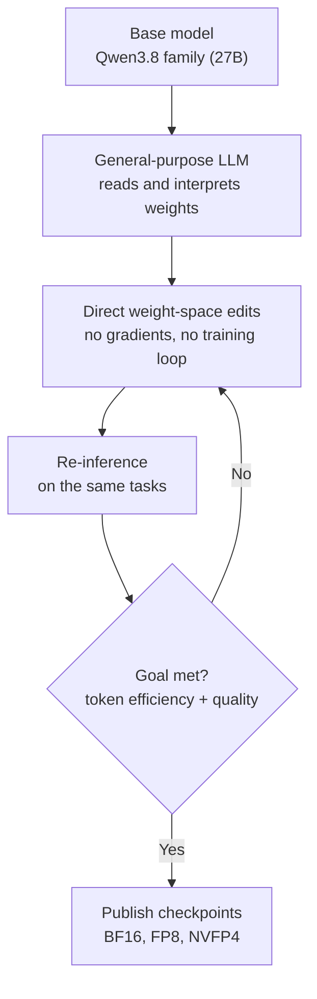

## Why read this

If you are an ML infrastructure engineer tracking the open-weight landscape, or a team that runs GPU queues and inference cost lines, read this to decide whether a new class of model, one built by editing weights directly instead of training, is worth watching. The conclusion first: varien's first model, Qwen Concept 27B, announced on November 6, claims a 54% cut in thinking tokens through direct weight-space edits with no training run. As of the day of writing, the weight link is still unverified, so the right posture is "wait for the link, then verify on your own eval set," not immediate adoption.

## In plain terms

Post-training is like re-learning every piece on the piano from scratch, and it is expensive. Weight-space editing is different. It is closer to a tuner sitting at the piano and adjusting the tension of specific strings directly, without re-learning anything. The tuner here is a general-purpose language model. In the MIT CSAIL experiment, GPT-6 Astra read the strings (the weights), picked the few that were slightly off, and adjusted them by hand. No rehearsal, meaning no gradients and no training loop. Qwen Concept 27B matters because it is the first open model that went public after being tuned this way. This post keeps the "tuning" analogy all the way to the end.

## Overview

The sequence is fast. On November 2, MIT CSAIL published a blog post titled "Sparks of Weight-Space Programming." The authors are Rikiya Takehi, Jayden Teoh, Alex Zhang, and Omar Khattab, and the post is explicitly marked as not peer-reviewed. The core experiment: GPT-6 Astra directly modified just 0.016% of the weights of Qwen3.5-0.8B. MATH-500 went from 7.9% to 48.1%, and GSM8K went from 13.8% to 67.1%. That is the kind of result that normally requires a serious training run, produced by weight edits alone.

Four days later, on November 6, the developer organization varien announced Qwen Concept 27B as "our first model." The announcement came in two voices: varien's first-person tweet ("We've open-sourced Qwen Concept 27B") and a write-up by Concept Country, which describes itself as "an experimental digital-governance project for people and AI agents." Both point to the same model, the same technique, and the same bundle of numbers.

## What is Qwen Concept 27B

The model is 27B in size, based on a Qwen model. The announcement text identifies the base as the Qwen3.8 family (per the original text quoted in secondary coverage), which means the base belongs to the same family as the Qwen3.8-27B that ThakiCloud already serves. The "Concept 27B" this post covers is not a variant produced by fresh training on top of that base. It is a variant produced by applying direct edits to the base weights. The difference matters. Production cost has no training loop in it, and instead contains "read, edit, verify."

The numbers the developer announced come to this table.

| Item | Developer claim | Verification status |
|---|---|---|
| Thinking tokens | 54% fewer (vs base) | No third-party replication |
| GPQA Diamond | +3% (vs base) | No third-party replication |
| Useful tokens per joule | +30% | No third-party replication |
| Build environment | Local NVIDIA DGX Spark | Announcement |
| Checkpoints | BF16, FP8, NVFP4 free | Weight link unverified as of writing |
| License | "Free" (no specific license stated) | Needs confirmation |

As of November 7 (the day of writing), we tried Hugging Face model search, the varien organization page, and GitHub repository search, and found no weights. In other words, "open-sourced" is still an announcement-stage statement, and the downloadable artifact has not been confirmed yet. Every number in this post should be read under that premise.

## Weight-space programming, the background

Let us settle the definition. It is a method in which a general-purpose language model interprets and directly writes the weights of another neural network, without using gradient descent or a training loop. The word "programming" is used because, from the model's point of view, editing weights belongs to the same category as writing code. The only difference is that the target is not a text file but the numbers inside a neural network.

The story moved past speculation because of the scale of the November 2 experiment. On a 0.8B small model, changing just 0.016% of the weights lifted MATH-500 from 7.9% to 48.1%. Achieving the same level through training would normally require a substantial run. Since then, related research (arXiv 2611.04268, 2611.07319) and editing tooling repositories (the openwsp and wsp-kit family) have appeared. The job now is to check whether the way we "fix a model" is moving from data plus training toward read, edit, and verify.

The surprising part is the reading ability. To edit weights, you must first interpret them, and the experiment's premise is that a general-purpose language model can read another network's weights and pick meaningful locations. If weights are not just a heap of floating-point numbers but are structured enough for an outside language model to read, then interpretability research and editing work share one language. A tuner must know where each string sits before adjusting it. If that premise holds, the model being edited and the model doing the editing can converse in the same token space.

## Why would thinking tokens drop

Thinking tokens are the tokens a model generates for itself before answering. A reasoning model produces a long internal chain of thought first, and that generation cost lands directly on the inference bill. The claim that weight-space editing cut these tokens means the weights were changed in a direction where "less thinking, same correctness" holds. The 54% number itself is unverified, but the direction of the mechanism is clear: inference cost can come down through editing rather than training.

The statement "30% more useful tokens per joule with no additional post-training" sits next to it. From a serving team's view, this is not a "slightly better model" story. It is a story about how much cheaper the inference unit price gets. Fewer thinking tokens means fewer generated tokens per query, fewer generated tokens means less card occupancy time and less power, and in an on-prem environment that chain converts straight into the monthly bill.

## What you can actually do

Right now, nothing concrete. There is no weight link to download. Two preparations are possible.

First, watch for the weight release. The varien organization page does not exist as of writing, so if the release happens, it will most likely land under the varien org on Hugging Face. If BF16, FP8, and NVFP4 checkpoints arrive together, serving setup gets simple.

Second, prepare the verification suite in advance. The 54% thinking-token cut is a number you cannot know from the announcement. You run your own eval set against the base and the edited model, or at minimum capture the base's thinking-token distribution first so a comparison is possible. If the base is the Qwen3.8 family, you are probably already doing that.

If the NVFP4 checkpoint arrives as promised, the execution path gets even shorter. A 27B-class NVFP4 model fits on a single high-memory GPU, and ThakiCloud's ai-platform already runs an NVFP4 GPTQ version of Qwen3.8-27B in its serving environment. Same base, same quantization family, same serving stack: the conditions for a head-to-head comparison of "edited version" versus "original" are in place.

On the serving side, the thinking-token cut reaches into the KV cache as well. Fewer generated tokens means less occupancy time per request, which means more concurrent requests per GPU. In an on-prem setup, that chain becomes "more capacity without buying more cards." The premise, however, is one: the edits must hold quality while cutting thinking tokens. You can only confirm that boundary on your own eval set.

## What this means for ThakiCloud products

**ai-platform (serving economics, on-prem).** The unit of model operations is changing. The unit used to be training. Fine-tuning, RL post-training, data curation: all of it is an investment structure that "produces weights with compute." Weight-space editing introduces a cheaper unit, editing. The cost of an edit is not GPU hours, it is verification. After an edit, you must run a test suite that proves quality did not regress. That raises the share of eval suites in the ai-platform model pipeline. When more actors can change a model, the tools that check the change become more valuable at the same time.

**Paxis (a new action class).** Paxis is an Agent-Native Cloud that treats Skills, Tools, Policies, and Audit Logs as first-class resources. Weight-space programming adds a new action class to that list: editing model weights. The moment an agent's program is not a text file but the weights of a model, the governance question becomes real. The scale of the change is also a reviewable unit. If the 0.016% from the MIT CSAIL experiment holds at 27B, the concept of "a small, reviewable diff" familiar from code PRs extends to models. Editing itself is cheap. Cheap edits must run with a policy gate, an audit log, and before/after eval comparison, or they stay modifications instead of becoming assets. From Paxis's view, "make weight editing an approvable workflow" will become a live question sooner than expected.

## Limits and counterarguments

First, the foundation is not peer-reviewed. The MIT CSAIL post marks itself as not peer-reviewed, and every number for Qwen Concept 27B is a developer report. There is no third-party replication, and currently no weights to replicate from.

Second, generalization is unproven. The Sparks experiment was done on a 0.8B small model. Whether the same editing method delivers the same benefit at 27B needs a separate experiment, even after the weights are public.

Third, regressions are not visible by eye. Code diffs are reviewable because people can read code. A 0.016% weight change is visible as numbers, but its meaning is only visible through the test suite. If the suite is thin, "tuning" degrades into "unpredictable micro-adjustment." The quality of the tuning is only as good as the tuner's ear.

Fourth, the license is unclear. "Free" is not a license. Whether Apache 2.0 or MIT, commercial use requires a stated license clause, and no such clause is visible in the announcement material. Until it appears, holding off enterprise adoption is the right answer.

## Summary

Qwen Concept 27B is the first case that brings weight-space editing from the paper stage to the release stage. The claims of a 54% thinking-token cut and 30% more useful tokens per joule are an inference-cost story, not a capability story. The reader's next actions are three.

1. Watch for the weight link. The varien org on Hugging Face is the first candidate.
2. When it lands, re-verify the thinking-token number on your own eval set before deciding adoption.
3. If the NVFP4 checkpoint arrives, run a head-to-head against the same base you already serve (NVFP4 GPTQ).

Tuning is cheap, but tuning is only as trustworthy as the tuner's ear. The difference between weight-space editing and post-training is not only in the cost. It is in that verification structure. Next week, start by checking whether the weights actually came down.

## Sources

- AGI Hunt, "Concept Country open-sources first model, Qwen Concept 27B" (2026-11-06). https://agihunt.info/en/p/1a1b16e2fc82298ba599eebdbd8
- varien announcement (X). https://x.com/varien/status/2118684136747454907
- Gabriel Garrett (X, original text cited by AGI Hunt). https://x.com/GabGarrett/status/2118722771169804501
- Wikipedia, "Weight-space programming". https://en.wikipedia.org/wiki/Weight-space_programming
- MIT CSAIL, "Sparks of Weight-Space Programming" (blog post, 2026-11-02, not peer-reviewed).
- Hugging Face model search, varien organization page, GitHub repository search (as of 2026-11-07, no weights found).
