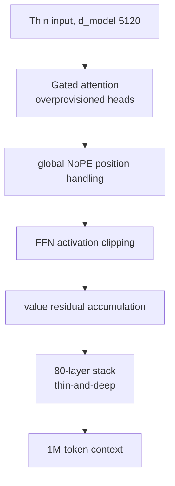

## Why you should read this

If you track U.S. open-weight coding models, if you budget for on-prem serving, or if you run Paxis and want to cut the per-task cost of agentic coding, this is for you. The headline conclusion up front: **Ripple-65B Preview**, released by Ricursive Intelligence on November 4, is a 65B dense Transformer with up to 1M-token context under Apache 2.0, and it claims U.S. open-weight state of the art on agentic coding (TerminalBench 2.1, 80.52, self-reported). With a stated total R&D cost of roughly $32M, claimed at one-tenth the cost of the previous open-weight SOTA, the release points in one direction: the open-weight landscape is shifting from "bigger model" to "cheaper model that codes well." Judge whether to use it from the benchmarks and serving requirements below.

## In plain terms

Most language models are shaped like wide, low buildings: a large hidden dimension and fewer layers, so each step is heavy. Ripple takes the opposite bet. It keeps the hidden width (d_model) relatively narrow at 5,120 and stacks 80 layers, a thin-and-deep design. The release describes this as a "Gemma 3N-like" narrow-and-deep layout. The name "Ripple" maps onto it nicely: a single thin layer sends a signal that travels, layer after layer, a long way down the stack.

## Overview

Ricursive Intelligence is opening a new chapter in U.S. open-weight models, and Ripple-65B Preview is its first. Per the release, the company chose to put out the "general-purpose variant" of the proprietary model behind its product as open-weight. Weights live on Hugging Face at `ricursiveAI/Ripple-65B-Preview`, with a BF16 instruction-tuned model, a BF16 base model, and a deployment-ready NVFP4 quantized checkpoint. Hosting is immediately available on Together AI, GMI Cloud, OpenRouter, and Fireworks.

Training is 12 trillion tokens on the company's figures. By stage: pretrain 12T, midtrain 200B, long-context 6.5B, SFT 183B, and long-context SFT 13.5B. The 1M-token (1,048,576) context comes from keeping a dedicated long-context stage in the same pipeline. Cost is "about $32M for full R&D from scratch," which the company frames as one-tenth the cost of the previous agentic-coding open-weight SOTA.

There is a practical thing to read into the stage layout. Relative to the 12T-token pretrain, long-context (6.5B) and long-context SFT (13.5B) are under two digits. In other words, the "1M context" capability is bolted on with a concentrated, short stage rather than an enormous extra cost. For teams trying to push a 65B to longer context, Ripple is a useful example of "long context acquired cheaply." That said, whether quality stays uniform across the full 1M range is not confirmed by the public numbers, and we return to that in Limitations.

## Architecture: thin-and-deep

Ripple's structural choice is to go narrow and deep in a dense Transformer. d_model 5,120, 80 total layers, and overprovisioned attention heads are the core. Four structural techniques are named in the release: FFN activation clipping, gated attention, global NoPE (dropping RoPE position encoding globally in favor of an absolute/position-free signal), and value residuals.



Two practical implications follow. First, a thin layer makes each step light, and many of those light steps are stacked to build depth. Second, global NoPE and value residuals are designs aimed at keeping the position signal and information flow stable over long context, and they are the load-bearing parts of what makes a dense model support 1M tokens. Combining these structural techniques at 65B is a signal that open-weight is moving from a "parameter race" to a "structure-and-training-cost race."

## Benchmarks

The table below lists the key instruct-model numbers. Every value is taken from the self-reported release material; there is no third-party re-measurement here. Coding and agent entries are strong, and math and general knowledge sit at the top tier.

| Benchmark | Score | Note |
|---|---|---|
| TerminalBench 2.1 | 80.52 | Claimed U.S. open-weight SOTA (self-reported) |
| SWE-bench Verified | 76.5 | |
| SWE-bench Pro v1.0 | 61.42 | |
| SWE-bench Pro v2.0 Hard | 79.1 | |
| DeepSWE 1.1 | 44.3 | |
| MCP Atlas | 71.67 | agent tool calling |
| AIME 2025 | 98.3 | math |
| GPQA Diamond | 85.2 | science reasoning |
| MMLU | 89.6 | general knowledge |
| MMLU-Pro | 84.2 | |
| IFBench | 79.2 | instruction following |

It helps to know what these benchmarks measure. TerminalBench 2.1 measures whether a model can autonomously finish multi-step work inside a terminal (file manipulation, running scripts, configuring an environment). The SWE-bench family measures whether a model can read a bug report in a real software repository and produce a patch that passes, with Verified being the vetted set and Pro v2.0 Hard the harder variant. MCP Atlas measures whether a model calls external tools (MCP servers) correctly to complete a task. Taken together, the three cover the full agentic-coding spectrum: manipulating an environment, calling tools, and fixing a real repository. Ripple sitting at the top across all three is the substance of this release.

The strength is the agentic-coding band. It records 80.52 on terminal-based tasks (TerminalBench 2.1), 76.5 on SWE-bench Verified and 79.1 on Pro v2.0 Hard for real-repository problem solving, and 71.67 on MCP Atlas for agent tool calling. On the other hand, SciCode 39.4, AutomationBench 36.4, and tau-3-bench banking 31.27 are comparatively lower, so the numbers show it is specialized for "coding agent" tasks and not uniformly strong across general domains. The base model sits around MMLU 5-shot 83.7, HumanEval pass@1 70.9, GSM8K 88.5.

## Getting the weights and running it

Weights download from `ricursiveAI/Ripple-65B-Preview` in BF16 (on the order of 130GB). An NVFP4 checkpoint is provided for deployment efficiency, and this variant explicitly targets execution on an NVIDIA DGX Spark (a small on-prem machine) in the release material. Hosting is available immediately via API on Together AI, GMI Cloud, OpenRouter, and Fireworks.

Three variants are provided.

| Variant | Precision | Use |
|---|---|---|
| Instruction-tuned | BF16 | serving/inference, dialogue and agent tasks |
| Base | BF16 | fine-tuning starting point |
| NVFP4 | 4-bit quantized | deployment/on-prem, DGX Spark-class execution |

That the base model is provided separately matters in practice. You can use the instruction-tuned model as-is, but if you want to fine-tune for your own domain (internal APIs, in-repo conventions, agent task definitions), the base model is the starting point. Apache 2.0 permits derivatives and modifications of the base weights, so both paths stay open: "use the downloaded model as-is" and "SFT a model tuned to your workflow." At 65B, efficient fine-tuning like LoRA or QLoRA is practical, so domain transfer via an adapter rather than full-weight training is on the table.

The Apache 2.0 license is also important in practice. It is an open license with no per-seat or call-count limits, so you may download the weights, serve them on-prem, and even fine-tune a derivative for internal use. The more often a workload calls the model (as in a coding agent), the more room there is to trade a hosted API's per-token price for fixed card and power cost. That freedom is also what makes 65B a size "you can actually handle with your own data and workflow."

The standard on-prem serving path is vLLM. Targeting the NVFP4 variant and long context together looks roughly like this.

```bash
pip install -U vllm
vllm serve ricursiveAI/Ripple-65B-Preview \
  --quantization nvfp4 \
  --max-model-len 1048576 \
  --gpu-memory-utilization 0.90
```

This command assumes the checkpoint variants from the model card and is a standard serving setup, not a measurement taken in this post.

The deciding variable in practice is context length. Quantizing a 65B to NVFP4 compresses the weights themselves, but the KV cache that grows as the context fills is a separate memory from the model parameters. The KV cache scales with tokens per batch, so filling a 1M-token context can make the KV cache the larger share of memory. If you are not putting a whole long document in one context, drop `--max-model-len` to your real needed length (say, a few hundred thousand) and use the freed space to raise batch size or per-card concurrent requests, which usually lowers unit cost. "Supports 1M" is a capacity ceiling, not a mandate to serve at 1M.

## What this means for ThakiCloud

This model touches both of ThakiCloud's products.

**ai-platform (on-prem, serving economics).** Releasing a 65B dense model under Apache 2.0, providing an NVFP4 checkpoint, and naming DGX Spark-class execution is directly meaningful for on-prem serving. ThakiCloud's ai-platform serves open-weight models on Kubernetes with vLLM in a multi-tenant way, and a model that ships an official quantized variant reduces the uncertainty in the serving pipeline. The 1M-token context matters for workloads that put a long document or a whole repository in one context, and how you manage KV-cache cost is the axis that determines whether that is feasible. The "one-tenth R&D cost versus the previous SOTA" frame should be read together with serving unit price (throughput per power, per card).

**Paxis (agent execution economics).** Paxis is ThakiCloud's Agent-Native Cloud: it selects from 960+ skills by BM25, runs them in isolated sandboxes, and passes every action through policy gates and audit logs. A model strong at agentic coding changes the floor of that execution economics. Strong on terminal/repository tasks (TerminalBench, SWE-bench family), Apache 2.0, and runnable on a DGX Spark means Paxis's CostRouter gains one more option: "use this local model for this agent step." The comparatively weak general domains (SciCode, tau-3-bench) line up exactly with Paxis's premise that per-model strength differences should drive the selection criterion.

## Limitations and counterpoints

First, "U.S. open-weight SOTA" and the TerminalBench 2.1 80.52 are both company self-reported. Until a third party re-measures under identical conditions (prompts, templates, sample counts), treat rank claims with care. SWE-bench Pro v2.0 Hard at 79.1 being much higher than v1.0 at 61.42 could also be a difference in benchmark-version difficulty and question composition, so do not read it as an apples-to-apples number.

Second, the name is Preview. It is likely a development/feedback build rather than a final release, and the weights and checkpoint layout may change. 65B dense is not a small scale in itself, so calling it "frontier" needs a head-to-head against other 65B-class models.

Third, 1M context is "max supported," not "recommended for production." How quality holds up on real long-document work, and how KV-cache memory and time-to-first-token change, are not in the public material, so before verification treat them as [estimates] only.

## Takeaway

Ripple-65B Preview is not an "expensive frontier"; it is the first U.S. open-weight pitched as "cheap, and strong at coding." The combination of thin-and-deep (d_model 5,120, 80 layers), structural techniques like global NoPE and value residuals, 12T-token training, an official NVFP4 checkpoint, DGX Spark execution, and Apache 2.0 shapes the next actions for practitioners. If you are planning on-prem serving, first re-measure the real memory and throughput of the NVFP4 variant on DGX Spark-class hardware. If you are running Paxis, put this model on the CostRouter shortlist for the coding-agent step and decide which model backfills the weak general domains (SciCode, tau-3-bench). Those two are the immediate experiments. Being a Preview also means this benchmark table should be re-read once the final version and third-party re-measurements land.

## Sources

- Ricursive official release: [ricursive.com/ripple](https://ricursive.com/ripple)
- Hugging Face model card: [ricursiveAI/Ripple-65B-Preview](https://huggingface.co/ricursiveAI/Ripple-65B-Preview)
- HuggingNews: [RicursiveAI Launches 65B Ripple Model With New Coding Benchmarks](https://huggingnews.com/ai/ricursiveai-launches-65b-ripple-model-with-new-coding-benchmarks-for-us-56ffa3d8)

> All benchmark numbers are company self-reported and were not re-measured in this post. This is a Preview release, so numbers may change in the final version.
