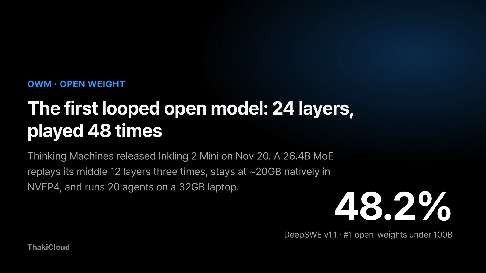
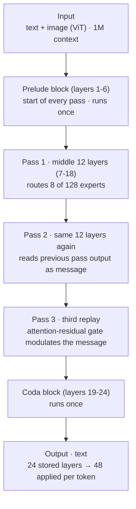
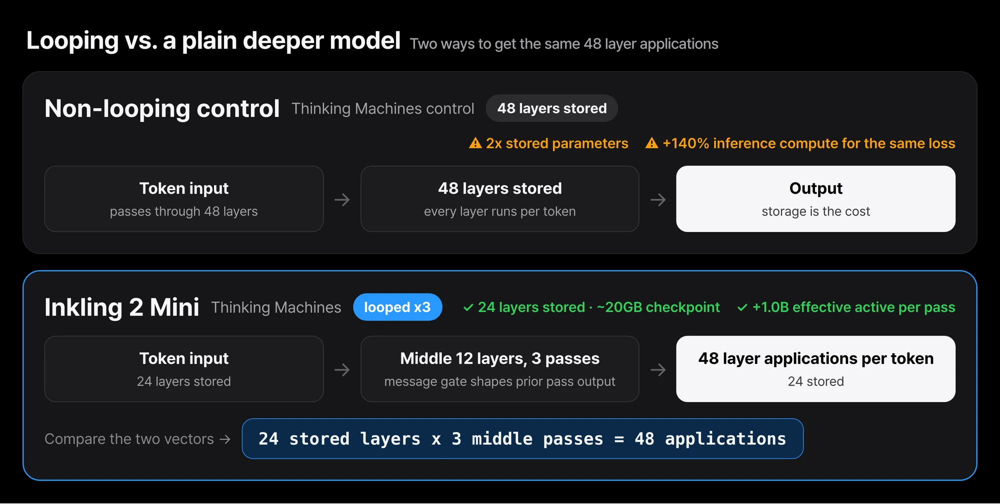
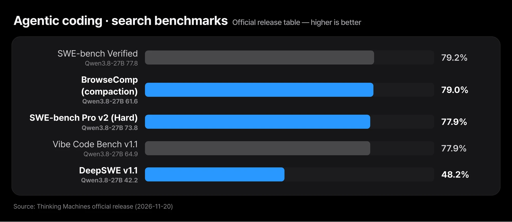
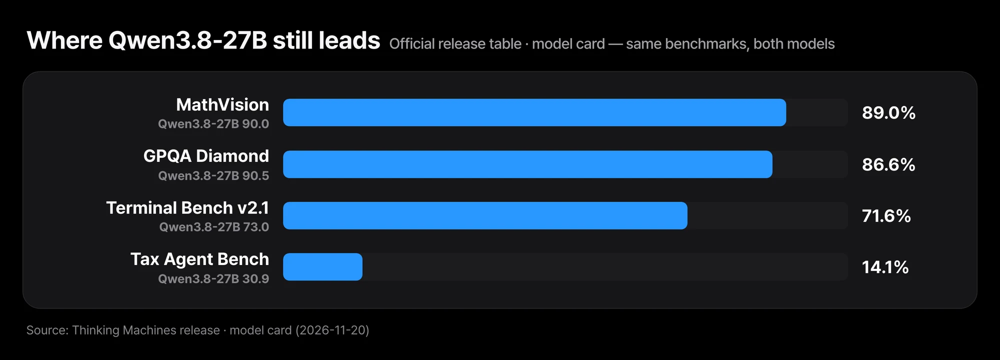
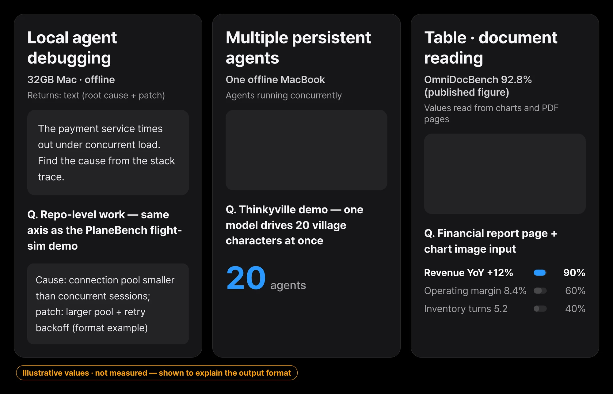

*Abstract visual of the post's core concept: the same layers, played three times.*

If you run agents on a laptop or a single GPU, model choice has always been one of two things: a small weak model, or a large expensive one. With 26B to 31B becoming the main class for local agents, the official comparison set (Gemma 4 31B, Qwen3.8-27B, Nemotron 3.5 Super VL) shows where that class stands today. On Nov 20, Thinking Machines released Inkling 2 Mini, the first open looped transformer, and the class just gained an option with a different structure.

The key numbers first. A 26.4B total, 3.4B active MoE model takes the lead on DeepSWE v1.1 (48.2%) across every open-weights model under 100B total parameters, and leads Qwen3.8-27B (73.8%) by 4.1 points on SWE-bench Pro v2 (Hard) with 77.9%. The model stores 24 layers but replays the middle 12 three times, applying 48 layers per token.

This post goes through the structure, the 4-bit native training, the benchmark numbers on both sides, the serving paths, and the items where Qwen3.8-27B still leads, using only the published figures.

*Inkling 2 Mini open-weight model card · 26.4B total, #1 open-weights under 100B on DeepSWE v1.1 (48.2%).*

## In plain terms

The structure of Inkling 2 Mini is closest to "chewing the cud". Like a cow that swallows feed and brings it back up to chew again, this model passes the middle 12 layers (modules) over a single token three more times. Instead of writing out its reasoning in long token streams, it buys thinking time by re-chewing the same weights. The official release puts it as "looping allows the model to reason longer without writing its reasoning down". This post keeps the cud-chewing analogy all the way through.

## 24 layers stored, 48 applied

The model is a 24-layer decoder-only transformer, split into four blocks of six layers. The first block (prelude) and the last block each run once; the two middle blocks (12 layers) run three times. Every pass starts from the prelude's output, and passes 2 and 3 re-execute after reading the previous pass's output, which the company calls the "message". The attention-residual structure carries a learned gate that initially blocks the entire message.

Why the middle and not the end? According to the release, looping the middle 12 layers produced larger accuracy gains than looping the last 12 on 27 of 28 evaluations. The compute-equivalent gain was 1.51x to 1.91x for the middle versus 1.24x to 1.36x for the last layers.

The comparison against the non-looping version was also published. The non-looping model cost 7.5% less compute to train, but needed 140% more inference compute to reach the same loss on 512K-token agentic traces. Looping, in other words, does not move cost from training to inference. It reduces the total cost of the same capability.

MoE routing picks 8 of 128 experts per token. Training started with 8 experts chosen out of 384, then kept only the 128 most-used per layer.

*Non-looping (48 stored layers) vs looped (24 stored, middle 12 three times). Source: Thinking Machines official release.*

## Trained in 4-bit, deployed in 4-bit

Most of Inkling 2 Mini's weights were trained in NVFP4, with only the last four layers in MXFP8. Twenty layers are NVFP4 and four are MXFP8, and the whole checkpoint is about 20GB. That combination is unusual among released models. The usual path is to train at high precision and compress later with post-training quantization. This model ran 4-bit NVFP4 in the expert layers on every forward pass, from pretraining through RL, so the release states that there is no conversion loss from quantization.

The training lineage goes like this. The model was derived from the company's mainline predictive scaling ladder, trained on 1T tokens distilled from a larger internal Inkling model, then given an RL phase totaling 2.2T tokens over 2,000 steps on NVIDIA's GB300 platform. English is the primary language with general multilingual support. It handles text and image inputs and produces text output, with up to 1M tokens of context.

This is the "small sibling" of the Inkling 2 line. Thinking Machines first released Inkling (the original) and Inkling-Small, then the larger Inkling 2 Small, and now derives this 26.4B Mini from the same line. The release says Mini's strengths mirror Inkling 2 Small's: both are strongest on long-horizon agentic work, and both used the same on-policy distillation for post-training. On PMPP-Hard (AUC over 0-10h production tasks) Mini scores 455.82, top of the comparison set, and the post describes it as approaching the score of the much larger Inkling 2 Small. The model card, however, concedes that Inkling 2 Small is stronger across most evaluations, with the largest gaps on factual recall and knowledge-heavy questions.

## #1 open-weights under 100B: the numbers and the gaps

In the official benchmark table (comparison set: Gemma 4 31B, Muse Glimmer, Qwen3.8-27B, Nemotron 3.5 Super VL), the agentic and coding axes line up with the release's claim of a lead on agentic coding across the board.

| Benchmark (harness) | Inkling 2 Mini | Qwen3.8-27B |
|---|---|---|
| DeepSWE v1.1 (mini-swe-agent v2.4.6) | **48.2%** | 42.2% |
| SWE-bench Pro v2 Hard (mini-swe-agent) | **77.9%** | 73.8% |
| SWE-bench Verified (bash only) | **79.2%** | 77.8% |
| BrowseComp (compaction) | **79.0%** | 61.6% |
| Vibe Code Bench v1.1 (openhands) | **77.9%** | 64.9% |
| SWE-bench Multilingual (bash only) | **73.7%** | 70.0% |

Qwen3.8-27B's lead on specific items is equally clear. It wins Terminal Bench v2.1 (73.0% vs 71.6%), GPQA Diamond (90.5% vs 86.6%), MathVision (90.0% vs 89.0%), and Tax Agent Bench (30.9% vs 14.1%) by a wide margin. On AA Index v5.0 the two tie at the top with 20.1. The "it beats Qwen" phrasing is going around, but the accurate picture is: a lead on agentic coding and search/tool use, with Qwen3.8-27B still ahead on factual recall and some math and finance benchmarks.

The knowledge-work axis is worth checking too. DeepSearchQA (with compaction) 85.3%, MCP Atlas (Public) 82.7%, and JobBench 49.6% all lead the set. Vals Finance Index is #1 at 50.1%, while AA-Briefcase v1.1 and GDPVal-AA v2.1 land at 1,263 and 1,319 points, second to Qwen3.8-27B (1,391 and 1,427). On enterprise document and finance analysis work, Qwen still holds a step ahead.

The vision and document axis is strong. OmniDocBench v1.6 at 92.8%, Chartography (with Python) at 72.5%, ScreenSpot Pro at 87.7% (with Python), and PerceptionBench at 57.5% all lead the comparison set, with MuirBench (77.5%) and BVB (68.4%) in the top two. Given that reading tables, charts, and screen instructions is a sub-skill of agent work, this axis underwrites the agentic coding numbers.

Factual knowledge and reasoning come out mixed. ARC-AGI v1/v2 leads at 84.5/49.3% (Qwen 87.5/42.4), and LongBench v2 (66.9%) and MRCR v2 (8-needle, 256K-512K, 46.4%) also lead. On the other side, the non-hallucination rate on AA-Omniscience is 63.4%, second to Qwen3.8-27B (71.4%), and HLE-Diamond trails Qwen's 15.3% by 0.1 point at 15.2%. The model card's line that "the knowledge gap is overcome by efficiently using search and tools" reads less like a way of hiding the weak axis and more like an explicit statement of the operating direction (tool use).

An external efficiency measurement exists as well. Stanford's Hazy Research Lab (Scaling Intelligence Lab) scored Inkling 2 Mini at 0.703 on "intelligence per joule" running on an NVIDIA DGX Spark, versus 0.430 for Qwen3.6-35B-A3B, 0.159 for Gemma-4-26B-A4B, and 0.036 for Qwen3.5-27B. Precision and reasoning effort differ per model, so read it as relative capability per watt on the same machine rather than a plain ranking.

*Agentic coding and search benchmarks. Blue bars are Inkling 2 Mini; the notes show Qwen3.8-27B scores. Source: Thinking Machines official release.*

*Qwen3.8-27B's lead. Blue bars are Inkling 2 Mini; notes are Qwen3.8-27B. Source: Thinking Machines release and model card.*

## Twenty agents on one MacBook

The second claim of the release is that the model is "a strong choice for running multiple persistent agents on local hardware". The official demos show two scenes. A MacBook Pro (M5 Pro, 48GB) in airplane mode building a playable flight simulator in a few minutes, offline (PlaneBench, mostly filmed at 15x speed), and Thinkyville, where the same single model drives all 20 village agents on one offline MacBook.

The model card's stated hardware requirements are as follows.

| Platform | Requirement | Notes |
|---|---|---|
| NVIDIA DGX Spark | 1 unit | Officially supported |
| Apple silicon (MacBook, Mac mini, Mac Studio) | 32GB+ memory | Via Ollama, supported at launch |
| Other GPUs and platforms | 32GB+ VRAM recommended | "Possible" support tier |

The checkpoint is a single ~20GB file (mixed NVFP4 + MXFP8), so on a 32GB machine you should budget headroom for context buffers on top of the weights. Serving paths are wide: Ollama, vLLM recipes, the SGLang cookbook, Unsloth (including GGUF quantized versions), NVIDIA Dynamo, TokenSpeed, and Llama App all link to official documentation, with Exo Labs as an Apple-silicon-specific path. RL fine-tuning runs on SkyRL, Miles, and NeMo AutoModel, inference and customization are open on Tinker from day one, and API access through third-party inference providers is noted in the model card. The variable-loop research variant TML-d24-varloop-research was released alongside.

The interpretability ecosystem opened too. Thinking Machines says it is working with the National Deep Inference Fabric (NDIF) to give interpretability researchers access, and Goodfire got early access and has started interpretability work on the model. The position of "the first model you can open and inspect the looped structure of" matters more than the weight release itself because of this ecosystem.

*Input/output format and representative use scenes (values are format examples). Source: Thinking Machines release and model card.*

## How looping changes the visibility of the thinking

Monitoring results from the variable-loop research variant (TML-d24-varloop-research) were published alongside. As loops accumulate, CoT (chain of thought) length shrinks to less than half of one pass (average 3,703 to 1,661 tokens). Looping, in other words, is not "thinking less". It is "writing down less". N-Hop Lookup, tasks that need repeated references, kept improving out to 10 passes, twice what the research model was trained with, and the uncertainty indicator fell from 9.7 to 3.6.

CoT controllability is high as well. When asked for a 750 to 1,250-token CoT, the model followed the instruction at most 0.1% of the time, versus 0.3% for Inkling 2 Small, 0.4% for the older Inkling-Small, and 1.3% for Qwen3.8-27B. For agent operations, that is one more lever for keeping output length inside a predictable range.

## Four things to know before running it

First, repetitive reasoning loops are a known limitation. The model card notes that the model sometimes got stuck in long reasoning loops, particularly when debugging code. Second, Chinese outputs showed clipped phrasing and mixed languages. Third, the minimum reasoning effort does not fully disable reasoning. Fourth, the model card states that local runtime support for looped models is new, so speed varies by runtime and hardware.

Multi-turn chat and heavily constrained instructions are not its strength. It scores 50.0% on MultiChallenge and 33.4% on ComplexConstraints v1.1, and the official post draws its own line: it is not the strongest small model. The model card also acknowledges that the gap versus the larger Inkling 2 Small is largest on factual recall and knowledge-heavy questions.

On safety and alignment internals it sits at the top of the comparison set. Misbehavior 9.8%, covert misbehavior 8.3%, destructive actions 10.2%, the lowest (lower is better) of the five models, clearly below Qwen3.8-27B (57.7 / 33.2 / 35.2). FORTRESS adversarial 89.5% and StrongREJECT 97.8% are both in the top two. The caveat that these are internal evaluations should stay attached.

## Where the two ThakiCloud products use it

From the ai-platform (K8s-based AI/ML serving) side, there are three points. First, a single native 4-bit checkpoint (~20GB) makes serving viable on a 32GB-class VRAM node, which puts a 26.4B agent-work model on the "what can one GPU serve" list for on-prem and edge nodes. ThakiCloud's serving stack already operates NVFP4-quantized models as the baseline (B200 inference), so this model joins the same path without an added conversion and validation step. Post-training quantization models have to prove quality regression after conversion separately, while this model's proof is built into the training. That structural difference matters. Second, the looped structure works in the direction of reducing inference compute for the same capability, which favors the GPU-min accounting of a multi-tenant queue (Kueue). Third, official vLLM and SGLang recipes mean it slots into a KServe-style serving stack.

From the Paxis (Agent-Native Cloud) side, the "20 agents on one offline MacBook" scene is the point. It shows the floor cost structure for the persistent-agent and orchestration workloads that Paxis handles: when work that does not need the cloud can drop to a local unit, this is what the execution economics look like. Looped reasoning that shortens CoT tokens also lands directly on the output-token cost of agent calls.

## In closing

Inkling 2 Mini is not "the strongest small model". It is the first open model that makes looped-transformer research possible in your own environment. The precise picture as of today: a lead on agentic coding among open weights under 100B (DeepSWE v1.1 48.2%), a native 4-bit 20GB checkpoint, and local multi-agent execution, three scenes captured at once.

A first experiment only needs one of two paths. On a 32GB+ Mac, pull `inkling-2-mini` from the Ollama library and feel the loop's limits in offline agent work. In a single-GPU setup (32GB VRAM recommended), validate the serving path with the official vLLM recipe.

Three things to watch right after launch: how fast community GGUF quantizations arrive, what structure Goodfire's interpretability research exposes inside the loop, and how far the variable-loop variant's "passes as a runtime tuning lever" pattern generalizes. If looped transformers settle into a model class, the structural competition in the 26B to 31B range becomes a question of how many more times the layers are re-chewed.

- [Official release: Introducing Inkling 2 Mini](https://thinkingmachines.ai/news/inkling-2-mini/)
- [Model card](https://thinkingmachines.ai/model-card/inkling-2-mini/)
- [Hugging Face: thinkingmachines/Inkling-2-Mini](https://huggingface.co/thinkingmachines/Inkling-2-Mini) (Apache 2.0)
- [Ollama library](https://ollama.com/library/inkling-2-mini) · [vLLM recipe](https://recipes.vllm.ai/thinkingmachines/Inkling-2-Mini)
