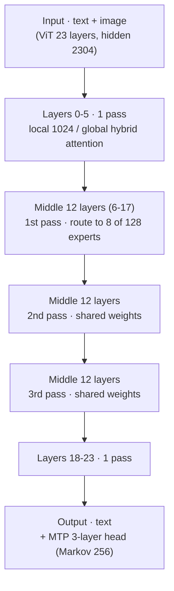
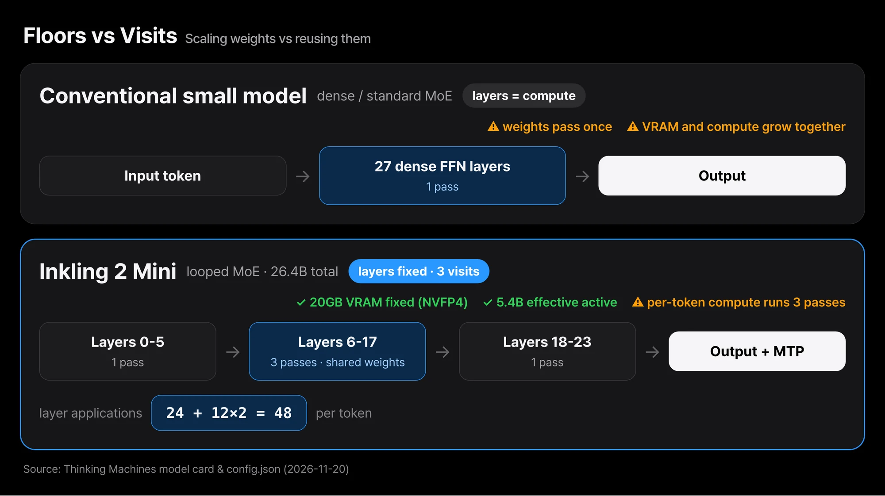
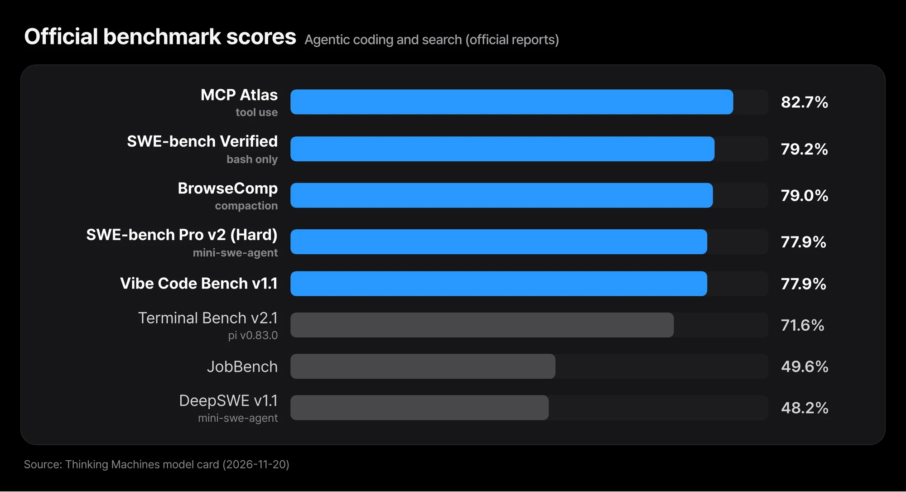
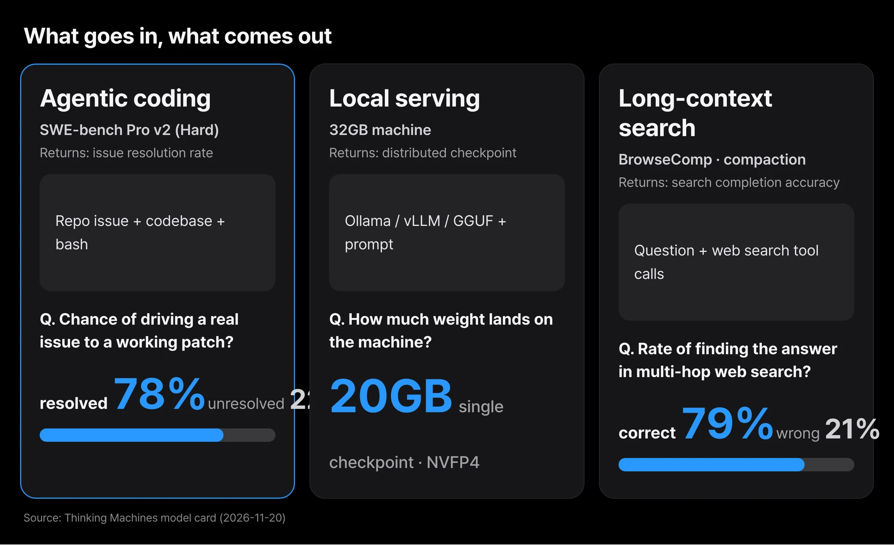

If you are deciding which small model to serve on your own inference nodes or on a 32GB laptop, this post is the model-card verification you need for that decision. Thinking Machines Lab released Inkling 2 Mini, a 26.4B-parameter multimodal open-weight model, under the Apache 2.0 license on November 20. The core idea is one: a design that adds visits instead of building a bigger building, i.e., a loop. The middle 12 layers are run three times with shared weights, so 24 layers of weights act as 48 layer applications. In official benchmarks it beats the same-class Qwen3.8-27B on the agentic-coding axis and trails it on the knowledge axis. This post covers the architecture, the official numbers, how to serve it on a 32GB machine, and what it means for ThakiCloud's serving lineup.


*Twenty-four floors, three visits. A visualization of Inkling 2 Mini's loop structure.*

## 24 layers, counted 48 times

Inkling 2 Mini is a 24-layer decoder-only sparse MoE (Mixture-of-Experts) model. In each layer, every token is routed to 8 of 128 experts. There are no shared experts (n_shared_experts 0), and the per-expert intermediate size is 1152. The total parameter count reaches 26.4B.

But the weights actually used per token are not 26.4B. For a single pass, the active count is 3.4B. This is where the loop enters. In our verification run we read the HF repository's config.json directly: the loop_config field records core_start 6, core_end 18, num_passes 3. The middle 12 layers (6 to 17) execute three times with shared weights. Twenty-four layers of weights, 48 layer applications per token.

The model card does the cost arithmetic for you. Each extra pass adds roughly 1.0B of effective active parameters, so at three passes the effective active count per token is 5.4B. The card's table records this as "5/26" (active/total). The comparison set is Gemma 4 31B (31/31), Qwen3.8-27B (27/27), and Nemotron 3.5 Super VL (12/125). On active parameters alone, Inkling 2 Mini lands in the same band as Nemotron 3.5 Super VL.

Attention is hybrid as well. Twenty of the 24 layers are local (sliding window 1024) and four (5, 11, 17, 23) are global. Grouped query uses 24 heads against 8 KV heads, and the attention residual (attn residual) is normalized in blocks of six layers. A three-layer MTP (multi-token prediction) head ships with the model, at Markov rank 256. The MTP's target_layer_ids are [5, 23, 41, 48], pointing into the unrolled 48-layer coordinate space.

The context window goes up to 1M tokens (config model_max_length 1,048,576). Multimodality is native. Images pass through a 23-layer vision transformer and are processed jointly with text tokens in a shared hidden space (2304).


*The loop structure unrolled. The middle 12 layers pass three times, turning 24 layers of weights into 48 layer applications.*


*Separating floor count (weights) from visit count (compute).*

## In plain terms

Let's use a department-store analogy. Conventional small models are stores where every floor is visited once per trip. Bigger stores (more parameters) mean bigger buildings (more VRAM) and heavier computation. Inkling 2 Mini takes a different path. Instead of a 48-floor building, it builds a 24-floor one, and every shopper passes through the 12 best-stocked floors (6 to 17) three times.

The building size is independent of the visit count. What visits change is shopping time, i.e., compute per token. In serving terms, VRAM is the floor count and per-token compute is the visit count. The 1M context is a million-page store catalog, and the 128-expert MoE is 128 specialty counters per floor. The guide (the router) walks each shopper to just 8 of them. "Effective active 5.4B" is the amount of shopping actually done per visit. This post keeps the department-store image to the end.

## Where it beats Qwen3.8-27B on agentic coding

The model card presents a same-table comparison against Gemma 4 31B, Muse Glimmer, Qwen3.8-27B, and Nemotron 3.5 Super VL. The axes where Inkling 2 Mini leads on official numbers are agentic coding and search.

| Benchmark (harness) | Inkling 2 Mini | Qwen3.8-27B | Gemma 4 31B | Nemotron 3.5 Super VL |
|---|---|---|---|---|
| SWE-bench Verified (bash only) | **79.2%** | 77.8% | 46.1% | 71.1% |
| SWE-bench Pro v2 (Hard) | **77.9%** | 73.8% | 14.2% | 44.1% |
| DeepSWE v1.1 (mini-swe-agent) | **48.2%** | 42.2% | 0.3% | 24.7% |
| Vibe Code Bench v1.1 | **77.9%** | 64.9% | N/A | 3.5% |
| Terminal Bench v2.1 (pi) | 71.6% | **73.0%** | 43.4% | 60.7% |
| PMPP-Hard AUC (0-10h) | **455.82** | 262.50 | N/A | N/A |
| BrowseComp (compaction) | **79.0%** | 61.6% | 37.0% | 78.9% |
| DeepSearchQA (compaction) | **85.3%** | 79.7% | 61.7% | 77.7% |
| MCP Atlas | **82.7%** | 77.3% | 54.2% | 67.7% |
| JobBench | **49.6%** | 33.4% | 8.2% | 36.5% |
| AA Index v5.0 | **20.1** | 20.1 | 4.4 | 13.6 |
| HLE-Diamond | 15.2% | **15.3%** | 7.2% | 8.8% |
| GPQA Diamond | 86.6% | **90.5%** | N/A | N/A |
| MathVision | 89.0% | **90.0%** | N/A | N/A |
| AA-Omniscience (non-hallucination) | 63.4% | **71.4%** | 14.5% | 69.5% |
| LongBench v2 | **66.9%** | 52.3% | 52.9% | 62.1% |
| MRCR v2 (8-needle 256-512K) | **46.4%** | 38.0% | N/A | 5.7% |

SWE-bench Verified is 79.2% against Qwen's 77.8%, SWE-bench Pro Hard is 77.9% against 73.8%, and DeepSWE is 48.2% against 42.2%. SWE-bench Multilingual is 73.7% against 70.0%, and FrontierCode v2.0 is 15.1% against 14.9%. The gap opens on PMPP-Hard (kernel optimization, AUC over 0-10 hours): 455.82 against 262.50. Search is wider still: BrowseComp 79.0% against 61.6%, DeepSearchQA 85.3% against 79.7%, MCP Atlas 82.7% against 77.3%.

These benchmarks measure process, not single answers. The SWE-bench family takes a real repository issue and drives it to a patch that passes tests; BrowseComp and DeepSearchQA chain web searches to find an answer; JobBench completes real work automation. That is why the loop design shines on exactly these process-centric axes. Running the same weights three times spends compute on re-passing intermediate results instead of committing to a first-pass answer. In the release blog's phrasing, the model applies more reasoning and reaches the right answer with fewer tokens.

The axes where it trails are equally clear. Terminal Bench v2.1 is 71.6% against 73.0%, HLE-Diamond is 15.2% against 15.3%, and the non-hallucination rate is 63.4% against 71.4%. On the knowledge representatives GPQA Diamond (86.6% vs 90.5%) and MathVision (89.0% vs 90.0%), Qwen leads as well. AA Index v5.0 ties at 20.1. The card itself concedes the knowledge gap: versus Inkling 2 Small, the largest differences are on factual recall and knowledge-heavy questions, and it is likelier than larger models to state incorrect information confidently. A 26.4B model that "thinks longer" via the loop overtakes a dense 27B on reasoning-dense axes, but it does not replace knowledge.

Note that the harness differs per row: mini-swe-agent v2.4.6, pi v0.83.0, compaction on/off, bash only. Every number in this table is an official report; none were independently reproduced in this post.


*Official model-card reports. Harnesses differ per row.*

## A 20GB checkpoint on a 32GB machine

The distribution format is a single ~20GB checkpoint. Precision is mixed NVFP4 and MXFP8; per the release blog, 20 layers are NVFP4 and the last four are MXFP8. The config.json quantization_config records modelopt NVFP4. This is native quantization, not quantize-after-release, and the release notes explicitly claim zero conversion loss from the original weights.

The official hardware requirements are three: one NVIDIA DGX Spark, Apple silicon with 32GB or more (MacBook, Mac mini, Mac Studio), and any other GPU with 32GB or more VRAM recommended. In the department-store image, the 20GB of floors and catalog runs inside the headroom of a 32GB building.

There are energy-efficiency numbers too. In Stanford Hazy Research and Scaling Labs' "intelligence per joule" measurement, Inkling 2 Mini scored 0.703 on an NVIDIA DGX Spark, against 0.430 for Qwen3.6-35B-A3B, 0.159 for Gemma-4-26B-A4B, and 0.036 for Qwen3.5-27B. The release blog also shipped demos running offline on an M5 Pro 48GB MacBook Pro: a playable flight simulator built in a few minutes, and a "Thinkyville" town of 20 agents running on a single offline MacBook.

The software list is long. Hugging Face, SGLang, vLLM, TokenSpeed, and NVIDIA Dynamo are the general inference paths; Unsloth and llama.cpp provide quantized GGUF builds; on Apple Silicon, Ollama and Exo Labs. Post-training runs through Miles and SkyRL, and fine-tuning is available on the Tinker platform.

```bash
ollama pull inkling-2-mini
```

The vLLM and SGLang recipes are linked from the model card. Because a looped architecture is a first-of-kind open release, runtime support is new territory. The card itself notes that speed varies by runtime and hardware, and that setting reasoning effort to its minimum does not fully disable reasoning. That is why per-token compute runs higher than the active-parameter count alone suggests.


*What goes in, what comes out. Official numbers.*

## What it means for ThakiCloud's serving lineup

Floors fixed, visits variable. That is how to read a looped MoE from the serving side. Before, "how much VRAM for this model size" was one question. Now it is two: how much weight (VRAM), and how many visits (passes). In the 27B dense class, both values are fixed. In Inkling 2 Mini, the VRAM side is pinned at 20GB and the compute side moves to three passes over the middle 12 layers.

From the ai-platform (K8s inference infrastructure) perspective, a new coordinate appears in the 32GB-class node lineup. "We need a 27B-class brain but the node only has 32GB" is one of the recurring constraints ThakiCloud hears in customer environments. This model is a candidate answer to that constraint. Native NVFP4 distribution also puts it in the same coordinate system as the quantized serving paths ThakiCloud already operates.

From the Paxis perspective, the story is different. Paxis is ThakiCloud's Agent-Native Cloud, in production since the official v1.1 GA. The Paxis loop is the execution of skills, tools, and policy gates, and the metric that decides how far a loop travels on a single node is exactly agentic coding and tool-use scores. SWE-bench Pro Hard 77.9, JobBench 49.6, MCP Atlas 82.7 are all numbers from the axes Paxis measures. A 26.4B model that runs on a 32GB machine means the agent loop can start in a local sandbox instead of renting a data center. On November 21 this blog described the asymmetry "generation at gigawatts, judgment on a laptop." Inkling 2 Mini is another instance of it.

## Limitations the model card itself names

First, knowledge. It trails Inkling 2 Small on most evaluations, with the largest gaps on factual recall and knowledge-heavy questions. The card concedes it is more likely than larger models to state incorrect information confidently.

Second, repetitive reasoning. In internal testing the model sometimes got stuck in long reasoning loops or repeatedly re-checked its own work without progress, especially when debugging code. The card recommends setting limits on output tokens and agent turns.

Third, agentic reliability. With tools in play, it is less reliable than larger models at following detailed instructions and project conventions. It may take destructive actions, such as deleting or overwriting files, without confirmation, and may not report outcomes accurately. That is why the card specifies: run in a sandbox and require confirmation before destructive actions. The same design requirement that Paxis makes first-class with sandbox isolation, policy gates, and audit logs.

Fourth, non-English quality. Chinese testing observed clipped phrasing and mixed languages. The positioning is English plus general multilingual support, and quality outside English can be lower.

Fifth, loop-specific observability. As the first released looped transformer, the lab separately studied whether the model can still be overseen by reading its chain of thought. The result: controllability over the CoT is very low, and the model was unable to perform covert side tasks in realistic agentic environments. The release blog adds that the CoT grew shorter as loops increased while staying legible, and that agentic-sabotage test scores did not trend higher as loops were added. The overall conclusion: no material uplift beyond what existing open-weights models provide.

## To close

The new department-store structure changes how small models are measured. The single total-parameter number becomes a triple: total/active/visits. 26.4B total, 3.4B active, 5.4B effective. In serving terms, VRAM is the floor count and compute is the visit count.

If you have a 32GB machine (DGX Spark, M-series Mac, or a GPU with 32GB+ VRAM) and want to run a coding-agent loop or a local verification layer, Inkling 2 Mini is the model to put on the serving line first. Apache 2.0, a native NVFP4 20GB checkpoint, and vLLM, SGLang, and Ollama recipes are all in place. Just remember every number here is an official report. Run a pass on your own benchmark before adopting. The two axes most worth measuring directly are knowledge recall and repetitive reasoning.

Provenance: the architecture numbers in this post were verified against the official model card and the HF repository config.json; all benchmark figures are official reports.

## References

- Thinking Machines, [Inkling 2 Mini model card (Hugging Face)](https://huggingface.co/thinkingmachines/Inkling-2-Mini)
- Thinking Machines, [Inkling 2 Mini release blog](https://thinkingmachines.ai/news/inkling-2-mini)
- [vLLM recipe](https://recipes.vllm.ai/thinkingmachines/Inkling-2-Mini) · [SGLang cookbook](https://docs.sglang.io/cookbook/autoregressive/ThinkingMachines/Inkling-2-Mini) · [Unsloth](https://unsloth.ai/docs/inkling-2-mini) · [Ollama library](https://ollama.com/library/inkling-2-mini)
- [Tinker Cookbook](https://github.com/thinking-machines-lab/tinker-cookbook) · [Hugging Face blog](https://hf.co/blog/inkling2mini)
