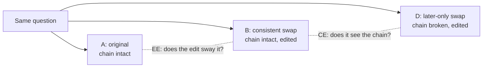

A model that decides whether to answer from retrieved documents is easy to judge by accuracy alone. We started that way too. Then an experiment that raised accuracy by 1.1 points also raised answers to under-supported questions by 30%. Getting more answers right and deciding on the right evidence turned out to be different problems.

This is for anyone choosing quality metrics for a retrieval-based agent, or deciding whether a model change is really an improvement. It records how the metrics collided as we revised the shared decision adapter from [our previous post](/tech-blog/en/research/shared-decision-adapter-27b/) three times.

## In plain terms

Think of a student taking a multiple-choice test. The test has an "I don't know" box, and a wrong guess costs a lot. A good student answers what they know and picks "I don't know" for the rest.

Say this student's score goes up. It might be because they now know more. Or they might be guessing on more questions they don't know, and a few guesses landed. From the score alone, the two cases look the same.

For our model, a question it "knows" is one where the retrieved documents hold the full support for the answer. A "guess" is choosing ANSWER when the support is not there. This post is about a student whose score rose while they were, in fact, guessing more.

<!-- nlm-visual -->
## What we did

### Three metrics

The first is accuracy: the share of items where the model picks the correct action among answer, retrieve more and stop.

The second is the unsupported-answer rate (UAR): among the items the model chose to answer, the share where the evidence was actually insufficient. In test terms, the share of answers that were guesses. It is the most direct product risk metric.

The third is [ChainCheck](https://huggingface.co/datasets/ThakiCloud/ChainCheck), a counterfactual evaluation. Each question is shown with three versions of the documents.

| cell | documents | chain | edit |
|---|---|---|---|
| A | original | intact | none |
| B | the bridge entity is swapped consistently in every document | intact | yes |
| D | the bridge entity is swapped only in the later document | broken | yes |

B and D are both edited, but only D breaks the chain. How well the model separates B from D is its chain sensitivity (CE). A and B share the same chain, so their score gap is a reaction to the edit itself, not the chain (EE). The summary score Σ is CE minus the size of EE; higher means the model judges by the chain rather than the edit. When the swapped entity is a real one we call it real, and when it is invented we call it fict.

*B and D share the edit and differ only in the chain. A and B share the chain and differ only in the edit.*

### Four models

The starting point is Q7, the adapter from our previous post, [published on Hugging Face](https://huggingface.co/ThakiCloud/ECP-Q7-27B-Research): the base model frozen, only 2.18 million parameters trained. On top of it we changed one thing at a time.

- **Q9**: more training data. The 2-hop questions stayed, and 3-hop and 4-hop questions were added.
- **Q10-R**: from Q9, the loss weight on items whose correct action is retrieve or stop was raised to 1.5. This penalizes guessing.
- **Q10-N**: from Q9, one of every four pairs that teach edit invariance was replaced with a pair using invented names. This targets the edit reaction on the fict side.

Q10-R and Q10-N each change a single thing and were never combined. Decision rules and pass lines were written down before training.

## What came out

All four models measured on the same evaluation set:

| model | accuracy | unsupported-answer rate | ChainCheck Σ (fict) |
|---|---|---|---|
| Q7 | .9276 | .0662 | .449 |
| Q9 | .9389 | .0818 | .354 |
| Q10-R | .9355 | .0720 | .371 |
| Q10-N | .9382 | .0882 | .428 |

*Means over four seeds. These are exploratory runs that reused the same development set, measured under the earlier protocol in batches of eight. Q7 versus Q9 mixes a data change with a checkpoint-selection difference. Not an independent product certification.*

No row improves all three metrics together. One at a time:

### Q9: the score rose, and so did the guessing

Q9's accuracy was 1.1 points above Q7's, with a 95% interval above zero. But the unsupported-answer rate also rose, from 6.6% to 8.2%. No seed had it at or below 5%.

Breaking it down, Q9 chose ANSWER more often in every state. Its answer rate went from 39.0% to 41.8%. Total answers grew 7% while unsupported answers grew 30%. The numerator grew far faster than the denominator. The accuracy gain came from recovering answers it had been missing on well-supported items.

ChainCheck also got worse. Fict Σ fell from 0.45 to 0.35, but chain sensitivity did not drop. CE barely moved and EE grew. Confidence on the original A rose sharply, while confidence on the consistently swapped B barely moved. The chain was the same, yet the mere fact of an edit started to split the scores.

### Matching the training step changed the story

Going back to the training logs, we found a trap in the comparison itself. Q7 picked a mid-training checkpoint on two seeds, while Q9 picked the final checkpoint on all four. So the Q9 minus Q7 gap mixed a data change with a change in training length.

Matched step for step, the two models had about the same accuracy at the midpoint. Q9's accuracy gain appeared only in the second half of training. A risk-ranking metric that first made Q9 look better was, at the same step, 2.9 points worse than Q7. The apparent improvement was an artifact of checkpoint selection.

### Q10-R: only the boundary moved

Penalizing guesses brought the unsupported-answer rate down from 8.2% to 7.2%. Accuracy also fell 0.3 points, past the margin we had set in advance.

More important, the risk ranking did not improve. The coverage metric, which asks how many supported items can be answered as the threshold moves, changed with a 95% interval that included zero. The model did not get better at spotting risky items. It simply answered less. In test terms, the ability to recognize what it did not know stayed the same; it just guessed less overall.

### Q10-N: less edit reaction, more guessing

Mixing in invented-name pairs largely restored the fict side it targeted. Fict Σ rose from 0.35 to 0.43, and the edit reaction EE fell by more than half. Accuracy and real-side Σ held.

But the unsupported-answer rate rose again, from 8.2% to 8.8%. Under the rules set beforehand, that alone means no pass. And when we restrict the check to documents never used in training, the fict gain is not statistically detected. We cannot yet say it generalizes to new documents.

In other words, teaching the model not to flinch at edits made it steadier under edits, but its habit of answering without support grew slightly.

### The two risks were not one problem

If the unsupported-answer rate and the edit reaction came from one cause, they should move together within a seed. Seed by seed, from Q7 to Q9, they did not. In one seed only the edit reaction rose sharply; in another only the unsupported-answer rate went up. Four seeds cannot prove two causes. They do remove the basis for fixing both with a single loss.

## What to change

First, always measure the unsupported-answer rate next to accuracy. Even an experiment like Q9, where accuracy clearly rose, can raise risk.

Second, confirm any claim of lower risk with a ranking metric. The unsupported-answer rate drops just by moving the threshold, as Q10-R shows. Only lower risk at the same coverage means the model judges better.

Third, match training steps when comparing two models. Picking each model's best checkpoint mixes the data effect with the training-length effect.

Fourth, count the independence of evaluation data separately. In this work, some ChainCheck pairs came from source documents that overlapped training data. Only the non-overlapping pairs tell you whether a gain generalizes.

For ThakiCloud this result bears on how Paxis should measure agent quality. When an agent answers from documents it finds, watching only the hit rate misses a rising risk of answering without support. When a decision model is retrained in Maxis, an improvement should count only if it passes accuracy, unsupported-answer rate and counterfactual invariance together.

<!-- nlm-visual -->
## What not to trust

First, the evaluation set was reused. All four models were evaluated repeatedly on the same development set, and the Q10 ideas came after looking at it. These results are exploratory, not confirmatory. The sealed test set and the calibration set were not opened.

Second, there is no independent replication yet. We tried to rebuild the same evaluation from another source, 2WikiMultihopQA, and failed. After meeting the independence criteria, too few items remained to reach the power target. A classifier could also tell which distractor paragraphs had been replaced. Following the rules set in advance, we did not lower the bar and closed that path. We are now designing a new evaluation from a different independent source.

Third, the scale is small. There are four seeds, and switching a single seed's checkpoint moved the unsupported-answer rate by several points. That swing was sometimes larger than the gap between models.

Fourth, the data range. Only multi-hop questions built from synthetic English text were used; Korean enterprise documents are untested.

*These numbers were measured on our own H200 GPUs, and only results recorded in our research ledger are cited.*
