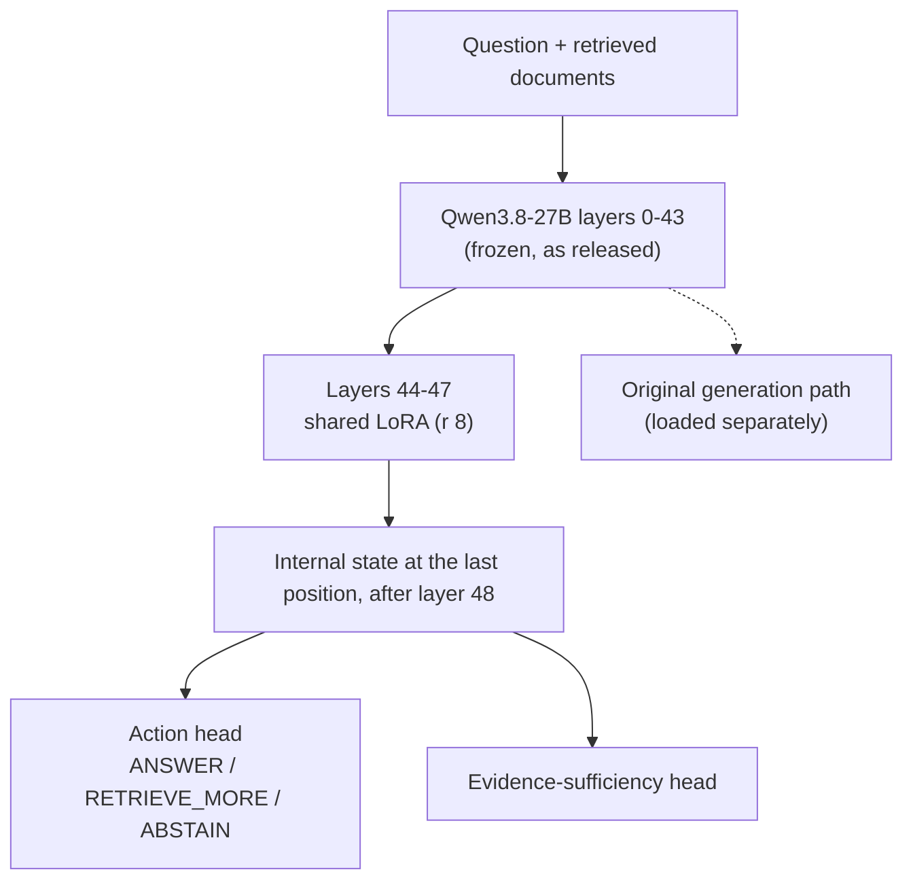

It is now common for a company to run several large language models side by side, each tuned for its own work. A Korean model, a finance model and a support model may all grow from the same base. If the decision to answer, search further or stop must be retrained for each of them, the cost grows with the number of models.

We left the base model untouched and trained a small, separate part that only makes that decision. It has about 2.18 million parameters, less than 0.01% of the 27B model. Attached unchanged to four derived models, it kept accuracy within 0.3 points. If you run retrieval-based agents on more than one model, this is for you.

## In plain terms

Picture a bank with several branches. Each branch has advisors with a different specialty: one is strong with foreign customers, another with loans. Yet the job with a customer's paperwork is the same everywhere. If the papers are enough, answer. If something is missing, ask for more. If more cannot be had, stop.

Instead of training each branch on these three calls, could every advisor share one decision sheet? The sheet does not change what an advisor knows. It reads the notes the advisor made while reading the papers, and ticks one of three boxes.

That sheet is what we built. The advisor is a 27B language model, and the notes are its internal intermediate state. The three boxes are ANSWER, RETRIEVE_MORE and ABSTAIN.

<!-- nlm-visual -->
## What we did

### How the sheet is built

The base model is Qwen3.8-27B with every weight frozen. It has 64 layers, and the sheet uses only the first 48. Layers 0 to 43 run exactly as released. A small LoRA sits on layers 44 to 47 only. Right after layer 48, we take the internal state at the last position, after the question and documents are read, and feed it to two small classifiers.

*The sheet stops at layer 48, so one decision costs about three quarters of a forward pass. This is a research diagram; running the decision and generation paths inside one serving engine is not implemented.*

The trained parameters are 2,162,688 in the LoRA and 20,484 in the heads, 2,183,172 in total. The sheet also never writes text. It returns probabilities for the three actions, and the base model must be loaded separately to write an answer.

### Training and evaluation

Training data came from MuSiQue, a multi-hop question answering dataset. For each question we varied the documents so the correct action follows from how the data was built. If every link in the chain is present, ANSWER is correct. If one link is missing and retrieval is available, RETRIEVE_MORE is correct; if retrieval is not available, ABSTAIN is.

We evaluated on a development set of 1,436 questions. We trained four seeds and report their mean, not the best seed. Published numbers come from the way the loader actually runs: one input at a time, no padding.

### Attaching it to other models

We attached the same sheet, without retraining, to four 27B models derived from Qwen3.8-27B. All four share the base structure and differ only in weights. We call them Derivative A to D and do not publish their names.

## What came out

### On the base model

Mean accuracy over four seeds was 92.7%, and the best seed reached 94.2%.

| seed | accuracy | unsupported-answer rate (UAR) | coverage of supported items* |
|---|---|---|---|
| 1 | .930 | .042 | .885 |
| 2 | .930 | .081 | .785 |
| 3 | .942 | .088 | .892 |
| 4 | .906 | .054 | .802 |
| mean | .927 | .066 | .841 |

*\* Share of evidence-supported items the model could answer when the answer threshold is moved on the same set to keep UAR at or below 5%. An in-sample diagnostic.*

The unsupported-answer rate is the share of ANSWER choices where the evidence was actually insufficient. It was above 5% for three of four seeds. High accuracy still left cases of answering with no real support.

For reference, RAG-Gate-27B, a full fine-tune of the whole model, reached 95.7% on the same set. That number comes from a different model measured a different way, in batches of eight, so it is not a direct comparison. The direction is still clear: the sheet is not more accurate than full fine-tuning.

### On the derived models

Attached without retraining, the sheet kept accuracy almost unchanged.

| model | accuracy (base → derived) | difference [95% CI] | UAR (base → derived) | decision agreement |
|---|---|---|---|---|
| Derivative A | .928 → .928 | +.001 [−.001, +.002] | .066 → .067 | .989 |
| Derivative B | .928 → .931 | +.003 [+.001, +.006] | .066 → .072 | .981 |
| Derivative C | .928 → .927 | −.001 [−.004, +.003] | .066 → .084 | .958 |
| Derivative D | .928 → .926 | −.001 [−.004, +.001] | .066 → .058 | .979 |

*Measured under the earlier protocol, in padded batches of eight; the one-input-at-a-time protocol was not applied here. Derivative D's lineage is not fully verified, so it is reported as a measurement only.*

Accuracy stayed within 0.3 points on all four models. The unsupported-answer rate, however, moved differently on each. On Derivative C it rose from 6.6% to 8.4%. Keeping accuracy does not mean keeping risk.

In other words, handing the same sheet to another branch kept the hit rate almost the same, but the habit of answering without support differed a little from branch to branch.

### Probabilities changed with the runtime

Verification before release turned up something we did not expect. The same weights gave different decision probabilities in different runtimes. In the reference runtime, probabilities matched bit for bit. With a different CUDA build and a missing kernel library, they differed by up to 0.14.

On 64 items per seed, no decision flipped. That does not guarantee the same for inputs near the decision boundary. So the release pins the exact runtime, and the loader warns when it runs anywhere else.

## What to change

What this result shows is not high accuracy. It shows that an evidence decision can be split off as a light, separate layer and shared across models that are already deployed.

A team running several derived models might try this order before retraining each one. Train one shared sheet first. Then measure each derived model's unsupported-answer rate as well as its accuracy. Accuracy alone would miss a risk rise like Derivative C's.

For ThakiCloud this direction ties straight into Paxis. A Paxis agent has to decide whether it may answer before it answers from retrieved documents. Even when customers run different models, one managed decision standard is better. Training only the sheet cuts the cost of retraining whole models in Maxis. Because the base model stays as it is, a decision layer on top of models already served by Metis is also possible, though that shared serving is not built yet.

The four weights, the loader and synthetic examples are on [Hugging Face as ECP-Q7-27B-Research](https://huggingface.co/ThakiCloud/ECP-Q7-27B-Research).

<!-- nlm-visual -->
## What not to trust

First, the evaluation set. Every number comes from the development set, and each seed's checkpoint was chosen on that same set. Results may look better than they are. We have not opened the sealed test set for this adapter.

Second, there is no safety certification. The unsupported-answer rate is above 5% for three of four seeds, and no statistical upper bound has been certified on a separate calibration set. One of the published synthetic examples gives a document about a different person with the same name and asks about an instrument. All four seeds chose ANSWER. Insufficient evidence is not always refused.

Third, the transfer is narrow. All four derived models share the base structure and agree with the base model's decisions at least 95.8% of the time. This is transfer within one model family, not across architectures. Since the derived models are unnamed, the transfer result cannot be reproduced from public weights.

Fourth, operating conditions. The data is synthetic English text, and Korean enterprise documents are untested. The loader handles one input at a time. Padded batches moved probabilities by up to 0.07, and we have not found whether a specific kernel, masking or something else is the cause.

*These numbers were measured on our own H200 GPUs, and only results recorded in our research ledger are cited.*
