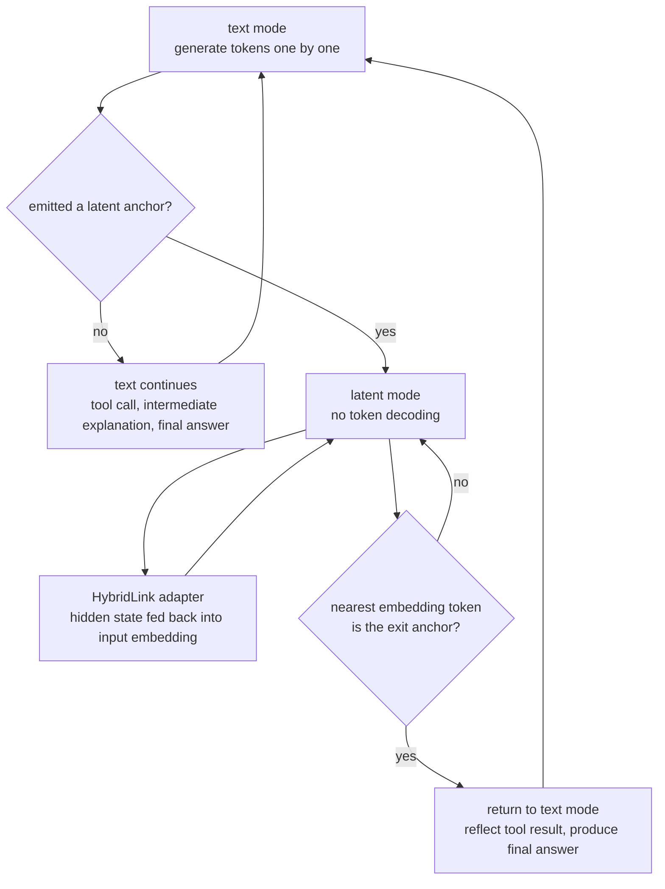

## Why It's Worth Reading

If you own the token bill for agentic workloads, the engineer serving, pricing, and SLO-ing agents on an agent platform like Paxis, this paper is a result that can move your cost curve next quarter. The core conclusion is one. You can build an agent that does not emit every intermediate thought as text tokens, keeps tool use and final answers in text, and gets better performance for it. "Hybrid Reasoning Agents" (arXiv 2610.18861, 2026-10-13) from Stanford and Together AI evaluates Qwen3-Base 4B, 8B, and 14B on 11 benchmarks and reports an average 10.4% accuracy gain over textual agent baselines, 35.5-54.7% fewer exposed tokens, 1.8x-2.6x faster inference, and 2.7x-3.7x lower cost.

> 📄 **Full deep review (DOCX)**: [Download the detailed peer review on Google Drive](https://drive.google.com/file/d/1bMo1hynw2gamzIO7yxxdx5ow2UeScgtK/view).

*The hybrid idea in one picture: dense silent reasoning (smooth streams) through a core, with sparse spoken action (token dashes) branching out where the agent acts.*

## In Plain Terms

You do not write down every intermediate step when you work through a math problem. You turn the big numbers over in your head and put on paper only the answer you hand over and the calculations worth revisiting. The habit HybridAgent teaches a model is exactly this one. "Thinking" happens inside the model, in latent space, without writing anything down, and "acting," the tool calls and final answers, happens in text. The key point is that this boundary is not a fixed rule like "think 50 steps silently, then speak." It is an adaptive rule learned from data. Keep the analogy in mind. The limitations and conclusion sections will bring the same paper back.

## Overview

Decoding is the dominant axis of an agent's cost structure. A long-reasoning model emits its chain of thought entirely as text tokens, and each token converts into GPU-seconds. Agent workloads stack repeated tool-call turns on top, so the invoice per task compounds as reasoning tokens times tool-turn tokens. Research into cutting that bill has split into two lines.

The first line is latent reasoning itself. Work in the Coconut family makes the model think in hidden states, but tool use and user observation get harder, and the reasoning becomes a black box. The second line stays in text. Agentic RL like ARPO or GRPO learns more efficient reasoning, but it cannot reduce the total volume of "writing" without changing the way the model writes. The central question is whether cutting volume keeps accuracy, or whether accuracy falls with it.

This paper argues the two lines can be one. Within a single generation, it alternates a text mode (action) and a latent mode (thought), and learns the switching points too. Stanford and Together AI are behind it, and alongside the October 13, 2026 arXiv submission, the code is public under the MIT license, with 8B/14B adapter weights and training datasets (HybridSFT-v1/v2, HybridRL) on Hugging Face. The experiments cover three model scales (4B, 8B, 14B) and 11 benchmarks: AIME 25, AIME 26, and MATH500 for math; GPQA-Diamond, MedQA, and MuSiQue for knowledge, science, and medicine; GAIA, HLE, WebWalker, SealQA, and DSQA for agentic reasoning.

## What the Technique Is

The structure has three parts: the backbone, the switching device, and the training procedure.

**The backbone** is Qwen3-Base 4B, 8B, and 14B. Every number in the paper comes from these backbones. It is worth noting that they are open backbones rather than frontier models: a substantial share of the results comes from the hybrid structure itself, not from picking a strong model.

**The switching device is HybridLink**, a lightweight adapter. Its form is a residual connection that feeds the hidden state back into the input embedding space, `h + W2 sigma(W1 h)`, roughly 10M parameters for a 4B backbone. On a 14B model, the part doing the switching is a fraction of a percent of the whole. The mechanics: while generating in text mode, the model emits a latent anchor, and generation stops decoding tokens, entering latent mode. At each step, HybridLink feeds the last-layer hidden state back as the next input, so the model turns its state around without writing anything. No tokens, no decoding cost. When to speak again is decided by the nearest token in embedding space becoming the exit anchor, with no fixed length or cadence in advance.

*One generation of HybridAgent: tokens are produced in text mode; once a latent anchor appears, the model thinks without tokens through HybridLink, and returns to text mode when the exit anchor is detected. The switching points are not fixed; they are learned.*

The difference from prior latent-reasoning attempts shows up directly in HybridLink's form. Coconut feeds the model's last hidden state straight back as the next input embedding and learns latent thinking through a staged curriculum. SoftCoT projects soft thoughts from a frozen auxiliary model into the backbone, and SoftThinking uses probability-weighted mixtures of vocabulary embeddings. HybridLink is a two-layer residual connection that adds a small path on top of the hidden state without replacing it, so the backbone's native text capability stays intact with the adapter off. The paper's 4B comparison makes the payoff of this choice visible: on the same backbone, AIME 25 scores of 10.6 for Coconut, 14.8 for SoftCoT, 19.0 for standard text SFT, and 35.2 for HybridAgent after RL. The latent line was assumed to be a trade that spends text capability for efficiency, and this table shows a different answer.

Transparency is also secured structurally. Allocation of the latent stages, which steps go latent and which stay text, is automated from expert judgment plus the model's prediction entropy, with tool calls and audit-critical steps kept in text. What the user must see is not hidden. Two theorems back the design: Theorem A.1 shows that the continuous working memory, the KV cache, preserves the complete latent history without converting latent thoughts into text, and Theorem C.3 shows that under exact replay, the gradient over text positions equals the gradient of the full hybrid trajectory likelihood. The first means a tool call interrupting mid-thought does not lose the thought, and the second means the optimization design below follows from a guarantee rather than ad hoc choice.

## Training: HybridSFT and HybridRL

The first stage, **HybridSFT**, filters existing text-agentic SFT data and auto-annotates it into 54K hybrid trajectories. What matters is that the intermediate text steps of the old trajectories are not simply swapped into latent. The annotation step first draws the line between what belongs in "head math" and what belongs on paper, and hands that to training. Learning runs in three phases: format activation, which turns on the anchor format; HybridLink activation, which freezes the backbone and aligns the latent hidden states with target embeddings; and a self-conditioned two-pass, where the model retrains on latent it generated with its own HybridLink. The last phase is the crux: it closes the train-inference input mismatch by training on the self-generated latent that will actually flow at inference time, rather than matching distributions by hand. The loss is cross-entropy at text positions and regression at latent positions.

The second stage, **HybridRL**, runs on 12K deep-reasoning plus 1K agentic-search examples, with rollout batch 512 (64x8) and 8 minibatches. The reward is `r_correct + r_format + r_tool`: correctness, format, and multi-tool use. Deliberately, there is no explicit reward for "how much latent mode was used." When to think silently is not prescribed by the reward function; it emerges from doing the task well. Rewarding mode use directly invites the derivative behavior of hiding steps that do no work, and this design avoids that trap. On the optimization side, HybridLink is held fixed, the latent context is replayed exactly, and the likelihood ratio is computed only over actually sampled text positions. The volatile latent stretch is kept out of the gradient, which is what Theorem C.3 certifies.

## What the Paper Reports

All numbers below were verified in the paper itself (abstract plus full text).

On agentic benchmarks, HybridAgent beats same-scale textual agent baselines across the board. At 14B, GAIA averages 52.4, eight points ahead of the ARPO-trained textual agent (43.7) and 15.5 ahead of GRPO (36.9), by level 53.8 on GAIA Lv1, 55.8 on Lv2, 33.3 on Lv3. WebWalker averages 49.5, HLE 16.0, SealQA S-0/Hard 24.3/37.8, DSQA accuracy/F1 21.7/46.8. The 8B model points the same way: GAIA 43.7 (ARPO 38.8, GRPO 32.0), WebWalker 42.5, HLE 14.4, SealQA 22.5/35.8, DSQA 20.0/40.7.

| Scale | Method | GAIA avg | WebWalker avg | HLE avg | MATH500 | AIME 25/26 |
|---|---|---:|---:|---:|---:|---:|
| 14B | GRPO | 36.9 | 38.5 | 8.6 | - | - |
| 14B | ARPO | 43.7 | 40.5 | 10.0 | 87.0 | 42.1/43.3 |
| 14B | HybridAgent | 52.4 | 49.5 | 16.0 | 88.2 | 43.3/45.8 |
| 8B | ARPO | 38.8 | 32.0 | 8.8 | 82.8 | 37.1/41.5 |
| 8B | HybridAgent | 43.7 | 42.5 | 14.4 | 84.6 | 39.2/43.3 |

*GRPO's math benchmark scores are not in the paper's results table, so they are omitted. Only verified values are reported.*

The knowledge, science, and medicine axes point the same way. The 14B HybridAgent's GPQA-Diamond 55.1, MedQA 81.7, and MuSiQue 34.5 all lead the same-scale ARPO (54.0, 80.3, 31.5). Latent switching does not hurt on pure reasoning tasks with no tool use at all.

The efficiency axis is the real point of this post. The 14B HybridAgent exposes 284 text tokens per instance where a textual agent exposes 497, and the 8B exposes 302 against 596. Depending on the benchmark, the exposed-token reduction runs 35.5-54.7%, inference speed 1.8x-2.6x (2.1x versus the textual agent), and cost reduction 2.7x-3.7x. The abstract puts it as "cheaper reasoning need not cost accuracy," and the +10.4% accuracy means the model does better than the baseline while using less, not that it lost accuracy and made up for it with speed.

The basis of the cost figures deserves a note. The paper charges per step, not per token: each text or latent generation step costs one full backbone forward pass, plus vocabulary projection for text steps and the HybridLink adapter for latent steps. Currency conversion assumes $2.50 per H100-hour at 10% of peak BF16 utilization, excluding prompt prefill and external tool execution. The result is 62.5-72.9% less compute, with cost falling from $359 to $98 (3.7x) at 4B, $439 to $121 (3.6x) at 8B, and $470 to $176 (2.7x) at 14B. The reduction is largest at small scale, an observation the paper itself makes: the relative cost of text projection is higher in small models.

The artifacts were checked too. GitHub (togethercomputer/HybridAgent) is MIT-licensed and ships hybrid_agent (the generation engine), hybrid_sft, hybrid_rl, hybrid_inference (batch runs), and interpretable_latent_mode (a module for inspecting latent stages). Hugging Face hosts the HybridAgent-8B-Agentic and HybridAgent-14B-Agentic adapters (adapter.pt in the checkpoint) plus three training sets (HybridAgent-HybridSFT-v1, v2, HybridAgent-HybridRL). With a backbone on hand, the adapter experiment is open, and the interpretable_latent_mode module provides the entry point for inspecting what the latent stages did.

## Implications for ThakiCloud Products

Both lenses apply. It is an agent paper, so Paxis comes first, and the decoding-cost logic puts Metis behind it.

**Paxis lens**: the cost invoice of an agent platform is printed in token counts. If a large share of the agents running on Paxis are "long thinking + short acting" workflows (planning, interpreting results, choosing the next action), the direction this paper points at is a structural lever on the exposed unit price of that thinking. It does not mean the 2.7-3.7x cost reduction reproduces on real workloads (see the limitations below), but making "exposed tokens" a design variable instead of a fixed constant already changes the table of agent economics. In Paxis's execution layer, the things a user must see, skill calls, tool use, policy-gate passage, stay in text, while intermediate exploration goes latent. That is exactly the hybrid division of labor in this paper, and the audit log then concentrates on actions.

**Metis lens**: in serving terms, cutting exposed tokens is cutting GPU-seconds in the decoding phase. ThakiCloud's Metis serves models across customer environments, and running the same checkpoint with less decoding moves both per-endpoint throughput and $/1M tokens. The paper's numbers come from the authors' self-hosted environment, so they are not quoted as-is. The next experiment is stacking the same adapter onto a real workload on our cluster and recomputing under the discipline of explicit serve configuration and repeated measurement.

## Limitations and Counterarguments

The paper on the page cannot settle every question. First, the baseline of the savings figures. The 35.5-54.7% is measured against textual agent baselines trained with ARPO/GRPO, not against the long chains of frontier thinking models. The scale tops out at 4B-14B, and the paper does not answer whether the claim survives at larger sizes. Second, transparency. Latent stages exist as hidden states, and the readout is possible only through the provider-owned HybridLink. The paper's own discussion flags this: with classic text chain-of-thought the user could see the reasoning itself, whereas in the hybrid design the part the user does not see grows structurally, and the side that can monitor it is the provider. If you operate a platform that polices agent behavior with policy gates and audit logs, the auditability of "what was thought silently" is a question that needs an answer before adoption. The interpretable_latent_mode module gives a partial answer, but decoding a latent stage into pseudo-text is an interpretation, not a recovery of the original reasoning. Third, generalization. All 11 benchmarks are reasoning- or agent-centric, and the paper does not cover whether the learned switching points transfer to production workloads (customer conversations, search, code), or what happens when "when to speak" itself becomes an attack surface. Fourth, the boundary of the cost model. The savings above are a per-step charge excluding prefill and tool execution. In tool-heavy workloads where execution time dominates, the relative effect of latent-step savings shrinks. The latent span is also capped at 16-256 steps in the experiments, and the behavior of the exit-anchor heuristic on longer silent stretches is unverified. Fifth, these are the paper's own measurements. Before any ThakiCloud deliverable quotes them, our serving environment must produce its own numbers until then, the label is "as reported by the authors."

## Wrap-up

The boundary between "thinking" and "acting" was, for a long time, a matter of sampling and prompts. This paper moves that boundary into the architecture: a 10M-parameter adapter and two stages of training. The result is that +10.4% accuracy and 35.5-54.7% fewer exposed tokens point in the same direction, which is the first and a substantial piece of evidence that cheaper reasoning need not pay for itself in accuracy.

For the people who serve or price agentic workloads, the next action is concrete: stack the HybridAgent-14B adapter onto your own backbone and re-measure "exposed tokens per passed task" on your single most expensive workload. This paper is the one that made that axis measurable, the one that turned "when to fold the scratch paper" into a decision variable. If the number points the same way in our environment, the next quarter of agent economics moves from model selection to the division of labor inside generation.

> 📄 **Full deep review (DOCX)**: [Download the detailed peer review on Google Drive](https://drive.google.com/file/d/1bMo1hynw2gamzIO7yxxdx5ow2UeScgtK/view).

*Sources: [Hybrid Reasoning Agents, arXiv 2610.18861](https://arxiv.org/abs/2610.18861) (Jiaru Zou, Yunzhe Qi, Sirui Chen, Federico Bianchi, Shang Zhu, Pan Lu, Jingrui He, James Zou, 2026-10-13). Code: [github.com/togethercomputer/HybridAgent](https://github.com/togethercomputer/HybridAgent) (MIT). Weights and datasets: [huggingface.co/collections/togethercomputer/hybridagent](https://huggingface.co/collections/togethercomputer/hybridagent). All figures in this post were verified in the paper itself and are the authors' measurements, not ThakiCloud re-measurements.*

> 📄 **Full deep review (DOCX)**: [Download the detailed peer review on Google Drive](https://drive.google.com/file/d/1bMo1hynw2gamzIO7yxxdx5ow2UeScgtK/view).
