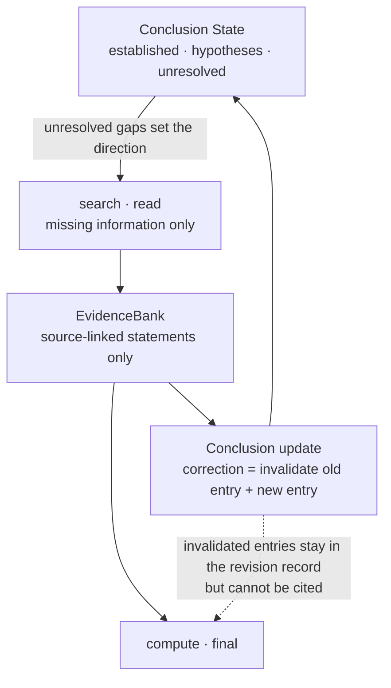

When you hand an agent a problem whose answer is scattered across thousands of documents, what separates a right answer from a wrong one is often not how much it searches, but how it accumulates what it finds. One new experiment changes nothing but that organization, and the accuracy follows.

On a financial document corpus of roughly 100 million tokens, swapping only the harness took the same model's exact match from 4.4 to 61.1. On the earlier corpus it rose from 15.8 to 60.2, and in budget-matched comparisons it beat two well-known coding-agent harnesses by 12 to 19 points.

The subject of the experiment is a harness called LongHarness. Its core idea is not to give the model more context but to pull acquired evidence and the current conclusion out of the conversation into explicit state. Here is how that structure works, and what it means for agent execution infrastructure.

*The core idea of LongHarness: acquired evidence and the current conclusion are managed as separate states outside the conversation.*

> 📄 **Full deep review (DOCX)**: [Download the detailed peer review on Google Drive](https://drive.google.com/file/d/1ecogVdRWzMAaLo_GsebScswNIaeDDqkz/view).

## In plain terms

Most people who write research reports have a habit. When they pull a file from the shelf, they jot the page number and the key sentence in a notebook. They keep a separate list of the claims going into the report and the items still unverified, and they open the shelf only when the list says something is missing. When a new regulation changes a number, they strike through the old page and write the new one. Only unstricken pages may be used in calculations and conclusions.

The structure LongHarness attaches to an agent is exactly this. The notebook is the evidence bank, the claim list is the conclusion state, and the unverified items are the key that drives the next search. The notebook accepts only pages actually opened, and a correction is never an in-place edit: a new entry is written and the old one is invalidated, and invalidated entries cannot be cited.

Until now, agents have accumulated everything on top of the conversation. What they searched, what they read, what they concluded, what they corrected, all growing in one pile. As the pile grows, the agent must repeatedly re-scan it to answer two questions: what am I still missing, and which number is current. LongHarness pulls those two out of the conversation and manages them as separate states, evidence and conclusion.

The structure addresses two failures. One is searching for its own sake, wandering the shelf without consulting the list. The other is knowing a number changed while the calculation still uses the old one. The experiment shows how the same model's accuracy changes when those two are organized structurally.

## What we tried

### The failure modes first

If the task is to find specific values across 1,435 documents and compute from them, model ability is rarely the bottleneck. The paper shows one real case. On the problem of computing the geometric mean of 80 monthly expenses, one harness found the table and then read backward 103 times in a row. It used 4,100 for May 1942 in its computation, later recognized the correction to 4,400, and still left the old value in its final answer. The relative error was about 0.1 percent, which is the boundary between right and wrong. LongHarness returned the correct answer on the same problem in 10 actions.

The paper names this kind of failure in two ways. Unbounded exploration keeps retrieving without resolving the information gap that matters for the decision, and it burns the turn budget. Evidence-state drift lets previously acquired evidence or later corrections fail to reach the current conclusion, so the final judgment rests on stale values. Both come from the same cause: evidence and conclusions entangled in implicit state inside the conversation.

### The evidence bank and the conclusion state

LongHarness manages three states. E is the active evidence, which accepts only statements carrying a source reference. C is the conclusion state, with three lists: conclusions justified by active evidence, plausible but unsettled interpretations, and concrete missing information that could change the answer. H is the history of prior reasoning and observations.

The cycle is simple. The missing-information list sets the direction of the next search. Newly acquired evidence is admitted into the bank, and then the conclusion state is updated. A search snippet is a navigation aid, not citable evidence. To cite, the agent must actually read the source, register it, and then write a statement that references it. Corrections never edit in place. A new entry is added and the old one invalidated, or the old one is simply retracted. Invalidated and retracted entries stay in the revision record but cannot be cited in compute or final answers.

The important design decision is this. The runtime does not automatically rewrite conclusions that depended on invalidated evidence. Recognizing a correction and issuing the revision remains the model's job. Drift is reduced, not eliminated.

*The LongHarness reasoning cycle. Evidence and conclusion update each other outside the conversation.*

### The comparison design

Four benchmarks. OfficeQA Pro V1 has 133 questions over 697 U.S. Treasury documents, about 100 million tokens. V2 has 90 questions over 1,435 documents, a doubled corpus. AA-LCR-1.1 has 100 questions, about 99.3K tokens per set. The Long subset of LongBench v2 has 108 questions, with a median context of 204K words.

The backbones are GLM-5.3-Flash and Qwen3.8-Flash. For each, the paper compares direct reasoning (BM25 retrieval into a 256K window, no tools), Claude Code, Codex, the programmatic REPL harness RLM, and LongHarness. Every harness gets 200 turns. LongHarness additionally caps search at 60 calls, cumulative reading at 1M tokens, and each read at 16,384 tokens. Sampling is fixed at temperature 1, top-p 0.95, and maximum reasoning effort. With the budgets matched, this is a comparison of structure.

## Results

### 14x with the same model

Exact match, in percent.

| Backbone | Harness | V1 | V2 | AA-LCR | LongBench v2 | Avg |
|---|---|---:|---:|---:|---:|---:|
| GLM-5.3-Flash | direct | 15.8 | 4.4 | 80.0 | 62.0 | 40.6 |
| GLM-5.3-Flash | Codex | 46.6 | 42.2 | 77.0 | 69.4 | 58.8 |
| GLM-5.3-Flash | Claude Code | 48.1 | 35.6 | 79.0 | 63.0 | 56.4 |
| GLM-5.3-Flash | RLM | 45.1 | 38.9 | 56.0 | 60.2 | 50.0 |
| GLM-5.3-Flash | LongHarness | 60.2 | 61.1 | 84.0 | 75.9 | 70.3 |
| Qwen3.8-Flash | direct | 15.8 | 4.4 | 80.0 | 54.3 | 38.6 |
| Qwen3.8-Flash | Codex | 49.6 | 50.0 | 81.0 | 69.4 | 62.5 |
| Qwen3.8-Flash | Claude Code | 53.4 | 41.1 | 83.0 | 63.9 | 60.3 |
| Qwen3.8-Flash | LongHarness | 61.7 | 51.1 | 87.0 | 76.9 | 69.2 |

The gap between direct reasoning and LongHarness is 44.4 points on V1 and 56.7 on V2. Against the strongest harness, LongHarness leads by 12.0 points on V1 and 18.9 on V2 for GLM. When the corpus doubles, direct reasoning collapses to 4.4 while LongHarness holds 61.1.

### The difference shows up in one stage

The paper splits the process into three stages: how much of the required evidence was found, whether evidence edits (adding, striking through) succeeded, and whether the acquired evidence was correctly transformed into computation and judgment. For GLM on the original corpus, Claude Code scores 85.0 on the first stage but 66.0 on the last. Codex is 77.5, and LongHarness is 80.8. On the new corpus, the last stage is 58.2 for Claude Code and 79.7 for LongHarness.

The differentiator is not finding things. It is using what was found correctly. In the notebook analogy, shelf-searching skill is similar across harnesses. The notebook and the claim list stop staying in sync in some of them.

### Notes alone do not reproduce it

Ablations show each mechanism's share, for GLM, V1/V2 exact (drop from full).

| Variant | V1 | V2 | Drop |
|---|---:|---:|---|
| Full LongHarness | 60.2 | 61.1 | baseline |
| No conclusion-guided search | 55.6 | 53.3 | 4.5 / 7.8 |
| No persistent state | 55.6 | 53.3 | 4.5 / 7.8 |
| Evidence accumulation, no correction rule | 56.4 | 51.1 | 3.8 / 10.0 |
| Free-form notes | 53.4 | 53.3 | 6.8 / 7.8 |

The free-form notes variant, which mimics the old pile-on-conversation habit, is 6.8 points lower on V1. The variant that accumulates evidence without the strike-through rule is 10.0 lower on V2. The correction mechanism matters more on the harder corpus.

### The gap varies by model and benchmark

With Qwen3.8-Flash, V1 leads the best harness by 8.3 points, but V2 is 51.1 against Codex's 50.0, a 1.1-point margin. In the three-run appendix (GLM only), LongHarness's spread is 0.4 to 1.3 points, versus 4.2 for Claude Code on V2. Codex exhausted its turn budget on 21.1 percent of V2 questions. Median turns are 30 for LongHarness, 43 for Codex, and 116 for Claude Code. The same 200 turns are spent very differently, and sometimes the budget runs out before they are spent at all.

## What to change

Three things to separate before you run a corpus-larger-than-window workload. First, let the missing-information list, not model discretion, decide the next search. When what-is-still-unknown is explicit state, retrieval becomes goal-directed and budget burn drops. Second, make corrections append-only. Write the new value, invalidate the old one, and block compute from citing invalidated values. The revision record is then an audit log for free. Third, do not budget in turns alone. Promote search counts and cumulative read tokens to first-class metrics.

At ThakiCloud, this structure is a candidate for the Paxis agent memory layer. The evidence bank's revision record is in the shape of an audit log, and missing-information-driven search is a control a policy gate can own. On the Metis inference side, cumulative read tokens belong next to output tokens as a cost metric. From a Maxis angle, structured evidence-and-conclusion update trajectories are more refined training data than raw conversation history.

## What not to trust

First, the headlines are single runs. Compute constraints left the main comparison at one run per setting, and the three-run report covers only the GLM backbone. Second, the model-agnostic claim rests on two Flash-class backbones. Whether dense frontier models gain the same, or manage state well enough to gain less, is unknown. Third, final responsibility for correction fidelity sits with the model. The runtime blocks citation of invalidated entries but does not verify that a computed value matches its source. Fourth, no code or traces are public, and there is no cost or latency report. The 0.1-percent case cannot be independently verified. Fifth, the domain is document-centric. Software or scientific corpora are outside the paper's scope.

*Sources: the paper (arXiv 2610.13075), the OfficeQA Pro benchmark repository (github.com/databricks/officeqa), and the full deep review on Google Drive.*

> 📄 **Full deep review (DOCX)**: [Download the detailed peer review on Google Drive](https://drive.google.com/file/d/1ecogVdRWzMAaLo_GsebScswNIaeDDqkz/view).

*The numbers in this post are values verified against the paper (arXiv 2610.13075v1); precise figures are kept in the tables and captions.*
