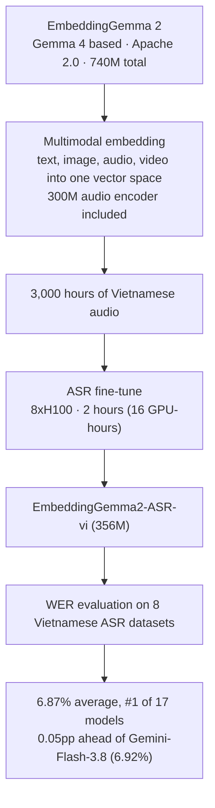

## Why Read This

This is for engineers operating STT (speech-to-text) in multilingual environments and deciding which model to serve per language, and for anyone pricing out ASR. The core claim up front: if you have roughly 3,000 hours of audio for a given language, retraining a sub-400M open model for that language can beat 2B+ API ASR systems on WER (word error rate), for a training bill of 16 GPU-hours (8xH100, 2 hours). It is a challenge to the assumption that "the big API model is the default for multilingual STT."

*Sound being turned into vectors and transcriptions, abstracted.*

## Overview

On October 14, 2026, @stablequan of Polyskill posted a benchmark table on X: "I took the Google Gemma Embedding 2 model and trained it on 3,000 hours of Vietnamese audio. It reached SOTA. All it took was 2 hours on 8xH100." The table compares 17 models on WER across eight Vietnamese ASR datasets (bud500, cv17, fleurs, gigaspeech2, lsvsc, phoaudiobook, vimd, VIVOS), lower being better. The star, **EmbeddingGemma2-ASR-vi (356M)**, takes first place with 6.87% average WER.

The base, EmbeddingGemma 2, is an open-weight multimodal embedding model Google DeepMind released on October 6, 2026. It encodes text, images, audio, and video into a single vector space; it is built on the Gemma 4 architecture, ships 740M parameters, and is Apache 2.0 licensed. Its official positioning is "best-in-class for its size" among open multimodal embedding models, aimed at semantic search, RAG, and clustering. It is not an ASR model. What makes this experiment interesting is that it repurposed the model as a speech recognition engine.

The use cases in the official announcement are all on the retrieval side, too: finding a specific video clip from a voice memo, searching through hours of audio recordings with a text query. The audio side is a tool for finding sound, not for transcribing it. In one sentence, this experiment turned a finding tool into a transcribing one.

## What the Model Is

EmbeddingGemma 2 assembles modality-specific encoders around a shared backbone. Per the Hugging Face card, it totals 740M parameters: Backbone 130M, Embedder 140M, Vision 170M, Audio 300M. Selective loading is a first-class feature: text-only 270M, text+image 440M, text+audio 570M, full multimodal 740M. Published benchmarks include MTEB multilingual v2 at 61.36, MIEB lite at 64.64, and MAEB, the Massive Audio Embedding Benchmark, at 49.39. The card also lists truncation performance: MAEB holds 46.92 at 128 dimensions versus 49.39 at 768, so compressing the vectors to a sixth of the size keeps most of the ability. That flexibility matters in small-model serving environments. The 570M text+audio configuration is already tuned for understanding sound.

The retrained model appears as 356M in the benchmark table, smaller than the card's 570M text+audio build; the exact configuration is not disclosed, so treat 356M as the author's figure. Training data: 3,000 hours of Vietnamese audio. Training time: 2 hours on 8 H100s, 16 GPU-hours.

An embedding model's job is to represent sound as vectors. Since the audio encoder was already trained to understand sound, bolting a transcription output on top and fine-tuning with language-specific audio is a natural path. Good embeddings place similar sounds in nearby vectors, and that discrimination can carry straight into recognition accuracy. Whether it generalizes is a separate question, covered in the limitations section.

## Benchmark Results

The table below transcribes the top rows of the author's screenshot. WER (%); lower is better.

| Model | Params | Avg | bud500 | cv17 | fleurs | gigaspeech2 | lsvsc | phoaudiobook | vimd | VIVOS |
|---|---|---|---|---|---|---|---|---|---|---|
| **EmbeddingGemma2-ASR-vi** | 356M | **6.87%** | **1.62%** | 10.19% | 6.75% | 12.34% | **5.48%** | 1.35% | **9.05%** | 8.15% |
| Gemini-Flash-3.8 | n/a | 6.92% | 1.83% | 10.12% | 5.98% | 10.16% | 5.91% | 1.60% | 10.25% | 9.36% |
| MAI-Transcribe-2.0 | n/a | 6.96% | 2.45% | 10.15% | 5.86% | 10.15% | 6.07% | 1.40% | 10.25% | 9.48% |
| Cohere Transcribe 03-2026 | 2,066M | 7.01% | 3.93% | 11.09% | 5.64% | 10.27% | 6.98% | 1.74% | 10.34% | 6.07% |
| Qwen3-ASR-1.7B | 2,038M | 7.01% | 5.20% | 11.31% | **4.88%** | **8.47%** | 6.60% | 1.85% | 10.54% | 7.25% |
| ElevenLabs Scribe v2 | n/a | 7.08% | 3.21% | 10.44% | 5.62% | 10.43% | 6.11% | 1.45% | 10.50% | 9.14% |
| PhoWhisper-large | 1,543M | 7.21% | 9.51% | 9.12% | 5.31% | 10.14% | 6.81% | **0.87%** | 11.38% | **4.52%** |
| Whisper large-v2 | 1,543M | 15.63% | 32.71% | 19.35% | 10.75% | 19.70% | 11.07% | 3.06% | 17.29% | 11.09% |
| Whisper small | 242M | 28.81% | 65.50% | 31.08% | 20.59% | 27.44% | 20.21% | 11.21% | 30.66% | 23.80% |

EmbeddingGemma2-ASR-vi leads on average at 6.87%, but the gap to second-place Gemini-Flash-3.8 (6.92%) is 0.05pp. MAI-Transcribe-2.0 (6.96%), Cohere Transcribe 03-2026 (7.01%), Qwen3-ASR-1.7B (7.01%), and ElevenLabs Scribe v2 (7.08%) all sit within 0.2pp. Per dataset, the new model is best on three of eight (bud500, lsvsc, vimd). PhoWhisper-large leads cv17 (9.12%) and phoaudiobook (0.87%), Qwen3-ASR-1.7B leads fleurs (4.88%) and gigaspeech2 (8.47%), and Cohere Transcribe 03-2026 leads VIVOS (6.07%). It is "lowest on average, best on a third of the datasets," not a sweep.

The baseline gap is larger. Whisper large-v2 sits at 15.63% and Whisper small at 28.81%. Vietnamese-specialized models (the PhoWhisper family and this new one) are 1 to 2x more accurate than general-purpose ones, which says switching to a language-specific model is itself the win.

Two caveats before taking this at face value. First, the table is self-reported by the author. Dataset splits, audio normalization, and decoding parameters are unknown, and no weights or training code were released. Second, "SOTA" means first among the 17 models in that table, not an absolute claim over all ASR in the world.

## What This Means for ThakiCloud

ThakiCloud's ai-platform (K8s-based AI/ML SaaS infrastructure) serves model inference and training into customer environments. Our standard STT engine is Qwen3-ASR-1.7B, which this table places at 7.01% on Vietnamese. The practical reading of this experiment: for non-English languages, a language-specialized small model is a realistic alternative to a general-purpose large one, with a completely different cost structure.

First, training economics. 16 GPU-hours is a small quantity on a K8s GPU training fleet. In a call-center or customer-support scenario with daily Vietnamese volume, a self-hosted 356M model is likely to beat the monthly plus per-call bills of metered API ASR (Gemini-Flash-3.8, ElevenLabs Scribe, Cohere Transcribe). At 356M it also serves on a single GPU, or even at the edge, which makes it a candidate for the on-prem and sovereign deployments our customers often ask for.

Second, the Paxis lens. Paxis is ThakiCloud's Agent-Native Cloud, where agents handle calls and voice input. Per-language STT model selection is a direct agent execution cost. If this direction (a small specialized model per language) is confirmed by replication, Paxis voice workflows can be designed to route each language to its own dedicated model. Since the same embedding model can be reused for retrieval use cases like speaker or voice search, one served asset covers two jobs.

## Limitations and Counterpoints

Read the biggest number gap honestly: 0.05pp between first and second. Across different evaluation harnesses that is within measurement noise. "The small model won" is a stronger headline than what the data supports; the fair version is "a Vietnamese-specialized 356M model reached parity with the best API ASR on Vietnamese datasets."

The 3,000 hours of audio is a cost that is not in the "2 hours" claim. Data curation, cleaning, and labeling are unknown, and languages with less data should not be expected to match this. It is also a single-language case, Vietnamese only; generalization to other low-resource languages is unproven. The embedding base is a double-edged sword: it was never trained as an ASR model, so its ceiling may be lower than dedicated ones, and in fact PhoWhisper-large (0.87%) beats the new model (1.35%) on phoaudiobook.

## Takeaway

A single language with enough data changes the STT model-selection equation. Before buying API ASR for a specific language, check whether a language-specialized open model exists and whether the retraining bill (on the order of 16 GPU-hours) is cheaper than the API's monthly total. The table here cannot be independently verified because the model and code are not public, but the direction itself, specialized small over general large, matches what the per-language ASR literature has been showing for a while.

Sources:

- @stablequan post: https://x.com/stablequan/status/2110209860511932554 (2026-10-14)
- Google EmbeddingGemma 2 model card: https://huggingface.co/google/embeddinggemma-2
- Official announcement: https://blog.google/innovation-and-ai/technology/developers-tools/embeddinggemma-2/ (2026-10-06)
- Benchmark table: author's screenshot (self-reported, weights not public)
