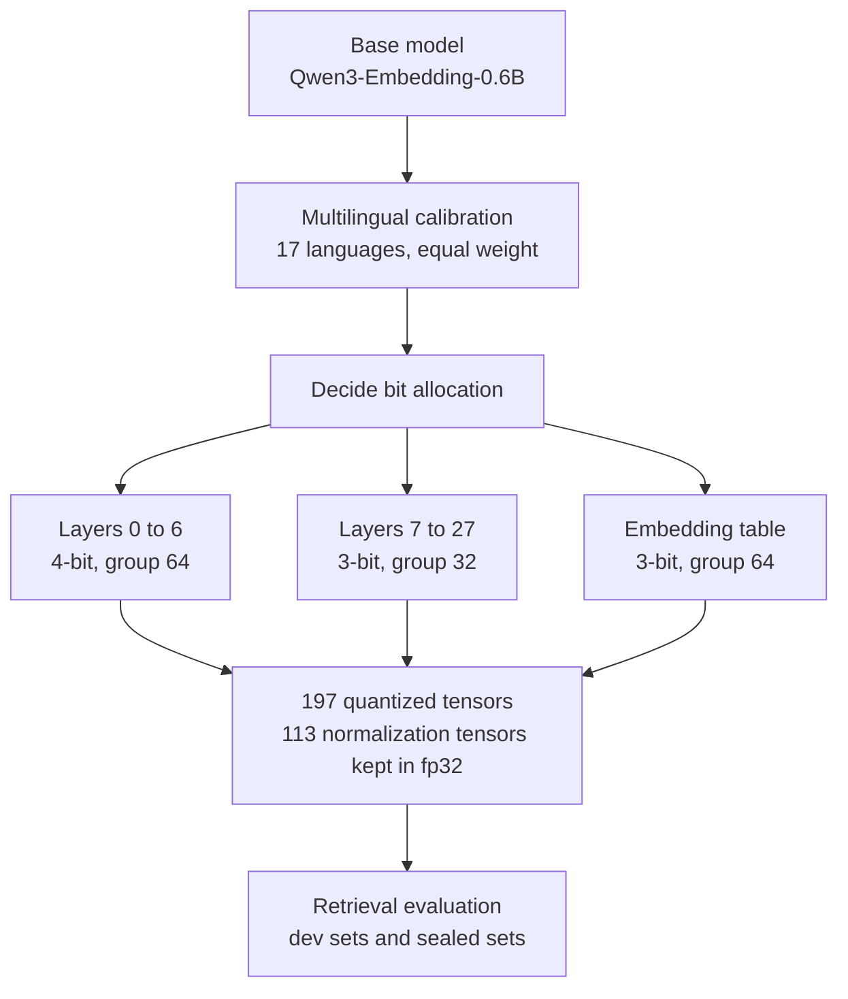

This post is for anyone who wants to shrink a multilingual retrieval embedding model to low bit widths. The conclusion first: a layout that splits bits differently per layer was 0.95% smaller by quantization payload than a layout giving every layer the same bits, and it scored higher on five of nine retrieval sets. We have not yet pinned down where that gain came from. This post gives both facts equal weight.

The model is built on Qwen3-Embedding-0.6B and went up on [Hugging Face](https://huggingface.co/ThakiCloud/Qwen3-Embedding-0.6B-MultiCal-M1a-GPTQ) today. It is a research preview, released as a reference point for quality comparisons.

*An illustration of a structure in which each layer is compressed by a different amount.*

## In plain terms

Think of packing a suitcase. The weight limit is fixed and every piece of clothing has to go in. The usual approach is to compress everything with the same force: one vacuum bag for all of it, pressed until the air is out.

But clothes differ in how well they survive creasing. A suit jacket is hard to wear after being squashed hard, while a T-shirt can be shaken out. So you press the jacket lightly and the T-shirt harder, keeping the total weight the same or slightly lower, and the clothes come out in better shape.

That is what this model did. We treated the network's layers as the clothes, gave the first seven layers more bits, and took the same amount back from the other layers. The suitcase weight is storage size, and the condition of the clothes when you unpack is retrieval quality. We use the suitcase comparison to the end of this post.

## Uniform compression is the default

Quantization means writing a model's weights with fewer bits than the original. Storing numbers that were 16 bits as 3 or 4 bits makes the file smaller and the download faster. The cost is that the numbers are written more coarsely, so the model may do its job a little worse.

Usually every layer gets the same setting. The baseline we used is like that too: a uniform layout that writes all 28 layers in 3 bits, with one scale and one min for every 32 values. In this post we call it the uniform 3-bit layout. It is simple to implement and operate, and a reasonable starting point for comparison.

There is reason to doubt a uniform layout. Layers do different work, so the damage from writing them coarsely may differ too. Still, we did not start by accepting the common belief that the early layers are more sensitive. To test that belief, you pin the storage budget to nearly the same value and change only the layout before measuring. If you loosen the budget, quality improves as a matter of course, and the layout deserves no credit for it.

## How M1a splits the bits

We call the released layout M1a. The base model is Qwen/Qwen3-Embedding-0.6B at revision 97b0c614be4d77ee51c0cef4e5f07c00f9eb65b3. The bits are split as follows.

| Target | Bits | Group size |
|---|---|---|
| Layers 0 to 6 | 4-bit | 64 |
| Layers 7 to 27 | 3-bit | 32 |
| Embedding table | 3-bit | 64 |

Group size sets how many values share one scale and one min. Smaller groups track the numbers more closely but need more room to store scales and mins. So bit width and group size are two knobs that split the same budget. For the first seven layers we raised the bits to 4 and enlarged the group to 64, which gave back some of the storage cost.

The method is per-group asymmetric min and max, with scale and min stored in fp16. Normalization weights are not quantized and stay in fp32. The artifact contains 197 quantized tensors and 113 normalization tensors kept in fp32. The quantizer is our own implementation in the GPTQ family, and we do not claim a new algorithm.

Calibration mixes 17 languages with equal weight. English comes from FineWeb-Edu, and the other 16 languages come from the FLORES languages in FineWeb-2. We used 256 sequences of 256 tokens each. We do not redistribute the calibration text or token ids; the model card lists only the sources.

One thing to be clear about: what we released is the model, not the code. The quantization engine and the bit-allocation implementation stay private. Making the model runnable from the published files alone was our own homework, and we will cover that in the next post.

## Where the budget came from

If you give the early layers more bits, you have to take them from somewhere. Counting the cost of one value shows where. Storage cost is not set by bit width alone; it also includes the fp16 scale and fp16 min attached to each group.

| Setting | Cost per value |
|---|---|
| 3-bit, group 32 (baseline) | 3 bits + 32 bits / 32 values = 1 bit, so 4.0 bits |
| 4-bit, group 64 (early layers) | 4 bits + 32 bits / 64 values = 0.5 bit, so 4.5 bits |
| 3-bit, group 64 (embedding table) | 3 bits + 0.5 bit = 3.5 bits |

The first seven layers spend 0.5 bit more per value, and the embedding table spends 0.5 bit less per value. In this model the embedding table is the largest single tensor, because it has more than 150,000 vocabulary rows. So the extra cost in the early layers is paid back by the embedding table. In suitcase terms, we pressed the jacket gently and made room by pressing the bulkiest item, the duvet, harder.

This arithmetic explains why the budget stays nearly constant, but how many bytes actually shrank in the real file has to be counted separately. Tensor shapes and packing boundaries shift the numbers slightly. The table below is the result of that count.

## What the 0.95% is a percentage of

Three different values often get mixed up when people talk about size. We report them separately.

| Value | Bytes |
|---|---|
| Quantization payload accounting | 295,029,952 |
| Weight file | 295,391,600 |
| Whole model directory | 311,275,695 |

Payload accounting is the number of bytes taken by the quantized weights and the scales and mins attached to them. The weight file is the actual file size, which is that payload plus the safetensors header. The model directory also includes the tokenizer and config files, so it is the largest.

The uniform 3-bit layout had a payload accounting of 297,855,488 bytes. M1a is 295,029,952 bytes, which is 2,825,536 bytes less, or 0.95%. In suitcase terms, we kept the weight almost the same and changed only how we compressed.

One important caveat applies. This 0.95% uses only the payload accounting column. We did not record the weight file size of the uniform layout, so we cannot know how many bytes differ once both are on disk. That is why we do not rewrite this number as "the disk shrank by 0.95%." The role of this value is only to show that the two layouts have nearly the same budget by accounting.

## Results

Evaluation used nDCG@10, averaged over three build seeds. The verdicts followed rules fixed before we saw the results. First we estimate a lower bound on the noise from rebuilding with different seeds, then we also look at a paired bootstrap interval, and ask whether the difference is larger than that noise.

Dev set results:

| Eval set | Uniform 3-bit | M1a | Verdict |
|---|---|---|---|
| E1 (FLORES-based cross-lingual retrieval) | 70.13 | 76.25 | M1a ahead |
| FLORES | 90.02 | 92.12 | M1a ahead |
| MIRACL bn | 53.47 | 57.06 | M1a ahead |
| MIRACL hi | 41.69 | 45.27 | M1a ahead |
| MIRACL ja | 58.54 | 60.37 | M1a ahead |
| MIRACL ko | 55.54 | 57.18 | not attributable |
| NFCorpus | 32.67 | 33.80 | not attributable |

The sealed sets were used for this comparison exactly once.

| Eval set | Uniform 3-bit | M1a | Verdict |
|---|---|---|---|
| MIRACL te | 53.60 | 56.57 | not attributable |
| MIRACL sw | 41.25 | 43.68 | M1a ahead |
| SciDocs | 20.65 | 20.89 | not attributable |

"Not attributable" must not be read as "the same." The verdict means the difference sits inside the build noise, so it cannot be credited to the layout. MIRACL te is a good example. The score rose from 53.60 to 56.57, nearly 3 points, but the noise lower bound on that set is 5.23, which is larger than the gain. It may have gone up, or it may drop on the next build. This is the cell where we write down what we do not know.

The seed spread suggests why the noise is so large. Building three times with the same settings and only the seed changed gave NFCorpus 32.97, 34.34 and 34.09, and FLORES 91.67, 92.64 and 92.05. Quantization corrects error layer by layer, so a small difference spreads toward the later layers. That is why we did not put a single build's value in the table as is. The released weights are seed 0 only; for the other two seeds, the card lists just the numbers and hashes so you can check the spread.

## We could not trace the cause to one place

This is the part we most want you to read carefully. M1a scored higher than the uniform layout on five eval sets, but we do not write that the reason is "we protected the early layers."

M1a changed three things at once. It raised the bit width of the first seven layers, enlarged the group size of those same layers, and changed the group size of the embedding table. This experiment alone cannot separate which of them produced the gain. We ran a separate follow-up experiment to localize the effect to the early layers, but it did not clear the pass condition we had set before seeing results.

So what we can say now stops at "the M1a configuration as a whole reached this level at this budget." Back in the suitcase, we still do not know whether the gain came from pressing the jacket lightly, from pressing the T-shirt harder, or from changing the bag. To go one step further, we would need to build the treatment arm and the control arm several times each and compare within the spread.

## At ThakiCloud

Our ai-platform runs GPU jobs on Kubernetes through Kueue queues and serves models into customer environments. Many customers have on-prem requirements, so model size and download time go directly into the real cost of adoption. That is why low-bit embeddings matter to us.

It would be hard to say this work already cuts that cost. What shrank is storage and download; we did not measure runtime memory or latency. What this experiment left in operations is the verdict rule instead. When comparing quantized checkpoints, we first measure the spread from rebuilding with different seeds, and credit only differences larger than that noise. We added this procedure to our evaluation path. Without it, differences produced by build luck get reported as wins for the recipe. When the work is re-quantizing and delivering per customer environment, this distinction becomes especially expensive.

## What not to trust

This is a research preview. We did not measure serving speed or GPU memory savings on this model, so please do not cite it for those claims. What shrank is disk and download.

The dev sets are not holdouts. They were the eval sets we looked at while choosing the layout, so a good result there comes with a mild advantage. That is why we kept the sealed sets and used them only once.

These results come from one model and one budget. They do not generalize to other embedding models or other byte budgets. We compared only against the uniform layout, and this post does not include a comparison with the original precision. And as noted above, "no attributable loss" is a weaker statement than "the quality is the same."

## Summary

Within the same budget, we split bits differently per layer and scored higher on five of nine eval sets. By payload accounting it was 0.95% smaller. We also disclose that we could not trace that gain to a single cause. Reporting only one of the two would send the next reader away with the wrong lesson.

If you work with low-bit embeddings, two things are worth taking away. First, bit width and group size are knobs that split the same budget, so comparing on one of them alone throws the budget off. Second, in quantization comparisons, measure the spread from rebuilding with different seeds first. Without it you cannot tell a rise from a wobble. The weights are on [Hugging Face](https://huggingface.co/ThakiCloud/Qwen3-Embedding-0.6B-MultiCal-M1a-GPTQ), so you are welcome to measure for yourself.
