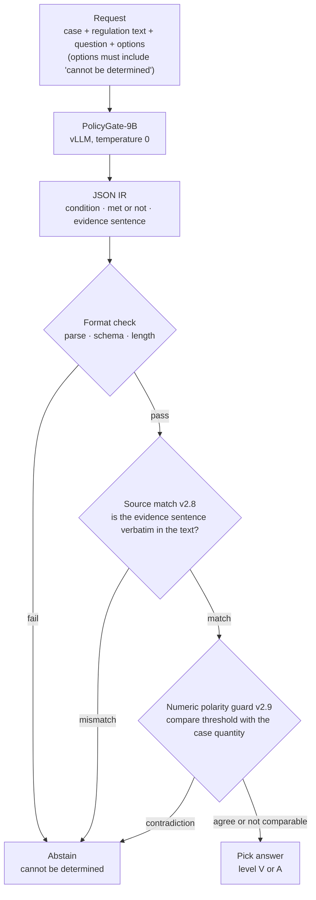

We released Thaki-PolicyGate-9B v0.1, a Korean regulation-checking model, on Hugging Face. The model does not make decisions. It reads a case and the regulation text, then writes down as JSON which condition applies, whether the case meets it, and which sentence shows that. The answer is chosen by deterministic code, released alongside it, after matching that record against the source text field by field. If anything does not match, the code abstains with "cannot be determined from the regulation."

On our two dev sets, the model allowed a wrong answer zero times. The share of answerable questions it held back instead was 2.0 and 4.9 percentage points. This post is for anyone who wants to put a language model behind decisions that are hard to undo when wrongly approved, such as benefit eligibility or fee reductions.

*An illustration of separating the reading from the deciding.*

## In plain terms

Think of a bank loan counter. The clerk reads the customer's papers and fills in a review sheet: the income, the years employed, and the page each fact came from. The approval stamp belongs to the reviewer. The reviewer opens the original papers for every line on the sheet and checks that the quoted sentence is really there. If any line fails, there is no stamp and the file goes back.

Our earlier 4B model was a clerk who also held the stamp. It read the papers and immediately stated an approval probability. The new 9B only does the clerk's job. The stamp is held by code playing the reviewer. However convincing the clerk's notes are, a sentence that is not in the original does not get through.

This design has a price. A clerk who knew the right answer but filled in the sheet clumsily still gets the file sent back. So this model has to be read with two numbers: how many wrong approvals there were, and how many approvable files were sent back.

## Why we changed direction after the 4B

[kd-4b-ko-v0](https://huggingface.co/ThakiCloud/kd-4b-ko-v0), released in September, put a Kev-style decision head on Qwen3.5-4B-Base. It read the question and options in one pass and produced a probability for each option. We later added a selective layer that declines to answer when confidence is low.

The trigger for the change was an experiment already written in that 4B card. Of 591 deadline questions from enforcement decrees, the 4B abstained on 406 for low confidence. Answering those directly, the 4B was right 58.4% of the time. When an in-house 27B model only extracted the dates and day counts and code did the arithmetic, accuracy was 99.3%.

*Left: accuracy of the two approaches on the deadline questions the 4B abstained on. Right: the 9B's results on two dev sets.*

Reading a number and reasoning from it to a conclusion turned out to be different skills. The model was good at reading, and code was exact at computing and comparing. So for the 9B we narrowed the model's job to reading.

## What we released

There are two repositories. [Thaki-PolicyGate-9B-v0.1](https://huggingface.co/ThakiCloud/Thaki-PolicyGate-9B-v0.1) is the extraction model: Qwen3.5-9B with a LoRA trained and merged in. [Thaki-PolicyGate-runtime](https://huggingface.co/ThakiCloud/Thaki-PolicyGate-runtime) is the backend that makes the decision, plus an HTTP API. Both sit in [one collection](https://huggingface.co/collections/ThakiCloud/thaki-policygate-korean-regulation-condition-checking-6ad31ba54339527205d81ce2).

This is the path a single request takes.

The backend is deterministic code built up in layers since v2.6. Each layer loads only after checking the hash of the layer below. If a frozen file changes by a single byte, it refuses to start. The backend takes under 3 ms per request at p95. Nearly all latency comes from the model writing JSON.

The training data is 6,151 synthetic records produced by a deterministic generator. No record was written by a language model. Filler clauses are statute text from Korea's National Law Information Center, while agencies, people and fee rules are invented by the generator. No AI Hub data was used.

## The numeric polarity guard added in this version

Up to v2.8, the backend checked that the evidence sentence existed in the source, but it took the model's word on whether that sentence meant the condition was met. Four wrong answers came through that gap.

The example in the model card is one of them. The regulation says the reduction becomes 47/100 "when the same document is requested more than ten copies." The case says the applicant asked for two copies. The model recorded this exception as "met." The evidence sentence really was in the source, so v2.8 accepted the record and answered 47/100. The correct answer is 74/100.

In such cases v2.9 reads the threshold and the case quantity and compares them itself. Two copies is not more than ten, which contradicts the model's "met." The backend then moves the answer to abstention. It only compares when four conditions all hold: the condition is a numeric threshold, the case sentence has exactly one quantity in the same unit, that quantity belongs to the same person and attribute, and there is no negation. If any of these is unclear, it leaves the decision alone.

The guard only moves answers toward abstention. There is no path in the code that turns an abstention into an answer. So when the guard is wrong, the result is an unnecessary abstention, not a wrong approval. When we injected 104 mutations that deliberately flipped the model's polarity, the guard blocked all 104.

## Results

We ran the released code as-is on one B200 with vLLM 0.28.0. There are two sets. VAL has 1,640 new questions from templates seen in training. DIAG has 1,448 diagnostic questions built to be deliberately tricky.

On VAL, 1,090 questions were answerable by the backend when given the correct record. The model path kept 1,068 of them and held back 22, an extra abstention of 2.0 pp. Wrong answers allowed, at any level: zero.

On DIAG, it kept 928 of 976 answerable questions. The extra abstention was 4.9 pp and wrong allows were again zero. All four cases the numeric guard was meant to catch were blocked.

Serving was measured once. At concurrency 1, latency was 683 ms at p50 and 737 ms at p95. It handled 7.3 requests per second at concurrency 8 and 22.1 at concurrency 32, with no errors.

Finally, we downloaded both public repositories into an empty environment and brought them up again. For the same 300 questions, all 300 decisions matched the earlier run.

## What to change

If you want a language model on Korean regulation checks, treat its output as a record to verify rather than a decision. Matching evidence sentences against the source character by character already filters out invented evidence. Work where code is exact, such as numeric comparison, belongs in code.

The second point is the metric. A model that can abstain should not be compared on accuracy alone. Wrong allows and unnecessary abstentions need to be reported separately, so you can see what was given up and how much.

## At ThakiCloud

This design comes from the same idea as Paxis's policy gate. Paxis is ThakiCloud's Agent-Native Cloud, and it runs every agent action through a policy gate and an audit log. PolicyGate's IR records which condition was judged from which sentence, so every decision carries an audit record with its evidence attached.

From the ai-platform side, the model runs on one GPU with open-source vLLM. It calls no external API, and the backend uses only the Python standard library. It can run as-is inside the networks of financial and public-sector customers who cannot send data outside.

## What not to trust

First, both evaluation sets come from our own generator. We have not measured on real government documents or civil complaints. This is not an independent evaluation, so read the numbers as development results.

We designed the numeric guard after seeing the four wrong allows on DIAG. The zero on DIAG is therefore not evidence that the guard generalizes. In the dev data, the guard actually computed only three units: copies, ordinal counts and age.

The released checkpoint is a single training seed. The study that ran the same method over three seeds did not pass our bar. This result comes from picking the better checkpoint among them.

Greedy decoding was not perfectly identical across runs either. Extra abstention on DIAG was 4.61 pp in the recorded run and 4.72 and 4.92 pp in two reruns. The serving numbers come from a single run, so treat them as a sense of scale only.

Cases where the scenario restates a condition in different words remain unsolved. On DIAG, extra abstention for this type sits around 11 pp. The consolation is that these end as abstentions, not wrong answers. Training documents went up to about 6,000 tokens, and longer inputs were not checked.

This is not a general-purpose decision model. Routing, tool selection and English documents were neither trained nor evaluated. Do not use it to approve or deny anything automatically without human review.
