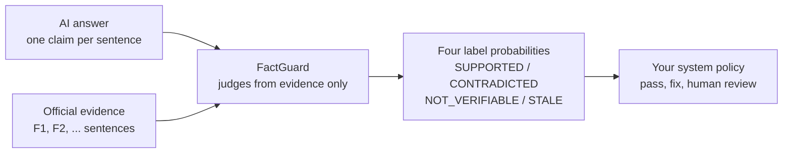
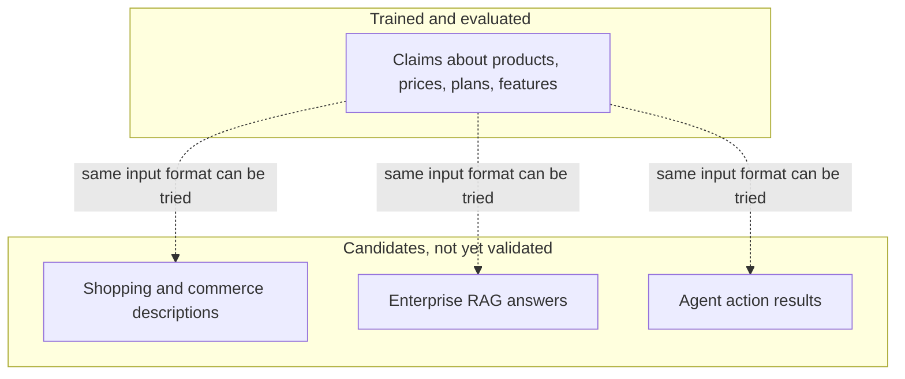

If you run a RAG system, a shopping assistant, a support-center bot or an agent that states prices and features on a person's behalf, you need a component that checks those statements against real evidence automatically. FactGuard reads a bundle of evidence and one claim, then picks one of four labels. We released it in four sizes, 4B, 8B, 9B and 27B, under Apache-2.0.

What we trained and evaluated is verification of claims about products, prices, plans and features. Shopping, enterprise RAG and agent-result checking are candidate uses we have not validated, and this post keeps the two apart throughout. This is a research preview.

## What FactGuard does

The model receives evidence and a claim. The evidence is a few sentences taken from official pages (F1, F2, ...), and the claim is one sentence from an AI answer. The model judges the claim using only that evidence. It does not search, it does not know facts you did not pass in, and it does not know live prices or stock.

The verdict is exactly one of four labels.

- SUPPORTED: the evidence backs the whole claim.
- CONTRADICTED: the evidence says the claim cannot be true.
- NOT_VERIFIABLE: the evidence does not say anything about the claim.
- STALE: the claim is backed only by outdated evidence.

The model does not generate text. At the answer position it reads the scores of the four label tokens and applies a softmax, so the output is always one of the four labels with probabilities attached. UNRESOLVED is not a model output. It is a separate undetermined state used in evaluation and system logic.



*Claim plus evidence goes in, four label probabilities come out, and your service decides what to do with them.*

## The trained domain: AI search and AEO/GEO

The domain we trained and evaluated is AI describing a brand's products, prices, plans and features. When an AI search engine summarizes a SaaS pricing page, errors such as "the Basic plan also gets 100GB" are common. Brands need to find and fix those errors, which is the AEO/GEO view of what FactGuard does. Put the official price table in as evidence and check each AI claim against it, and you can separate claims that are wrong from claims the official page never mentions.

## Three candidate uses: not validated

The three below are ideas for applying the same method. We have not measured FactGuard in any of them.



*The inside of the solid box has evidence behind it. The three dotted targets are hypotheses.*

For a shopping assistant, you could put the product page specs and shipping terms in as evidence and check whether claims like "free returns" or "waterproof" actually appear. For enterprise RAG, the retrieved document chunks serve as evidence, and you check whether each sentence of the generated answer is really in them. For agents, tool execution logs serve as evidence, and you check whether "the booking is complete" matches the log. That last one is a research direction. All three involve evidence shapes such as tables, contracts and logs that fall outside this training scope, so measure on a small sample of your own before relying on it.

## Why four sizes

Each model is a BF16 checkpoint trained with its own LoRA on its own base model using the same recipe, then merged into the weights. No adapter setup is needed. We offer four sizes because latency and cost budgets differ by service.

| Model | Base | p50 latency |
|---|---|---|
| FactGuard-4B | Qwen3.5-4B | 85.5 ms |
| FactGuard-8B | Qwen3-8B | 68.1 ms |
| FactGuard-9B | Qwen3.5-9B | 105.6 ms |
| FactGuard-27B | Qwen3.8-27B | 182.8 ms |

Latencies are medians on a single B200, batch size 1, model only. The 8B has a different architecture (full attention in every layer, a different tokenizer, text only), so size order and latency order do not line up, and we make no size-ranking claim from this table. The 4B, 9B and 27B checkpoints contain vision towers that we did not train, so we claim no image ability.

## Performance and honest limits

Only the 4B has a sealed evaluation. On eval-v6, 2,483 counterfactual items about 28 brands unseen in training, the 4B alone scored 0.913 accuracy, with 27 false supports and 37 false contradictions. Adding a deterministic Claim Coverage Guard (guard/2.2, which is not part of the weights) gives 0.908, nearly the same, but false supports drop to 7 and false contradictions to 8. A Qwen3.8-27B prompted generative judge with the same guard scored 0.918.

One caveat matters here. The pre-registered non-inferiority bar for replacing the 27B judge with the 4B was not met. The difference is -1.1 percentage points with a 95% confidence interval of [-5.0, +4.3], so we cannot say the 4B is not worse.

The 8B, 9B and 27B have development-set results only, and sealed evaluation is pending. Development-set accuracy is 0.987 for the 8B (0.495 for its base with the same prompt), 0.992 for the 9B (base 0.260), 0.993 for the 27B (base 0.371) and 0.993 for the 4B. The 27B base figure uses the label-token prompt, so it is a different measurement from the prompted generative judge above. None of these numbers is generalization accuracy: the 4B seed was chosen on these sets, and the 8B differs in architecture, so this is not a clean size curve. Accuracy on naturally occurring errors in real AI answers is not established.

## How developers use it

Each repository ships `example_inference.py` and `label_contract.json`. The contract is simple. Do not use a chat template; build a raw text prompt. Concatenate the header, the evidence packet and a final `\n\n판정:`, tokenize with `add_special_tokens=False`, and keep the input within 1,024 tokens. Then read the scores of the four label tokens at the next-token position. Only the 8B uses different label token ids (362, 425, 356, 422); the others use (357, 417, 351, 414), and the example script computes them for you.

The evidence packet looks like this. The header and the labels inside the repository are Korean, so keep the packet text as the example script shows it.

```text
대상 브랜드: <brand>
근거:
F1: [<page title>] <line>
F2: [<page title>] <line>
주장: <one atomic claim>
```

## Three real runs

We ran the published FactGuard-4B (Hub commit 29a66c89bdacb183b94cfa3ef6770f16603fa614) as is, on a Mac CPU. The brand is a fictional "MoaNote", and the evidence has three lines: Basic costs 4,900 KRW per month with 10GB, Pro costs 12,900 KRW per month with 100GB, and Pro supports shared team folders. We built the three items once, did not reword them, and the values below are exactly what came out. The packets were in Korean, and the claims are translated here.

| Claim | Expected | Model verdict | Probability |
|---|---|---|---|
| The MoaNote Pro plan provides 100GB of storage. | SUPPORTED | SUPPORTED | 0.9998 |
| The MoaNote Basic plan can also use 100GB of storage. | CONTRADICTED | CONTRADICTED | 0.9983 |
| The MoaNote Pro plan supports offline mode. | NOT_VERIFIABLE | NOT_VERIFIABLE | 1.0000 |

In the second item the remaining mass was 0.0014 on NOT_VERIFIABLE and 0.0002 on SUPPORTED. In the third, every other label was below 0.00002. All three matched expectations, but three easy items demonstrate behavior and are not evidence of accuracy. Probabilities this close to 1 on easy items do not mean the same confidence appears on naturally occurring errors.

## Next: Generalist FactGuard

The current models are tuned to product, price and plan claims. We are developing a Generalist FactGuard that widens the evidence forms to tables, contracts, enterprise documents and RAG, Korean NLI and tool execution logs. There are no results to report yet.

## Model links

- Collection: [FactGuard collection](https://huggingface.co/collections/ThakiCloud/factguard-evidence-grounded-verification)
- [FactGuard-4B](https://huggingface.co/ThakiCloud/FactGuard-4B), [FactGuard-8B](https://huggingface.co/ThakiCloud/FactGuard-8B), [FactGuard-9B](https://huggingface.co/ThakiCloud/FactGuard-9B), [FactGuard-27B](https://huggingface.co/ThakiCloud/FactGuard-27B)

All are Apache-2.0 with merged BF16 weights. This is a research model family published under the ThakiCloud organization, not a feature of a commercial product.
