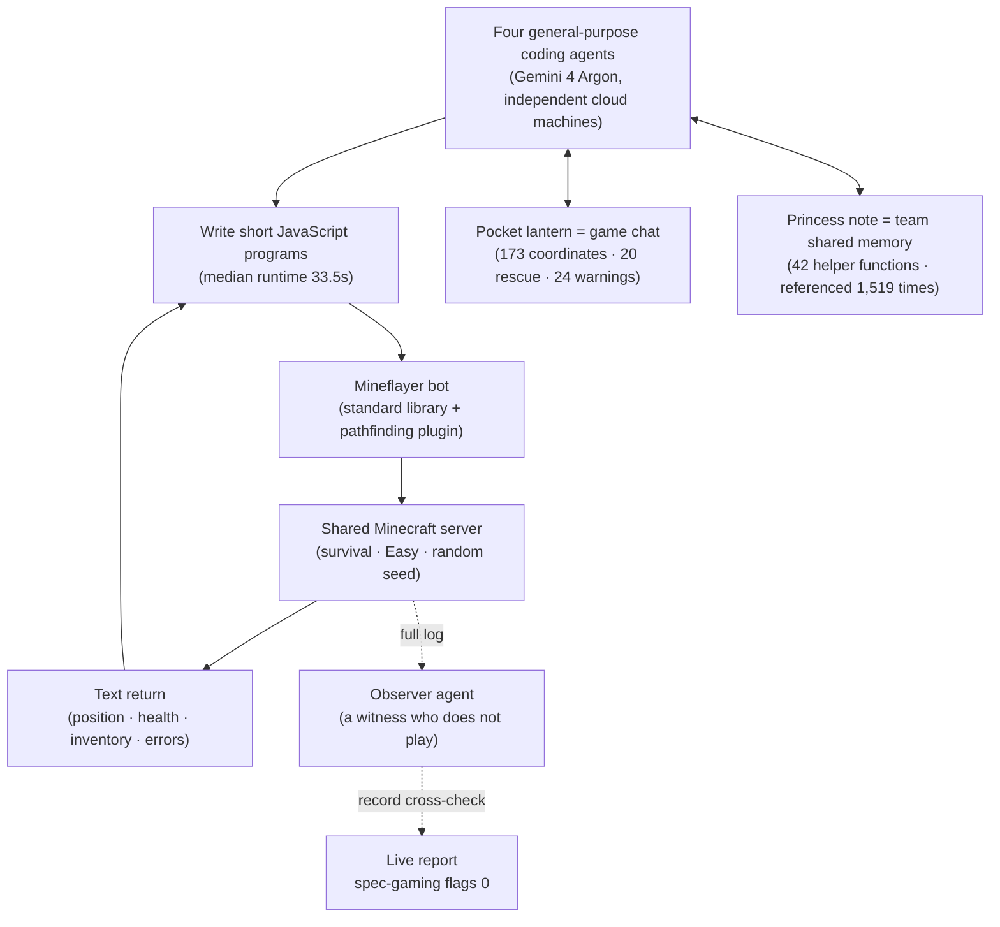

> 📄 **Full deep review (DOCX)**: [Download the detailed peer review on Google Drive](https://drive.google.com/file/d/1QyFYkbS5-kwnfjNGpWBj7n3x5otVRrZC/view).

*Four agents, one expedition, 27 hours.*

## Why It's Worth Reading

If you are a platform engineer or agent architect who judges multi-agent work by "can it run unattended for a long time," this record is your evidence. Here is the conclusion up front. **Four instances of Google DeepMind's general-purpose coding agent Gemini 4 Argon wrote 2,783 programs over 27 hours 14 minutes to clear the Minecraft campaign. There was no role assignment, no curriculum, and no human-written game tooling. This paper (arXiv:2610.22319) is a record of how coordination behavior emerges in such a team, and how you verify it.**

## In Plain Terms

Let's use an expedition as the analogy. A four-person team set out to climb a summit. They do not have a single map. No route drawn by someone else (a curriculum), no route scouted in advance (a seed), no tools built by an expert (human game logic). All they have is a pocket lantern (in-game chat) and a princess note (shared team memory). The mission order is one line: "Kill the dragon. You decide the rest."

Ten minutes after they set out, one agent proposed a division of roles, and a minute later another put forward a different proposal. Two hours later the base camp was done and the Nether portal was lit. When one agent goes down on the trail, the other three send the equipment location and the despawn time (the deadline before a dropped item disappears) over the pocket lantern, and recover it with 2 minutes 30 seconds to spare. What they lose becomes a rule in the note. This paper is the full record of that expedition. All 605 falls, all 173 coordinate transmissions, and the two "what I just said was wrong" corrections are in the record.

## Overview

The paper's setup is deliberately minimal. The agents are four instances of the general-purpose coding agent Gemini 4 Argon, and each instance runs on an independent cloud machine. Each instance drives one player using Mineflayer, an open-source JavaScript library for Minecraft bots. The agents do not look at pixels and do not press keys. They write short JavaScript programs, run them on the shared server, and read the logs and return values as text. Position, health, inventory, discoveries, errors.

The world is a random-seed survival world (Easy). Cheats are disabled, and there is no human intervention during the run. The instructions about the game are a single paragraph: "The goal is to kill the Ender Dragon. That is the only criterion. Within the survival rules, any means is allowed, and the players decide how to divide the work." No roles, no plan, no route was given.

The result is a dragon kill at 27 hours 14 minutes. 2,783 programs (63,313 lines of JavaScript), 229 chat messages, 605 deaths, about 81 in-game days. The paper claims this is the first case of clearing Minecraft all the way using only the standard Mineflayer library, with no pre-scouted seed and no human-written game-specific tooling (to the best of their knowledge). A fifth instance, the Observer, watched the entire process without playing and verified the players' claims against the record.

*This is the loop the agents run. They write a program, run it, read the text, and write the next one. Chat and shared memory are the two channels of coordination, and the Observer watches the whole loop without playing.*

## The 27-Hour Expedition

The first stage is role formation. Ten minutes after the first program, janesick raised the role question in chat, and a minute later auratian raised a different one. One "Copy that!" settled the direction, and two hours later iron tools, diamonds, and the Nether portal had gathered in the team inventory. auratian found 55 lava blocks in the village, janesick placed the final obsidian block, and 2 seconds later auratian lit the frame.

The middle stage is resource transport and one piece of triangulation. To make an Eye of Ender you need blaze rods from the Nether and ender pearls. In the warped forest, three members built a 2-block-high shelter. It is a defense that respects the boundary of the rules: an enderman, which teleports when looked at, cannot enter under a 3-block ceiling. At 10 hours 46 minutes, janesick threw an Eye of Ender from two points, sampled the flight path at 50-millisecond intervals, and computed the intersection of the two lines. The error from the estimated point to the actual portal room was 43 blocks. What a human does with a compass and sense, the agents replaced with measurement and intersection.

The longest stretch is the dragon. In the End, the team died to the dragon 69 times. Between attempts they read the dragon's internal state (behavior phase, health) from game data and wrote down the rules: do not wait on the arrival platform, approach only while it is seated, and if stuck, leave the End and reset. The breakthrough came at about 21 hours. auratian read that the reason the dragon held 200/200 health was the 10 crystals (+2 HP/s), and opened a no-pickaxe corridor. You pile up dirt to climb, hit the crystals bare-handed, then dig back down bare-handed. Over the following 4 hours 40 minutes all 10 crystals fell, and the dragon died 39 minutes after the last one. bulicame's remaining health was 2.5 out of 20.

## Emergent Team Behavior

This is the valuable part of the paper. The instructions had no roles, no trunk, no structure (just the one line that the players decide how to divide the work). Classifying the 229 chat messages by simple pattern, there are 173 messages with exact coordinates, 64 mentions of the shared trunk, 24 teammate warnings, 20 item rescues, and 11 lessons. Five emergent patterns can be read from the record.

First, specialization. gyldenia took on rescue and broke 6 of the 10 crystals, janesick took on tools and triangulation, auratian opened the portal and the crystal corridor, and bulicame built a shelter and then landed the final blow.

Second, the princess note actually worked. At the 19-minute mark, gyldenia wrote the quirks and workarounds of Mineflayer crafting into the note, and that helper function shows up in 655 of the programs the four agents wrote.

Third, self-built tooling. 146 pieces of state and code survive across programs, and 42 of them are helper functions. Here is a background loop that keeps a bot afloat in water, timing-based walking, item counting, and a counter that stops the leftover code of a timed-out program by itself (referenced by 1,519 programs).

Fourth, mutual rescue. Items dropped after death have a despawn deadline. The 12 Ender Eye incident is the representative example. When auratian drowned carrying all 12, janesick and auratian sent the exact coordinates and despawn time to bulicame, and bulicame recovered all of them with 2 minutes 30 seconds to spare.

Fifth, correction. When auratian's program reported a success that did not happen, auratian corrected itself 2 minutes later: "my previous chat was an unguarded script branch" (the chat I just sent was the output of an unguarded script branch). When janesick reported coming back with 12 blaze powders after a 1-second burn, gyldenia pointed out the contradiction within 3 minutes. In a 27-hour record of 605 deaths, these two correction messages are what hold up the word "team."

## Verification and Cost

The verification design is the paper's second methodological strength. All 2,783 programs and their outputs, the entire chat, and the entire server log are recorded. Victory is not the agents' report; it is the advancement record in the server log: "bulicame has made the advancement [Free the End]". No program used a server command during the run. The Observer flagged not a single instance of specification gaming (exploiting a flaw in the evaluation), and the researchers' manual log-sample inspection also concluded without a hitch.

The cost accounting is transparent. Up to the victory, about 1.35 billion input tokens, of which 91% come from the context cache. Output is about 16 million (including 4 million thinking tokens), and model calls are about 24,000. At Gemini 4 Argon's public API list price (introductory rate), about $520; at the standard rate, $1,040. The full session, including the Observer and one day of post-victory activity, is about $810 (standard rate $1,620). The paper states this is an estimate of list price times the session token counter, not the model serving cost. The number to look at here is not $520 but 91%. The economic structure of a long multi-agent run is determined not by the total token volume but by how much the repeating prefix is reused.

## Implications for ThakiCloud Products

**Paxis lens (agent coordination, execution economics).** Paxis is ThakiCloud's Agent-Native Cloud, a control plane that treats Skill, Tool, Policy, and Audit Log as first-class resources. The coordination principles this run shows map directly onto Paxis's layers.

First, the Observer role. Paxis already has policy gates and audit logs. What this paper adds is the pattern of an independent witness agent that verifies claims against the record without playing. Attaching a read-only Observer to a long Paxis run and having it report specification gaming is a direct candidate. The paper's limitation (the Observer uses the same model as the players) is our starting point. We will run a homologous Observer and a different-model Observer in parallel and compare-measure the blind spots of the claim-versus-record cross-check.

Second, the loop where a loss becomes a rule. After a Ghast's fireball blew away a dropped item, auratian posted the rule and janesick posted the root-cause analysis and fix 2 minutes later. This sequence (failure → shared note → verified fix) can be pinned down as an execution contract of Paxis's multi-agent DAG. A contract that a lesson note (cause, concrete state, fix pattern) must exist in the team's shared workspace after a failed step and before a retry.

Third, the compaction survival contract. The agents in this paper also compact when the context gets long, and the instruction is "leave in memory what must survive the compaction." In Paxis, this is not a matter of agent habit but of audit continuity. We need to place handoff points where the in-progress work, the next step, and the verified state are explicitly recorded at the compaction boundary.

Fourth, using the cache ratio as a cost KPI. The 91% cache ratio is the core variable of this run's cost. Paxis cost routing can have an axis that measures and manages the context cache hit rate per workflow. Cost accounting that looks only at total token volume misses the structure of this run.

**ai-platform lens (observability, cost accounting).** The principle "verify victory from the artifact logs" points in the same direction as the philosophy ThakiCloud's ai-platform uses in its experiment observability stack. Artifacts go to S3, execution logs in full, and verification comes from an external source (server log, Observer), not the agent's self-report. A rule that ports directly into agent-run QA.

## Limitations and Counterarguments

First, the asymmetry of world-state perception. Mineflayer gives the agents the exact state. Blocks beyond solid rock, the dragon's internal behavior phase, current health. What a human has to see and interpret, the agents read via API and delegate the calculation to. Pathfinding is done by a plugin, too. "Clearing Minecraft" in this setup is not the result of perception; it is the result of a text interface that is close to an oracle.

Second, prior knowledge. Gemini 4 Argon knows Minecraft and Mineflayer from its training data. This run does not ask "can it play a game it has never seen." Generalization to a new domain (an unfamiliar codebase, an unknown API) cannot be extrapolated from this result.

Third, a single run. The first attempt succeeded. There is no success rate. With 605 deaths, a 22% program error rate, and 6 server restarts in the record, you should not read "did it once" as "does it reliably."

Fourth, the homogeneity of the Observer. The witness is the same model as the players. Shared prior knowledge is also a shared blind spot. The "no specification gaming" conclusion is the combination of a homologous witness and manual sampling, not independent verification.

Fifth, the cost assumptions. $520 is an estimate based on the provider's API list price. In self-hosted serving, the pricing structure of the context cache (91%) is different, and the stability conditions of prefix reuse need to be re-confirmed in our own serving environment.

Sixth, the framing of "first". Two dragon kills were reported earlier in the community. A single Claude Opus 5 agent that cleared the Normal difficulty using 37 high-level tools (AI Bengineering, 2026-09-15), and a case that paired a planner with an action-selection model to clear a fixed-seed Peaceful (Malde, 2026-09-20). "First" holds separately for each setup. This paper's "first" is a "first" with the setup (standard library + 1-paragraph goal + no additions) stated.

## Wrap-up

I collect the conclusion from the introduction. **A four-person expedition without a single map reached the summit in 27 hours 14 minutes. All they had was the pocket lantern and the princess note, but the roles settled themselves in 10 minutes, the equipment was recovered by despawn-time calculation, losses became rules within 2 minutes, and "what I just said was wrong" made it into the record twice. Victory was confirmed not from the agents' mouths but from the server log.**

Four things to take from this record: the Observer that does not play, the loop where a loss becomes a rule, the survival contract at the compaction boundary, and the cost KPI that leads with the cache ratio. All four are patterns that can be pinned down as execution contracts of a multi-agent platform. The 27-hour run with 605 deaths is not a proof of stability. It is the first full-volume record showing what a team of general-purpose coding agents emerges on its own. The next expedition should not be Minecraft; it should be a corporate codebase and APIs the agents have never seen. The paper's authors point in the same direction. The long-horizon coding and multi-agent coordination this run requires are precisely the requirements of real software engineering and enterprise tasks.

## Sources

- Paper: [A team of Gemini 4 Argon agents beats Minecraft (arXiv:2610.22319)](https://arxiv.org/abs/2610.22319) · Google DeepMind · v1 2026-10-15
- Quoted tweet (2026-10-18): https://x.com/hjguyhan/status/2111792803684778129
- Comparative community runs: [AI Bengineering (Claude Opus 5 · 37 high-level tools · Normal)](https://github.com/aibengineering/mine-ai-mcp) · [Malde (planner + action-selection model · fixed seed · Peaceful)](https://github.com/rmalde/minecraft-agent)
- Related research lines: Voyager · DEPS · GITM · JARVIS-1 · Optimus-1 (LLM planner line) / MineRL · VPT · DreamerV3 (learned policy line) / SIMA · SIMA 2 (pixel-based)

> 📄 **Full deep review (DOCX)**: [Download the detailed peer review on Google Drive](https://drive.google.com/file/d/1QyFYkbS5-kwnfjNGpWBj7n3x5otVRrZC/view).
