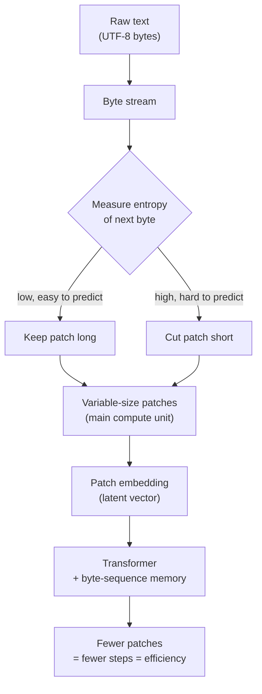

*A visual metaphor for the article's key idea.*

## Why read this

You serve a blog, or you bill for the serving cost, and you are a domestic engineer in that space. We also include the data scientist who wants to see, in numbers, what actually changes when you remove the tokenizer. At the end of October, a thread went viral claiming Meta published a paper that ends the LLM era and kills the tokenizer forever. The conclusion of this post is calmer than that thread. The real contribution of BLT is not removing the token, but reallocating the unit of computation by information density. That is the mechanism that buys inference efficiency and long-tail robustness at once. By the end, the meaning of a byte-level model in your serving stack is visible as a number.

*A uniform raw byte stream (left) re-segmented into patches that are long where prediction is easy and short where it is complex.*

> 📄 **Full deep review (DOCX)**: [Download the detailed peer review on Google Drive](https://drive.google.com/file/d/1qtoBcv6efdHV-aMSAcOUmMt6DhcZy9KO/view).

## In plain terms

Think of compressing a JPEG photo. JPEG cuts the photo into 8 by 8 pixel blocks. An empty region like the sky is represented coarsely with a few coefficients. A complex region like wood grain is represented finely. In other words, it spends less on simple places and puts detail only where it is complex. BLT's patch ports that idea straight into language model computation. Easy-to-predict text passes as one long patch. Hard text is split into short patches. The yardstick that decides where to subdivide is the entropy of the next byte, i.e. its surprisal. Throughout this post we use that one JPEG-block analogy to explain how BLT works.

## Overview

The tokenizer is the first step of every LLM. It is also the oldest piece of preprocessing. It splits text into subword tokens. It turns those tokens into integer ids, then trains the model. There is a cost hidden in this habit. You must learn a fixed vocabulary. For multilingual text and rare symbols and code, the token split comes off the linguistic structure. A vocabulary, once fixed, cannot be changed mid-training.

Byte-level language models have been tried for a long time. Remove the tokenizer and the preprocessing goes away. The model handles every character directly, which is appealing. But byte-by-byte generation is slow. It also needs more steps for the same meaning. So in the scaling race, token-based models beat them. What BLT changed is that it does not go byte by byte; it cuts the computation into patches by information density.

Meta FAIR researchers released the Byte Latent Transformer, or BLT, at the end of 2024. BLT is a byte-level LLM that trains on raw bytes with no fixed vocabulary. It presents the first FLOP-controlled scaling study up to 8B parameters. It claims to match token-based models while improving inference efficiency and robustness. In May 2026 the same team released Fast BLT, which attacks the biggest weakness of byte-level, slowness, with diffusion-based block decoding. The October viral thread is not a new paper; it is a re-ignition of the BLT line. We note that first.

## What this is

The existing approach builds a vocabulary with subword learning like BPE. Once the vocabulary is fixed, it stays fixed. New strings are recombined from it. In JPEG terms, it is close to cutting every photo into blocks of one fixed size. Whether it is sky or wood grain, the block size is the same. BLT drops the fixed vocabulary. Instead it groups the data into units of variable size called patches.

There is one rule for the patch boundary. In a region where the entropy of the next byte is low, i.e. easy to predict, it keeps the patch long. In a region where it is high, it cuts the patch short. This is exactly like JPEG handling the empty sky coarsely and the wood grain finely. This segmentation is not fixed during training. It changes per input, per region. Information density, not a fixed vocabulary, decides the split.

A patch is not just a split. It is the main unit of computation in the transformer. BLT builds an embedding per patch. It also adds a new attention mechanism and a byte-sequence memory. An easy region glides past in a few steps as a long patch. Steps are spent only on the hard region. Processing the same text in fewer steps is the starting point of BLT's inference-efficiency claim.

The title, Patches Scale Better Than Tokens, points to this. BLT's scaling is two knobs, not one. You can grow the model size and the patch size at the same time. A token-based model has a fixed vocabulary, so it cannot easily move the size of the compute unit. BLT re-splits units by information density. So it can grow the model and the unit together. The core evidence is that, at fixed FLOPs, this two-knob scaling beats the token model.

Here is why FLOP-controlled matters. Comparing models by parameter count alone is not fair. Two models with the same parameters can spend different compute serving the same context. FLOP-controlled means matching two models to spend the same compute budget, i.e. the same FLOPs, then comparing performance. If BLT matches the token model under this setting, it means it got the same score for the same money. But BLT spent part of that money as fewer steps, i.e. shorter patch count. A structure that serves the same performance in fewer steps is the basis of the inference-efficiency claim.

Dropping the fixed vocabulary gives a second benefit, robustness. The abstract reports, alongside inference efficiency, qualitative gains in long-tail generalization and robustness. It does not force a string that is not in the vocabulary to be recombined. Rare symbols or letters from another language are taken in as raw bytes. The split that a fixed-vocabulary model suffers when it handles OOV does not exist here.

Removing preprocessing also affects the training side. Tokenizer-free means the data goes straight into training. The preprocessing pipeline is shorter, and there is no vocabulary to update. On the other hand, the same sentence is longer at byte level, so training sequences can be longer than at token level. That asks for different conditions in training batching and context management. A serving gain can partly return as a training cost. We note that.

Fast BLT targets the slow generation of byte-level. BLT-D is a diffusion variant that emits several bytes per cycle. BLT-S is a drafting mode. BLT-DV is a checking mode. Look at the draft-verify structure and a small model proposes several bytes first, then a large model checks them at once. If the proposal is right, several bytes are confirmed in one step. If it is wrong, only the checker runs again. It is in the same direction as speculative decoding in serving. The claimed 50 percent-plus memory-bandwidth saving comes from exactly this round reduction.

- Paper: [Byte Latent Transformer: Patches Scale Better Than Tokens (arXiv 2412.09871)](https://arxiv.org/abs/2412.09871)
- Follow-up: [Fast Byte Latent Transformer (arXiv 2605.08044)](https://arxiv.org/abs/2605.08044)
- Code: [github.com/facebookresearch/blt](https://github.com/facebookresearch/blt)
- Models: [facebook/blt-1b](https://huggingface.co/facebook/blt-1b), [facebook/blt-7b](https://huggingface.co/facebook/blt-7b)

## Hands-on results

We checked whether patch segmentation actually reduces the unit count. We lightly reproduced the BLT principle in our venv. It is not the trained BLT model; it is the principle of entropy-based segmentation. We built one multilingual sample of 475 bytes, 328 characters, and 62 words, mixing English, code, Korean, a run of digits, and rare symbols. We chose this sample because it is exactly the region where BLT claims robustness, the long tail with multilingual and code mixed together.

The baseline is a first-order byte Markov model. From a reference corpus we build the probability of the byte that follows each byte. Over the sample we compute the surprisal of the next byte, in bits, at each position. We place a patch boundary where the surprisal is in the top 20 percent. The threshold was 8 bits. A first-order Markov is a heavy simplification of the entropy BLT learns. But it is enough to show how easy and hard regions map onto patch length.

*Left: unit-count comparison for the 475-byte multilingual sample. Right: next-byte surprisal curve and the top-20 percent patch boundaries.*

For the same 475-byte sample, raw bytes were 475. Char level was 328. GPT-4's BPE, cl100k_base, was 179. Dynamic patches were 90. The dynamic patches produced fewer units than any fixed tokenization. Patch length averaged 6.27 bytes, ranging from a minimum of 2 to a maximum of 38. An easy region passes as one 38-byte long patch. A hard region is cut into 2-byte short patches. The empty sky and the wood grain in a JPEG are separated exactly like this.

There is an important distinction here. The byte count itself does not drop. 475 bytes are still 475 bytes. The real context length is measured in bytes. What drops is the number of transformer steps that process those bytes. If you reduce the patches to 90, you compute only 90 times. That is the basis of BLT's inference-efficiency claim. And it is the part this demo actually verified.

Note the spread in the patch-length distribution. It averages 6.27 bytes but reaches 38. That means the information density of the input is not uniform. Runs of digits or repetitive code become long patches. Rare symbols and language boundaries become short ones. A fixed tokenizer cannot make this spread, because its vocabulary is set.

Look at the longest patch the demo actually caught and the principle is confirmed. The 37-byte patch was "# predictable code gets long patches", a repetitive code comment line. It swallowed the easy line whole. The short patches clustered at high-surprisal positions, near language boundaries or rare symbols. That is the same structure as JPEG making the empty sky one coarse block and the wood grain many fine blocks.

## Implications for ThakiCloud products

ThakiCloud's ai-platform serves models with vLLM on K8s. The largest axis of serving cost is the number of steps that process the context. The transformer runs as many times as the unit count of patches or tokens. It produces FLOPs and memory movement accordingly. If BLT's dynamic patches compress the same meaning into fewer units, there is room for a lower serving unit price at the same context.

Fast BLT's diffusion block decoding matters from a serving view too. The serving bottleneck is mostly memory bandwidth. BLT-D emitting several bytes per cycle means fewer decode rounds for the same output. The estimated 50 percent saving does not translate directly into serving latency yet. But the direction is something we, who handle KV cache and batch size, should watch. From ThakiCloud's on-prem and self-hosting stance, a byte-level architecture that moves both serving unit price and robustness can be one axis of the serving portfolio in the long run.

For Korean serving, one more point matters. BPE vocabularies are usually learned on English-heavy corpora. Then a single Korean word is split into several subwords. Byte level has no such split. A Korean letter is represented uniformly as 3 bytes in UTF-8. Removing the language bias of a fixed vocabulary is, for a platform that serves Korean, a quality problem as well as an inference-efficiency problem.

Concrete, plug the demo's ratio in. The same multilingual sample is 179 units under BPE and 90 under dynamic patches. About 2x. This ratio will not hold on every input. But for a real agent workload where code and digit runs and multilingual text are mixed, a unit cut of this size has a large chance of carrying into steps per context. Fewer steps means fewer FLOPs per context, and the same GPU holds more requests. In serving economics, that 2x is not a spec line; it is read as a direct variable of unit price and throughput.

## Limitations and counterarguments

The claim that this ends the LLM era is an overstatement. BLT is an 8B-scale scaling study. It is not a replacement for frontier models. Whether the advantage over token-based models holds at larger scale and longer context is not answered by the paper alone.

Byte level does not reduce bytes. 475 bytes are still 475 bytes. The real context-window limit is measured in bytes. JPEG does not reduce the pixel count of a photo. What it reduces is how the blocks are represented. A language like Korean, where one letter is 3 bytes in UTF-8, uses more bytes than English for the same meaning. How well patch segmentation offsets that is not detailed in the paper.

Fast BLT's 50 percent saving is an estimated memory-bandwidth cost. The contrast against real end-to-end serving latency and throughput is limited. This post's demo is also a first-order Markov approximation. Real BLT uses the entropy of a trained model. The absolute position of patch boundaries is different. What the demo shows is the principle, not BLT's performance numbers.

There is a side that pushes back on variable patches. A fixed token has a set vocabulary, so batching and caching are predictable. Variable patches change unit count and length per input. In serving, if you cannot gather them into a uniform unit length, the patch variability itself can become a new bottleneck.

Set up the strongest counter-argument and BLT's result comes from an 8B-scale FLOP-controlled comparison. That BLT reached parity with the token model there, rather than beat it, is an important nuance. A well-learned BPE vocabulary fits the data better as scale grows. So it is open whether the 2x unit cut we saw in the demo holds at frontier scale. Where BPE already compresses well, the relative gain of variable patches can shrink. The 50 percent saving is also an estimate, so this counter-argument is not yet refuted. BLT has to prove an advantage at this scale for "killing the tokenizer" to move one step beyond the current fact, which is "parity at 8B."

## In summary

More accurate than "killing the token" is "reallocating the unit of computation by information density." As JPEG compresses the empty sky coarsely and the wood grain finely, BLT assigns transformer steps with long patches where prediction is easy and short patches where it is hard. In our venv, on the 475-byte sample, this principle produced 90 patches, fewer units than any fixed tokenization.

If you bill for serving cost, remember one thing. After the tokenizer changes, check whether what actually dropped was the unit or the step. Measure the patch count, then see how it carries into steps per context, and the serving meaning of the BLT line becomes a number. That is the calm but concrete contribution behind the "killing the tokenizer" viral thread.

> 📄 **Full deep review (DOCX)**: [Download the detailed peer review on Google Drive](https://drive.google.com/file/d/1qtoBcv6efdHV-aMSAcOUmMt6DhcZy9KO/view).
