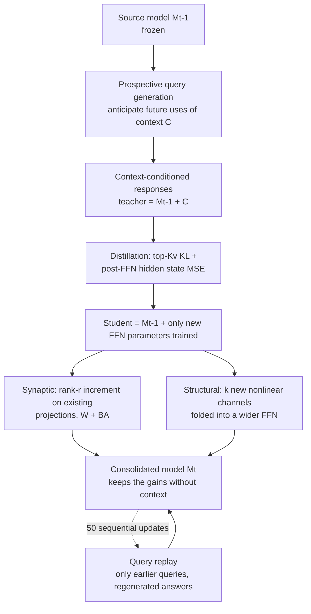

## Who should read this

A post for teams operating agent platforms who face the decision "do we have to keep what this conversation taught us into the next session", and for ML engineers stuck on catastrophic forgetting when they write memory into weights via fine-tuning. The bottom line first: Cortex, from Zhejiang University and ByteDance Seed, is the strongest design at this point for moving only the gains a context gives into the weights. It hits both recovery (88.9% of the context-induced gain) and retention (99.8% of pre-existing capability) even under the harshest setting, 50 sequential updates. For teams choosing how to make context memory permanent, one design principle from this paper, "distill through anticipated questions", is practical enough to serve as the selection criterion.

> 📄 **Full deep review (DOCX)**: [Download the detailed peer review on Google Drive](https://drive.google.com/file/d/1I5rK3Zzra0p_BfobIvqG-OUdjRiItKhE/view).

*Memory consolidation from the hippocampus to the neocortex, pictured.*

## Overview

The context window is temporary RAM with a high rent. Put information in the prompt and the model answers well, close the session and it is gone, and fine-tuning that information into weights afterwards usually lobotomizes the base model. The paper formalizes this problem as Memory Consolidation, or MC: internalize the gains context C gave model M so they survive C's removal, while preserving the capabilities unrelated to C. MC connects context-specified editing, skill learning, and behavioral steering under a single objective. The biological analogy is systems consolidation, the hippocampus moving episodic memory into distributed neocortical representations.

The experiments run on a testbed of five task families (steering, editing, unlearning, code, agent) across 4B to 120B dense and MoE backbones, text-only and multimodal. The testbed design is the paper's second contribution. Context-editing research is scattered across per-task benchmarks and metrics, making cross-method comparison effectively impossible. Cortex lifts every task onto one plane with two axes, on three time horizons (single, batch, sequential updates): the consolidation rate (CR, how much of the context-induced gain was recovered) and the retention rate (RR, how much of the non-target capability was kept). With both axes drawn together, a sly trade-off, "a lot gained, something else lost", cannot hide. The headline result: in most evaluated settings, Cortex sits on the empirical consolidation-retention Pareto frontier. This post covers the three design questions (what, where, and how to consolidate), the 50-edit continual measurements, and the implications for agent platforms.

## What it is: a three-question design

Cortex splits into three design questions.

### What to consolidate: prospective rehearsal

A context contains diverse information, and its relevance depends on future tasks. Long-term memory should support future use, not reproduce past inputs. Cortex has the pre-update frozen model M_{t-1} generate prospective queries. It predicts what kinds of questions the context will be used for later, and generates the context-conditioned responses to those questions itself, forming the rehearsal dataset D_new. No external generator or teacher is required, and that is the core of the design. Because the teacher, the query producer, and the student's origin are all the same frozen model, the distribution mismatch stays small, and that smallness is what holds the retention rate. Agent tasks (ALFWorld, τ²-Bench) are the exception where the environment supplies the queries and a correctness filter keeps only successful offline trajectories. Rehearsal construction never touches held-out evaluation queries or answers.

### Where to consolidate: two forms of FFN plasticity

In Transformers, FFN/MLP layers exhibit key-value memory properties and are known to carry factual associations. Cortex takes MLP parameters as its memory substrate and implements two forms of plasticity on the bias-free SwiGLU FFN F(x) = W_D[(W_U x) ⊙ SiLU(W_G x)]. Synaptic adds a rank-at-most-r increment to existing projections (W' = W + B A W, original matrices frozen). Structural adds k new nonlinear channels (F(x) + D_s[(U_s x) ⊙ SiLU(G_s x)], original weight blocks fixed). Both fold into the model weights: Synaptic merges into existing matrices, while Structural folds into a wider FFN, so the deployed intermediate width grows from d_ff to d_ff + k. At k = r, a dense SwiGLU layer trains 3rd_k Structural parameters versus 3r(d_h + d_ff) Synaptic parameters, so Structural writes with fewer trainable parameters while adding write capacity. For MoE there is independent Structural per unshared expert or Structural on the shared expert, and when routing weights sum to one the shared branch folds into every expert.

### How to write: context-to-memory distillation

The student has parametric memory without context; the teacher has the context and sees the same inputs. Teacher input is [prefix, C, suffix, q, y]; student input is [prefix, suffix, q, y]. The loss adds a truncated top-Kv KL to a layer-wise hidden-state MSE after the FFN. L_t = βT²KL_Kv(p_T || p_S) + α(1/(L d_h)) Σ ||h^S - h^T||². The KL transfers the contextualized predictive behavior of the teacher to a context-free student, and the MSE gives the new FFN parameters a direct target for compensating the attention output changes that context removal causes. Layer-wise hidden states serve as a stand-in for an internal reasoning trace, which adds supervision when rehearsal examples are scarce. To preserve non-target capability, generic queries paired with the model's own responses are mixed into the rehearsal. In continual consolidation only the earlier queries persist; their answers are regenerated each step by the latest model (query replay). The only trained parameters are the newly introduced FFN parameters ψ_t; all existing parameters, including earlier writes, stay frozen.

## Measured results

### Single and batch: the Pareto frontier

Five task families, backbones from 4B to 120B (Qwen3-4B, Qwen2.5-14B, GPT-OSS-20B/120B, Gemma3-12B), against specialized editing methods (FT-M, ROME, MEMIT, AlphaEdit, WISE), context-distillation methods (Locas, SHINE, SPLIT, Reps, CAA, MemP), hypernetworks, and test-time training. Across all 15 panels of Figure 5 (five task families, single/batch), at least one Cortex variant (Synaptic/Structural) sits on the empirical CR-RR Pareto frontier. On steering it recovers roughly 95 to 100% of the contextual gain while holding 99 to 100% retention, and on batch editing it reaches 80 to 91% CR across the three Qwen backbones. The counterexamples are just as clear: on unlearning, SHINE hits CR 103% with RR 4% (a collapse of existing capability), and on code (batch), Synaptic sits at RR 23% on GPT-OSS-120B, so the variant choice decides success and failure per task and per backbone.

### 50 sequential edits: the paper's decisive experiment

A fixed sequence of 50 zsRE factual edits is applied to Qwen2.5-14B-Instruct. At each update Cortex trains a new adapter while freezing the backbone and all previous adapters, and replays historical queries without revisiting earlier source contexts. Evaluation uses the accumulated adapters with no source contexts, and checks fixed MMLU, SimpleQA, and GSM8K subsets every five updates. Results average three seeds.

| Method | CR after 50 edits | RR after 50 edits | Trainable params per edit |
|---|---|---|---|
| Vanilla (no context) | 2.9% | 100% | 0 |
| FT-M | 4.3% | 100% | 70.8M |
| ROME | 19.1% | 100% | 353.9M |
| MEMIT | 40.3% | 100% | 353.9M |
| AlphaEdit | 80.9% | 100% | 70.8M |
| WISE | 4.6% | 100% | 2.73M |
| Cortex Synaptic (r=1) | 80.6% | 97.2% | 2.73M |
| Cortex Structural (k=1) | 88.9% | 99.8% | 0.74M |

The table shows the editing baselines holding MMLU/SimpleQA/GSM8K near full retention (around 100%) while only Cortex Synaptic dips to 97.2%, and the CR side collapsing: AlphaEdit reaches 80.9% while ROME and MEMIT fall to 19.1% and 40.3%. Taking ROME as the strongest baseline by final CR (28.5% in the paper body), Structural's 88.9% and Synaptic's 80.6% are roughly a 3x gap. Per-edit trainable parameters are 0.74M for Structural and 2.73M for Synaptic, about 1/500 to 1/130 of ROME/MEMIT (353.9M).

The immediate-versus-final gap is also analyzed. Structural goes from 91.3% CR right after each edit to 88.9% at the end, losing 2.4 points; Synaptic goes 85.8% to 80.6%, losing 5.2; WISE falls 52.0% to 28.0%, losing 24.0 points. Cortex's final advantage is the sum of stronger initial writing and smaller losses from later updates. Re-evaluating the first ten facts after 40 subsequent edits, Structural holds 97.2% mean CR and Synaptic 92.6%. Output termination by repetition or length limits is 0.0% for Structural and 0.8% for Synaptic at checkpoint 50, incidental evidence that 50 accumulated adapters do not pathologically change the model's generation behavior.

## ThakiCloud product implications

This paper touches both of ThakiCloud's products.

From the Paxis side, it is the physics problem of skill learning. Paxis is ThakiCloud's Agent-Native Cloud, treating Skills, Tools, Policies, and Audit Logs as first-class resources. For a procedure an agent repeated successfully in a session to keep working in the next session, today that procedure lives in the context or in an external skill file. Cortex's prospective rehearsal is a design where "the agent first generates the questions its successful trajectories will be asked about, and distills only its own behavior on those", lifting the automatic refinement of skill files to the weight level. The agent-task setup, where the environment supplies the queries and only successful trajectories pass the filter, is structurally identical to using Paxis sandbox execution records as a rehearsal data source.

From the ai-platform side, the cost structure of "fine-tuning to make context permanent" changes. While ROME/MEMIT touch 353.9M parameters per edit and FT-M 70.8M, Structural adds only 0.74M of new channels, and 50 accumulations total 37M. This shows that a request like "write customer A's domain knowledge into the model" on an on-prem multi-tenant serving stack can be answered not as a full fine-tune but as accumulated adapters. In a K8s serving stack, adapters are a supplementary asset rather than a model file, a unit that can be stacked and removed per tenant. The training cost is low too: because the teacher and the query producer are both the frozen model already in serving, one batch-inference pass builds the rehearsal, with no additional inference cluster.

## Limitations and counterarguments

Boundaries to check before applying it.

First, factual editing (zsRE) is a narrow problem. The 50-edit sequential experiment is the most impressive result, but zsRE factual editing is one-sentence key-value replacement. As the scope widens to multi-document, mathematical, procedural, or long-horizon policy knowledge, whether CR holds is outside this paper's testbed. The Pareto advantage on the skill-learning and steering panels is evidence of range, but the failure modes (code Synaptic RR 23% collapse) are equally evidence that per-task variant choice decides the outcome.

Second, the time axis of continual consolidation is short. 50 edits, 3 seeds, 14B. Even with Structural adding just k=1 channel per edit, the intermediate width grows by 50 after 50 edits, and the long-run balance between channel count and model size, plus inter-channel interference over thousands of consolidations, is an unknown territory. The paper's claim that "adding channels gives capacity across sequential updates" is a short-horizon statement.

Third, the self-referentiality of rehearsal. When the model generates both queries and responses, question types the model has not seen never enter the rehearsal. "Anticipate future uses" is bounded by the model's own usage distribution, and does not cover questions humans or other systems will throw. Part of the retention benefit comes from this self-reference; introducing an external teacher would raise CR but put RR back on trial.

Fourth, the absence of an inverse operation. After a Synaptic merge, the paper does not present a procedure for "removing tenant-specific knowledge" (unlearning could be the answer, but it is unverified here). And as GPT-OSS-120B code Synaptic RR 23% shows, failure modes exist per backbone and per task, and the Pareto frontier is bounded by the hedge "most settings".

Fifth, a small upward pressure on deployment cost. Structural widens the FFN intermediate width by k per consolidation. The training cost is as small as 0.74M parameters, but the deployed model's FLOPs and memory grow monotonically with the number of consolidations. After 50 accumulations, serving runs a model whose intermediate width grew by 50, which reflects in the serving cost curve. Synaptic keeps the width but permanently alters the original weights once merged, so responding to a "remove this tenant's knowledge" request has no clear inverse. The accumulated-adapter form fits serving stacks best, but it presumes the serving engine treats adapter layers as first-class.

## Bottom line

Cortex decomposes the problem of moving context memory into weights into three design questions (what, where, how), and answers each with self-referential prospective rehearsal, rank-r increments and channel additions in the FFN, and distillation with truncated top-Kv KL plus hidden-state MSE. The measured combination is, after 50 sequential factual edits, Structural at 88.9% CR, 99.8% RR, and 0.74M parameters per edit, a gap versus ROME (28.5% CR) that is exactly the gap of "where you write".

The reader's next actions. If you are designing permanent context memory, first price the rehearsal pipeline where the serving model itself generates the prospective queries for "what will this context be asked about later". It works without an additional inference cluster, and that is the cheapest part of Cortex. And if you are reviewing adapter-accumulated serving, put the per-edit parameter count (0.74M versus 353.9M) into your baseline, because it sets the total cost curve for per-tenant knowledge accumulation. In an era where memory is written into weights, where you write (the FFN) and how much you write (one channel) must be chosen before how fast you write.

## Sources

- Zhang, Jintian et al. (Zhejiang University, ByteDance Seed, Tsinghua University), [Cortex: Consolidating Context into Parametric Memory](https://arxiv.org/abs/2610.20399) (arXiv:2610.20399, 2026-10-14)
- Code: https://github.com/zjunlp/cortex
- Gill, [X post](https://x.com/gurtej__gill_/status/2114190634223604050) (2026-10-23)
- 📄 Full deep review (DOCX): [Download the detailed peer review on Google Drive](https://drive.google.com/file/d/1I5rK3Zzra0p_BfobIvqG-OUdjRiItKhE/view)
