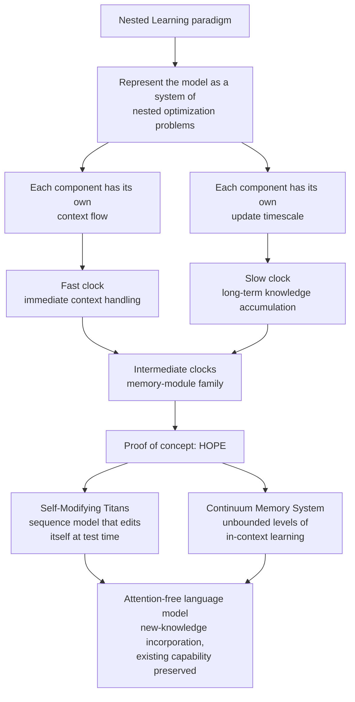

## Who should read this

A post for teams building agent platforms who face the decision "should what this session taught us survive into the next one", and for ML engineers stuck on catastrophic forgetting, the way new fine-tuning erodes existing behavior. The bottom line first: Google Research's Nested Learning (NL) argues that the essence of a deep learning architecture is not attention or recurrence but "update frequency", and accepting that reframes catastrophic forgetting from "attach a new module" into "design the clocks". Its proof of concept, HOPE, shows an attention-free sequence model that modifies itself at test time and incorporates new knowledge along the way.

> 📄 **Full deep review (DOCX)**: [Download the detailed peer review on Google Drive](https://drive.google.com/file/d/1Y1pFPqCQta7m5RDuign0O2SZ9ERd5tpF/view).

*A rendering of the Nested Learning view: clocks turning at different speeds, nested into a single system.*

## Overview

In late October, a tweet calling it "a Google paper with an ambition worthy of 'Attention Is All You Need V2'" made the rounds in the AI community. Its subject is Nested Learning: The Illusion of Deep Learning Architectures, registered as arXiv 2512.24695 and accepted to NeurIPS 2025, from a Google Research team led by Ali Behrouz. Google's official blog introduced the work on November 7, 2025 as "a new ML paradigm for continual learning".

The problem NL targets is the memory gap of large language models. An LLM is frozen the moment training ends. To learn what happens next, you either stream information through the context, or run a new fine-tune, and the latter eats away at existing behavior somewhere. The community calls that phenomenon catastrophic forgetting.

The answers so far fall into two families. One leaves the model untouched and attaches memory on the outside: RAG, agent harnesses, file-based memory. The other adds learning at test time: the test-time training (TTT) line. NL's claim goes beyond both. The way we look at architectures is itself wrong, and it offers a new name and design principle for that difference.

The title says it: "The Illusion of Deep Learning Architectures". The paper argues that what we call attention layers, feed-forward layers, and memory modules are actually bundles of linear layers operating at different update frequencies. Attention reads the immediate context fast, weights accumulate slowly through training, and memory modules sit in between. The difference between "architectures" may be a difference in clock speed rather than structure.

The direct predecessor is Titans (arXiv 2501.00663), also a Google Research attention-free architecture that reads and writes a large external memory at test time, built from three discrete memory tiers: slow, medium, fast. NL generalizes those "three clocks" into a continuous spectrum of update frequencies, and proposes a paradigm that organizes the model as a system of nested optimization problems, each carrying a frequency.

The corollary is the unification of learning itself. NL does not treat supervised, unsupervised, and continual learning as separate problem families; it describes them as differences in clock allocation. The fast clock handles fit to the current data, the intermediate clock accumulates structure within the context, and the slow clock accumulates knowledge across tasks. One model running several learning objectives at several speeds, at once.

## What this technology is

### One model, many clocks

The core definition of the Nested Learning paradigm in one sentence: represent a machine learning model coherently as a set of nested, multi-level, and/or parallel optimization problems. Each nested component carries its own context flow and its own update timescale.

In this view, an LLM is not "stuck in the immediate present" but a multi-layered system learning simultaneously on different clocks. The striking re-framing in the paper is to see the model and the optimizer as two nested associative memories on different clocks. The fast clock reacts to the token in front of it; the slow clock deals with older knowledge. Catastrophic forgetting then reads less like a defect of the model ("it forgets when it learns") and more like a design error in which the two clocks run as one.

*The model reorganized as nested optimization problems, and the composition of its proof of concept, HOPE (Self-Modifying Titans + CMS).*

Translating the clock division into practice gives the table below.

| Clock | Representative component | What it carries |
|---|---|---|
| Fast | attention-family reads | immediate context, token-level response |
| Intermediate | external memory (Titans family) | sequence-level test-time reads/writes |
| Slow | weights, optimizer state | task-level long-term knowledge |

This table is our translation of the paper's view, not a figure from the paper. "Which learning goes on which clock" is the question NL leaves behind.

### From Titans to HOPE: a proof of concept on the frequency spectrum

Where Titans partitioned memory into three discrete tiers, HOPE extends that ladder into a continuous spectrum of frequencies. It has two components.

The first is Self-Modifying Titans, a sequence model variant that modifies its own parameters at test time. While processing inputs, the model generates its own learning signal and adjusts its weights, becoming a kind of built-in optimizer. Google's blog describes this combination as concretizing NL's core image: the model and the optimizer as two associative memories on different clocks.

The second is the Continuum Memory System (CMS), a memory regime that puts no upper bound on the level of in-context learning. As the context window grows, memory layers are added, targeting "unbounded levels of in-context learning".

Together, HOPE is an attention-free language model. Google's official blog reports that HOPE showed superior performance in language modeling and demonstrated the ability to incorporate new knowledge into the model. Within the source scope verified for this post (paper abstract, official blog, community coverage), reproducible large-scale public benchmark figures were not included, so the results discussion here is limited to those qualitative claims.

### Why "illusion" lands hard

What distinguishes this paper from other continual learning papers is not scale but the direction of the claim. Most papers present a method that reduces forgetting; NL redefines the concept of architecture itself. If architectures can be described by frequency distributions rather than by structure names, a new design space opens up: you design the frequencies, not the blocks. The follow-up paper, Dynamic Nested Hierarchies (arXiv 2511.14823), has already moved toward evolving the hierarchy and the frequencies themselves, dynamically.

## Getting your hands on it

The author of this post did not run the code locally. NL is a paradigm-stage proposal, and HOPE is research code whose meaningful validation requires large-scale pre-training conditions, so a small local experiment would prove little. Instead, here are the public entry points for hands-on work.

- HOPE reference implementation: [smallhours19/nested-learning-hope](https://github.com/smallhours19/nested-learning-hope)
- PyTorch implementation: [Ray0907/Hope](https://github.com/Ray0907/Hope)
- Paper materials repo: [Dpp1/nested-learning-paper](https://huggingface.co/Dpp1/nested-learning-paper)
- NeurIPS 2025 review page: [OpenReview](https://openreview.net/forum?id=nbMeRvNb7A)
- Author PDF: [alibehrouz.com/files/NL.pdf](https://alibehrouz.com/files/NL.pdf)

The recommended reading order starts with Titans (2501.00663). Once "attention-free models that read and write external memory at test time" feels familiar, the sentence "generalized into a frequency spectrum" in the main paper reads much more sharply. The OpenReview page is where the claim of "the illusion of architectures" was received by the community, with the arguments for and against sitting side by side.

## ThakiCloud product implications

The Paxis lens first. Paxis is ThakiCloud's Agent-Native Cloud, the agent control plane that treats Skills, Tools, Policies, and Audit Logs as first-class resources. The question Paxis runs into most often is "why does agent capability degrade as it learns new tasks". Our August post on harness continual learning (HCL) established one empirical fact: the way agents get smarter over time is to keep the frozen core untouched and evolve the periphery, the memory, the signposts, the skills.

NL supplies the vocabulary for that practice. How many clocks does this system have, and who owns each timescale? Session-level learning sits on the fastest clock and never touches weights. Skill-level learning, the procedures picked up from new workflows, sits on the intermediate clock, where Paxis's self-evolving skills and skill weaving already operate. Policy and organizational memory sit on the slowest clock. The CMS idea of "unbounded levels of in-context learning" suggests bending the design direction: instead of choosing what memory to delete, add a layer. A way around the "retrain or forget" either/or.

Through the ai-platform lens, the same view is a design principle for the boundary between serving and learning. ThakiCloud's ai-platform is a K8s-based AI/ML SaaS that gets asked for "a model that learns while it runs". The current answer is a combination of RAG and LoRA fine-tuning. NL's clock division adds a scheduling question to that combination: which clock does this learning belong to, session memory, test-time external memory, or weight update. If Maxis's training pipeline is reconstructed from "one-shot fine-tuning" into a scheduler that allocates timescales per learning objective, the balance between serving cost and continual learning becomes a resource-scheduling problem that can be translated into Kueue-class stops.

## Limitations and counterarguments

Let us set up the strongest counterargument first.

The claim "frequency is architecture" may be a relabeling rather than a discovery. Every deep network already layers fast and slow components: attention, residual connections, weights, optimizer state. Bundling them under the name "frequency spectrum" is a new paradigm only if it produces design decisions that could not be made before. Making the question "clock design" explicit is useful; whether it opens a genuinely new architecture space is still open.

The evidence is still light, too. HOPE is a proof of concept, not a large-scale system. Within the source scope of this post, reproducible large-scale public benchmark figures were not available, and it is not publicly confirmed at what scale, compute, and baseline the blog's "superior performance" report was produced. Test-time learning also adds computation at inference: if the inference cost grows as much as the performance gain, the old price structure, "learning is not free", stands as is. No report resolving this trade-off has appeared yet.

Community reception is split. On OpenReview and Hugging Face, praise for a paper that "turns the premises of existing architectures upside down" sits next to readings that place it in the lineage of meta-learning and deep declarative networks, the existing view of memory and computation as layers. That split sits at exactly the same position as the relabeling counterargument above: the larger the paradigm claim, the larger the evidence it should carry, and NL is still early in that verification.

Industrial applicability is also a question. Modern LLM pre-training is one-shot large-scale runs, and NL's continual paradigm is most natural in the long-running, always-learning environment of agents and memory systems. How to insert frequency scheduling into an existing pre-training pipeline has not been presented yet.

## Wrap-up

Back to the conclusion stated up front. Even if the claim "the essence of an architecture is update frequency" turns out to be right, the immediate payoff is not a new module but a new bookkeeping. What a reader can do starting today: when designing memory and learning for an agent or a model, count the clocks in the system and name the owner of each timescale. The fast clock carries session learning, the intermediate clock carries skills and external memory, the slow clock carries policy and weight updates. The direction of the question, "where does this learning go", alone filters out a large share of the design decisions that reduce catastrophic forgetting. Whether NL grows into a new generation of architectures, or settles as a powerful lens, will be decided by large-scale verification after HOPE. But the question of "clock bookkeeping" that the paper opened is usable right now.

## References

- Paper (arXiv): [Nested Learning: The Illusion of Deep Learning Architectures](https://arxiv.org/abs/2512.24695)
- Google Research blog: [Introducing Nested Learning](https://research.google/blog/introducing-nested-learning-a-new-ml-paradigm-for-continual-learning/)
- OpenReview (NeurIPS 2025): [nbMeRvNb7A](https://openreview.net/forum?id=nbMeRvNb7A)
- Predecessor, Titans: [Learning to Memorize at Test Time](https://arxiv.org/abs/2501.00663)
- Follow-up: [Dynamic Nested Hierarchies](https://arxiv.org/abs/2511.14823)
- HOPE reference implementation: [smallhours19/nested-learning-hope](https://github.com/smallhours19/nested-learning-hope)
- PyTorch implementation: [Ray0907/Hope](https://github.com/Ray0907/Hope)
- Paper repo: [Dpp1/nested-learning-paper](https://huggingface.co/Dpp1/nested-learning-paper)
- Author PDF: [alibehrouz.com/files/NL.pdf](https://alibehrouz.com/files/NL.pdf)

> 📄 **Full deep review (DOCX)**: [Download the detailed peer review on Google Drive](https://drive.google.com/file/d/1Y1pFPqCQta7m5RDuign0O2SZ9ERd5tpF/view).
