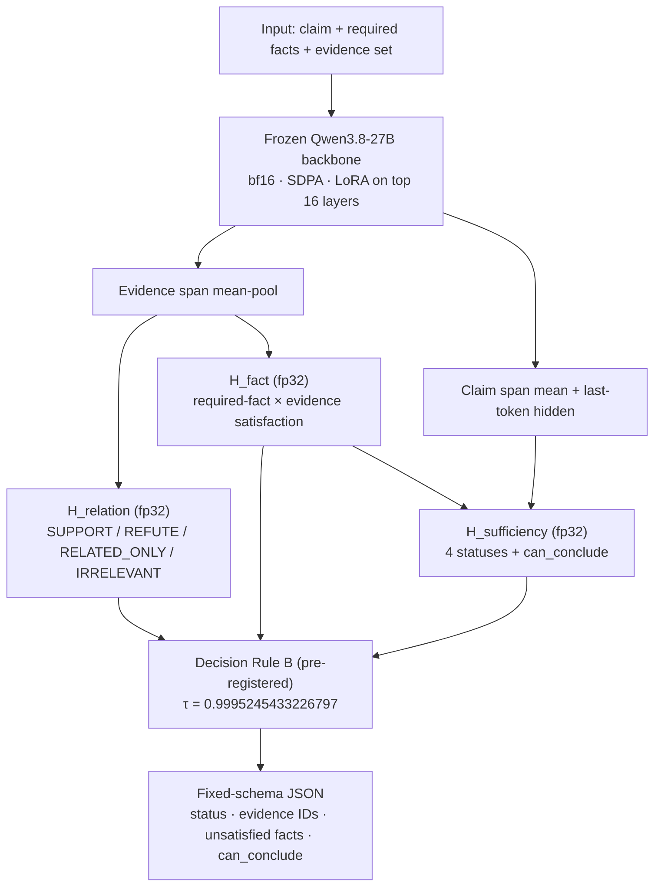

In autonomous security response, the moment you conclude is the moment action begins. The instant a detection is concluded to be an active intrusion, isolation or account suspension follows. So the important question is not whether the model writes a good answer, but whether it may answer with the evidence it has right now.

This post introduces a model that judges whether security evidence is sufficient. It takes a claim, the required facts that must be established for that claim to hold, and the evidence collected so far. It decides whether the claim is supported, refuted, short of evidence, or contradicted; which input evidence supports and which refutes; which required facts remain unsatisfied; and whether a conclusion is allowed at all. The model does not write freely; it only fills in the verdict form. The model is named Thaki-SecDecision-27B-V2, and the four verdict states are SUPPORTED, REFUTED, INSUFFICIENT, and CONFLICTED. It is written for people building security agents, or deciding what to place where in an agent stack.

The model, inference code, and model card are [public on Hugging Face](https://huggingface.co/ThakiCloud/Thaki-SecDecision-27B-V2).


*The moment of checking each piece of evidence against the claim, before the verdict is rendered.*

## In plain terms

Think of a courtroom. The prosecution's allegation is the claim, and the facts that must be proven for it to stand are the required facts. The submitted evidence is the evidence, and the judge must conclude from that evidence alone.

The judge has four possible rulings: accepting the allegation because the evidence is sufficient, the evidence overturning the allegation, the evidence still being short, and the evidence contradicting itself. These are SUPPORTED, REFUTED, INSUFFICIENT, and CONFLICTED. The judge does not write a new case report to invent facts; the judge looks at the submitted evidence and picks one of the four rulings. Likewise, this model generates no text.

The question a judge ponders longest is not the ruling itself but when a verdict can be handed down at all. Sometimes evidence never arrives, and sometimes one more check flips the verdict. The model has a separate output for this question. When evidence is short, it answers "not sufficient" instead of lowering the bar, and the side collecting evidence learns what to collect next. So in plain language, this model is a judge who treats "not enough yet" as one of its rulings.

<!-- nlm-visual -->

*Infographic generated by NotebookLM from the sources.*

## What this model does, and what it does not

In a security agent stack, this model is a gate. The agent receives a detection and collects evidence (telemetry, collection attestations, attack-reference documents) and asks this model whether it may conclude on this claim now.

The model judges four things. First, the claim status. Second, which evidence IDs from the input support the claim and which refute it. Third, which required facts remain unsatisfied. Fourth, whether a conclusion is allowed now (can_conclude). These four come out as a single line of fixed-schema JSON.

For example, for the claim "this host is exfiltrating data to an external IP", the required facts decompose into (1) did an outbound connection actually occur, (2) is the destination an external IP, (3) does the data volume exceed the threshold. If the agent first collects telemetry and asks, it may get back that (1) and (3) are satisfied and only (2) is not. The next collection target then narrows to "verify the destination-IP attribute of that connection".

Naming what the model does not do is equally important. It does not approve responses, execute detections, or make incident judgments. can_conclude being True is a sufficiency statement ("with this evidence, this claim can be concluded to be in this state"), not an action authorization. Keeping "No Evidence, No Action" only as a policy document is different from the model's output schema itself enforcing that principle. This model is the latter.

## Architecture: three heads over a frozen backbone

The model is a combination of a frozen Qwen3.8-27B backbone, a LoRA adapter, and three small fp32 heads. The backbone is pinned to a fixed revision and never changes, not even during training. LoRA is applied to the top 16 layers (48 to 63 of 64) only. The three heads each do a different job.



The relation head decides the direction each piece of evidence takes relative to the claim: one of SUPPORT, REFUTE, RELATED_ONLY, IRRELEVANT. The fact head decides, for each pair of a required fact and a piece of evidence, whether that evidence satisfies that fact. The sufficiency head takes the claim status and the degree of fact satisfaction together and emits the four statuses plus can_conclude.

The absence of generation matters a lot for the output. A general LLM first writes a sentence that looks like a justification, then answers on the basis of that sentence. This model does not write the verdict narrative; it only fills in the verdict form. The failure mode that generative models show, fabricating a plausible-sounding reason that is not true, is structurally absent.

The input format is fixed too. Plain text with no chat template: the claim, then the required-facts block, then evidence blocks tagged with source_type, and finally a DECISION marker. Examples exceeding the 4096-token context are excluded, not truncated. A judgment made on a truncated input is not a judgment on the original input, so such examples are not put to the model.

Training ran one epoch (3,334 steps), and the checkpoint was selected on the train_dev and calib splits only. The selection criterion was "maximum ENOUGH recall among checkpoints whose False-ENOUGH rate stays at or below 2%". The chosen checkpoint is step 2200. After selection, τ was fixed on the calibration split, and only then was the TEST opened.

## The decision rule: Rule B demands a basis for refutation too

The heads' probability distributions are not the output. On top of them sits a pre-registered decision rule, Rule B.

Support requires the status to be SUPPORTED, no unsatisfied required fact, and at least one piece of evidence in the SUPPORT direction. Refutation requires not only the status REFUTED but an observation-based basis. Concretely, at least one REFUTE-direction piece of evidence whose source_type is collection_attestation or telemetry counts as a refutation basis. In courtroom terms: even when declaring the defendant not guilty, the judge demands directly observed evidence, not a witness's testimony. A non-observed document like "I read some reference" (attack_reference) cannot serve as a refutation basis.

The same principle applies to the absence of a record. "A command is not in the logs" does not mean "the command did not run." It may simply not have been collected yet. Until the collection scope and completeness are verified, absence cannot be a refutation basis.

A conflict is judged when the status is CONFLICTED, or when there is at least one piece of evidence in each of the SUPPORT and REFUTE directions. can_conclude becomes True only after passing all these gates and the sufficiency score crossing the pre-set threshold τ. τ is the value chosen on the calibration split as "the lowest threshold whose False-ENOUGH rate is at or below 2%", with maximum recall among those. Its full precision is in Table 1 below. It was chosen without seeing the results, so it is not changed after the results are seen. The moment you retune the threshold against a different split, the number is no longer trustworthy.

Rule B was learned and corrected in earlier experiments. In the previous regression run, the macro F1 rose above the stock (62.7% → 73.1%), but the false-conclusion rate rose with it (1.79% → 3.19%), and it did not pass the pre-registered gate. The pre-amendment rule was conservative in the refutation direction: overall conclusion recall on the calibration split stayed around 0.48, and on the cases where the evidence overturns the claim (REFUTE_COVERAGE) it was only 4.8%. The amendment that requires an observed refutation basis (refutation coverage gate correction, amendment seq 274) is Rule B, and on the sealed TEST it produced a REFUTE_COVERAGE recall of 99.85%. This too was fixed before the TEST was opened.

The support/refute evidence IDs in the output are picked only from the input's evidence_ids. An ID that is not in the input therefore cannot structurally appear in the output.

**Table 1. Pre-registered values fixed together with Rule B**

| Item | Value |
|---|---|
| Sufficiency threshold τ | 0.9995245433226797 |
| Macro F1 (regression run) | 0.627 → 0.731 |
| False-conclusion rate (regression run) | 1.79% → 3.19% |
| REFUTE_COVERAGE recall (pre-amendment, calib split) | 0.048 |
| REFUTE_COVERAGE recall (post-amendment, sealed TEST) | 0.9985 |

## The results

The sealed TEST has 4,002 examples: 2,202 from the standard generator and 1,800 from a generator with different generation rules (generator_disjoint). Ground truth was set by the generation rules only (0 teacher-model, human, or LLM judgments). Cross-split leakage is 0 on all of the world, group, host, IP, and user axes.

**Table 2. Sealed TEST results and pre-registered requirements**

| Metric | SecDecision-27B-V2 | Stock (zero-shot) |
|---|---|---|
| False-ENOUGH | 1/2668 (0.04%) | 202/2668 (7.57%) |
| ENOUGH recall | 1297/1334 (97.2%) | 390/1334 (29.2%) |
| FULL recall | 0.946 | 0.0555 |
| REFUTE_COVERAGE recall | 0.9985 | 0.5292 |
| Relation Macro-F1 | 0.9634 | not measured |
| Pairwise accuracy | 0.9975 | not measured |
| ADJACENT stratum False-ENOUGH | 0 | not measured |
| generator_disjoint stratum False-ENOUGH / recall | 0.0 / 0.9567 | not measured |
| Safety-gap paired bootstrap 95% CI | [−0.08771, −0.06408] | n/a |
| Pre-registered CI upper bound | +0.005 | n/a |

The False-ENOUGH in the ADJACENT (adjacent-claim) stratum is 0, and mis-concluded conflict cases are 0 as well. The 95% confidence interval of the paired bootstrap (group-cluster, 2,000 resamples) of the safety gap (V2 minus Stock) is [−8.77%, −6.41%] (full precision in Table 2). The pre-registered requirement, an upper bound of +0.5% or less, is satisfied with wide margin.

All seven pre-registered gates (G0 to G7) were passed; the verdict is GO.

We state the limit of the Stock comparison as well. The Stock baseline ran Qwen3.8-27B zero-shot under a fixed evaluation contract (same input render, greedy, thinking off, max_new_tokens=64). Under that contract, Stock failed to emit a parseable status at all on 3,370 of 4,002 examples (83.96%, PARSE_ERROR). In some cases the thinking output consumed the 64-token budget before the decision output could start. This comparison is therefore not a complete proof of superiority over an optimized Stock model (tuned prompts, larger output budget, fine-tuning). The pre-registered GO verdict stands; we disclose this limit so the Stock comparison is not over-read.


*Left: the rate of not missing cases that allow a conclusion (ENOUGH recall). Right: the rate of mis-concluding on cases that do not allow one (False-ENOUGH).*

## Verifying the public package as-is in a fresh process

The numbers were not read from the training run's log; they were reproduced with the package that is being published. The package containing the exact bytes to be published was loaded in a fresh GPU process that had not been used for training or evaluation, and we checked that the base resolves to exactly the pinned revision, that all weights and heads load without error, and that Rule B and τ are applied with numeric precision intact.

The most important check is forward-identity. On held-out calib examples, the recomputed probabilities matched the sealed dump within a maximum difference of 1e-3. That means this package reproduces the arithmetic of the sealed TEST. All four statuses (SUPPORTED, REFUTED, INSUFFICIENT, CONFLICTED) fired normally, and out-of-input evidence IDs in the output were 0.

The package runs with one line. `python3 inference.py --base Qwen/Qwen3.8-27B --example smoke_example.json --check-sha` emits one line of JSON, and --check-sha compares the fingerprints of the adapter, heads, and decision module against the config.json canonical. As emphasized above, loading the adapter alone does not reproduce the verified behavior. This model is the adapter, the heads, and the Rule B decision rule as one bundle.

## The Paxis view: a gate between evidence and response

Integration with Paxis is not in scope for this release. This section presents, as a goal architecture, what role the model will play in a security workflow.

In a Paxis security workflow, this model sits between evidence collection and response planning. As the agent collects evidence for a detection, it asks the model at every step whether a conclusion is allowed now. If can_conclude is False, the agent does not guess a response. It takes the unsatisfied required facts and the evidence that still needs collecting, as reported by the model, as the next collection targets. When it is True, it moves to the response-planning stage with the supporting and refuting evidence IDs in hand.

The roles of the model family become clear as well. Retrieval is handled by Thaki-SecEmbed-8B, vulnerability-patch fix verification by Thaki-SecProof-2B, and evidence-sufficiency judgment by this SecDecision-27B. Each model does only its one job, and the agent orchestrates them.

| Role | Model |
|---|---|
| Security retrieval · embedding | Thaki-SecEmbed-8B |
| Vulnerability-patch fix verification | Thaki-SecProof-2B |
| Evidence sufficiency · conclusion-allowance judgment | Thaki-SecDecision-27B-V2 |

Paxis's policy gate and audit log take this model's output as the basis of judgment. When recording what response was executed, the record says "because it was based on these evidence IDs, at this sufficiency score", not "the agent judged it intuitively".

The gate matters for execution economics too: it moves the cost of "one wrong response" forward to the cost of "one more round of evidence collection". The cost of a response caused by a wrong conclusion is greater than the cost of one more collection round. The number, False-ENOUGH of 1 in 2,668, is the size of the cost paid in that trade.

```mermaid
flowchart TB
    A["Detection"] --> B["Security agent<br/>evidence collection (telemetry · attestation · documents)"]
    B --> C["Thaki-SecDecision-27B-V2<br/>evidence-sufficiency judgment"]
    C --> D{"can_conclude?"}
    D -->|"False: unsatisfied facts + evidence to collect"* --> B
    D -->|"True: status + support/refute evidence IDs"* --> E["Response planning<br/>policy gate + audit log"]
```

## What to not trust

A judge honed only in a mock courtroom is hard to say ready for a real one. This model's TEST is a synthetic claimworld: 4,002 examples whose ground truth was set by generation rules. It measures controlled generalization within the synthetic range, not the real SOC operational performance that involves real logs, real detections, and analyst judgment. Accuracy on real logs is disclosed as unverified.

The structural parser records 1.0 inside the generator, so in-generator performance can be saturated; generalization claims rest only on the generator_disjoint stratum (FE 0.0, recall 95.7%). The full-precision value is in Table 2.

To re-emphasize: can_conclude being True is not an action authorization. It is a statement that the evidence is sufficient. Approving a response is a decision of a separate policy layer, and this release provides neither Paxis or Autonomous-SOC integration nor resident serving. Only the model weights and inference code are public.

<!-- nlm-visual -->

*Infographic generated by NotebookLM from the sources.*

## In one line

This model does not write a story. It looks at the submitted evidence and decides whether the claim is supported, overturned, short of evidence, or contradicted, and whether a conclusion is allowed now. On the sealed TEST, only 1 of the 2,668 cases that do not allow a conclusion was mis-concluded, and 1,297 of the 1,334 cases that do were found.

In a security agent, the moment you conclude is the moment action begins. The model that decides "may I conclude now" is the gate that guards that moment. The model, inference code, and model card are public on Hugging Face, and anyone can load them as-is and reproduce the numbers in this post.

**Related posts**

- [From vulnerability discovery to fix verification: building a security agent with SecProof-2B and Paxis](/tech-blog/en/agentops/secproof-2b-paxis-security-agent/)
- [One 27B model running answer generation and evidence judgment together: a shared backbone that only the last 4 layers diverge](/tech-blog/en/research/shared-backbone-evidence-gate-27b/)
- [Thaki-CiteRank-4B: a 4B model that picks what a RAG agent should cite](/tech-blog/en/agentops/citerank-4b-paxis/)
