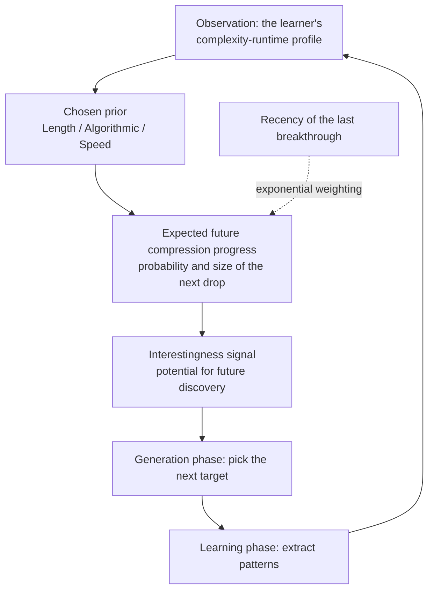

*A visual metaphor for the article's key idea.*

## Who should read this, and what you will get

This post is for developers running unattended agents or open-ended systems who still pick "what to explore next" by hand. It is also for data scientists who need a criterion when choosing what to learn from.

Here is the conclusion first. This paper turns the question "which tasks hold potential for future progress" into a signal you can compute and predict from past progress records. The first result says expected future progress depends exponentially on how recent the last breakthrough was. The second proves that, on the same progress record, the eye that reads structure is quadratically more optimistic about future discovery than the eye that only counts length. If you run agent loops, you just gained another candidate objective function for "what to pick next."

*The post's core concept visualized: a complex signal compressing into an increasingly simple structure as learning proceeds.*

<!-- nlm-visual -->

*Infographic generated by NotebookLM from the sources.*

## Context

Around October 27, a passage started circulating on X. It carries over the legend-like sentences of this research lineage: the brain as a relentless compression engine, dopamine flooding the moment a pattern is found.

> "This paper answers why anything is beautiful, why jokes are funny, why we get curious, why you get bored, why babies explore, why music has hooks."

The paper behind it is a position paper by Vincent Herrmann and Jürgen Schmidhuber. The paper's identity is organized in the table below.

| Item | Content |
|---|---|
| Title | "Interestingness as an Inductive Heuristic for Future Compression Progress" |
| Authors/affiliations | Vincent Herrmann, Jürgen Schmidhuber (IDSIA/USI/SUPSI Lugano, KAUST Thuwal) |
| Registered | May 14, 2026, [arXiv 2605.14831](https://arxiv.org/abs/2605.14831) |
| Accepted | [ICML 2026 Position Track](https://proceedings.mlr.press/v306/herrmann26a.html) |
| Code | [Project page](https://inductive-interestingness-2026.github.io/future-compression-progress/) |
| Prior work | Schmidhuber 2008 "Driven by Compression Progress: A Simple Principle Explains Essential Aspects of Subjective Beauty, Novelty, Surprise, Interestingness, Attention, Curiosity, Creativity, Art, Science, Music, Jokes" ([arXiv 0812.4360](https://arxiv.org/abs/0812.4360)) |

One boundary must be drawn, though. The claims about beauty, jokes, and babies exploring are not from this 2026 paper. They belong to the same author's 2008 prior work (the title is in the table above). The 2008 paper explains "why humans experience what they experience" via compression progress. The 2026 paper pushes one step further and asks "can the signal itself be predicted in advance." The viral thread merged the two. This post writes from that boundary.

## In plain terms

An analogy from venture investing. An investment firm watches the growth charts of hundreds of startups every day. It does not put money into startups whose revenue has already hit the ceiling. It also does not look at startups whose numbers are flat. It looks at exactly one thing: startups whose recent curvature is alive, the ones that broke through last quarter.

The interestingness this paper formalizes is the mathematical version of that "recent curvature." When data or a task is given to a learner, a curve forms. It shows how much the learner can compress, i.e., simplify, it over time. The next advance has the most potential where that curve just became steep. It has the least where the curve bent once long ago and went flat. That is the first result.

The second result maps to "types of investors." An accountant's eye counts only revenue (Length prior). A venture partner's eye reads the tech stack and pipeline structure (Algorithmic prior). The two eyes extract different expectations from the same startup. The paper proves that the second eye, given the same past record, expects much larger future discovery than the first. The gap widens not linearly but quadratically.

*The analogy above is the author's interpretation. In the paper, the two "eyes" are specific priors, the startups are complexity profiles of binary strings, and the discoveries are the next drops.*

## The problem the paper sets up

The paper names the "interestingness problem" as a bottleneck on the way to self-improving systems. The minimal picture of open-ended intelligence is a cycle of two phases. The learning phase extracts patterns and skills from data with gradient descent or reinforcement learning. The generation phase turns those insights into new artifacts. For the cycle to keep turning indefinitely, the generation phase needs one criterion. It must distinguish "structure worth learning" from "already-known knowledge, or noise." In the paper's Figure 1 wording, it is the criterion for "learnable structure from noise or already-acquired knowledge."

This paper places the definition of that criterion as follows. Interestingness is "an inductive heuristic for future compression progress." It is not "how surprising is this data right now." It is the expectation of "how much more can this be compressed after I learn it." That view sits on the same line as the "first derivative of subjective beauty, the steepness of the learning curve" that Schmidhuber already wrote in his 2008 paper.

Section 2 maps the territory carefully. It classifies existing interestingness criteria into eleven families and places the compression-progress family and this paper within them.

| # | Existing interestingness criterion family |
|---|---|
| 1 | count-based |
| 2 | space coverage |
| 3 | maximum entropy |
| 4 | prediction error (incl. adversarial) |
| 5 | information gain |
| 6 | Bayesian surprise |
| 7 | learning progress |
| 8 | competence progress |
| 9 | compression progress |
| 10 | open-endedness (social multi-agent interaction) |
| 11 | LLM judge predicts interestingness |

The last line is what makes this paper worth reading today. Beyond the formalization, a practical path, approximating the criterion itself with an LLM judge, is already inside the territory.

Section 3 connects the formalization to "current machine learning." The concept of a complexity-runtime profile is mapped three ways. First, neural network training with gradient descent. The profile is "required complexity falls as training time on the same data grows." Second, chain-of-thought and recurrent reasoning. The profile is "the length of generated reasoning is the runtime." Third, model scaling. The reading is "parameter size moves the complexity-runtime tradeoff." This mapping is the paper's practical value. It is not abstract formalization. The curve an engineer training today is looking at is exactly that profile.

On top of that, section 3.2 moves to combinatorics: counting how many strings have a given profile, and the probability that the next drop comes for such a string.

## Key results

The formal toolkit is Kolmogorov complexity and algorithmic statistics. All data and artifacts are treated as binary strings x. K(x) is taken as the length of the shortest program that outputs x on a universal machine, the prefix-free Kolmogorov complexity. The moments when the required complexity of an observed string "drops" as the learner improves are compression progress. The temporal arrangement of those drops is the profile.

With that, the paper computes "expected future progress given the profile observed so far" under three computable priors: Length prior, Algorithmic prior, and Speed prior. The results (all proofs fill Appendix A) are two.

First, expected future progress depends exponentially on the recency of the last observed breakthrough. If only old breakthroughs have accumulated, expectations fall quickly. In domains where progress just happened, expectations rise exponentially.

Second, for the same observed profile, the Algorithmic prior is markedly more optimistic than the Length prior, and the gap widens quadratically in expected discovery. Intuitively: "the eye that reads algorithmic structure" raises expectations of the next breakthrough much faster than "the eye that only counts length."

The three priors are tools that answer the same question ("what is the expected value of the next advance?") with different approximations. The Length family takes length, the Algorithmic family takes algorithmic structure, and the Speed family takes computational speed as its respective standard for weighting the probability of the next drop. Which prior is more optimistic is, in the end, the difference of "through which eye you look at learning."

The paper states that these two results are confirmed experimentally across three distinct universal computational paradigms. The body's experiment section is chapter 5, which treats settings such as the 2-Tag Rule.

*The paper's learning-generation cycle with a "predictable interestingness signal" layered on it. The recency weighting decides the direction of the next rotation.*

## Implications for ThakiCloud products

[Paxis](https://thakicloud.com) by ThakiCloud is an Agent-Native Cloud where unattended agent loops run continuously. Moments that decide "what to run next," such as the overnight experiment queue (research lab loop), skill self-evolution, and the paper factory, happen every day. Today, those decisions are owned by human-designed queues and simple heuristics like escalating the model after consecutive failures.

This paper offers a computable candidate objective for that decision. The evaluation-score curves or cost curves of each domain are physical instances of the "compression-progress profile." Computing expected future progress over that profile with a prior yields a ranking. It ranks which experiment to rerun and which new candidate to queue. The recency weighting of the last result matches the intuition of looking harder at domains that just broke through. The adoption barrier is low.

The family claiming that LLMs can predict human-distilled interestingness meshes directly with ThakiCloud's agent production stack. In the stack's evaluation structure, heuristics cover 100% of traffic. The LLM judge covers 5 to 10 percent. Whether an experiment result is worth re-exploring is a natural candidate task for the LLM judge.

## Limitations and counterarguments

Six, compressed.

First, it is a position paper. It builds no new system and does no large-scale empirical validation. The body's experiment section is a small setting across three paradigms, and the force of the results sits in the combinatorial proofs of the appendix.

Second, K(x) is uncomputable. Every result is relative to a chosen prior, and Length/Algorithmic/Speed are approximations that route around that uncomputability. The claim "expected discovery is quadratically larger" is a result inside those approximations, not a law of physics.

Third, observer relativity. As the 2008 paper presupposes a "self-improving, but computationally limited, subjective observer," interestingness is defined relative to a specific learning program's eye. It is not an objective property of the data; it is a property of "what that agent can gain next."

Fourth, the boundary with the viral wording. The descriptions of dopamine, beauty, and babies exploring are not claims of this 2026 paper. Not confusing them with the 2008 lineage when citing is the duty of anyone using this theory.

Fifth, the practical degeneration risk of recency exponential weighting. The rule "look harder where breakthroughs just happened" can turn into trend-chasing depending on how a domain defines "breakthrough."

Sixth, half the cycle is still empty. This paper gives the generation phase a selection criterion. The cost of actually producing progress is outside this paper's scope. That cost runs from the target the criterion picks through to the learning phase.

## Summary

We collect the conclusion set in the introduction. The question "what should we explore next" becomes a computable signal once you look at past progress profiles. The two results, expected future progress depending exponentially on recency and quadratically on the prior choice, guarantee that.

For those running agents, here is the suggested next action. Reinterpret the evaluation curves of the experiments and data candidates stacked in your queue as compression-progress profiles. Then attach a score that computes expected future progress from the last drop point and the slope of those curves. That is the first step of moving this paper into a system.

In one line. Curiosity is no longer a psychological concept. It is an objective function you can optimize.

<!-- nlm-visual -->

*Infographic generated by NotebookLM from the sources.*

## Sources

- Herrmann, V., & Schmidhuber, J. (2026). [Interestingness as an Inductive Heuristic for Future Compression Progress](https://arxiv.org/abs/2605.14831). arXiv:2605.14831.
- [Position: Interestingness is an Inductive Heuristic for Future Compression Progress](https://proceedings.mlr.press/v306/herrmann26a.html), ICML 2026 (PMLR v306).
- [Project page](https://inductive-interestingness-2026.github.io/future-compression-progress/)
- Schmidhuber, J. (2008). [Driven by Compression Progress: A Simple Principle Explains Essential Aspects of Subjective Beauty, Novelty, Surprise, Interestingness, Attention, Curiosity, Creativity, Art, Science, Music, Jokes](https://arxiv.org/abs/0812.4360). arXiv:0812.4360.
- Viral thread: [@HowToPrompt__](https://x.com/HowToPrompt__/status/2115042117085221160) (2026-10-27)
