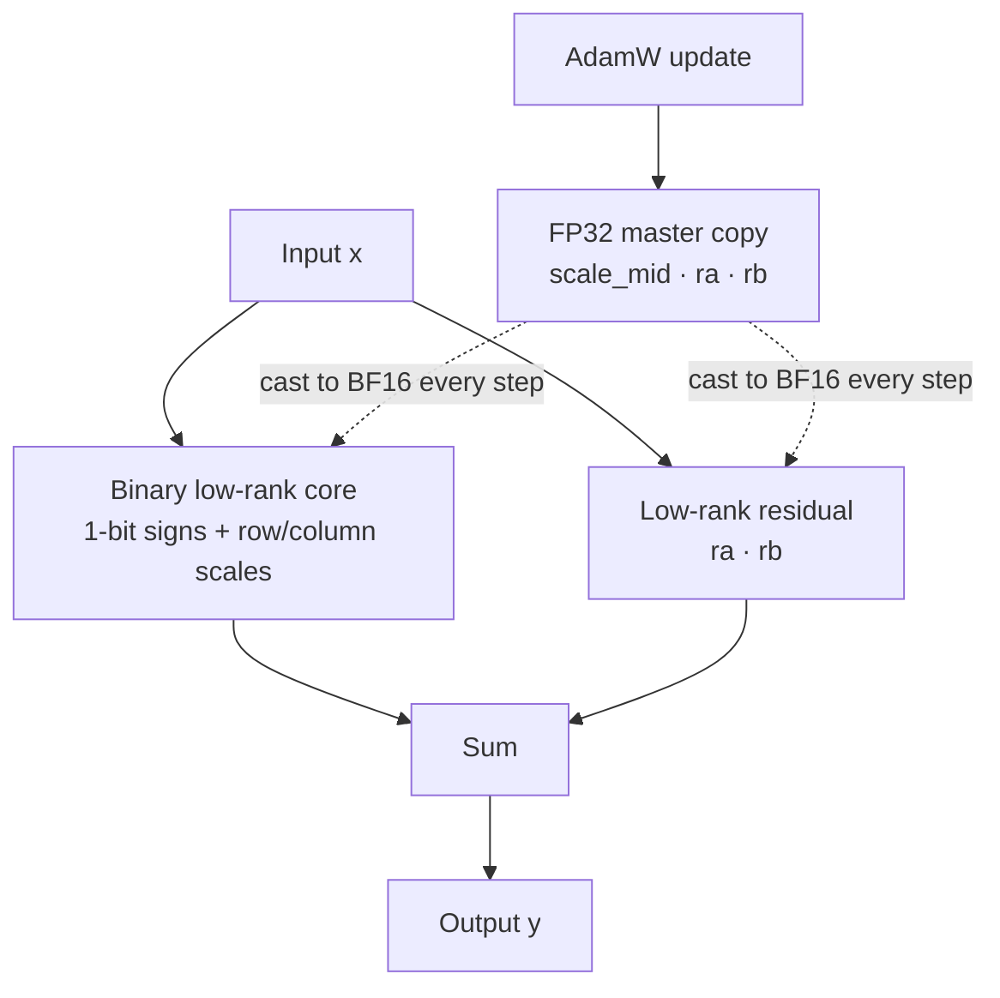
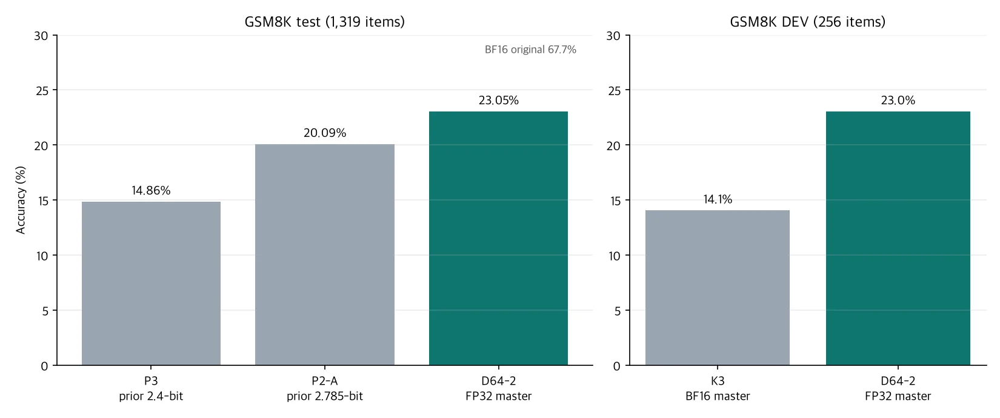

*We traced how very small changes were being erased the moment they were stored*

## Why read this

When you shrink a model and then train it again, you expect quality to come back. We did exactly that, and at some point training simply stopped improving. The cause was neither the data nor the objective. The number format used to store each change was so coarse that small changes vanished the moment they were written.

This post is for engineers who compress models to 2 to 3 bits and try to recover quality through retraining or distillation. The key point is that the loss curve does not reveal this problem. The numbers do. In our original setup, the parameters that hold the scale values changed in fewer than 0.01% of their elements over 1,000 steps. Updating the same parameters through an FP32 copy instead of BF16 changed 67% of them. The model we trained on from there and released, [Qwen3-1.7B-Base-CareQ-2.4bpw](https://huggingface.co/ThakiCloud/Qwen3-1.7B-Base-CareQ-2.4bpw), scores 23.1% on GSM8K test. Our previous 2.4-bit checkpoint scored 14.9%.

FP32 master weights are not a new technique. They have been standard practice in large-scale training since the 2018 Mixed Precision Training paper. What we want to share is the **diagnosis**. We describe how we found a few parameters quietly frozen while the loss curve looked healthy. We also describe how we measured the effect without mixing it up with other factors.

## In plain terms

Imagine measuring a plant that grows 0.1 mm a day with a ruler marked only in centimeters. The plant grows every day, but the reading never moves. If every measurement is rounded to the nearest mark, the record stays at the same number forever.

BF16 is like that ruler. Near the value 1, the gap between representable numbers is 2 to the power of −7, or 1/128. An update that moves a value by 1/10,000 in one step is less than half of that gap. After adding it and rounding, the value returns to where it was. The optimizer computes a direction diligently at every step, and nothing stays in the parameter.

An FP32 master is a second, much finer ruler kept on the side. Small changes accumulate in the FP32 copy, and only the forward pass uses a BF16 cast of it. Once the 0.1 mm changes add up to more than one mark, the BF16 value moves too.

## Overview

Starting from the binary low-rank decomposition in [NanoQuant](https://github.com/SamsungLabs/NanoQuant), we built a format (internal name CareQ) that attaches a small low-rank residual to every linear layer. The goal was to bring Qwen3-1.7B-Base below 2.4 bits per weight, embeddings included, and to recover as much quality as possible by distilling from the BF16 original as teacher.

The problem was that quality did not rise as much as expected, even with long training. The loss went down and no NaN or other abnormal values appeared. On the surface, it was a normal training run. So we counted, for each parameter group, "the fraction of elements whose value actually changed since the start," and found that the middle scale (scale_mid) was barely moving.



## What the technique is

Each of the 196 linear layers (28 blocks × q, k, v, o, gate, up, down) computes:

```
y = NanoQuant(x) + F.linear(F.linear(x, rb), ra)
```

`NanoQuant(x)` is the binary low-rank core: sign matrices packed at 1 bit per element, multiplied by row and column scales. `ra · rb` is a small low-rank residual. The embedding and LM head are tied and stored as a 4-bit embedding plus a rank-56 residual.

During training the binary signs stay fixed, and only the scales and residuals are learned. The loss is centered on KL to the BF16 teacher, with next-token cross-entropy and hidden-state alignment added at small weights. The single file is 515,564,507 bytes; multiplying the file bytes by 8 and dividing by the total parameter count gives an effective BPW of about 2.4. Embeddings are counted, not excluded.

| Component | Bytes |
|---|---|
| Binary sign core | 297,041,920 |
| 4-bit embedding | 165,306,368 |
| Layer residuals | 32,112,640 |
| Embedding residual | 17,246,208 |
| Scales, norms, metadata | 3,228,832 |

The FP32 master covers the 196 middle scales and the two residual factors, 16.5 million values in total. That is under 1% of the model, so the memory cost is small.

## How we diagnosed it

A falling loss does not tell you which parameters are doing the work. So we built two arms starting from the same checkpoint. One arm updates the BF16 parameters directly; the other updates them through an FP32 master copy. The starting checkpoint, data order, step count, loss, and learning rate were all identical; the only difference was the update path. The held-out measurements at the start were bit-identical between the two arms.

After running each arm for 1,000 steps (global step 1,500 to 2,500), we counted the fraction of elements in each parameter group whose value had changed since the start.

| Parameter | Direct BF16 update | FP32 master |
|---|---|---|
| scale_mid changed | 0.007% | 67.1% |
| ra changed | 38.9% | 98.7% |
| rb changed | 37.4% | 98.8% |

In the BF16 arm, scale_mid was effectively frozen. More than half of the elements of the residuals ra and rb never changed either. In the FP32 master arm, nearly every element moved.

Quality followed. Held-out KL to the teacher was lower for the FP32 master arm on all three data sources (fineweb-edu, finemath, opc). A paired bootstrap over 192 sequences (10,000 resamples) put the difference at about 0.06, with a 95% confidence interval that excludes zero. The deployed BPW of the two arms matches to the third decimal place. The extra precision is used only during training, and the FP32 copy is not shipped in the file.

In plain words: "Same model, same data, same size; we only changed the container that holds the updates, and training started moving again."

## Results

Based on the diagnosis, we continued training from the same starting point with the FP32 master to the end; that model is D64-2. It trained for 9,156 steps in total, and the segment after step 1,500 took 5.0 hours on a single B200. The promotion criteria were registered before training: BPW at or below 2.4, integrity when loaded from the packed file alone, C4 PPL, held-out KL, and GSM8K DEV accuracy. All six criteria passed on the DEV set.

The sealed GSM8K test (1,319 problems, 5-shot, strict match) was run exactly once, after the model and file were frozen.


*GSM8K test and DEV accuracy, all measured by us with the same harness (lm-eval 0.4.9, greedy)*

| Model | Effective BPW | GSM8K test | GSM8K DEV | C4 PPL | held-out KL |
|---|---|---|---|---|---|
| Qwen3-1.7B-Base BF16 | 16 | 67.7% | not measured | 15.42 | 0 |
| D64-2 (FP32 master) | 2.397 | 23.05% | 59/256 | 24.12 | 0.426 |
| K3 (same start, BF16 master) | 2.397 | not measured | 36/256 | 25.98 | 0.541 |
| P3 (previous 2.4-bit) | 2.394 | 14.86% | 37/256 | 25.81 | 0.529 |
| P2-A (previous 2.785-bit) | 2.785 | 20.09% | 50/256 | 24.61 | not measured |

The controlled comparison is the K3 row. K3 started from the same checkpoint as D64-2 and saw the same data in the same order; the only difference is that its trainable parameters were stored in BF16. On DEV the gap between the two is +9.0 points, 95% CI [+3.5, +14.5]. Against P3, our previous 2.4-bit checkpoint, the test gap is +8.2 points (CI [+5.9, +10.5]). It is also 3.0 points higher on test than the 2.8-bit model that uses more bits. The P3 and P2-A comparisons, however, are between final models with different starting points and rank allocations, so they do not isolate the FP32 master effect.

You can download and run the model right away. It is a research packed format, so it uses the loader included in the repository.

```bash
git clone https://huggingface.co/ThakiCloud/Qwen3-1.7B-Base-CareQ-2.4bpw && cd Qwen3-1.7B-Base-CareQ-2.4bpw
pip install -r requirements-inference.txt
git clone https://github.com/SamsungLabs/NanoQuant.git && cd NanoQuant
git checkout a9e0a430881ff80d83b622c3129e330dc33c04f5
git apply ../patches/nanoquant-a9e0a430-torch_dtype.patch.txt && pip install --no-deps -e . && cd ..
python load_careq.py .
```

The loader verifies the SHA-256 first and rejects any pickle that references code before building the model.

## What this means for ThakiCloud products

This work ran on Metis, ThakiCloud's training and serving platform. Every training and evaluation run went into the Kueue queue as a batch job. An exit hook uploads outputs to internal S3 even if the job is evicted or times out. Each 1,000-step diagnostic arm took about one hour on one B200, and the whole post-hoc diagnosis used 2.6 GPU-hours. Finding causes like this one depends on being able to run small controlled experiments cheaply and often.

Ultra-low-bit models matter most in on-premises and sovereign environments. In air-gapped institutions and on edge hardware, GPU memory is the cost, and fitting a larger model or more concurrent requests on the same machine is the advantage. Shrinking a 1.7B model from 3.44 GB in BF16 to 0.52 GB is an experiment in that direction. When Paxis runs work-automation agents on customer hardware, the number of models that fit on one GPU sets the cost per task. That said, the current format has no fused kernel and runs slower than a dense model of the same size. Kernel work has to come first before it can go into a serving product.

The diagnosis also left us with an operating rule. We now log "the fraction of elements that actually changed" per parameter group as a default metric for every low-bit training job. Monitoring that looks only at the loss curve could not catch this problem.

## Limits and counterarguments

- **Reasoning is far below the original.** GSM8K test at 23.1% is a long way from the BF16 original's 67.7%. ARC-Challenge, HellaSwag, and PIQA are also below the original. This is a research checkpoint, not a replacement for the original.
- **One seed.** By pre-registered design we did no additional seed, rank, or data search. We make no claim about seed-to-seed variance.
- **We could not narrow the cause to one factor.** The FP32 master also increased the updates of the residuals ra and rb, not only scale_mid (about 2.8× in relative L2 change). This experiment cannot separate whether the gain comes from recovering the scales or from a higher effective learning rate on the residuals. The strongest counterargument is that "this is a problem with BF16 parameter updates in general, not with the scales," and we cannot rule that reading out.
- **Generation loops remain.** About 8% of greedy generations repeat the same sentence until the token limit, and those outputs are almost never correct.
- **One model, one architecture.** We confirmed this only on Qwen3-1.7B-Base. We do not yet know whether the same stagnation appears in other architectures or sizes.

## Summary

In ultra-low-bit QAT with a small learning rate, per-step updates can be smaller than BF16's representable gap and get erased by rounding. In our 2.4-bit model the scale parameters effectively did not change at all, and the loss curve did not show it. Updating the same parameters through an FP32 master brought the updates back, and in the controlled comparison GSM8K DEV rose by 9.0 points.

If you train low-bit models, we recommend measuring "the fraction of elements that actually changed" per parameter group at least once. It costs almost nothing, and if the number is close to zero, that is a reason to check update precision before changing the data or the loss. As a next step, we plan to check whether the same effect appears in other architectures (hybrid attention, linear attention) and in larger models.
