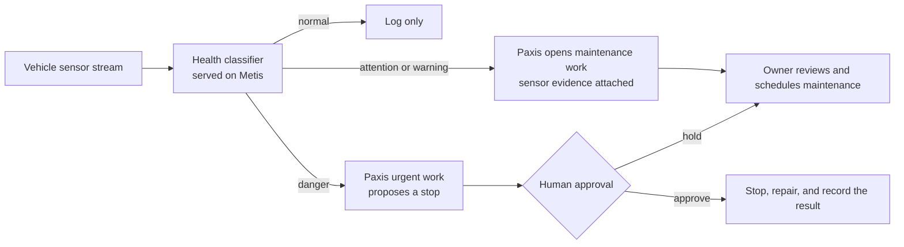

We released a small model that sorts a machine into four health states using only its sensor readings. It is for engineers and operations leads who want factory equipment data to drive real work. On vehicles it had never seen, it never called a dangerous machine normal.

The model reads the sensors of transport vehicles that carry wafers around a semiconductor fab. It outputs one of four states: normal, attention, warning, or danger. We also describe a usage scenario in which Paxis handles what comes after the verdict: opening the maintenance work, attaching the evidence, and getting human approval.

## Plain terms

Think of the triage nurse at the entrance of an emergency room. The nurse looks at a few numbers, such as temperature, pulse, and blood pressure, and sorts patients by urgency. The nurse does not decide on surgery. A doctor makes that call after reading the chart.

This model is the triage nurse. It looks at sensor numbers such as current, temperature, and dust, and puts each vehicle into one of four boxes. In the intended design, Paxis plays the role of the hospital's intake and chart system. It turns the triage result into a maintenance ticket with evidence, and hands heavy decisions, like stopping a vehicle, to a person.

A triage nurse does not need a full diagnostic lab, and this step does not need a large language model. A model that is small, fast, and easy to audit is enough.

## What we tried

The released model is [Thaki-EquipmentHealth-Sensor-LGBM](https://huggingface.co/ThakiCloud/Thaki-EquipmentHealth-Sensor-LGBM). It covers overhead hoist transport vehicles (OHT), which run on ceiling rails, and automated guided vehicles (AGV), which run on the floor. The training data is AI Hub dataset 71802.

Each vehicle logs four current sensors, a temperature sensor, three particulate sensors, and ambient humidity, light, and temperature over time. The health labels come from the dataset's testbed simulation system.

The model is a single gradient-boosted tree ensemble (LightGBM). For each sensor it uses the current value, the change from the previous reading, and the mean of the last five readings. It only looks backward, so it can judge each new reading as it arrives. Thermal camera frames, maintenance history, and cumulative run days were left out.

One thing about the evaluation matters most. The vehicles used for training and for evaluation were fully separate. We trained on vehicles 1 through 14 and measured on four vehicles from units 15 and 16 that the model never saw. The baseline is logistic regression on the same inputs.

## What we found

These results come from 11,792 sensor readings on the four unseen vehicles.

| Model (same inputs) | Macro F1 | Danger recall | Danger called normal |
|---|---|---|---|
| **This model (LightGBM)** | **0.9432** | 0.9645 | 0 / 930 |
| Logistic regression | 0.9182 | 0.9710 | 0 / 930 |
| Always predict the most common state | 0.1635 | 0.0000 | 930 / 930 |

*Macro F1 gain +0.0254, 95% bootstrap CI [+0.0111, +0.0385]. Evaluation vehicles: units 15 and 16, two AGVs and two OHTs.*

Macro F1, which rewards getting all four states right, was 0.94 against 0.92 for logistic regression. The confidence interval for that gap does not include zero. Out of 930 danger readings, none was called normal. In plain words, the model never waved a dangerous vehicle through on machines it had not seen.

One honest caveat. On danger alone, logistic regression caught slightly more cases. Our gain comes mostly from separating the attention state better. The model is about 1 MB and takes roughly 0.1 ms per reading on a CPU.

Before release we also checked that the downloaded model gives the same answers as at training time. On 146 readings from six shuffled sessions, features and probabilities matched exactly.

## Usage scenario: how Paxis would turn this into maintenance work

A triage label on its own changes nothing. When a warning appears, someone has to open a maintenance request, note which sensor looked wrong, and assign an owner. In this scenario Paxis handles that link. Below is the reference design; the path from model verdict to Paxis work creation has not yet been verified end to end.

In this design, on attention or warning, Paxis opens a maintenance ticket. The ticket would carry the class probabilities, the latest sensor values, and their changes as evidence. The owner can see at once why the ticket exists.

On danger, the design has Paxis propose a stop instead of stopping the vehicle itself, and wait for a person to approve. The triage nurse can flag a critical patient, but the doctor decides on surgery. The approval and the outcome would be kept in the work record.

The model side is split as well. The intended setup is that Maxis trains and verifies small models like this one, and Metis serves them in production. At about 0.1 ms per reading, the model runs on a CPU without a GPU. The more work Paxis automates, the cheaper each judgment needs to be, and small models keep that floor low.

## What to change

When you add AI to equipment data, try separating judgment from action first. Give judgment to a small, verifiable model. Give action to a workflow that keeps evidence and approvals.

Not every step needs a large language model. Sorting sensor numbers into four boxes worked with a 1 MB tree model. Save the language model for writing maintenance reports or talking with the owner.

Always evaluate on equipment the model has not seen. If you test on the same vehicle at a different time, you cannot tell whether the model learned the health state or memorized that vehicle's habits.

## Limitations

The biggest limit is the labels. The four states come from the testbed's simulation system, not from real breakdowns. In triage terms, this nurse practiced on training mannequins, not real patients. So we do not claim the model predicts real failures.

We did not measure other fabs, other vehicle models, or other sensor hardware. If sensor units or environment readings differ from the dataset, the output should not be trusted.

There is also a test score on vehicles 17 and 18, about 0.94 macro F1. That split had been scored once with an earlier model, so we do not treat it as a blind estimate.

False alarms happen. The most common error is calling a normal reading attention: 286 out of 5,729 normal readings. In plain words, about one normal reading in twenty raises an attention alert. Four normal readings were called danger.

No training data is included in the repository. To get the data, apply to AI Hub under its terms. The trained weights are released under AI Hub's terms for trained models.

---

*Model: [ThakiCloud/Thaki-EquipmentHealth-Sensor-LGBM](https://huggingface.co/ThakiCloud/Thaki-EquipmentHealth-Sensor-LGBM) (CC BY 4.0, research preview). Training data source: AI Hub dataset 71802 (OHT and AGV equipment). The Paxis maintenance flow is a reference design, not a measured result of an integrated product.*
