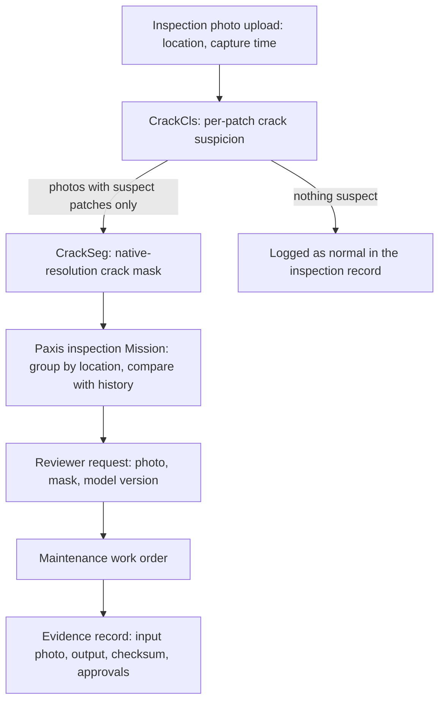

We have made two small models public that find concrete cracks in inspection photos and trace their shape pixel by pixel. If you want to automate inspections of buildings, bridges, or tunnels, check how far these models can actually take you. The scores are very high, but they were measured on one public dataset, so they are not field accuracy.

One model decides whether a small patch of a photo contains a crack. The other marks every pixel a crack runs through across the whole photo. Both are released under terms that allow commercial use, and the training data is not redistributed.

## Plain terms

Picture an editorial desk proofreading a manuscript. A proofreader flips through quickly and folds the corner of every page with a typo. An editor then opens only the folded pages and underlines each wrong word in red ink. Finally, the managing editor collects the marked pages and writes a correction order: who fixes what, and by when.

The classifier is the proofreader folding corners, and the segmentation model is the red pen. Paxis plays the managing editor, writing the correction order and following it through. The editorial office that picks the pens, trains them, and keeps them to one standard is Metis and Maxis. The rest of this post follows those three steps in order.

## What we released

The two models are [Thaki-FacilityVision-CrackCls-ResNet18](https://huggingface.co/ThakiCloud/Thaki-FacilityVision-CrackCls-ResNet18) and [Thaki-FacilityVision-CrackSeg-E2](https://huggingface.co/ThakiCloud/Thaki-FacilityVision-CrackSeg-E2). Both use the CC BY 4.0 license, which only asks for attribution.

The classifier is based on ResNet-18 and has about 11 million parameters. Cut a photo into small patches and it returns a crack probability for each one. On four CPU threads a patch takes about 12 ms, so it works as a first filter without a GPU. In plain terms, the corner-folding proofreader is cheap to keep on staff.

The segmentation model is a U-Net with a ResNet-34 encoder and about 24 million parameters. It does not shrink the photo. It processes the original resolution in overlapping tiles, which keeps hairline cracks that a downscaled pass loses. A 12-megapixel photo takes under a second on a GPU and close to 30 seconds on CPU alone.

Before release we checked three things. Anonymous download works without logging in. The downloaded weights match the training output by checksum. The published inference code gives the same output as the training code, with zero difference for both models.

## Results

The classifier got only 4 of 5,524 held-out test patches wrong. It missed 2 cracks and raised 2 false alarms on clean surfaces. It edged out a small CNN and a ResNet-18 with only the last layer trained. What matters more is that all three already scored above 0.98. In plain terms, this dataset is on the easy side, so the gaps stay small.

For segmentation, the number to watch is how many thin cracks the model keeps. The earlier model, which shrank photos to 1,024 pixels, caught about 7 in 10 thin cracks. The new model, working at native resolution, catches more than 9 in 10. The overall overlap score (Dice) is about 0.9, essentially the same as before. The red pen now traces finer lines, but the overall accuracy of the underlines did not jump.

| Model | Evaluated on | Headline numbers | Compared with |
|---|---|---|---|
| CrackCls-ResNet18 | Test set, 5,524 patches (scored once) | Macro F1 0.9993, 2 false alarms, 2 misses | Last-layer-only 0.9955, small CNN 0.9864 |
| CrackSeg-E2 | Dev set, 60 images (61-image test set not scored) | Dice 0.8983, thin-crack recall 0.9139 | 1,024 px downscaled model: Dice 0.8957, thin-crack recall 0.7358 |

*The segmentation threshold of 0.95 was chosen on the same dev set. The 95% confidence interval for the thin-crack recall gain excludes zero; the interval for the Dice difference includes zero.*

## The inspection flow with Paxis

Finding a crack does not finish an inspection. Someone needs to know which wall on which floor the photo came from. They need to know whether the crack grew since the last visit, and who checks and repairs it. Paxis groups the model output into those units of work and keeps the evidence. Below is a reference design that places the two released models into that flow.

Back to the proofreading desk: the red pen only touches folded pages, so the expensive step never runs on every photo. The underline the pen draws becomes the evidence for the correction order. The checksum records which version of which model drew it. If a repair decision later turns out wrong, you can trace back through photo, mask, and model version to see why.

The key principle is to keep the model's output apart from the repair decision. A crack mask is not a structural safety verdict. So Paxis does not order repairs or restrict use based on a mask alone, and it always routes through a human reviewer. The models shrink the pile of photos a person must look at and organize the evidence.

## Why small models

Inspection photos pile up by the thousands per visit. Running one large general vision model over all of them drives up both cost and latency. If a CPU-friendly classifier filters first, native-resolution segmentation only runs on suspect photos. Splitting the work this way makes the cost of one Paxis inspection task easier to predict.

Small models are also easier to verify. One weights checksum, one inference script, and one evaluation summary tell you exactly what was published. When models trained on Maxis and served on Metis are this small and checkable, a version retrained on site data can be compared the same way. Customers who cannot move data outside can consider running the same flow inside infrastructure they control, such as Aegis.

## Limitations

The biggest limit is that there is only one data source. Both models were trained and evaluated only on the concrete crack datasets published by Özgenel. Those photos come from one campus with similar lighting and texture. Expect a large drop with other cameras, shadows, stains, or joints that look like cracks. The near-perfect classifier score means it fits this dataset, not that it generalizes to the field.

The segmentation numbers come from 60 dev images only. The threshold was picked on that same dev set, so the figures may be optimistic. The held-out 61-image test set has not been scored. Asphalt, steel, tile, and drone imagery are untested.

Both models are research previews, not certified inspection tools. The Paxis flow above is a reference design, not a measured integrated product. Putting this in the field requires a separate evaluation on site photos. A version retrained on that data should then be compared through the same procedure.

## Summary

What this release offers is less a high score and more a pair of small, verifiable models shipped with a clear account of what to trust. The corner-folding proofreader and the red pen are ready, and Paxis takes the managing editor's seat. The next question is whether the pen draws the same lines on real site photos, and only site data can answer it.



---

*Source: the public model cards for both models (Hugging Face, published October 31, 2026). Training data: Ç. F. Özgenel, Mendeley Data (doi:10.17632/5y9wdsg2zt.2, doi:10.17632/jwsn7tfbrp.1), CC BY 4.0.*
