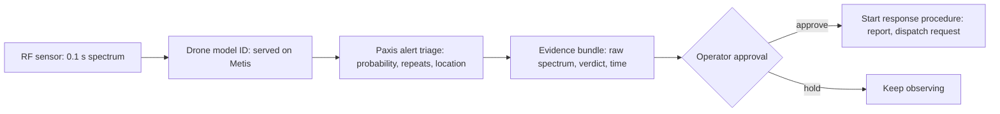

We released a small model that looks at one slice of radio and tells you which drone model is transmitting. It is meant for engineers and operators who want to automate facility security or airspace monitoring. On recordings from a site not used for training, it scored 0.93 macro-F1 across 14 models.

We then trained a newer version, and it did not beat the first one. So the first version stays as the public release. This post covers what the model does well, where it falls short, and how its output becomes real security-operations work.

## In plain terms

Think of picking up the phone and knowing who is calling from a single "hello." Every voice has its own pitch and tone. Every drone model also leaves a slightly different shape in the radio band. The model looks at 0.1 seconds of radio power and picks one of 14 models.

The key point is that we tested it with calls from a different room. If you test with voices recorded in the same room, the model can memorise the room and the score inflates. So we trained on one recording site and evaluated on another.

## What we built

The input is a single power spectrum: 20 MHz around 2.43 GHz split into 8,192 bins. The model is a one-dimensional residual network (ResNet1D) with about 3.3 million parameters. We trained it from scratch, without a pretrained backbone.

The data is the AI Hub "UAV Flight Signal Data" set (dataset 71954). It comes from three recording sites. We trained on site 01, made every selection decision on site 02, and kept site 03 sealed. The data cannot be redistributed, so we published only the weights and the inference code. The model is on [Hugging Face](https://huggingface.co/ThakiCloud/Thaki-RFUAV-PSD-ResNet1D) for anyone to download.

The model is small. On one Mac, a single prediction took about 2 ms on the GPU and 4 ms on the CPU. In other words, an ordinary computer next to the sensor can run it in real time.

## Results

We evaluated on about 60,000 captures from site 02, which the model never trained on. Its 14-model score (macro-F1) was 0.93. A logistic-regression baseline trained directly on the 14 models scored 0.83. In plain words, the model is ahead by about 10 points out of 100.

To check that the gap is not luck, we resampled the 280 recording sessions 2,000 times. The gap stayed clearly above zero. The table lists the observed gap and the resampled mean gap separately.

| Comparison (site 02, 60,480 captures) | Score (macro-F1) | Difference |
|---|---|---|
| Released model v1 | **0.9295** | vs baseline: observed +0.0987, resampled mean +0.1002, 95% CI [+0.0789, +0.1224] |
| Baseline (14-model logistic regression) | 0.8309 | reference |
| v2 candidate E1 (trained on 14 models directly) | 0.9266 | vs v1: −0.003, 95% CI [−0.013, +0.005] |
| v2 candidate E2 (multi-resolution input + augmentation) | 0.9159 | vs v1: −0.014, 95% CI [−0.026, −0.001] |

*Intervals come from resampling the 280 dev recording sessions 2,000 times. Site 02 was also used for model selection, so these numbers carry selection optimism.*

Performance is uneven across models. Six of the 14 are recognised more than 99 times in 100. uav02 is right only about 6 times in 10. The baseline is just as weak on uav02, and it is slightly ahead on uav02 and uav07.

## The new version that did not win

After v1, we tried two candidates. One trained the same network directly on the 14 models. The other added multi-resolution input and augmentation such as random gain shifts. Both beat the baseline, but neither beat v1.

The first candidate showed no evidence of a difference from v1. The second was slightly worse. Neither lifted uav02 above 6 in 10. So we released neither, and the public weights did not change.

In phone terms, the new hire was no better at naming callers than the person already on the desk, so we kept the person on the desk. A new version alone is not a reason to swap. We swap only when a rule set in advance says so. We think that rule will outlast any single score.

## Usage scenario: connecting identification to Paxis

Naming the model does not finish the job. An operator still has to decide whether the alert is real, where it came from, and who should hear about it. Paxis, ThakiCloud's agent platform, connects that judgment to action. Below is a reference design for plugging this model into Paxis; the path from model verdict to Paxis work has not yet been verified end to end.

In this design, Metis serves the small signal model close to the sensor, and release decisions follow pre-set gates. Paxis would take each verdict and triage it: is the same model seen repeatedly, and is the probability high enough? It would then bundle the raw spectrum, the verdict, and the time as evidence for the operator.

Where the human sits is the point. This model cannot reject an unknown signal, so it always answers with one of the 14 models. That is why its answer never turns straight into action. The agent checks and organises, and the operator decides whether to start a response.

In this design the model only identifies. Neither the model nor the design includes any jamming or countermeasure capability.

## What not to trust

There is no site 03 result. That site stayed sealed because the pre-registered opening condition was not met, and it has not been evaluated. So we cannot claim the same score at new sites in general.

The 0.93 on site 02 is not an independent test score either. We picked the checkpoint there and compared v2 there, so selection optimism is baked in. Session-level intervals also do not cover variation between sites.

The model's view is narrow. It sees one band near 2.43 GHz, one receiver setup, and one 0.1-second slice. It has no multi-frame voting and no way to reject non-drone signals. Multiple simultaneous emitters and jammed conditions were not evaluated.

It reads little beyond the drone model. Telling control signals from status signals works only about 6 times in 10, close to a coin flip. The flight-phase head is near chance and should not be used. This is a research release, not a certified detection product.

## Wrap-up

We released a small model that names the drone model from one slice of radio, and it clearly beat a baseline on recordings from a site not used for training. Keeping v1 because a later candidate did not win is part of the same result. In the intended design, Paxis handles checking and evidence after identification, and a person decides whether to respond.

Even if someone can name every caller by voice, the person in charge still decides whether to report it. That is the relationship between this model and Paxis.

---

*Source: the public model card and our internal experiment ledger, finalised 1 November 2026. All numbers are from recording site 02; site 03 was not evaluated. The Paxis integration is a reference design, not a measured result of an integrated service. Data: AI Hub "UAV Flight Signal Data" (dataset 71954).*
