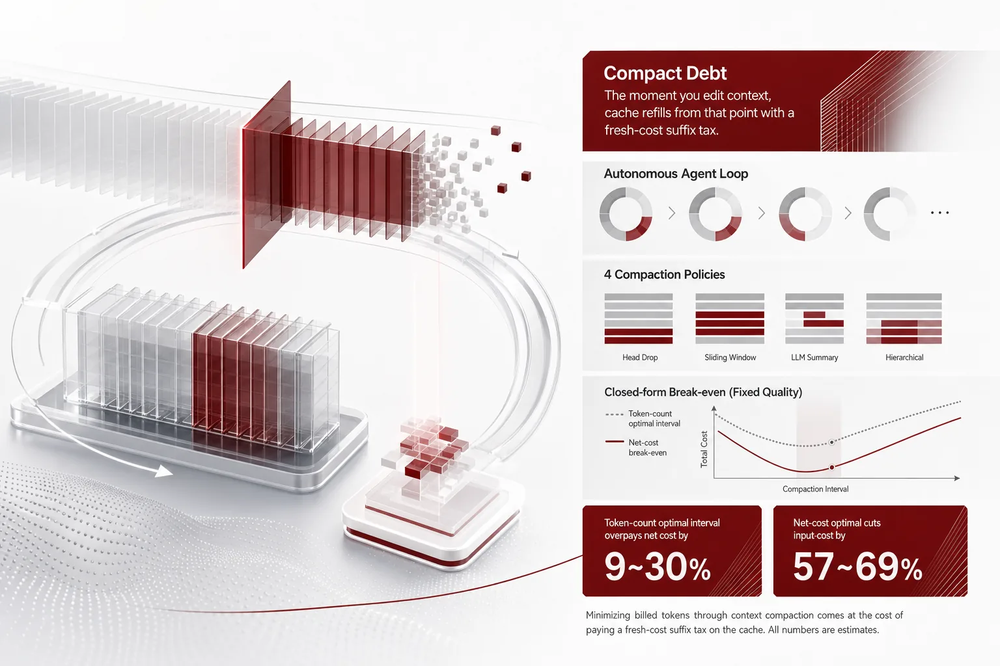
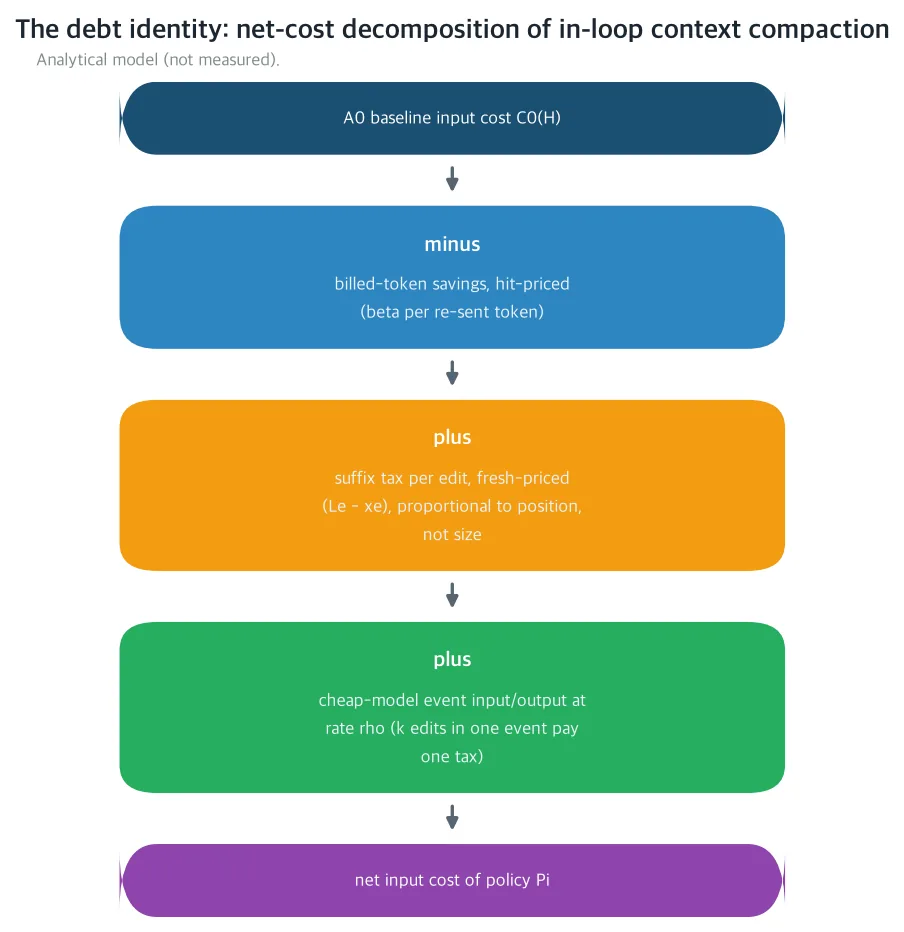
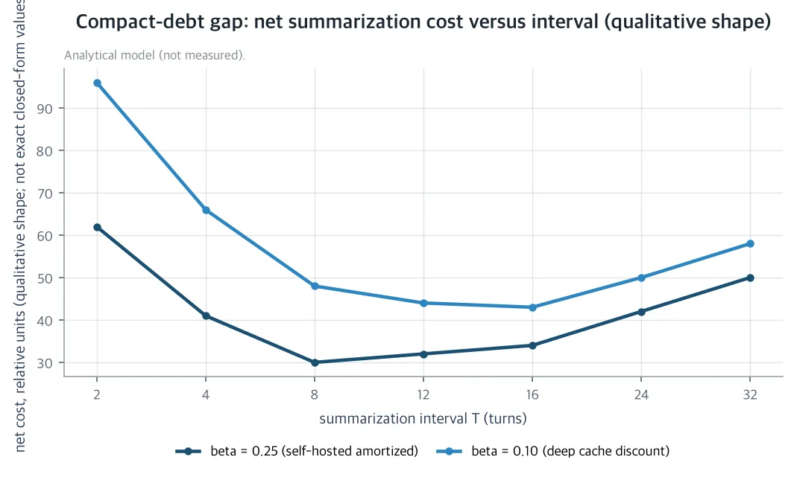
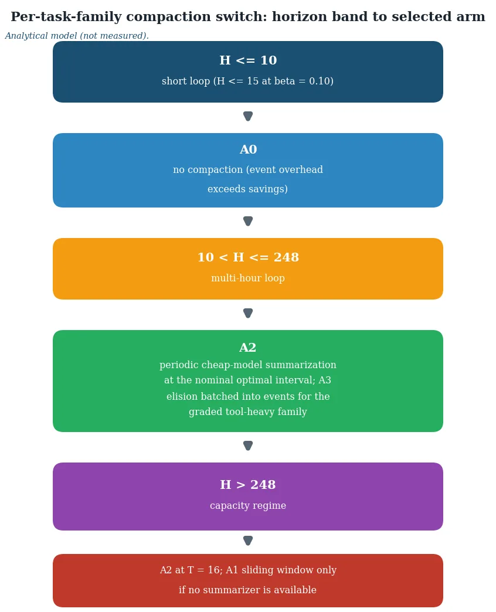

You can spend more money to save money. If you run unattended agents on your own GPU overnight, this post tells you how compaction changes the bill. The answer is not in the billed tokens. It is in the cost of re-reading what you edited.

*A visual metaphor for the article's key idea.*

## In plain terms

Think of the engine's cache as a notebook. The engine keeps the pages it has already processed, and it discounts them when the same pages come back. An unattended agent resends the whole conversation every turn, so most of it is just re-reading the same pages. That is cheap.

But rewriting the middle of the notebook changes the bill. From the rewritten page to the end, the engine must compute everything again from scratch. A one-line edit on page ten costs the same re-read as a full rewrite of that page. Position decides the burden, not size. The cache that gives this discount is the prefix cache. The paper calls the per-edit re-read the suffix tax, and the total cost of paying it through compaction the compact debt.

In short: compaction is priced by where you touch, not by how much you shrink. And that debt never shows up in the billed-token column.

## What the paper sets up

All pricing sits on one declared platform. A 14B dense model runs on a self-hosted H200 (141GB HBM3e), with a 0.6B summarizer on the same instance. The engine is a paged KV engine with a prefix cache under exact-match semantics. A new prompt reuses the cache only up to the shared prefix, and computes the rest from scratch.

There are four compactions. None. A sliding window, which keeps only the last W tokens. Periodic summarization, where a cheap model rewrites the history into a short summary every T turns. And elision, which replaces stale tool output with a short stub. Model-written text and the fixed instructions are never touched.

All arms are compared at fixed task quality. Tool-heavy families use a deterministic code grader (exact match plus near-miss band); prose families use a declared fixed verdict. In a single loop, capacity-based eviction does not bind within the task lifetime, so all cache loss attributed to compaction comes from content edits. Churn is priced by the two earlier posts and combines additively.

This paper is the explicit upgrade of [Unstable Prefix](https://thakicloud.com/tech-blog/en/research/unstable-prefix-harness-erosion/) (2026-10-01). That post priced the passive edits the harness makes to the shared manifest every night. This one prices the agent's own edits to its working context. Both answers take the form of a square-root law. Prior compaction literature priced billed tokens, information, quality, or latency, but nobody priced the interaction between the client-side edits and the serving-side cache. Every value below is a closed-form prediction under the nominal assumptions in the table, not a measurement. Each prediction has a pre-registered measurement design and falsification criterion.

| Symbol | Meaning | Nominal |
|---|---|---|
| H | loop horizon (turns) | 16/32/64/128 |
| p | fixed instructions (system + schemas + manifest) | 4,096 tokens |
| b | fresh content per turn | 512 tokens |
| u | tool payload per turn | 384 tokens |
| M | model context window | 131,072 tokens |
| β | cache discount rate (vs fresh price) | 0.25 self-hosted / 0.10 API |
| s̄ | summary length cap | 2,048 tokens |
| ρ | cheap model's rate (vs main) | 0.25 |
| a | tool-payload staleness age | 4 turns |
| m | elision stub length | 32 tokens |

## What it finds

Most of the overnight fleet's input bill goes to resending what was already seen. At nominal values (H=128 turns, β=0.25), the cumulative cost of resending a growing history is 84% of the no-compaction baseline input cost. That is the last dominant input cost left unpriced in the series: the agent's own growing working context.

### First: position sets the burden, not size

The paper's first theorem (Theorem 1) collects the interaction into one accounting identity. Any compaction's input cost decomposes into four terms. Take the no-compaction baseline, subtract the billed-token savings at the hit price, add a fresh-price re-read at each edit position, and add the cheap model's event compute. The suffix tax is proportional to the length left after the edit position, not to the size of the edit.

*Concept diagram of the analytic model (not a measurement). Any compaction policy's input cost decomposes into the no-compaction baseline minus the billed-token savings at the hit price, plus the fresh-price suffix tax per edit position, plus cheap-model event compute.*

Two consequences follow. A one-token edit and a ten-thousand-token edit at the same position pay the same debt. The edit size shows up only in later savings. And k edits bundled into one event pay one debt, that of the earliest edit. This debt batching is what later makes elision free.

### Second: the window loses while it fits

Sliding-window truncation is the first compaction an engineer reaches for. But under exact-match semantics the window content shifts every turn. The common prefix with the previous prompt is exactly the fixed prefix p, and after warm-up each turn is a hit on p plus W fresh tokens. The net delta comes out in closed form, and the break-even horizon is H* = 2(W−b)/(β·b).

At nominal values (W=8,192 tokens, b=512), H* is 120 turns at the self-hosted discount (β=0.25) and 300 turns at the API-style deep discount (β=0.10). The context window holds at most 248 turns.

In short: under the deep discount the window loses at every horizon that fits in the notebook, and it is justified only beyond capacity, and only without a summarizer.

Under the self-hosted discount, cost motivation begins at 120 turns. But at every such point, summarization with T 4~16 is strictly cheaper and quality-better. The window hard-drops old turns, while summarization compresses them, so the two are not on comparable footing. The operator rule is short: never enable sliding truncation for cost, only for capacity relief without a summarizer. This debt is front-loaded. The first H* turns carry the whole deficit before the savings begin, so switching the window on is buying a short-term loss.

### Third: the summarization interval is EOQ, and the gap is the debt

Periodic summarization (Theorem 3) has the structure of economic order quantity (EOQ). In the cap regime, the per-turn cost splits into three. A constant term, a holding cost, and a setup cost. The holding cost is the history that grows within the summarization period and is resent at the hit price. The setup cost is re-reading the summary at the fresh price and the cheap model re-reading the context. Convexity in T gives a unique interior minimum T*.

T* = √(2[s̄(1−β) + ρ(p + 2s̄)]/(β·b)). At nominal values, T* is 7.5 turns at β=0.25 and 12.3 turns at β=0.10, and the discrete optima sit at 8 and 16 turns. The minimum is flat. Any T between T*/2 and 2T* overpays by at most 1.8% at β=0.25 and 4.5% at β=0.10. There is no need to hit the interval exactly.

The compact debt in the title comes from here. Billed input tokens of the main model fall monotonically as T shrinks. So the token-minimizing interval is the most aggressive non-degenerate one, T=2. Yet its net cost overpays 9.1% at β=0.25 and 29.5% at β=0.10 versus the net-cost optimum. The degenerate every-turn T=1 goes to 25.6% and 71.7%.

In short: the more aggressive the compaction, the larger the overpayment, and the deeper the cache discount, the wider the gap. As β approaches 1, the cache loses value, and the token optimum is nearly the net optimum. As β approaches 0, every re-read is a near-full-price tax on an almost-free savings stream. Aggressive compaction is most severely mispriced exactly where the prefix cache is most valuable.

*Analytic model (not a measurement). Qualitative shape of summarization net cost against interval T: a flat U-shaped minimum, earlier for the shallow discount β=0.25 and later for the deep discount β=0.10. The most aggressive token-minimizing interval at the left end (T=2) pays the largest compact-debt gap (9.1% / 29.5% of baseline) versus the net-cost optimum (8 / 16 turns).*

There is a floor on when to switch on. Summarization first strictly beats no-compaction at about 11 turns (β=0.25) and about 16 turns (β=0.10). In shorter loops, event overhead dominates, and the right answer is no compaction. The first-pay horizon is not independent of β. The deeper discount pushes payback later, in the same direction as T* and the gap, so the billing regime moves the switch-on point as well as the optimal interval.

The headline numbers at H=128 and nominal values are in the table below.

| β | no-compaction C⁰ | window Δ₁ | window H* | discrete Ť | T* | optimal/C⁰ | gap (T=2) |
|---|---|---|---|---|---|---|---|
| 0.10 (API) | 537,805 | +104.0% | 300 | 16 | 12.33 | 43.2% | +29.5% |
| 0.25 (self-hosted) | 1,240,064 | −5.2% | 120 | 8 | 7.48 | 30.6% | +9.1% |

*Table: H=128 turns, nominal values, fresh-token units. Δ₁ is the window net delta; gap is the overpayment of the token-optimal interval T=2. The first-pay horizon H₁ is about 16 / about 11 turns, and elision first-pay is H−τ > 58.2 / 23.3 turns.*

At nominal parameters, net-cost-optimal compaction cuts long-horizon input cost by 57~69% versus no compaction. The policy ranking differs from the billed-token ranking. Look only at billed tokens, and the shorter, more aggressive intervals look cheapest. Ranked by net cost, the sliding window becomes the worst arm under the deep discount (+104% at H=128). The token-minimizing interval overpays 9~30%.

The sensitivity is clean. T* scales with β to the −1/2 power, H* with β to the −1 power, and elision first-pay with β to the −1 power. The compact-debt gap increases monotonically in 1/β. The operator must estimate only two parameters from telemetry: the discount β and the summary cap s̄ the cheap model actually achieves. The rest are harness constants.

The expensive mistake that billed-token intuition makes is aggressive summarization to minimize input tokens. Under a prefix cache, that is paying a fresh-price re-read to save a hit-price resend. The 9~30% overpayment at nominal values is exactly that price.

### Fourth: elision is free at event boundaries

The fourth policy (Theorem 4) is structural elision of stale tool payloads. A payload born at turn tₑ (nominally 384 tokens) is replaced by a 32-token stub once it is 4 turns stale. Model-written text and the fixed prefix are never elided. Eliding constraint clauses is the failure mode the governance literature shows: violations rise from 0% to 30%. Payload-only elision is approximately quality-neutral under the deterministic grader, because deliverables are re-validated and stale payloads are low-access tail items.

The net gain of one payload is N(τ) = β(u−m)(H−τ) − b·a. By the debt identity, the suffix tax of one elision is b·a, independent of the elision turn and of the full context length. Break-even is H−τ > 23.3 turns at β=0.25 and 58.2 turns at β=0.10. A payload elided at turn 8 pays off at H>31 / H>66, and the net gain at H=128 is +8,512 / +2,176 fresh-token units.

Two structural results. Earliest-stale-first: with the target set fixed, eliding each payload the moment it goes stale (FIFO) minimizes total debt. Pulling elision earlier never raises the suffix tax, since the payload position is fixed; it only lengthens the savings lifetime H−τ. Debt batching: elision aligned with a summarization event has zero marginal debt, because the event already re-reads the suffix from position p. Between events, bundling k elisions into one GC turn pays one tax instead of k. Inside a summarization policy, elision carries no independent cost. For tool-heavy families it is the net-cost-optimal treatment of the between-event window, and it makes summarization cheaper still.

## What to change

The paper presents the result as a compaction switch by task family. A two-line configuration picks the arm and the interval from (family, horizon band).

| Family | Horizon band | Arm | Parameters |
|---|---|---|---|
| graded tool-heavy | H ≤ 10 | none | none |
| graded tool-heavy | 10 < H ≤ 128 | summarization + elision | T = 8, age 4 at events |
| graded tool-heavy | H > 248 | summarization + elision | T = 16 |
| prose/judged | H ≤ 10 | none | none |
| prose/judged | 10 < H ≤ 16 | summarization | T = 8 |
| prose/judged | 16 < H ≤ 128 | summarization | T = 16 |
| prose/judged | H > 248 | summarization (window if no summarizer) | T = 16, W = 8,192 |

*Table: the shipped compaction switch, a deployable configuration. Bands are at β=0.25 nominal; at β=0.10 the first-pay horizon shifts to about 16 turns and the no-compaction band extends to roughly H ≤ 15.*

Prose/judged families exclude elision, because without a grader the quality-neutrality argument does not hold.

*Analytic model (not a measurement). Arm mapping by horizon band for the switch presented. Short loops (H≤10 at β=0.25, about H≤15 at β=0.10) do not compact. Long loops past the first-pay horizon (H≤248) use periodic cheap-model summarization, together with event-batched stale-payload elision for grader-backed tool-heavy families. The capacity regime (H>248) keeps T=16 summarization, with the sliding window reserved for operation without a summarizer.*

For the company, the switch goes into the existing overnight agent harness as a deployable configuration. KV telemetry and per-call token metering already run on the self-hosted H200, so no new instrumentation is needed. After routing overhead (Router's Toll), skill execution cost (Sticker Price), and registry-churn KV decay (Unstable Prefix) were each priced, this prices the last dominant unmeasured input cost: the agent's own growing working context.

For society, the net-cost economics of compaction, with cache invalidation removed, is presented in closed form under declared nominal assumptions, alongside a falsifiable four-arm protocol. Multi-hour unattended loops become affordable for small teams and self-hosters on low-cost inference fleets. The deterministic-grader arm shows the right compaction policy can cut context-fade and raise late-loop task quality at lower cost. In short: it lowers both the price and the failure rate of unattended automation.

For science, this is the first closed-form treatment of the interaction between active in-loop compaction and serving-side cache economics. It decomposes billed-token savings from the re-prefill clawback, and it establishes where the token-optimal policy stops being the net-cost-optimal one. The two square-root laws are one EOQ phenomenon on different token classes. One sets how often the harness may edit the shared prefix (k*). The other sets how often the loop should edit its own context (T*). The series' prefix-reuse line is upgraded from passive churn decay to an active control knob.

## What not to trust

The paper states its limits. First, single-loop regime: multi-loop churn on a shared engine is excluded by construction and combines additively with Unstable Prefix and Manifest Order. The joint policy of churn cadence k* and compaction cadence T*, a two-knob EOQ, is left to measurement. Second, declared β: the discount is regime-dependent (self-hosted amortization versus API billing), and all results are monotone in β. Third, quality as an outer band: the T 4~16 intervals and payload elision quality-neutrality are nominal claims from cited evidence. Compact-Bench reports stable damage of 5~64% of full-history successes, and the governance result shows silently deleted visible constraints raise violations from 0% to 30%. The measurement protocol replaces the band with a measured one. Fourth, block granularity: the suffix tax rounds up to 16-token cache blocks, and the per-event residual is at most 16 tokens, negligible against the suffix. Fifth, nominal κ and s̄: the summary cap s̄ binds T*, which scales with the square root of s̄, and the compression ratio κ only delays reaching the cap.

Each closed-form prediction becomes a measurement on the declared platform without changing any formula. There are four arms: none, a 6-step window, 4-step cheap-model summarization, and elision of payloads older than 4 steps. The workload is a per-family seed-fixed synthetic multi-step task suite at horizons 16/32/64/128, with identical model weights, harness, and fixed prefix. Per-call input tokens come from the engine's usage fields, and re-read tokens from the prefix-cache hit/query counters. The rendered prompt and the previous three turns are cross-checked analytically by their longest common prefix, floored to 16-token cache blocks. Counters the engine does not expose are reported as null, never imputed. Quality is exact-match pass plus near-miss band under the deterministic grader, and the prose family uses the declared fixed verdict.

The falsification criteria are pre-registered. R1 (window diseconomy): at H=128, the measured sign of Δ₁ must match the closed-form sign computed with the measured hit-rate proxy within 2σ, else the window theorem is rejected. R2 (EOQ structure): the measured optimal interval must fall within T*/2~2T* from the measured values, else, off by two or more epochs, the square-root law is rejected. R3 (elision quality-neutrality): the matched-T elision arm may lower the grader pass rate by no more than 3pp versus no compaction, else payload-only neutrality is rejected. R4 (compact-debt gap): the measured overpayment of the token-optimal interval must be at least 2% of the baseline. Below that, the token optimum is effectively net-optimal, and the title claim is rejected.

---

The paper's detail page and accompanying materials are available here: [The Compact Debt](https://huggingface.co/datasets/thaki-AI/daily-paper-2026-11-02-compact-debt-context-compaction-kv-cache)

*This is an analytic paper. Every value in the body is a closed-form prediction under stated nominal assumptions, not a measurement. Every figure is either a model prediction or a result from a cited reference.*
