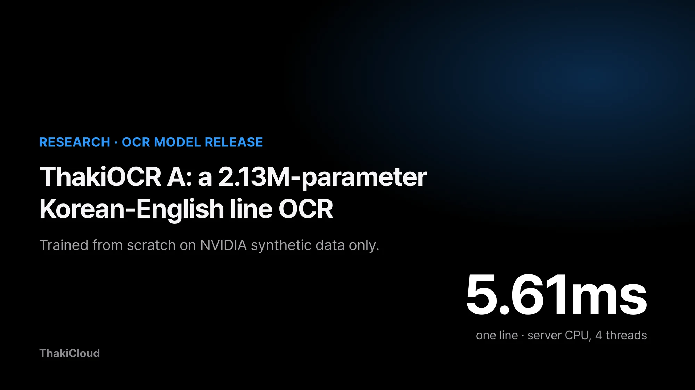
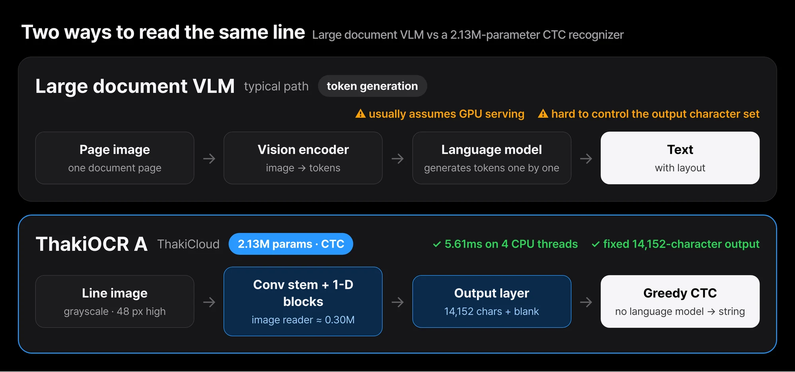
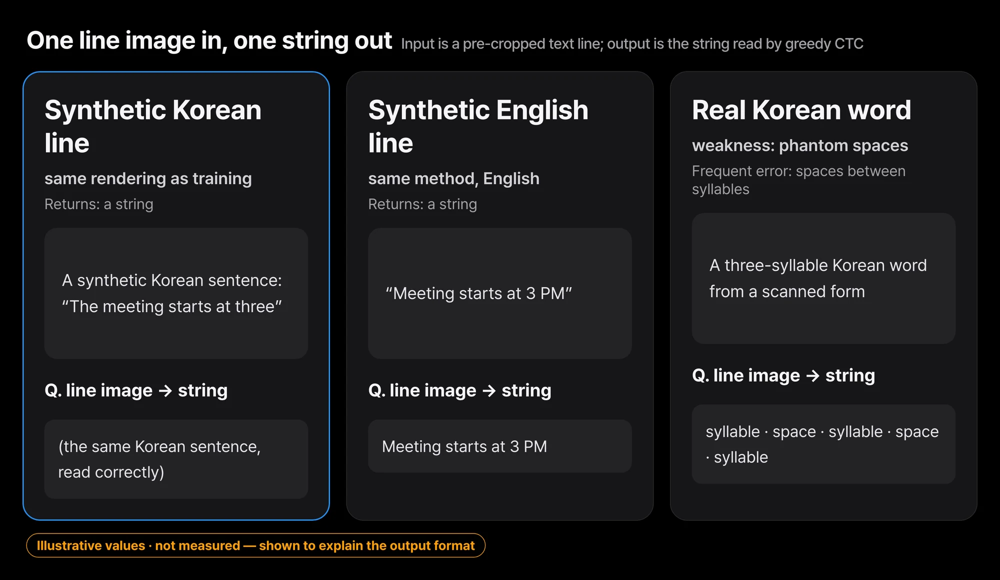
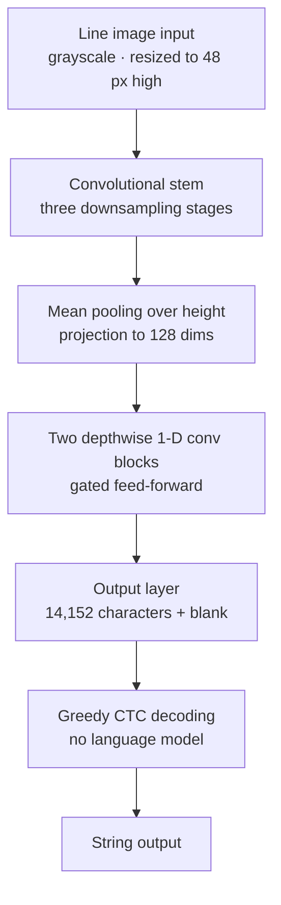
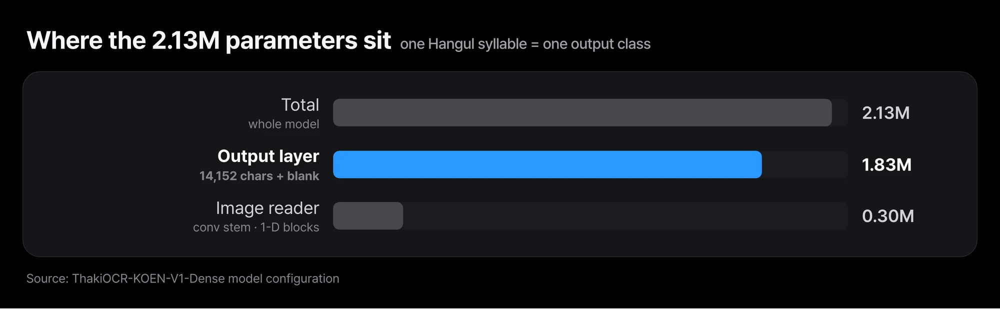
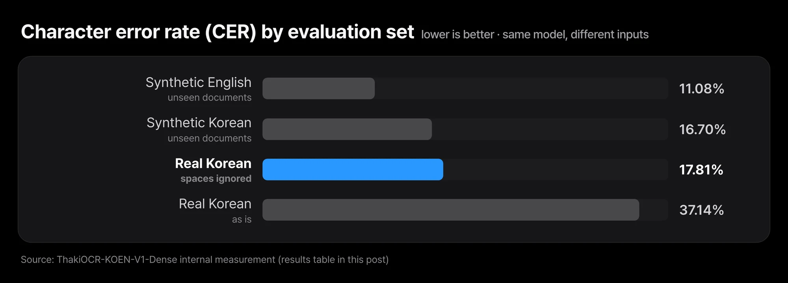

A line cropped from a scanned application form, the amount line on a receipt, the header line of a contract. Document processing reads line images like these hundreds of thousands of times a day. Often the server has no GPU, or the model has to run on a device on site, so there are places where a large model simply does not fit.

So we published ThakiOCR A, a Korean-English OCR model that ThakiCloud trained from scratch, on Hugging Face as [ThakiOCR-KOEN-V1-Dense](https://huggingface.co/ThakiCloud/ThakiOCR-KOEN-V1-Dense). It has 2.13M parameters, and both code and weights are Apache-2.0. It reads one 512-pixel-wide line image in 5.61 ms on 4 threads of a server CPU.

This post covers why we built a small model ourselves, what we trained it on, and where it is weak on real documents, without hiding the weak parts. This is a research release, not a product launch.

## In plain terms

ThakiOCR A is like a student who studied only from a handwriting workbook. It reads the neat printed letters in the workbook well. But the first time it sees a real form, it misjudges the gaps between letters, because workbook spacing and real-form spacing differ.

Still, this student is very light and very fast. The models that followed improved by showing it real forms.

## We needed a few milliseconds per line on servers without a GPU

There are plenty of large document VLMs for OCR already. A document VLM is a vision-language model that looks at an image and generates text; it takes a whole page and writes tokens out one at a time. That is heavy when the same kind of line has to be read hundreds of thousands of times, or on an on-premises server with no GPU. Those settings need a model that reads a line in a few milliseconds on a CPU.

*A large document VLM takes a page and generates tokens one at a time. ThakiOCR A takes one cropped line, reads it with convolutions, and decodes it in one pass with CTC.*

The other reason is control. With a model we trained ourselves, we know exactly what data went in and which characters it can output. In areas such as finance, where a single symbol matters, that transparency is where improvement starts.

## One line image in, one string out

ThakiOCR A is a line recognizer: it takes an image of one cropped text line and returns a string. It does not find text on a page, so it needs a text detector or layout model in front of it.

*Examples of the input and output shape. The text is made up for illustration and does not come from training or evaluation data.*

The last step is CTC (Connectionist Temporal Classification) decoding. CTC produces character probabilities at each horizontal position, then collapses repeated characters and blanks into a single string. We decode greedily, picking the most likely character at each position, with no language model.

Each Hangul syllable is one output class. The model can output 14,152 characters, including all 11,172 modern Hangul syllables plus ASCII, Jamo and symbols.

*About 1.83M of the 2.13M parameters are in the output layer that emits 14,152 characters; the part that actually reads the image is about 0.30M.*

In Korean OCR, vocabulary size drives model size. The body that reads the image is only about 0.30M parameters, but giving every syllable its own output slot makes the last layer most of the model.

## Trained from scratch on NVIDIA synthetic data only

The training data is one Korean and one English training file from NVIDIA's OCR-Synthetic-Multilingual-v1, released under CC BY 4.0, and nothing else. We split train and held-out sets by source document and trained on 879,645 lines (435,510 Korean, 444,135 English).

Training ran for 20,000 steps on one B200 GPU, taking 1,407 seconds. We used the checkpoint from the final step as is, without picking checkpoints by looking at an evaluation set. No AI Hub data was used for training or for building the vocabulary.

## It reads synthetic lines but adds phantom spaces on real documents

| Evaluation set | Description | Character error rate (CER) |
|---|---|---|
| Synthetic Korean | NVIDIA synthetic lines from documents not seen in training | 16.70% |
| Synthetic English | English lines built the same way | 11.08% |
| Real Korean documents | word crops from part of the AI Hub 71299 validation data, evaluation only | 37.14% |

Character error rate (CER) is the number of wrong characters divided by the number of reference characters; lower is better. The synthetic sets come from the same generator as the training data, so they come out better than performance on real documents would. The real-document set is a development measurement, not an independent test set.

*Synthetic lines come in at 11.08% and 16.70%, real Korean word crops jump to 37.14%, and ignoring spaces brings that down to 17.81%. Most of the error is phantom spaces.*

Most of the 37.14% error on real documents comes from spaces. Ignoring spaces, CER falls to 17.81%. On 38% of real Korean word crops, the model inserted spaces between syllables that are not there; a three-syllable word comes back as three syllables separated by spaces. The spacing statistics of synthetic lines differ from those of scanned documents.

## One line takes 1.29 ms on a GPU and 5.61 ms on 4 CPU threads

For speed, on one 512-pixel-wide line image the median was 1.29 ms on a B200 GPU and 5.61 ms on 4 threads of a data-center server CPU. Replaying both at real speed makes the gap visible.

<figure class="fig-video"><video src="/assets/images/thakiocr-a-small-korean-english-line-ocr-fig-race-en.mp4" poster="/assets/images/thakiocr-a-small-korean-english-line-ocr-fig-race-en.webp" autoplay muted loop playsinline preload="metadata" aria-label="Animation replaying, at real speed, the time to read one line image on a B200 GPU and on 4 server CPU threads"></video><figcaption>B200 GPU 1.29 ms and server CPU on 4 threads 5.61 ms (measured medians), replayed in real time for 8 seconds. Values are for one image at a time.</figcaption></figure>

The CPU is about four times slower than the GPU, but a few milliseconds per line is still real time on a server without a GPU. That is why we made this model small.

## We rechecked hashes and outputs before release

The public repository holds only weights, config, the vocabulary file, inference code, the model card and license files. No training data is included.

After switching it to public, we downloaded the repository from an unauthenticated environment, checked that the file hashes matched the originals, and reran inference on the same line images. 509 of 512 Korean lines and 507 of 512 English lines produced the same strings as our internal results. We traced the remaining differences to floating-point differences between CPU and GPU.

## Five things to know before using it

| Use | Verdict |
|---|---|
| Reading synthetic or printed lines fast without a GPU | ✅ 5.61 ms on 4 CPU threads |
| Using real Korean word output as is | ⚠️ inserts phantom spaces, needs post-processing |
| Scans, photos, handwriting | ⚠️ outside the training range |
| Feeding a whole page at once | ⚠️ line images only, needs a detector in front |

- Space insertion on real documents is a big problem. Do not use Korean word-level output as is.
- It was trained on synthetic renderings only. Scans, photos, handwriting and faded text are outside its training range.
- It takes line images only. Feeding it a whole page or several lines at once gives meaningless output.
- It was trained once. We did not measure how much results vary from run to run.
- Do not read financial, legal or identity documents with this model alone, without human review.

## Closing

ThakiOCR A reads a line in a few milliseconds on a CPU with 2.13M parameters, but because it only saw synthetic data, it adds spaces between syllables on real documents. To try it, run the repository's inference code on a few line images from your own documents. Then compare the output with and without spaces side by side.

That weakness became the next model's goal. The second model, G2M, added real public-document images and synthetic symbol data and focused on keeping numbers and symbols intact. Its results and the failures that remain are in the [G2M release post](/tech-blog/en/research/thakiocr-g2m-numbers-and-symbols/). Where and how to deploy a small model is the subject of the [Metis tiered inference post](/tech-blog/en/llmops/thakiocr-metis-tiered-document-inference/).

ThakiCloud builds a platform for training models (Maxis), serving them (Metis) and connecting them to business work (Paxis), all in environments the customer controls. ThakiOCR A is the first model where we ran that flow end to end for document AI ourselves. Data lineage records, queue-based GPU training, hash verification and anonymous-download reproduction all went through the same procedure.

- Model: [ThakiCloud/ThakiOCR-KOEN-V1-Dense](https://huggingface.co/ThakiCloud/ThakiOCR-KOEN-V1-Dense)
- Training data: [nvidia/OCR-Synthetic-Multilingual-v1](https://huggingface.co/datasets/nvidia/OCR-Synthetic-Multilingual-v1) (CC BY 4.0)
- This is a research release; product release decisions are separate. We do not claim state-of-the-art accuracy.
