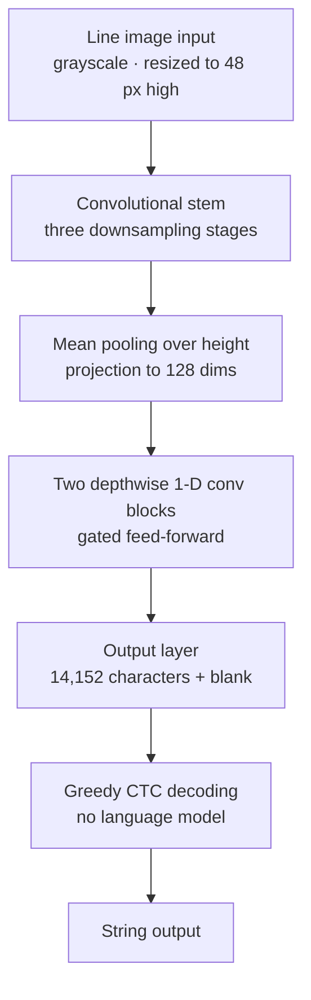

We published ThakiOCR A, a Korean-English OCR model that ThakiCloud trained from scratch, on Hugging Face as [ThakiOCR-KOEN-V1-Dense](https://huggingface.co/ThakiCloud/ThakiOCR-KOEN-V1-Dense). It has 2.13M parameters, and both code and weights are Apache-2.0.

This post is for engineers and researchers who want to build a small OCR model themselves. It covers why we started this small, what we trained it on, and where it is weak on real documents, without hiding the weak parts. This is a research release, not a product launch.

## In plain terms

ThakiOCR A is like a student who studied only from a handwriting workbook. It reads the neat printed letters in the workbook well, but the first time it sees a real form it misjudges the gaps between letters, because the spacing in the workbook and the spacing on real forms are different.

Still, this student is very light and very fast. The models that followed improved by showing it real forms.

## Why we started with a small model

There are plenty of large document VLMs for OCR already. But enterprise document processing often has to read the same kind of line image hundreds of thousands of times a day, and sometimes on on-premises servers or devices with no GPU. Those settings need a model that reads a line in a few milliseconds on a CPU.

The other reason is control. With a model we trained ourselves, we know exactly what data went in and which characters it can output. In areas such as finance, where a single symbol matters, that transparency is where improvement starts.

## What we built

ThakiOCR A is a line recognizer: it takes an image of one cropped text line and returns a string. It does not find text on a page, so it needs a text detector or layout model in front of it.

Each Hangul syllable is one output class. The model can output 14,152 characters, including all 11,172 modern Hangul syllables plus ASCII, Jamo and symbols. As a result, about 1.83M of its 2.13M parameters sit in the final output layer, and the part that actually reads the image is about 0.30M. It shows how much vocabulary size drives model size in Korean OCR.

## What we trained it on

The training data is one Korean and one English training file from NVIDIA's OCR-Synthetic-Multilingual-v1, released under CC BY 4.0, and nothing else. We split train and held-out sets by source document and trained on 879,645 lines (435,510 Korean, 444,135 English).

Training ran for 20,000 steps on one B200 GPU, taking 1,407 seconds. We used the checkpoint from the final step as is, without picking checkpoints by looking at an evaluation set. No AI Hub data was used for training or for building the vocabulary.

## Results

| Evaluation set | Description | Character error rate (CER) |
|---|---|---|
| Synthetic Korean | NVIDIA synthetic lines from documents not seen in training | 16.70% |
| Synthetic English | English lines built the same way | 11.08% |
| Real Korean documents | word crops from part of the AI Hub 71299 validation data, evaluation only | 37.14% |

The synthetic sets come from the same generator as the training data, so they come out better than performance on real documents would. The real-document set is a development measurement, not an independent test set.

Most of the 37.14% error on real documents comes from spaces. Ignoring spaces, CER falls to 17.81%. On 38% of real Korean word crops, the model inserted spaces between syllables that are not there, for example reading `평면도` ("floor plan") as `평 면 도`. The spacing statistics of synthetic lines differ from those of scanned documents.

For speed, on one 512-pixel-wide line image the median was 1.29 ms on a B200 GPU and 5.61 ms on 4 threads of a data-center server CPU.

## What we checked before release

The public repository holds only weights, config, the vocabulary file, inference code, the model card and license files. No training data is included.

After switching it to public, we downloaded the repository from an unauthenticated environment, checked that the file hashes matched the originals, and reran inference on the same line images. 509 of 512 Korean lines and 507 of 512 English lines produced the same strings as our internal results, and we traced the remaining differences to floating-point differences between CPU and GPU.

## What not to trust

- Space insertion on real documents is a big problem. Do not use Korean word-level output as is.
- It was trained on synthetic renderings only. Scans, photos, handwriting and faded text are outside its training range.
- It takes line images only. Feeding it a whole page or several lines at once gives meaningless output.
- It was trained once. We did not measure how much results vary from run to run.
- Do not read financial, legal or identity documents with this model alone, without human review.

## What carried over to the next model

ThakiOCR A's weaknesses became the next model's goals. The second model, G2M, added real public-document images and synthetic symbol data and focused on keeping numbers and symbols intact. Its results and the failures that remain are in the [G2M release post](/tech-blog/en/research/thakiocr-g2m-numbers-and-symbols/).

Where and how to deploy a small model is the subject of the [Metis tiered inference post](/tech-blog/en/llmops/thakiocr-metis-tiered-document-inference/).

## What it means for ThakiCloud

ThakiCloud builds a platform for training models (Maxis), serving them (Metis) and connecting them to business work (Paxis), all in environments the customer controls. ThakiOCR A is the first model where we ran that flow end to end for document AI ourselves. Data lineage records, queue-based GPU training, hash verification and anonymous-download reproduction all went through the same procedure.

## References

- All four public OCR models at a glance: [ThakiOCR model hub](/tech-blog/en/ocr/)
- Model: [ThakiCloud/ThakiOCR-KOEN-V1-Dense](https://huggingface.co/ThakiCloud/ThakiOCR-KOEN-V1-Dense)
- Training data: [nvidia/OCR-Synthetic-Multilingual-v1](https://huggingface.co/datasets/nvidia/OCR-Synthetic-Multilingual-v1) (CC BY 4.0)
- This is a research release; product release decisions are separate. We do not claim state-of-the-art accuracy.
