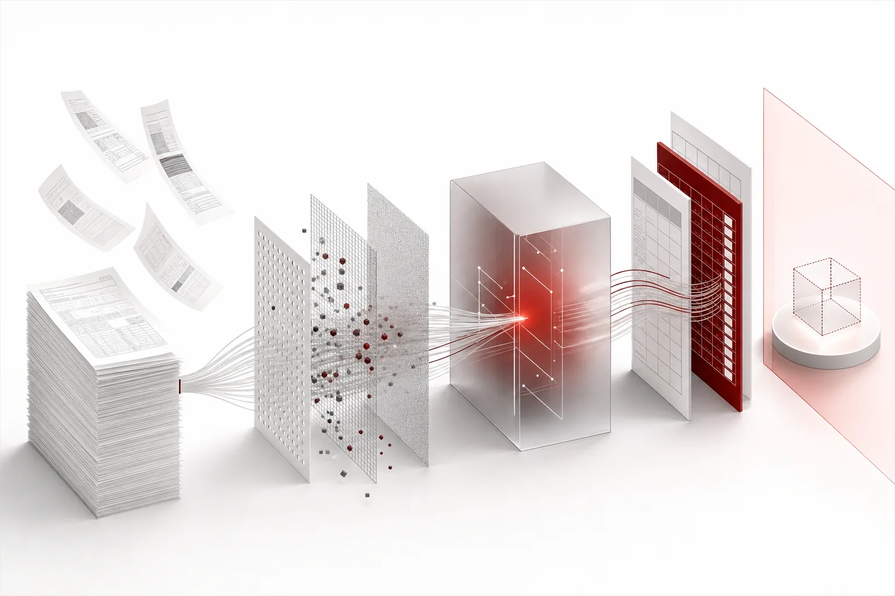
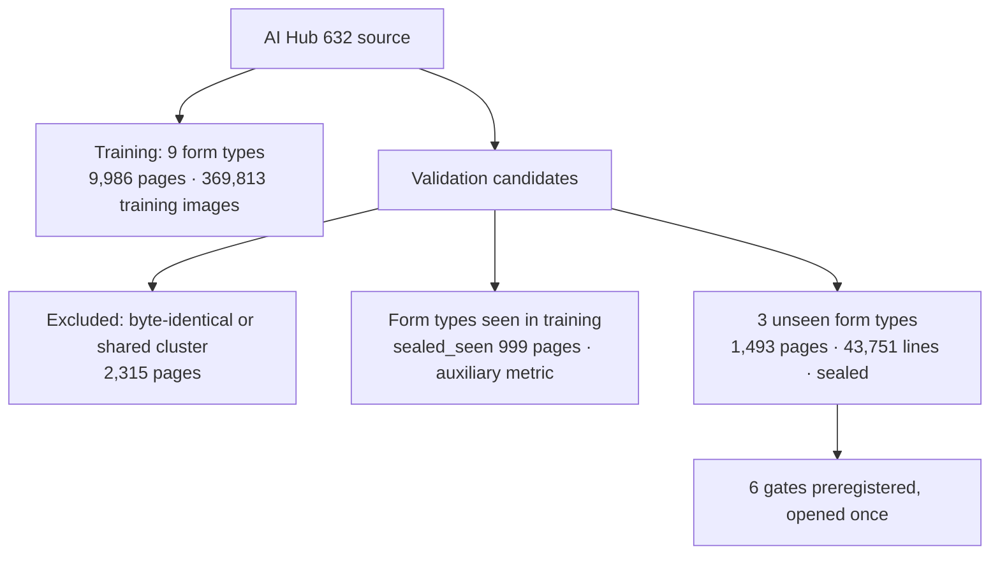
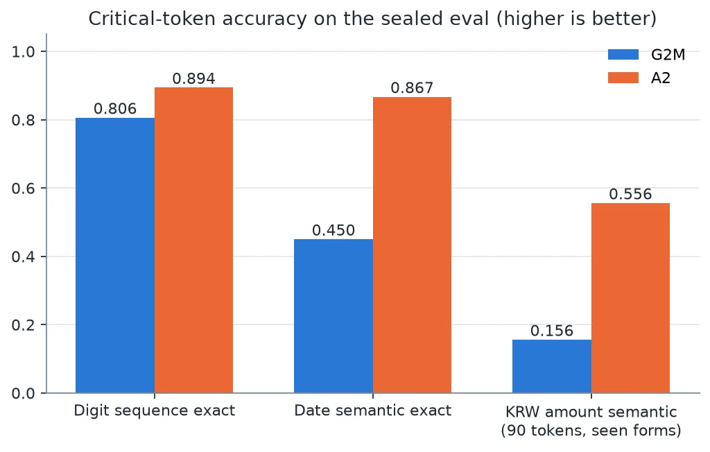

We evaluated A2, the third ThakiOCR model, on 1,493 pages of forms that were never used in training. It passed all 6 preregistered gates and received a **research-candidate GO**. The **product verdict is NO_GO**, and the weights remain private. This post is an evaluation report, not a model introduction.

The [Maxis post](/tech-blog/en/research/thakiocr-maxis-same-size-fewer-errors/) reported "the same size, 31% fewer errors." Here we cover which test that number came from, what passed at each gate, and what is still lacking.

*A visual metaphor for the article's key idea.*

## In plain terms

Imagine a student who studied one workbook and then took an exam from a completely different publisher. The exam paper stayed sealed until test day, and the passing line was written down in advance.

A2 clearly did better than the previous model on that exam. But the paper had almost no questions with the won sign, and the model still made many mistakes on documents that look handwritten. So we can say "the study direction is right," but not "it is ready for real work."

## How we built the exam

A2 was trained on 369,813 line and word images cropped from 9,986 pages of 9 form types in the Training split of AI Hub dataset 632. Evaluation used 3 form types that never appeared in training: a bank transaction application, an insurance pre-contract disclosure, and a confirmation of notice on tax treatment of insurance gains. This removes the effect of the model simply memorizing form layouts.

Building the evaluation set also exposed problems in the dataset itself.

- 936 images in the official Validation split were byte-identical to Training images (checked by CRC32 and file size). There were also 2,338 duplicate images within Training.
- We therefore excluded 2,315 Validation pages that share a cluster with the training data.
- We confirmed zero leakage between the final sealed set and the training data.

If you evaluate on the Training and Validation splits of a public dataset as given, duplicates like these can inflate the score. This check may be the most reusable result of the project.

## Results by gate

The comparison baseline is G2M, our previous public model. Both models have about 8.93 million parameters, so they are the same size.

| Gate | What it measures | A2 | G2M | Result |
|---|---|---|---|---|
| S1 | CER on the whole sealed set | 3.34% | 4.84% | Pass (ratio 0.689) |
| S2 | CER ratio per form family | Bank 0.651 · Insurance 0.727 | 1.0 baseline | Pass |
| S3 | Exact match on digit sequences | 0.894 | 0.806 | Pass |
| S3 | Semantic match on dates | 0.867 | 0.450 | Pass |
| S4 | Semantic match on won amounts (90 tokens from seen forms) | 0.556 | 0.156 | Pass |
| S5 | Dev-set mean at or below the ceiling | 0.0492 | Ceiling 0.0541 | Pass |
| S6 | Size and CPU latency | 8.93M · 13.6ms | | Pass |

For the S1 difference we also ran a cluster bootstrap with the 1,493 pages as the unit. The CER difference is −1.51pp, and the 95% confidence interval runs from −1.57pp to −1.44pp, which does not include 0. For reference, the first public model, A, scored 12.19% on the same set.

Training took about 2.16 GPU hours on a single B200 GPU, with 40,000 steps at batch size 128.

## How to read the numbers

**Semantic match and verbatim match are different.** A date counts as a semantic match if the year digits, month, and day are the same. Separators and whitespace are ignored. "2024. 3. 5" and "2024.03.05" are the same in meaning but different as text. If your workflow uses the date as a value, semantic match is the right metric. If you need to preserve the original text, you need to check verbatim match separately.

**We corrected the definition of the verbatim-match metric during the audit.** In the A2 report, verbatim match counted a hit whenever the ground-truth string appeared anywhere inside the prediction. So "￦1,000" counted as correct even inside a longer prediction such as "￦1,0005". For reproducibility we left the A2 report values as they were, and from the next evaluation onward the headline metric will check that tokens are exactly equal. The tables in this post list only semantic match and CER.

## What not to trust

**This test cannot tell us anything about the won sign.** The 3 unseen form types contained no rows with a won sign at all. All 90 tokens in S4 came from forms seen in training (sealed_seen), mostly the full-width won sign `￦`. Only 2 rows in the whole sealed data contained the half-width won sign `₩`, too few to evaluate on their own. So there is still no evidence that the model reads won amounts well on forms it has never seen.

**Handwriting-style documents are still weak.** CER on documents that look handwritten is 7.2%, better than G2M's 15.8%, but still about twice as high as on printed lines.

**Masked numbers did not improve.** Partially hidden numbers such as "****-1234" are at 9.7%, essentially the same as G2M's 10.0%.

**This is one training run on one dataset family.** The forms were new to the model, but they are financial forms from the same dataset. We cannot say anything about photographed documents or forms from other institutions.

## Verdict and next steps

The verdict has two layers. On the research side it is A2_GO. We now have evidence that switching the training data to real forms helps on forms the model has not seen. On the product side it is NO_GO, and we will not release it (NO_RELEASE). The evidence on the won sign exists only for forms seen in training, and handwriting-style and masked-number results are not at a level usable for real work.

The next step is an external evaluation set built from a different dataset family. To answer those two questions, we need to collect rows with enough won signs and masked numbers on forms the model has not seen.

Even if A2 becomes a product, OCR output will not go into business processes as is. How to split work between small and large models is covered in the [Metis post](/tech-blog/en/llmops/thakiocr-metis-tiered-document-inference/), and how to verify and get approval for results that may be wrong is covered in the [Paxis post](/tech-blog/en/agentops/thakiocr-paxis-verify-before-commit/).

## References

- All four public OCR models at a glance: [ThakiOCR model hub](/tech-blog/en/ocr/)
- The A2 weights are private. This post is an evaluation report, not a model release or usage guide.
- Earlier result: [Maxis post](/tech-blog/en/research/thakiocr-maxis-same-size-fewer-errors/)
- Previously released models: [ThakiOCR A](/tech-blog/en/research/thakiocr-a-small-korean-english-line-ocr/), [ThakiOCR G2M](/tech-blog/en/research/thakiocr-g2m-numbers-and-symbols/)
- Evaluation data: [AI Hub dataset 632](https://www.aihub.or.kr/aihubdata/data/view.do?dataSetSn=632) (official name: 금융업 특화 문서 OCR 데이터). We do not redistribute the originals or the cropped images.
- AI Hub data usage terms: [AI Hub FAQ](https://www.aihub.or.kr/aihubnews/faq/list.do)
- We do not claim state-of-the-art performance.
