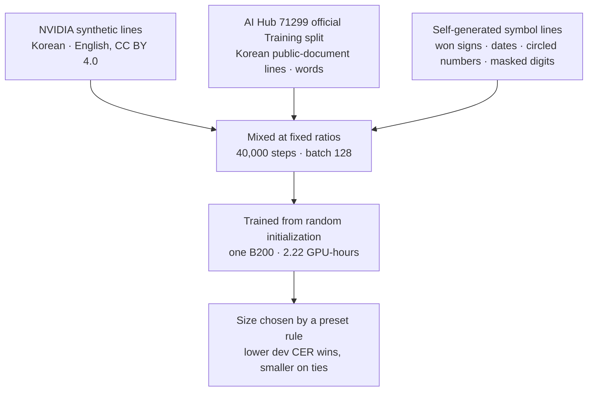
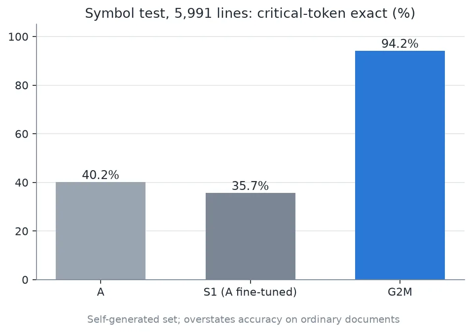

We have uploaded G2M, the second public ThakiOCR model, to Hugging Face as [ThakiOCR-KOEN-G2M-Preview](https://huggingface.co/ThakiCloud/ThakiOCR-KOEN-G2M-Preview). It has 8.93 million parameters and is released under the Apache-2.0 license.

First, its status. G2M is a **research preview**. It failed one of the five gates we set in advance, the date gate, and was ruled **A1_GEN2_NO_GO**. For product use, the verdict is NO-GO. We are releasing it not because it clears a bar, but so that other researchers can see what we did and where it got stuck, and reuse it.

⚠️ **Do not use this model to automatically process critical fields in financial or contract documents (amounts, account numbers, ID numbers, dates, contract terms).** The date and won-sign errors described below are exactly the failures that matter in those documents. Keep a human verification step in the loop.

## In plain terms

Think of a receipt reader that turns "₩1,000" into "W1,000", or erases the "①" in a contract. Even with a low character error rate, it is unusable, because the one or two characters it gets wrong are the ones that fix the amount and the clause.

G2M targets this problem. We deliberately generated lines heavy in numbers and symbols and added them to training, along with real public-document images. Symbol accuracy rose sharply, but the model still gets dates with spaces wrong, and it still confuses two won signs that look almost identical.

## Why symbols are a separate problem

Standard OCR evaluation reports performance as a single character error rate (CER). But symbols make up a small share of any line of a document. Even if every won sign is wrong, CER barely moves.

The same thing happened when ThakiCloud earlier fine-tuned a public document VLM on Korean financial forms. The overall error rate improved, but symbols were stripped out while the training data was being built, so the model learned to drop won signs, spaces inside dates, asterisks, and circled numbers. This time we defined a metric that measures symbol preservation separately before doing anything else.

## What we built

The architecture is a line-level CTC recognizer from the same family as our first public model, [ThakiOCR A](/tech-blog/en/research/thakiocr-a-small-korean-english-line-ocr/). It takes one cropped line of text and returns a string. It does not locate text regions on a page. We increased the convolution channels and block count relative to A, taking the parameter count from 2.13 million to 8.93 million.

The output vocabulary is 14,250 characters: A's 14,152, plus the half-width and full-width won signs, the yen sign, and 96 characters that appear at least three times in the training labels. We used only NFC Unicode normalization, which keeps `₩` (U+20A9) and `￦` (U+FFE6) as distinct characters.

## What we trained on

From AI Hub we used only the official Training split and did not use the Validation split for training. The synthetic symbol lines were rendered with fonts under the SIL Open Font License 1.1. The public repository contains only weights and code. It includes none of the AI Hub source images, cropped images, or labels.

## Results

We opened the independent evaluation set once, after training and model selection were both finished. Model A is our first public model, and S1 is an internal model made by fine-tuning A on AI Hub data.

| Evaluation | Metric | G2M | A | S1 |
|---|---|---|---|---|
| Symbol test, 5,991 lines | Critical-token exact match | 94.2% | 40.2% | 35.7% |
| Symbol test, 5,991 lines | CER | 0.40% | 10.38% | 12.91% |
| Real-document holdout, 70 lines | CER | 0.89% | 6.33% | 1.60% |
| Real-document holdout, 526 items | Exact match on rows with numbers | 98.7% | 94.6% | 97.3% |
| Real-document holdout, 526 items | Date-token exact match | 3/4 | 4/4 | 4/4 |

The symbol test is a set we generated ourselves, collecting only the characters G2M was built to handle. It measures the trained skill directly, so scores run higher than they would for reading ordinary documents. The real-document holdout is one volume, unused in training, taken from the same dataset family as the training data.

The gate results are as follows. I1, critical-token exact match, passed. I2, won-sign family exact match, passed (99.9% when the two won signs are treated as the same currency). I3, whether real-document line CER is lower than S1's, passed. I5, size and CPU latency (median 13.3 ms per line), passed. **I4, real-document numbers and dates, failed: only 3 of 4 dates were correct.**

## What you should not trust

**Failed the date gate.** The one wrong date used the format with a space after the period that follows the year (`YYYY. M.DD`), and the model deleted that space. On our internal real-document dev set, date-token exact match was also only 45% to 69%. Dates containing spaces are a known weakness.

**The real-document holdout is too small.** It has 526 items from a single volume and a single series, of which only 70 are full lines and only 4 are date tokens. One mistake moves the date score by 25 percentage points. It tells us almost nothing about other kinds of documents.

**It confuses the two won signs.** `₩` and `￦` look nearly identical in the fonts we trained on. On the symbol test, the rate of getting the exact code point right is 81.0%, and 99.9% when treated as the same currency. In 427 rows it read one as the other (301 rows of `￦` read as `₩`, 126 rows of `₩` read as `￦`). If you only need the meaning of the currency, map both to KRW in post-processing. Avoid applying NFKC to the whole string for this, because it also rewrites characters such as `①`.

**Other limits.** Photos, handwriting, low contrast, and decorative fonts are outside the training scope. The model handles line images only, and we trained it once, so we did not measure run-to-run variance.

## What we checked before release

After switching the repository to public, we downloaded it from an unauthenticated environment and compared file hashes against the originals. We then re-ran inference on the same line images: all 512 Korean lines and 510 of 512 English lines produced the same strings as our internal results. We also checked the file listing to confirm that the repository contains no training data.

## What carried over to the next model

G2M's real-document evaluation was too small. So for the next model, A2, we built a separate sealed evaluation set that was never used in training: 3 form types, 1,493 pages, and 43,751 lines. A2 is still a private research candidate, and its results and remaining limits are written up in [the A2 independent evaluation post](/tech-blog/en/research/thakiocr-a2-independent-eval-43751-lines/).

Model improvements alone will not eliminate symbol errors. How a business system should respond when OCR misreads an amount is covered in [the Paxis verification post](/tech-blog/en/agentops/thakiocr-paxis-verify-before-commit/).

## References

- All four public OCR models at a glance: [ThakiOCR model hub](/tech-blog/en/ocr/)
- Model: [ThakiCloud/ThakiOCR-KOEN-G2M-Preview](https://huggingface.co/ThakiCloud/ThakiOCR-KOEN-G2M-Preview) (research preview, A1_GEN2_NO_GO)
- Training data: NVIDIA OCR-Synthetic-Multilingual-v1 (CC BY 4.0), AI Hub 71299 Training split (not redistributed), symbol lines synthesized with SIL OFL 1.1 fonts
- This is not a product release. We do not claim state-of-the-art performance.
