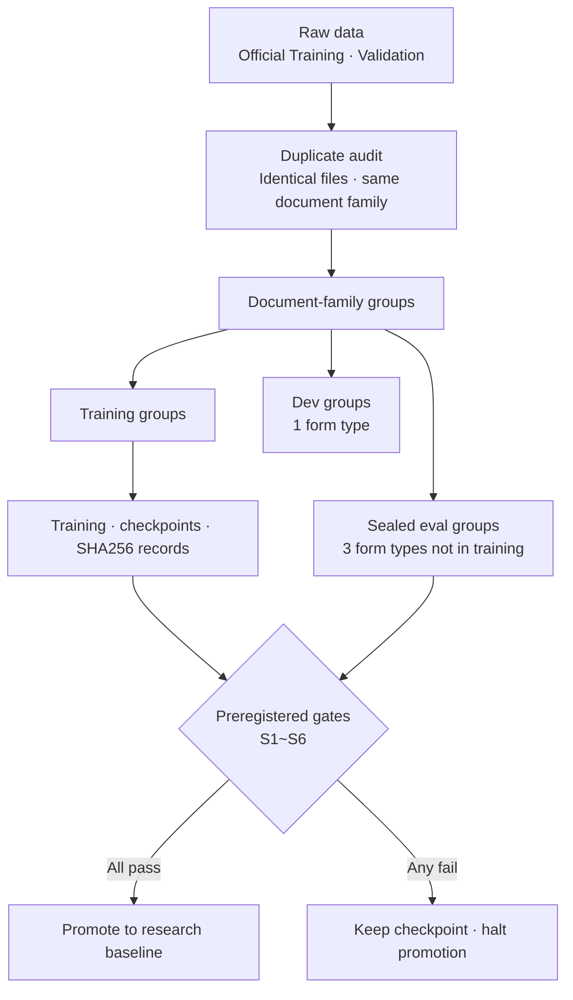
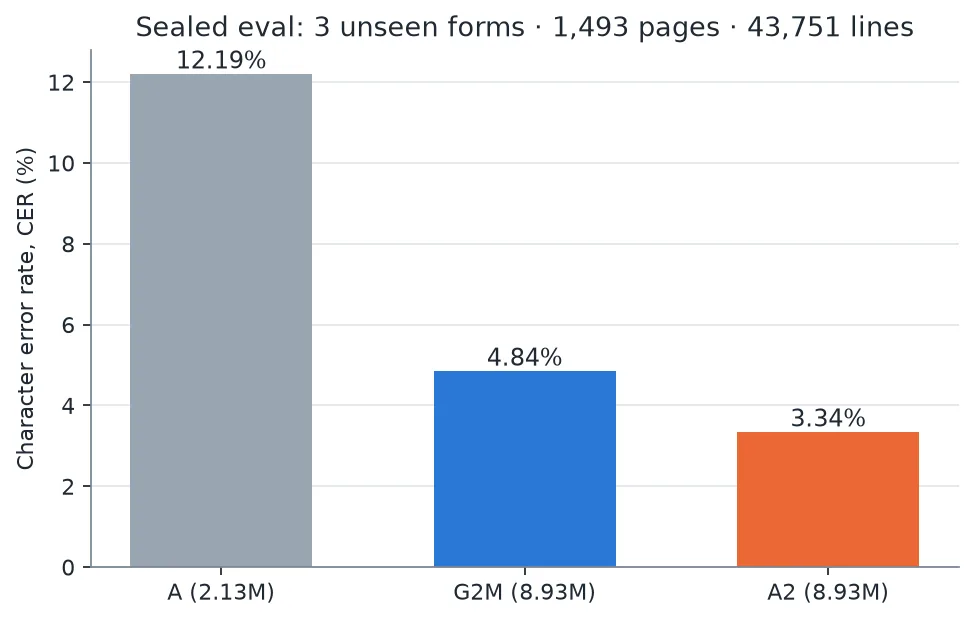

To improve document OCR accuracy, should you start by looking for a bigger model? Our in-house text recognition model gave a different answer. We compared two models with the same architecture and parameter count, G2M and A2. A2, with its training data and evaluation method redesigned, cut the character error rate (CER) by 31% on financial forms it had never seen.

This post is for engineers and data owners who want to build their own OCR model. It explains what we changed, how far the numbers hold, and what Maxis needs to own when this process moves into an enterprise training pipeline.

## In Plain Terms

Think of it as an experiment where the student stays the same and only the textbook changes. We left the student's brain (model architecture and size) alone and changed what the student studies from and how the exam is run.

If the exam questions appear verbatim in the textbook, the score goes up, but it does not measure ability. So we first cleaned up the overlap between textbook and exam paper, and we wrote down the grading criteria before the exam. The 31% figure comes from an exam paper cleaned up this way.

## How the Three Models Relate

ThakiOCR is a family of line-level recognition models that read one line of text cropped from a document. It does not locate text regions on a page. A detection model upstream crops the lines, and ThakiOCR turns each image into a string.

The first model, ThakiOCR A, has 2.13M parameters and was trained only on NVIDIA synthetic OCR data. The second, G2M, grew to 8.93M parameters and added public document data and synthetic symbol data. The third, A2, retrains the same architecture as G2M from scratch and adds financial document data.

Because A2 and G2M are the same size, the difference between them comes from the data and the training setup. That is what makes this comparison meaningful.

## What Went Into Training

A2 was trained on a fixed mix of four data sources: NVIDIA multilingual synthetic OCR data, the official Training split of AI Hub 71299 public documents, the official Training split of AI Hub 632 finance-specific documents, and synthetic symbol data we generated ourselves.

From 632, we removed document-family duplicates and used 9,986 of the remaining pages for training. The training samples cropped from those pages number 369,813, about 370K. Training ran for 40,000 steps on a single B200 GPU, and the main run took 2.16 GPU-hours.

The form types used for evaluation and the official Validation data were not put into training. We also fixed the list of what was excluded from training before training began.

## Cleaning the Exam Paper: Duplicates First

While auditing 632, we found something important. Of the official Validation images, 936 were effectively the same files as Training images, matching in CRC32 and file size. Within Training itself, 2,338 images were duplicates of each other.

Had we measured the Validation score in that state, we would have measured how well the model remembers documents it has already seen, not how well it reads documents it has never seen.

So we grouped by document family rather than by file. Using image and text fingerprints, documents from the same family were put into one group, and no group was allowed to appear in both training and evaluation. In this step we removed 2,315 Validation pages that shared a group with training data.

## Results: Same Size, 31% Fewer Errors

The final evaluation used three form types held out of training entirely: one bank account-opening application and two insurance guides and confirmation forms. We scored 43,751 lines from 1,493 pages, excluding masked rows. We opened this set exactly once.

| Model | Parameters | Character error rate (CER) |
|---|---|---|
| ThakiOCR A | 2.13M | 12.19% |
| ThakiOCR G2M | 8.93M | 4.84% |
| ThakiOCR A2 | 8.93M | 3.34% |

A2's error rate is 0.689 times G2M's, which means errors fell by about 31%. We also resampled the 1,493 document groups to compute the difference, and its 95% confidence interval lay entirely below zero.

Detailed metrics and the remaining weaknesses are covered separately in the [A2 evaluation post](/tech-blog/en/research/thakiocr-a2-independent-eval-43751-lines/).

## How Far Can This Number Be Trusted?

The forms in the sealed evaluation were not in training, but the data source was the same AI Hub 632. We have not yet verified that the same improvement holds for documents from other financial institutions, or for other scanners and phone-camera conditions.

The evidence on currency symbols is also limited. The won sign never appeared in the three sealed form types, so the currency metrics come only from evaluation sets of form types that did appear in training. For that reason we do not claim that A2 distinguishes the two similar-looking won signs (₩ and ￦).

A2 was promoted to a research baseline, but its product release verdict is NO_GO. We have not released the weights. We kept to the principle of judging research results and product release separately.

## What Maxis Has to Solve

For a company building its own OCR model, the hard part is not running the training code. The harder part is continuously tracking which data the model was trained on, whether documents from the same family leaked into evaluation, which experiment a given set of weights came from, and whether the new model is really better than the old one.

Maxis is ThakiCloud's AI training and fine-tuning platform. The methods used in this study map directly onto the design of the Maxis training pipeline.

- Data manifests and SHA256: Record hashes of the file lists that went into training, and check for cross-duplicates against the evaluation set before training starts.
- Queue-based GPU jobs: Run training and evaluation as batch jobs on a Kueue queue so they do not take GPUs from other work. Outputs are kept in object storage regardless of how the job ends.
- Checkpoint lineage: Record a hash for every checkpoint, then read it back and confirm it gives the same value.
- Preregistered gates: Record the pass criteria before seeing results. If a gate fails, keep the checkpoint but halt promotion.

The last item matters most. Even when a research metric looks good, a model that fails the gates it set must not move to the next stage, and that decision has to be left in code and in records.

## Next Steps

The next-generation model starts from A2 as the baseline, and the first task is to obtain documents from new sources for evaluation. The key targets are forms from other institutions, near-handwritten text, changes in capture conditions, and currency symbols. The sealed set we already opened will not be reused to choose the next model.

What this study confirmed is that fixing the data mix and the evaluation design before growing the model can pay off more. Maxis's role is to make it repeatable to train on customer data in an environment the customer controls, verify the results, and carry them into the next model.

How to serve the trained model is covered in the [Metis tiered inference post](/tech-blog/en/llmops/thakiocr-metis-tiered-document-inference/), and how to connect the extracted results to business work is covered in the [Paxis verification workflow post](/tech-blog/en/agentops/thakiocr-paxis-verify-before-commit/).

## References

- All four public OCR models at a glance: [ThakiOCR model hub](/tech-blog/en/ocr/)
- Released models: [ThakiOCR-KOEN-V1-Dense (A)](https://huggingface.co/ThakiCloud/ThakiOCR-KOEN-V1-Dense), [ThakiOCR-KOEN-G2M-Preview](https://huggingface.co/ThakiCloud/ThakiOCR-KOEN-G2M-Preview)
- A2 is an unreleased checkpoint that passed the research evaluation. It has not been released as a financial document automation product.
- The original AI Hub images and labels, along with the cropped training samples, are kept only in domestic internal storage and are not published or redistributed.
