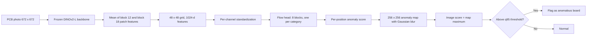

We trained a model on photos of normal PCBs only, and it picks out defective boards and marks where the defect is. This is for manufacturing engineers working on visual inspection, and for teams that cannot collect enough defect photos. On the test split of four PCB categories in the public VisA benchmark, its mean image-level score (image AUROC) was 0.978.

That number comes from VisA photographs. We have not measured it on a real SMT production line or with a different camera. The model is public on [Hugging Face](https://huggingface.co/ThakiCloud/Thaki-FabVision-PCB-Anomaly) as a Research Preview, and this post covers what it did and what we still do not know.

## Key numbers

| Metric | Value (VisA PCB1-4 official test, mean of 4) |
|---|---|
| Image AUROC | **0.978** |
| Image AP | 0.976 |
| Pixel AUROC | 0.991 |
| AUPRO (FPR≤0.3) | 0.956 |
| Normal-board false alarm rate at the fixed threshold | 6.2% |
| Latency per image (one B200, batch 1, median) | about 27 ms |
| PatchCore on the same DINOv2 features | image AUROC 0.871, AUPRO 0.817 |

*All numbers come from a single evaluation of the official VisA PCB1-4 test split after the model and threshold were fixed. They do not carry over to a real SMT line.*

## Why we built a PCB visual anomaly detector

In PCB visual inspection, defect photos are the hardest thing to collect. The better a line runs, the rarer defects become, and new defect types appear without warning. Collecting hundreds of photos per defect type to train a classifier tends to finish after the line has already changed.

Photos of normal boards, on the other hand, pile up every day. So we chose to learn only what a normal board looks like and flag the places that depart from it. It is the same idea as an experienced inspector who has never seen a particular defect but still notices that something looks off.

The goal of this work was to see how far that approach goes on a public benchmark, and to release the result in a form anyone can check again.

## VisA PCB1-4 data and license

We used the four PCB categories, PCB1 to PCB4, of VisA (Zou et al., ECCV 2022), released by Amazon Science under CC BY 4.0. We kept VisA's official 1cls split and divided its normal training images 9:1 into training and a held-out normal validation set (Normal Dev).

| Category | Train (normal) | Normal Dev (normal) | Test |
|---|---|---|---|
| pcb1 | 814 | 90 | 200 (100 defective, 100 normal) |
| pcb2 | 811 | 90 | 200 (100 defective, 100 normal) |
| pcb3 | 815 | 90 | 201 (100 defective, 101 normal) |
| pcb4 | 814 | 90 | 201 (100 defective, 101 normal) |

Before training we checked for files shared between training and test. There were no exact duplicates and no train-test leaks. The public repository contains no raw images, defect masks, test images or extracted features. We released only the trained head weights, the inference code, a config file and the model cards.

## Training on normal images only

Training used no defect images at all. The model learns from normal board photos what usually appears at each position. At inference it scores how far each position of a new photo is from that distribution, and the highest position score becomes the image score.

Selection also used normal images only. We measured the mean loss (NLL) on Normal Dev every 5 epochs and kept the lowest checkpoint, and set the decision threshold at the 95th percentile of Normal Dev scores (q95). Test defects and masks were not used for any choice, and we did not reselect a checkpoint or threshold after seeing test results.

A q95 threshold means that on normal boards similar to the training data, roughly 1 in 20 raises an alarm. That is a starting point by design. In real use the threshold has to be set again on your own line, based on what a missed defect and a false alarm each cost you.

## DINOv2-L + flow head architecture

The model has two parts. The front is DINOv2-L, the image model released by Meta, kept frozen with no training. The back is a small flow head trained separately for each PCB category. Only the heads were trained.



DINOv2-L takes the photo resized to 672×672. We average the patch features of blocks 12 and 18 to get 1024-d features on a 48×48 grid. We picked middle blocks because we expected them to keep more texture and local shape information than the last block. We did not run a separate comparison for that choice.

The flow head is our own implementation in the FastFlow style. It is not Anomalib's official implementation and not one of its checkpoints. Eight blocks are stacked, each made of ActNorm, a fixed channel permutation and an affine coupling layer (3×3 and 1×1 kernels alternating, 512 hidden channels). Put simply, it learns a transform that turns normal features into a simple Gaussian shape, and positions that still land far from that Gaussian are treated as anomalous.

Training used Adam (learning rate 1e-3), 60 epochs and seed 0. All four categories took about 36 minutes on one B200 GPU. Each head's weights are 126 MB.

## Same-condition comparison with a PatchCore baseline

As a baseline we ran PatchCore under the same conditions. PatchCore is a widely used method that stores normal features in memory and judges a new feature by its distance to the nearest stored normal one. Here we built it on the same frozen DINOv2 features, with 3×3 neighborhood pooling, a 10% coreset and 1-nearest-neighbor scoring.

| Method (same DINOv2 features) | Image AUROC | Pixel AUROC | AUPRO | Normal false alarm rate |
|---|---|---|---|---|
| FabVision flow head | **0.978** | **0.991** | **0.956** | 6.2% |
| PatchCore | 0.871 | 0.981 | 0.817 | 9.0% |

Per category, PatchCore's image AUROC was 0.859 (pcb1), 0.884 (pcb2), 0.812 (pcb3) and 0.928 (pcb4).

This comparison says something narrow. With the same features, the flow head made better use of them than nearest-neighbor scoring did. It is not a comparison with the usual WideResNet-50 PatchCore, and we did not compute confidence intervals. So we do not claim that this model beats PatchCore in general or that it is state of the art on VisA.

## Per-category test results for PCB1-4

| Category | Image AUROC | Image AP | Pixel AUROC | AUPRO | Normal false alarm rate | Defect detection rate |
|---|---|---|---|---|---|---|
| pcb1 | 0.973 | 0.972 | 0.997 | 0.976 | 8.0% | 91% |
| pcb2 | 0.970 | 0.966 | 0.988 | 0.954 | 4.0% | 90% |
| pcb3 | 0.985 | 0.985 | 0.988 | 0.941 | 7.9% | 93% |
| pcb4 | 0.985 | 0.983 | 0.992 | 0.951 | 5.0% | 93% |

*False alarm and detection rates use the Normal Dev q95 threshold. Each category's test set has 100 defective and 100-101 normal images.*

We fixed and committed the pass criteria before training started. There were six: mean image AUROC at least 0.95 with each category at least 0.90, mean pixel AUROC at least 0.95, mean AUPRO at least 0.80, mean normal false alarm rate at most 10%, image AUROC no more than 0.03 below same-feature PatchCore, and a score error of at most 1e-5 when the saved weights are reloaded. All six (G1 to G6) passed.

Training was not always smooth. For pcb4, validation loss jumped around epoch 50, and the selection rule picked the epoch-30 checkpoint. We did not retrain with other seeds, so we do not know how often this instability happens.

## Normal false alarms and the near-duplicate problem

First, false alarms. A mean of 6.2% means about 6 in 100 normal boards raise an alarm. That may be acceptable where a person reviews flagged boards, but each line has to decide that for itself.

The bigger limit is that the images look very much alike. VisA photographs the same board designs repeatedly with the same camera. There were no exact duplicates, but counting near-duplicate pairs with a perceptual hash (dHash) distance of 4 or less gave large numbers.

| Category | All near-duplicate pairs | Of which train-test pairs |
|---|---|---|
| pcb1 | 16,438 | 3,088 |
| pcb2 | 14,879 | 3,760 |
| pcb3 | 129,390 | 31,437 |
| pcb4 | 5,514 | 1,710 |

In other words, most test photos were taken under conditions very close to what the model saw during training. On a real line, where lighting, angle and board revision drift, scores will likely be lower. We also did not test generalization to other cameras or other boards. The model does not name defect types either. It only marks where a board looks unlike normal.

## The release check that failed, and how we fixed it

After the model verdict, we checked on a GPU that the inference code packaged for release gives the same answers as the code used for evaluation. We ran the release code (one image at a time) and the evaluation code (16 images at a time) on the same test images and compared scores, anomaly maps, decisions and metrics. The tolerances were fixed in code before the first run. The check failed twice at first.

| Run | Result | What happened |
|---|---|---|
| 1st | Fail | The config file had an empty backbone revision. The release code also used fp32 features, so its scores differed from the fp16-feature evaluation by up to 0.63% relative error, above the 0.5% tolerance. We pinned the revision in the config and made inference use fp16 features like the evaluation. The tolerance stayed the same. |
| 2nd | Fail | pcb3 showed a 1.97% relative score error. pcb3 scores cluster near zero (threshold 0.003), so tiny differences look large as relative error. Maps, decisions and metrics matched. We stopped here and asked the project owner to decide. |
| 3rd | Pass (changed criterion) | After seeing the results, the score check was changed to "maximum absolute error at most 0.5% of the test score range." Under it, all four categories were at or below 9e-5, decisions agreed 100%, and metrics matched the verdict record. |
| Anonymous recheck | Pass (changed criterion) | Right after the repository went public, we downloaded every file from Hugging Face without a token and ran the same check again. |

One point needs to be clear. The changed criterion is a post-hoc criterion, set after seeing the results. Under the original criterion, a 0.5% relative score error, the second run failed, and we kept that record as it is. The third run's pass means it passed the post-hoc criterion. It does not mean it passed a preregistered one.

The G1-G6 criteria in the previous section are a separate model verdict, independent of this package check. They were set before training and were not changed after seeing results. What changed in the package check is how we measure whether the release code reproduces the evaluation code, not the model performance criteria.

## Research Preview use cases

At this stage we can recommend the model for experiments and as a starting point. First, it can serve as a reference for estimating how well normal-only anomaly detection works on your own data. The released heads are fitted to VisA boards, so in practice you would train a new head with the same architecture on your line's normal photos and set the threshold again on that line.

Second, you can study an assist tool that overlays the anomaly map on an inspector's screen to suggest where to look again. Third, you can use it to estimate the cost of false alarms and missed defects on an early line, before defect photos have accumulated.

In every case we assume a person reviews the decision. This is not a certified inspection system, and we have not tested it together with other ThakiCloud products.

## Installing from HF and running inference

The backbone is not included in the repository. At runtime it is downloaded from `facebook/dinov2-large` at the pinned revision `47b73eefe95e8d44ec3623f8890bd894b6ea2d6c`.

```bash
pip install torch "transformers>=4.45" safetensors pillow numpy huggingface_hub
```

```python
from huggingface_hub import snapshot_download
import sys

path = snapshot_download("ThakiCloud/Thaki-FabVision-PCB-Anomaly")
sys.path.insert(0, path)
from PIL import Image
import inference

backbone, head, threshold, device = inference.load(path, "pcb1")   # pcb1 | pcb2 | pcb3 | pcb4
amap, score = inference.score(backbone, head, Image.open("board.jpg"), device)
print(score, score > threshold)   # image score and the fixed threshold decision
```

From the shell you can also run `python inference.py <model_dir> pcb1 board.jpg`. `amap` is a 256×256 anomaly map, and high values mark places that look unlike normal. Pick the head that matches the board type. A head trained on pcb1 does not know what a normal pcb2 board looks like.

The repository has 10 files: two model cards (English and Korean), a config file, aggregate metrics, the model code, the inference code and four per-category head weights. The repository revision we verified is `ede737842367b1a569041435e602831d3a2fcd4e`, and the SHA256 of each head is listed in `config.json`.

## Summary

We released a model that learns from normal PCB photos only, picks out defective images on the VisA PCB1-4 test split with a mean AUROC of 0.978, and marks where the defect is. It scored higher than PatchCore on the same features, but that comparison holds only under the narrow same-feature condition.

What we did not do is just as clear. We did not measure it on a real SMT line, another camera or another board, and training and test photos are very similar. The release code check failed under the original criterion and passed only under a criterion changed afterwards, and we kept both records. Please treat this model as a starting point to retrain and re-measure on your own line.

---

*Sources: the public model card (Hugging Face revision `ede7378`) and internal verdict and release records (November 2-3, 2026). All numbers use the official VisA PCB1-4 1cls test split. Data: VisA (Zou et al., ECCV 2022), CC BY 4.0. Backbone: DINOv2 (Oquab et al., 2023), Apache-2.0.*
