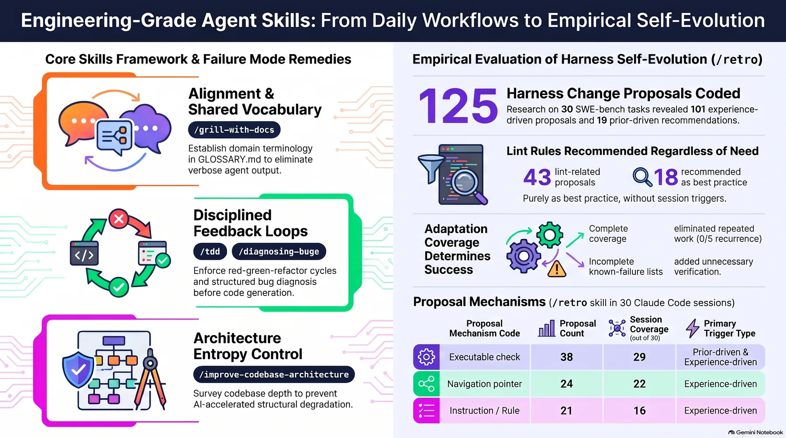
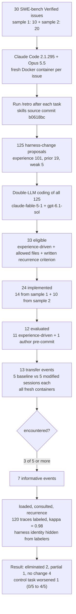
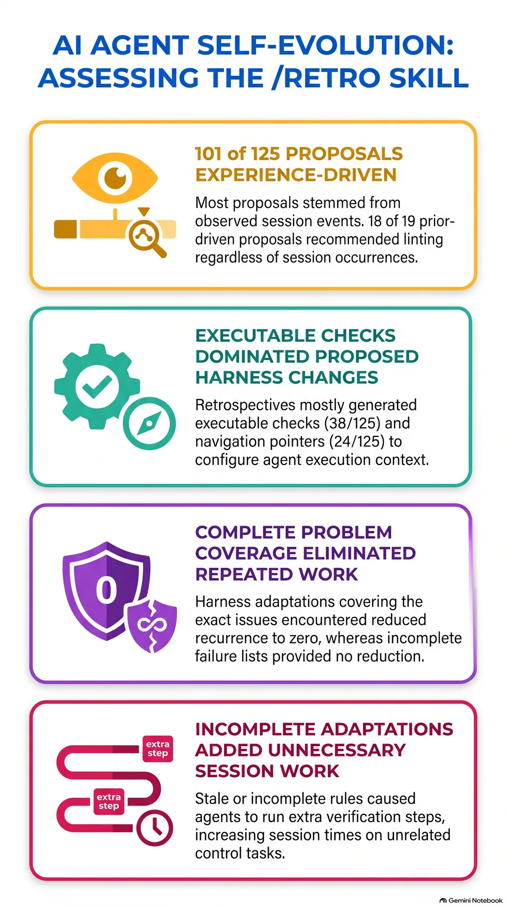

If you operate an agent harness and have accepted an agent's post-session promise to "fix it for next time," this post is for you. The conclusion first: the self-evolution narrative ends at the proposal stage. Of 12 implemented changes, only 2 eliminated the targeted behavior; the rest changed nothing or added work to unrelated tasks.

> 📄 **Full deep review (DOCX)**: [Download the detailed peer review on Google Drive](https://drive.google.com/file/d/1Pw0Q8C7Wkda1KKafmqeo9PMOqGz4jjD2/view).

*A visual metaphor for the article's key idea.*

## In plain terms

Imagine a driver's logbook. After each day's driving, the driver writes down what went wrong. "Today the engine light came on on Route 3." The next day on the same route, the driver opens the book and avoids the same mistake.

The interesting distinction is between two kinds of entries. A **list of instances** ("Oct 12: engine light, once") and a **trigger rule** ("when the engine light comes on, check the oil cap first") behave completely differently on the next drive. If the light comes on next time for a different reason, the instance list is useless no matter how faithfully it was kept. The rule fires for whatever instance comes.

The paper fills such a logbook across 30 drives (sessions) and carries 12 entries into later, different drives to check whether they actually worked. Result: four instance-list entries were opened and read every time (consulted 5/5) yet left recurrence unchanged; two trigger-rule entries took recurrence from 5/5 to 0/5. And one entry made the driver take detours on unrelated routes.

<!-- nlm-visual -->

*Infographic generated by NotebookLM from the sources.*

## Overview

Coding agents can adapt their harness: the software, configuration, and instructions that run them. The canonical loop is a post-session retrospective: run `/retro` after a Claude Code session and ask "what did you struggle with, and which files, hooks, or settings should change for the next session?" Matt Pocock's `/retro` skill in the `mattpocock/skills` repo has been part of the Engineering suite since v1.3, in a repository with 290,000+ stars.

But no study had measured whether these adaptations actually change behavior on **later, different tasks**. Prior work either (a) compared presence versus absence of context files, (b) found random community rule files and curated rules scoring the same pass rate on 58 SWE-bench Verified tasks, or (c) showed all six transfer methods of BenchTrace lagging a no-memory baseline.

Treude and Baltes close that gap (arXiv:2610.34938, 2026-10-26). They transfer harness changes **one at a time** to later issues in the same repository and compare the baseline harness against the modified harness in **fresh sessions**.

## What the study does

The study resolves two questions:

1. **RQ1**: What does `/retro` propose (triggers, mechanisms, realizability)?
2. **RQ2**: Do the proposals that survive into implementation actually prevent the targeted behavior on later issues?

The core design decision is measuring the **causal chain in four separate stages**. Whether a change entered context (loaded), whether the agent actually used it (consulted), and whether the targeted behavior recurs (recurrence) are labeled independently. That is what makes the conclusion "the agent read the file 5/5 and still repeated the behavior" possible. It is the paper's distinguishing contribution.

## Study design

**Samples.** 30 SWE-bench Verified issues in two samples. Sample 1: 10 issues (Django, SymPy, Matplotlib, Astropy, Sphinx, two each), randomly drawn from the "15 min-1 hour" effort category. Sample 2: 20 issues (Astropy, pytest, Sphinx, SymPy), not random: sample 1 exposed environment trouble, and later same-repo issues were needed for transfer evaluation.

**Execution.** A fresh Docker container per issue with the repo snapshot and dependencies; the prompt contained only the issue text. After the task, the **same session** was resumed with `/retro` and the retrospective collected regardless of hidden-test outcomes. Researchers selected proposals, chose later issues, and labeled outcomes: human-selected self-evolution, not a fully autonomous loop.

**Coding and labeling.** Two LLM coders (claude-fable-5-1 at defaults, gpt-6.1-sol at high reasoning) double-coded all 125 proposals; agreement: trigger kappa 0.67, mechanism kappa 0.84, with 91 disagreements resolved by the first author. Recurrence labels covered 120 session traces with two LLM labelers plus the first author, with **harness identity hidden from labelers**: agreement 119/120, kappa 0.98.

**Evaluation.** 33 proposals passed eligibility (experience-driven, persistent edit in allowed files, safe to apply, not a fix of the original issue, written criterion for detecting the repeated behavior later). 24 were implemented (14 sample-1 edits + 10 sample-2 edits). Of those, 11 produced adaptations testable on another issue; adding one author-written pre-commit control gave 12 evaluated across 13 transfer events, 5-vs-5 sessions each.

## Key results

### RQ1: what was proposed

Of 125 proposals, 101 were experience-driven, 19 prior-driven, 5 weak. Most translate session events, but **18 of the 19 prior-driven proposals were lint-related**. `/retro` treats "this repo has no pre-commit or CI checks" as a finding in its own right, even when nothing of the kind happened in the session. Retrospectives mix event translation with the skill's opinion of good practice.

The mechanism distribution:

| Mechanism | Proposals | Sessions with 1+ | Example |
|---|---:|---:|---|
| Executable check | 38 | 29 | pre-commit hook running flake8 on staged files |
| Navigation pointer | 24 | 22 | CLAUDE.md line naming bin/test as the runner |
| Instruction | 21 | 16 | bug fixes must include a test failing before the fix |
| Information access | 20 | 18 | known-failures file listing pre-existing test failures |
| Tool or configuration | 12 | 10 | script printing one line per failing test |
| None (behavior only) | 10 | 10 | use the Edit tool instead of a replace script |

The gap to reality stands out. Of 38 executable checks, **only 9 could report a failure as written in the task environment**. Of the other 29, 28 needed missing tools or were commit hooks that could never fire because task sessions made no commits; one was a CLAUDE.md pointer offered instead of installing pytest, described as a change that cannot fail. Proposals accumulate without being verified against the environment they target.

### RQ2: did the changes alter later behavior

Of 13 transfer events, 7 were informative (the problem actually occurred in 3/5+ baseline sessions). The results compress to one table:

| Repo | Adaptation | Baseline recurrence | Modified recurrence | Consulted |
|---|---|---:|---:|---:|
| SymPy | CLAUDE.md "bin/test" pointer (trigger rule) | 5/5 | **0/5** | 5/5 |
| Astropy | known-failures file, 3 tests (instance list) | 3/5 | **0/5** | 5/5 |
| Sphinx | known-failures + AGENTS.md (list) | 5/5 | 5/5 | 5/5 |
| Sphinx | known-failures + CLAUDE.md (list) | 5/5 | 5/5 | 5/5 |
| SymPy | 2-package file + script (list) | 4/5 | 4/4 | 4/4 |
| pytest | known-failures, 3 (list) | 5/5 | 5/5 | 5/5 |
| Astropy | cache-repair plugin + script | 5/5 | 2/5 | 5/5 |

The two **covered** adaptations eliminated the targeted behavior entirely. The SymPy pointer removed the failed first-attempt pytest call, 5/5 to 0/5; the Astropy file stopped baseline comparisons for failures all 10 sessions encountered (stale leap-second data, NumPy deprecations) because modified sessions read the file instead.

The five **uncovered** adaptations were unchanged in four cases. Decisively, **four of them had consulted = 5/5**. Agents read the changed file every time, and the failures simply occurred as *different* instances. The Sphinx file listed two failures and told the agent to treat unlisted failures as new; sessions met other failures and ran baseline comparisons anyway. The pytest file listed three failures in one test file; sessions hit failures in other files. The Astropy cache-repair plugin reduced recurrence from 5/5 to 2/5, but no session met the leap-second failure, so that effect cannot be isolated.

**A control task showed a side effect.** One Sphinx file told the agent to treat any failure absent from the file as self-caused; on an unrelated task, baseline comparisons rose from **0/5 baseline to 4/5 modified**. Retained changes can add work elsewhere, directly observed.

Secondary outcomes are drier. Task success differed by at most one session per event: no consistent improvement. Recurrence reduction does not guarantee runtime savings: the SymPy edit bundled a "run CI lint before finishing" instruction with the pointer, raising median runtime from 88 to 156 seconds. The Sphinx control task went from 82 to 245 seconds. The other four informative events fell by 5 to 28 seconds.

The author-written pre-commit control was present in 5/5 modified sessions; **zero sessions read it or ran it**.

## Implications for ThakiCloud

The paper weighs extra because ThakiCloud runs **skill self-evolution as a first-class feature**. Paxis, the Agent-Native Cloud, treats skills, tools, policies, and audit logs as first-class resources and runs nightly retrospective loops that evolve skills (selfharness-evolve, hermes-skill-evolver). That is the production version of what `/retro` does.

Four operational lessons read directly off the results.

First, a **downstream recurrence gate**. A loop that ends at generate, implement, retain can keep 11 of 12 wrong changes. A promoted change should be measured on later tasks in paired sessions (baseline vs modified) across the loaded, consulted, recurrence chain, and only changes with verified recurrence reduction should be retained.

Second, **edit trigger rules, not instance lists**. The known-failures style was read 5/5 yet ineffective 4/5 times. Skill edits must read "when this class of failure appears, check X first," not "these failures exist."

Third, **control tasks for retained changes**. The 0/5 to 4/5 case exists. Re-evaluation must probe "does it add work on unrelated tasks," not just "does it help," and changes that are ineffective and harmful should be auto-retired.

Fourth, **fire verification for executable checks**. 9 of 38 could fire. A pre-commit hook never sounds in sessions that make no commits. Proposed checks need a smoke run in the target environment before retention.

## Limitations and counterarguments

The authors' threats to validity, honestly listed:

- **Selection bias in evaluation issues.** Later issues were chosen to reproduce the targeted problem, so the 2-of-12 success rate may overstate benefit on arbitrary tasks; a fairer read is that it may be lower.
- **Same-session, same-container implementation.** Edits were made in the containers that produced the proposals, so unreported context may ride along in changed files.
- **Scale.** Five sessions per arm, seven informative events. Only 0/5 and 5/5 were observed, so continuous effect estimation is impossible and values like 4/4 resist interpretation.
- **LLM coders and labelers.** Recurrence kappa 0.98 is high, but trigger coding kappa 0.67 feeds the eligibility rule directly. Agreement reflects consistency between two model inputs, not human rater reliability.
- **Post-hoc grouping and multi-property changes.** Second-order attribution is impossible: the SymPy success shipped with a bundled CI instruction that inflated runtime.

A counterargument exists: "2/12 still validates the mechanism." The paper's strength is precisely the opposite. It classifies the ten failures along covered/uncovered, control, and runtime axes and shows the **failure points themselves in reproducible form**. The gap between reading a logbook (consulted) and changing behavior (recurrence) is now in numbers.

## Summary

The logbook metaphor pays off. For an entry to work on the next drive, it must pass three questions.

1. **Does it fire?** Only 9 of 38 executable checks could fire in the target environment. Keep only checks that sound where you actually drive.
2. **Does it cover the next instance?** Instance lists were consulted 5/5 yet ineffective 4/5 times. Write "when this class of failure appears," not "these failures happened."
3. **Does it cause detours elsewhere?** Control 0/5 to 4/5: retained entries cost on unrelated drives too.

The moment an agent says "I will fix this going forward," the narrative is already over. Owning the evolution means owning the four remaining stages (eligibility, implementation, transfer, recurrence) as metrics. The loaded, consulted, recurrence chain is the cheapest acceptance criterion available for a skill-evolution loop, and it transfers to production harnesses unchanged.

<!-- nlm-visual -->

*Infographic generated by NotebookLM from the sources.*

## Sources

- Treude, C. & Baltes, S., "How Do Coding-Agent Harnesses Self-Evolve? An Empirical Study of Retrospective Adaptation," arXiv:2610.34938, 2026-10-26. [abstract](https://arxiv.org/abs/2610.34938) · [PDF](https://arxiv.org/pdf/2610.34938)
- Artifacts (scripts, traces, labels, codebook): [Zenodo 10.5281/zenodo.23653700](https://doi.org/10.5281/zenodo.23653700)
- The /retro skill: [mattpocock/skills](https://github.com/mattpocock/skills) (skills/engineering/retro)
- Matt Pocock's original tweet: [x.com/mattpocockuk](https://x.com/mattpocockuk/status/2117588845864575397)

> 📄 **Full deep review (DOCX)**: [Download the detailed peer review on Google Drive](https://drive.google.com/file/d/1Pw0Q8C7Wkda1KKafmqeo9PMOqGz4jjD2/view).
