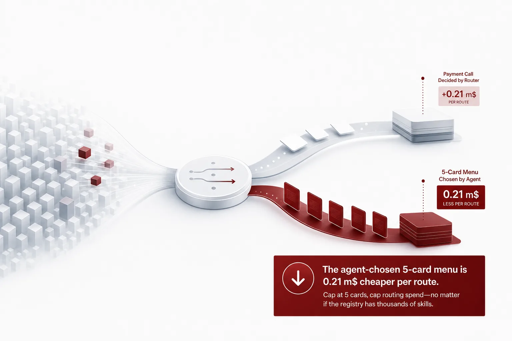
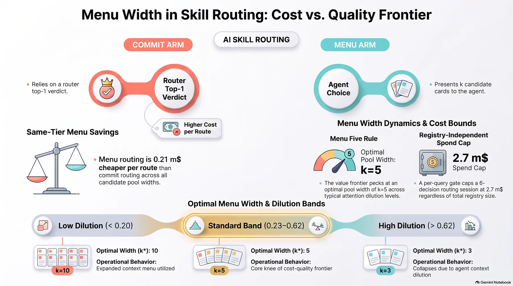
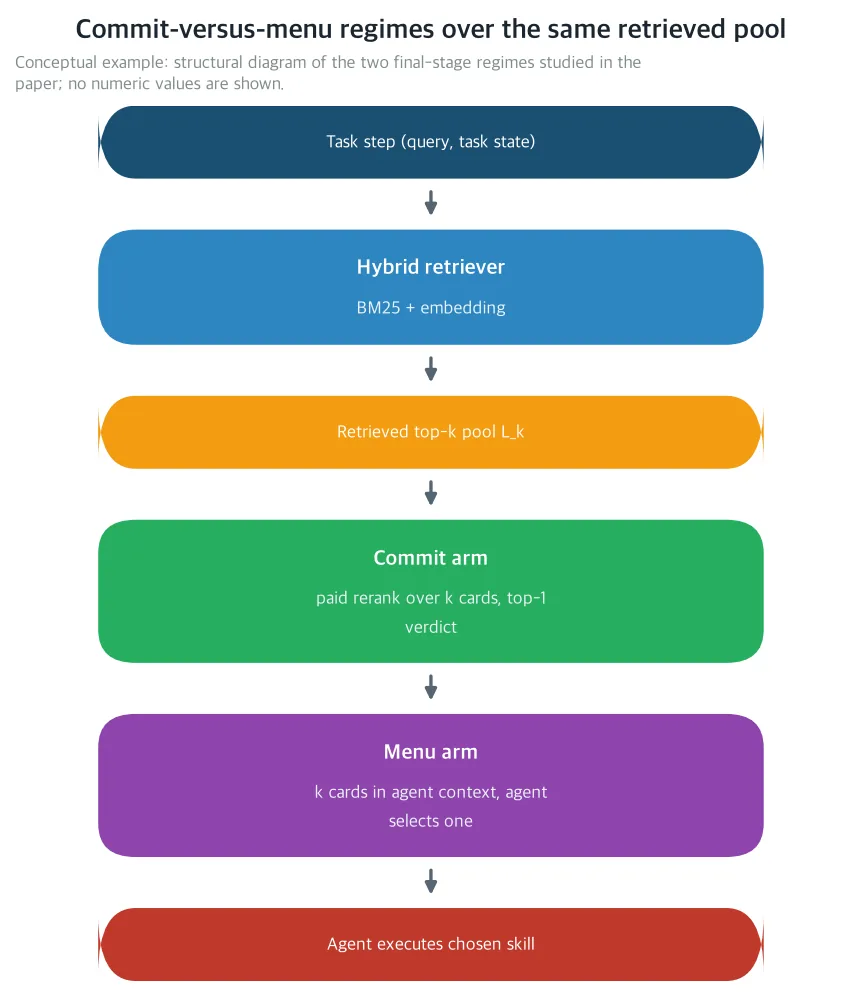
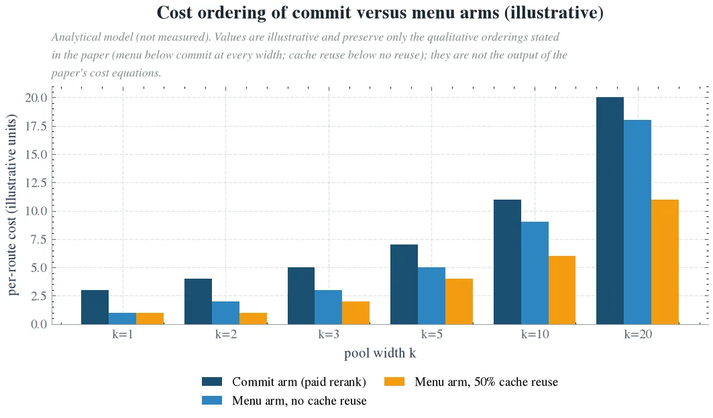
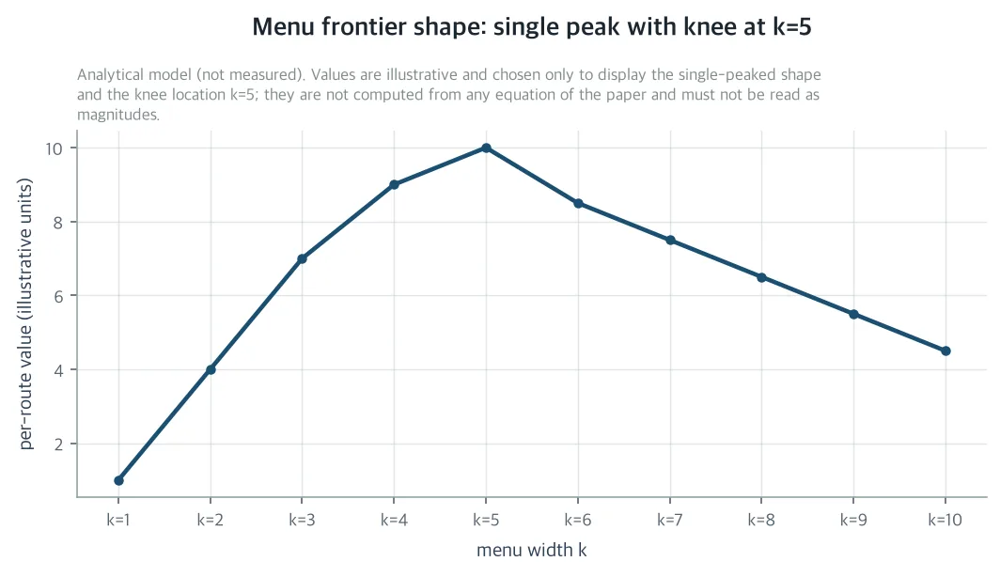
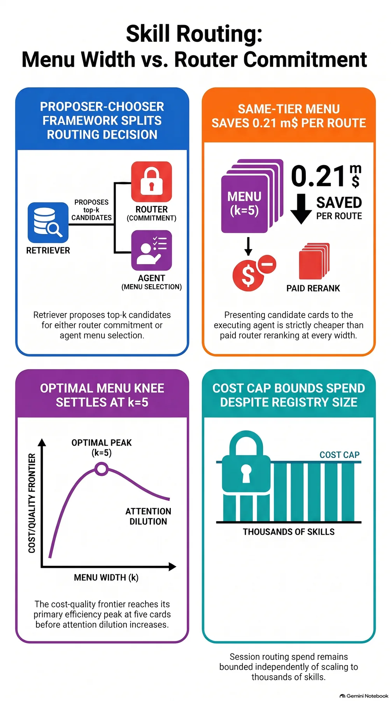

If you run an unattended agent harness on your own GPU, this post is for you. The last stage of a skill router comes in two forms. The router pays for a model call and decides the answer itself, or it hands a candidate list to the agent and lets the agent pick. This paper shows the second is always cheaper under self-hosting. And the best list length is five cards.

The object of measurement is a frozen 2,029-skill registry and a self-hosted H200. The variables the paper prices are two that had never been priced together. How many cards the list has, and who holds the final choice.

*A visual metaphor for the article's key idea.*

## In plain terms

Think of the last order at a restaurant. There are two ways. The maître decides the menu for the table and sends it to the kitchen. Or the menu goes to the guests, and they order for themselves.

The guests sit at the table. They know the occasion better than the maître: what they came for, what they ate before, how long they can stay. The maître knows the kitchen inside out, but nothing about that table's occasion.

The last stage of a skill router is exactly this. The router is the maître, the agent is the guest. The router has already narrowed thousands of skills to a short candidate list. The question left is who picks the final one from that list. The paper prices that choice. How many cards should the list have, and who should hold the right to pick?

<!-- nlm-visual -->

*Infographic generated by NotebookLM from the sources.*

## What the paper did

The paper asks one question. At what list length, and under what chooser conditions, does letting the agent pick beat the router deciding for it? The axes are per-route token cost, top-1 quality, and the M-weighted sum of the two. M is the expected downstream loss of one misroute.

The setup is a frozen 2,029-skill registry on a self-hosted H200. A production-scale unattended harness sends every task step to the router. The router picks one of about 2,200 versioned skills. The retriever fuses BM25 with dense embedding similarity. The last stage is an optional paid listwise LLM call over the narrowed top-k pool, and that call overwrites the retriever's raw ranking. In an unattended loop, a misroute is not a softened answer a human will catch. The step itself fails, or the task's token budget burns away before anyone notices.

The holdout is the 63 cases of the SRA bench. The recorded September 2026 router-stage point sits at 48.9 percent top-1 and 86.7 percent five-card recall. Two neighboring stages in the same series are already priced. The first is the gatekeeper result: how cheaply the router can "look at" a candidate, the scoring-stage price of quantization. The second is the Final Five result. On a fixed pool, one paid listwise rerank lifts top-1 to t + a_k(r_k − t), and the cost grows linearly with pool width k. Selection accuracy dilutes as a_k = a_5(5/k)^δ, and in the band δ ∈ [0.23, 0.66] the pool that pays most is k = 5.

What stayed open was how the frontier moves when the pool width changes, and who holds the final choice. That is the gap this paper closes. In the harness, the router's verdict is consumed by the executing agent. The agent already sees the full task state, the goal, and the previous tool outputs. Using the same retrieved pool splits into two ways.

Commit: the router pays for a listwise rerank over k cards and commits the top-1 verdict. The agent then loads and executes the spec of the chosen skill. Menu: the router hands k candidate cards to the agent's execution context. The model that already owns the task context picks one.

A menu is not a reranker substitute in the ordinary sense. The chooser's information differs: full task state versus query. The attention economics differ: one of k cards in a long context versus one in a short listwise prompt. And the billing differs: the agent's tokenizer and rates versus the router's. The paper's question is this. At what menu width k, and under what chooser conditions, does showing the agent a menu beat committing the verdict at the router? The axes are per-route token cost, top-1 quality, and the M-weighted sum of the two. Where is the knee?

The paper does not measure new routing. It prices under explicit assumptions, A1 to A6, and the declared rate card in the table below. The bill is written as a deterministic closed form.

| Item | Symbol | Rate (m$ per route) |
|---|---|---|
| Base input | S | 0.08 |
| Fixed query | Q_r | 0.10 |
| Ranking output | O_r | 0.06 |
| Single ID output | O_sel | 0.03 |

*Structural schematic of the two final-stage regimes the paper prices, commit and menu. On the same top-k pool, the router either commits top-1 with a paid listwise rerank or presents k candidate cards to the executing agent. (Conceptual illustration: no numeric values shown)*

## What came out

### The menu route is always cheaper: the break-even inequality

The paper formalizes this setup as the menu-width problem. In a proposer-chooser decomposition, the retriever proposes the top-k pool. Either the router, the commit arm, or the agent, the menu arm, picks one skill. Under the keep-safe assumption A4 to A5, neither arm breaks an already-correct top-1. The condition for the menu arm to weakly dominate the commit arm on per-route value V = MT − C is one inequality per pool width k.

M(r_k − t)(b_k − a_k) ≥ C^m_k − C^c_k

b_k is the agent's in-pool fix probability. The goal is in the pool but not ranked first, and the agent picks it among the k cards presented. a_k is the reranker's fix probability. The left side is the value of the agent's task-context advantage, living on the fix mass retrieval has already reached. The right side is the extra cost the menu pays against the commit call. The rerank call's fixed input Q_r and output O_r, which the menu's single ID output O_sel avoids, enter there.

This corollary is the paper's central structural claim. Under same-tier self-hosted serving, one rate card, the agent's tokenizer and the router's tokenizer billed at the same price. Without prefix-cache reuse, C^m_k − C^c_k = O_sel − O_r − Q_r − S < 0 holds for every k ≥ 1. The menu arm is strictly cheaper per route at every width, by a width-independent constant.

At the declared nominal rates, that constant is 0.03 − 0.06 − 0.10 − 0.08 = −0.21 m$. The menu is 0.21 m$ cheaper per route, at every width. At k = 5, M = 100 m$, the tolerance is about 0.56 points. The menu wins on value even when its in-pool selection runs close to half a point behind the reranker. The committed rerank call is justified in two cases only. When the agent's in-pool selection is strictly worse: a degraded agent tier, a noisy context. Or when it is strictly more expensive.

In other words, on self-hosted serving, letting the one who knows the occasion choose costs a fixed amount. And that amount is cheaper than the router's paid call.

### Why it is cheaper: the two arms bill for different things

The menu is structurally cheap because the two arms bill for different things. The commit call pays for all k cards in the router tokenizer, plus the fixed query Q_r and the ranking output O_r. The menu bills only the "additional" k−1 cards. The first card is the spec the agent loads anyway for execution under both regimes. The additional cards are paid at the agent tier, minus prefix-cache reuse, plus the cheaper single ID output.

The same skill cards come back every night. Exact-match automatic prefix caching reuses a fraction β_m of the card text within a session. That is why β_m enters every theorem. It is not merely a serving detail.

### The tier gap draws the deployment boundary

The tier-gap threshold corollary draws the deployment boundary. If the agent tier is μ times the router card price, μ = 3 at nominal, the menu pays a (μ−1)S premium per additional card. Then C^m_5 − C^c_5 = 0.43 m$. Break-even requires b_5 − a_5 ≥ 1.14 points at M = 100 m$, 0.57 points at M = 200 m$, and 2.28 points at M = 50 m$. The menu is the default on a same-tier self-hosted fleet. On heterogeneous tiers it is a premium option, and the premium thins as the misroute penalty shrinks.

In other words, when the guest's tier is more expensive, each extra menu card costs a premium. The smaller the loss from a misroute, the smaller the premium.

*Per-route cost ordering of the two arms. Under same-tier serving, the menu arm sits below the commit arm at every pool width, and prefix-cache reuse flattens the menu's width-dependent slope. (Analytical model, not a measurement)*

### Menu Five rule: the knee is at five cards

The width problem has its own dilution exponent. The agent's in-pool fix probability falls as b_k = b_5(5/k)^δ_m as the menu widens, and the exponent is δ_m (A3). The paper does not assume δ_m equals the reranker's δ. The two choosers have different attention economics: a short listwise prompt versus a long execution context.

The literature's positional-bias and long-context-degradation results push δ_m positive. A longer menu is not just more cards. It is harder attention.

Under recall shape A1 and A3, the menu arm's per-route value is strictly concave in k. A1 is a single-saturating exponential anchored to the recorded point, with r_∞ = 0.94 assumed. The frontier has a unique knee, which two adjacent widths may share. The knee is where one more visible card no longer pays for itself. Each additional card buys new recall mass (r_{k+1} − r_k) times b_{k+1}, and dilutes the existing mass by r_k(b_k − b_{k+1}). If their net, in M units, clears the prefix-cache-adjusted price S_e(1 − β_m), the card pays.

The Menu Five theorem pins the knee under the declared nominal rates, M ∈ {50, 100, 200} m$, and widths {1, 3, 5, 10}. Across the M range and the scenario range of b_5, k* = 5 holds uniformly over the core of the dilution band, δ_m ∈ [0.23, 0.62]. That is the same band that priced the reranker arm. At the top of the band, δ_m > 0.62, strong agent dilution, the knee collapses to 3. Even at M = 200 m$, the extra cards do not pay. The path to k* = 10 opens only when the agent's attention dilution drops below the band's bottom, δ_m < 0.16~0.22.

The lever between the two regimes is the arm, not the width. Final Five priced the rerank pool at k* = 5 for δ ∈ [0.23, 0.66]. The menu reaches k* = 5 for δ_m ∈ [0.23, 0.62] at the same nominal rates.

*The single-peaked shape of the menu arm's per-route value over menu width, with the knee at five cards. The recorded anchor point is t = 0.489, r_5 = 0.867, and r_∞ = 0.94 is assumed. (Analytical model, not a measurement)*

The scenario grid at the middle of the band, δ_m = 0.5, reads the break-even across the plausible chooser pairings. At parity, b_5 = a_5, quality is equal at pool five and the menu costs 0.21 m$ less per route. The free-menu corollary becomes a number.

Under context advantage, b_5 = 1.25·a_5, the agent's task state helps the in-pool choice. The value gain grows to +4.9 to +6.8 m$ per route. The per-session dividend of the D = 6 decision is 30~41 m$. Under context disadvantage, b_5 = 0.8·a_5, a noisy or degraded agent, the sign flips. At M = 100 m$, the menu loses 3.6 to 6.6 m$ per route. That is the regime where the paid rerank call, or its distilled version, is the right default.

### A gate that runs per query, a bound independent of registry size

The commit-versus-menu decision can descend to the query level. For a query q with top-1 mass t_q, showing a menu pays when M_q·b_{q,k}(r_k − t_q) ≥ C^m_k − C_0. C_0 is the retrieval-only fallback cost, with no paid last stage.

The certified-margin gate implements this sufficiently. Where the rank-safety margin diagnostic certifies the retriever's top-1 as provably safe, the paid last stage is skipped. A width-k* menu turns on for the rest. Certified queries keep the correct verdict at fallback cost. The gate's harmful-skip accounting bounds the keep-break risk. At skip rate p and gate keep-break rate ε_g, the hybrid's quality and cost split as follows.

T^h = p·t(1−ε_g) + (1−p)[t + b_{k*}(r_{k*} − t)], and C^h = p·C_0 + (1−p)·C^m_{k*}

Under the same-tier regime, the hybrid weakly dominates uniform commit. Uniform menu and uniform commit are the special cases p = 0 and p = 1.

The cost cap theorem is a generalization this series had not delivered before. In any retrieve-present-choose stack, capping the presented width at the knee k* bounds per-session routing spend. RAG over a skill corpus, tool selection, and best-of-N over candidate answers all qualify. The bound is D[(k*−1)s̄(1−β̄) + ĉ_sel + C_0], independent of registry size N.

Spend beyond the fallback per decision does not exceed (k−1)s̄(1−β̄) + ĉ_sel. Selection quality is bounded above by the recall ceiling r_k and below by the fallback t. A rerank cannot create what retrieval did not bring, and the bound holds for both arms.

At the declared nominal rates, with D = 6, k* = 5, β̄ = 0. The per-session routing spend bound is 6 × (0.32 + 0.03 + 0.10) = 2.7 m$, under one cent per session. The registry can grow to thousands of skills, and the bound stays put.

In other words, a restaurant's bill does not grow just because its menu is long. The bound is set by how long the menu you hand a table is and how many tables you seat. Pin the menu at five cards and the bound is fixed.

## What to change

For the ThakiCloud agent platform, this result lands as the closed-form deployment value of the routing policy. The policy is set in two steps. Measure the two dilution exponents δ and δ_m, or assume them inside the inherited band. Take the arm by the parity comparison of b_5 versus a_5, and take the width by the knee.

It needs no relearning and no new infrastructure. The lever is the harness's presentation parameter, and its cost side is a deterministic bill. It can be implemented with the existing sra_bench and Metis token metering alone.

On a same-tier self-hosted fleet, the committed rerank call is a premium option, not the default. The default is a knee-width menu. The hybrid router of certified skip plus knee-width menu becomes the cheapest routing mode that holds quality. This is the part that goes directly into per-task token spend across the whole 2,000+ skill ecosystem.

The social reading of the cap is a token-cost bound for small organizations. Per-session routing spend for a thousand-scale skill ecosystem on self-hosted inference becomes linear in the knee and independent of registry growth. Since routing spend is token spend, the bound is an energy bound as well. It generalizes to any propose-present-choose interface.

Scientifically, what the paper prices is new. The existing cost-quality literature on cascades and reranking treats the final-stage candidate set only at a fixed k. This paper prices, for the first time, the allocation frontier between the retrieval router's right to commit and the downstream agent's right to choose. It ships a reproducible experimental protocol over a frozen registry alongside.

<!-- nlm-visual -->

*Infographic generated by NotebookLM from the sources.*

## What not to trust

Every number in this post is a model estimate under explicit assumptions, A1 to A6. It is also a deterministic bill of declared nominal rates on self-hosted H200 infrastructure. The study is analytical and reports no routing measurements. The mechanism that turns each theorem into a measured number is the pre-registered protocol the paper ships alongside.

There are six limits. First, the SRA holdout is n = 63, so the frontier is an inequality with wide bootstrap intervals, not a point. Second, the single-saturating-exponential recall shape of A1 and the power-law menu dilution of A3 are assumptions. A shoulder in r_k or an attention cliff in b_k moves the knee. That is exactly what the falsification criteria P-M3 and P-M4 are built to catch.

Third, the cost nominal rates are declared inputs, not measurements taken in this study, and P-M1 prices them again. Fourth, with one gold skill per case, top-1 is stricter than the harness's true success condition when functionally equivalent skills coexist. Fifth, the study is one fleet and one menu format, flat cards with rank order preserved. Card compression or reordering changes the card price and the dilution exponent at the same time. Sixth, the model prices a single agent tier. A multi-tier agent that escalates per query creates a second, router-side width decision that the cap does not cover.

The protocol runs six arms over the frozen 2,029-skill registry snapshot on the frozen 63-case SRA holdout. Arm 0 is the retrieval-only fallback, and Arm 1 is commit-5, the Final Five configuration. Arm 2~4 are menu-3, menu-5, menu-10, and Arm 5 is the hybrid. The hybrid is the certified-margin gate plus menu-5 on the rest.

The estimands are b_k, δ_m, β_m, the deterministic bill, and the M inherited from the series accounting. b_k is the agent's in-pool fix probability, graded by deterministic task success of the executed step. δ_m is read off as the flip rate of the agent's choice by a permutation probe over three serializations of the same k-card menu. β_m is the card-text hit rate at exact-match prefix granularity within a session.

Falsification is registered per result. P-M1 is that the free menu holds within billing precision on the same-tier arms. P-M2 is parity or better, b_5 ≥ a_5. P-M3 is that the measured knee lands in {3, 5}, rejecting 10 unless δ̂_m < 0.20. P-M4 is the permutation probe's dilution band [0.23, 0.66] and a flip rate of at most 10 percent per menu. P-M5 is the hybrid skip rate p ∈ [40 percent, 60 percent] and a quality cost of at most 1.5 points.

At the declared nominal rates, full six-arm confirmation costs 63 × 6 × about 1 m$, roughly 0.38 dollars, under 50 cents. The menu arm is the cheaper side by the free-menu corollary.

---
The paper and companion materials can be seen here: [The Menu Width](https://huggingface.co/datasets/thaki-AI/daily-paper-2026-11-04-menu-width-skill-routing)

*Every body number is a model estimate under explicit assumptions A1 to A6 and a deterministic bill of declared nominal rates; no routing measurements are reported. The body rounds for readability, and exact values stay in the captions and the table.*
