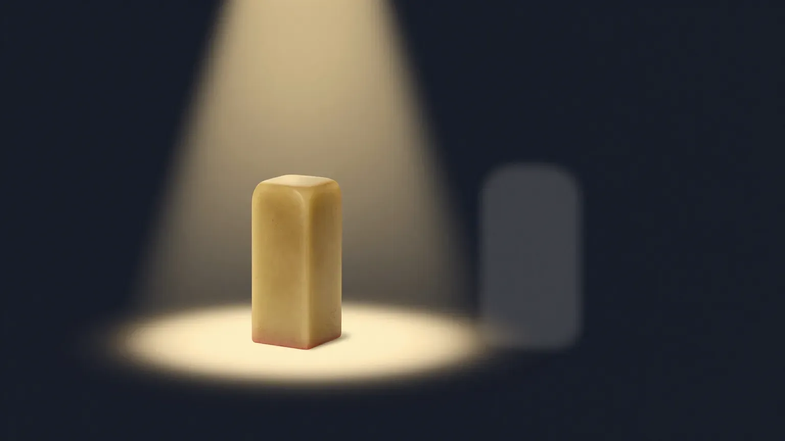
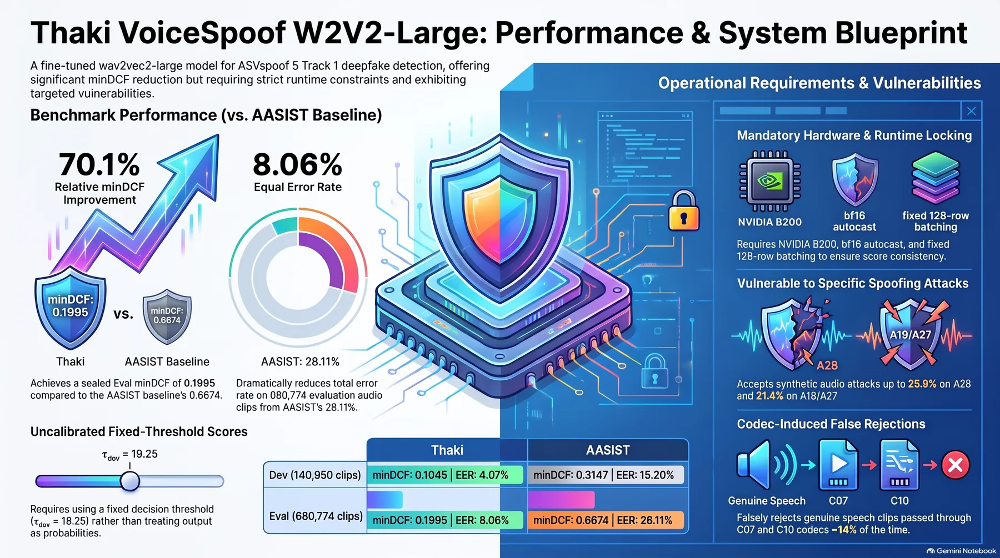
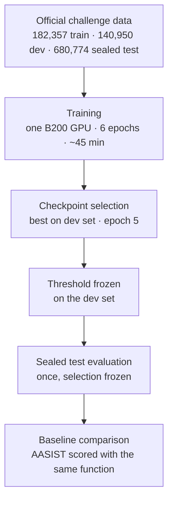
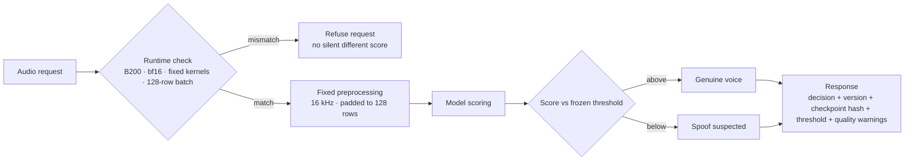
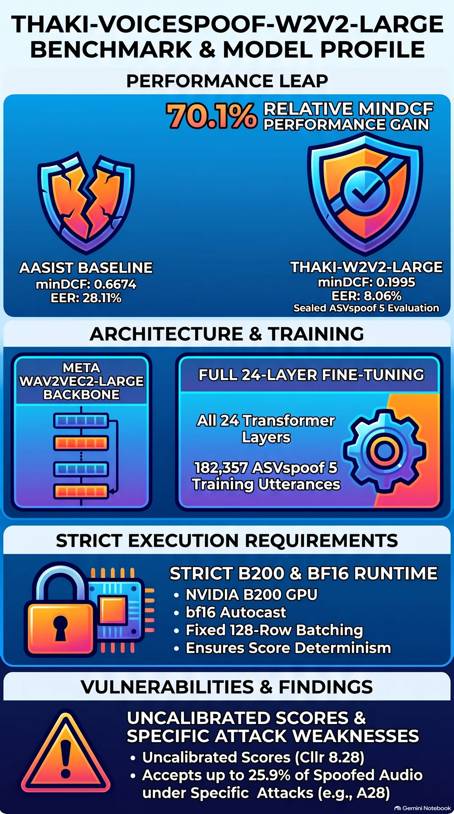

We built a model that separates real voice recordings from synthetic ones, and we released it. On the sealed test set its error cost ran about 70 percent below the baseline. One pre-release check failed, and we keep that failure on the record. If you train models for production, or decide what an agent may do with a model's output, this post is for you.

AI voices now sound closer to human voices. A call you take at a contact center, or an approval request that arrives by phone, may need one question answered. Is this a real person?

The model does one thing. It scores each incoming audio clip, and a score above the frozen threshold means genuine speech. ThakiCloud released it as a research preview on a public model hub, under the name Thaki-VoiceSpoof-W2V2-Large.

*An abstract image of the job the model does: telling a real seal impression from a copied one.*

*Status as of November 4, 2026: released as a Research Preview (revision 093c7a1). Three of the four pre-release checks passed; the reload check failed. The failure record is kept, and the release is a separate exception approved for the verified runtime only. Metis production deployment and Paxis automated execution were not approved. The Metis and Paxis sections below are reference designs.*

## In plain terms

Think of a front desk that checks documents. A clerk looks at the stamp on a form and decides whether it came from a real seal or from a copy of one. The two impressions differ in subtle ways, and an experienced clerk can tell them apart.

This model does the same job on voices. A genuine recording is the real stamp, and synthetic or converted speech is the copied one. The model scores how close a voice's impression is to a real recording.

The clerk also has limits. The stamp does not say who pressed it, whether the content is true, or whether the person had the authority to sign. A real stamp on an unauthorized signature is still invalid. The model is the same. A high score only proves the voice resembles a real recording. It does not prove the speaker's identity, the truth of the words, or any authority to approve a transaction.

<!-- nlm-visual -->

*Infographic generated by NotebookLM from the sources.*

## What we did

The model was trained on data from a public voice deepfake detection challenge (ASVspoof 5). The challenge provides a training set of 182,357 utterances, a validation set of 140,950, and a test set of 680,774. The test set's audio and labels are sealed, so the final evaluation happens once, with the selection frozen.

The backbone is an external speech foundation model (Wav2Vec2-Large), with about 300 million parameters. The first planned backbone was dropped before training because its pretraining data did not fit the challenge rules. It was not a score chase; it was about keeping a data lineage the evaluation can trust.

Training ran on a single B200 GPU. It took 6 epochs, 34,188 steps, about 45 minutes. No step produced a non-finite value. We picked the best checkpoint on the validation set and froze the decision threshold there.

The score is the genuine-side logit minus the spoof-side logit. A score above the frozen threshold is classified as genuine.

Data integrity was checked before training. All 18 official files matched their checksums, and there were zero exact duplicates between the training and validation sets. The test set's audio and labels were stored and sealed separately.

The baseline is the challenge's official reference model (AASIST). It was scored on the same sets with the same evaluation function, so both models face the same test.

*The training and dev sets were used to learn and select the model; the sealed test set was evaluated once with that selection frozen.*
*The first planned backbone was XLS-R 300M, dropped before training because its pretraining data (MLS) did not fit the ASVspoof 5 open condition rules.*

## Results

### Overall score: about 70 percent lower error cost

Here is how to read the table. The equal error rate (EER) is the point where the two error directions meet, and lower is better. minDCF is the total cost of those errors weighted by real business conditions, and lower is better.

| Metric | Reference model (AASIST) | This model |
|---|---:|---:|
| Dev set EER | 15.20% | 4.07% |
| Dev set minDCF | 0.3147 | 0.1045 |
| Sealed test EER | 28.11% | 8.06% |
| Sealed test minDCF | 0.6674 | 0.1995 |

On the sealed test set, minDCF was 70.1 percent lower than the reference model.

To check that the gap is not luck, we paired the two models by their 737 speakers and resampled 2,000 times. The 95 percent confidence interval for the improvement sat entirely below zero.

Both preregistered gates (at least 10 percent improvement, interval upper bound below zero) passed.

In plain terms, the model's total error cost is about a third of the reference's, and the gap is not chance.

But the conditions differ. The reference model trained only on challenge data (closed condition), while ours used external speech pretraining (open condition). So we do not claim "70 percent better on the same data" or "best on the challenge". This is a comparison of two systems under this evaluation protocol.

### What the average hides

At the frozen threshold, spoof acceptance varies a lot by attack.

| Attack | Spoof acceptance | EER on that attack |
|---|---:|---:|
| A28 | 25.9% | 14.2% |
| A19 | 21.4% | 12.3% |
| A27 | 21.4% | 11.3% |
| A31 | 20.0% | 11.5% |

On the hardest attack, one fake voice in four was accepted as genuine.

There are errors in the other direction too. Genuine human speech that passed through telephone codecs was rejected as fake at rates above 10 percent.

*Through codecs C07, C10 and C09, genuine human speech was rejected as fake at 13.9, 14.3 and 12.9 percent respectively.*

The score is also not a well-calibrated probability, so it should only be used with the frozen threshold.

*The calibration index (Cllr) is 5.09 on the dev set and 8.28 on the test set.*

In plain terms, the clerk is good at catching fakes overall, but the sharper the fake and the more distorted the real, the murkier the call.

### The pre-release check that failed: same weights, slightly different scores

One of the four pre-release checks failed. The reload check loads the frozen weights in a fresh process, scores 5,000 validation utterances, and compares them with the scores the training run saved. The criterion was a maximum difference of at most one thousandth and decision agreement of at least 99.9 percent.

The result was a FAIL. Decision agreement was 100 percent, but the maximum difference was one bf16 step. We did not change the original criterion, and the FAIL stays on the record.

*Reload check details: maximum score difference 0.125 (one bf16 step) against a 1e-3 criterion. Two clips actually differed; the other four flagged rows were decimal rounding in the reference score file.*

The cause was narrowed with a single read-only diagnosis.

- Only 2 clips actually scored differently, each by one bf16 step (0.125).
- The two clips sat in the final group of 8 left after splitting 5,000 clips into groups of 128. The training run had scored the same clips inside a full group of 128.
- Scoring with the same group layout reproduced the original scores exactly. Three independent processes were bit-identical.
- The weights, inputs and compute path matched the training path.

The conclusion is not random GPU variation but a numerical difference that depends on batch shape, deterministically. In low-precision arithmetic, the same operation can give slightly different results depending on how numbers are grouped.

The rule output and the final causal verdict are both kept on the record.

*The rule output was IMPLEMENTATION_DEFECT, triggered only by two config metadata fields (_name_or_path, the dtype label). The final causal verdict is BF16_NUMERICAL_VARIATION_SUPPORTED, root cause DETERMINISTIC_BATCH_SHAPE_SENSITIVITY.*

The diagnosis also showed something bigger. Scores move more than you would expect when the numerical environment changes.

| What changed | Score change (first 5,000 dev clips) | Decision agreement |
|---|---|---:|
| Batch shape (bf16) | one bf16 step (0.125) | 100% |
| Attention kernel (flash, mem-efficient, math) | up to 3.6, 3.5, 1.5 points | 100, 99.98, 100 percent |
| Precision (fp32 or fp16, TF32 on or off) | up to about 8.9 points | 99.46 percent (27 decision flips) |

Running in full precision (fp32) does not reproduce the published numbers. The model was trained and evaluated in bf16, so the published numbers hold under that condition only. We do not claim equivalence with fp32.

In plain terms, the score is what the model reads under a fixed inspection light, and a different light reads a different number.

So we separated the release decision from the reload check. Instead of loosening the one-thousandth criterion, we approved a separate release exception that names the verified runtime and refuses to run outside it.

The runtime contract is this: a B200 GPU, bf16 autocast, a fixed attention kernel, a fixed 128-row batch (short requests are zero-padded and the padded rows discarded), and pinned software versions. If any of these differ, the inference code refuses the request instead of returning a score.

*Pinned versions: torch 2.9.0 (cu130), CUDA 13.0, cuDNN 9.13, transformers 4.57.6.*

We verified the policy separately. With request sizes from 1 to 512, the original scores reproduced within the reference file's rounding range.

*The tested request sizes were irregular: 1, 7, 128, 300, 33 and 512.*

The targets were the 5,000-clip reload subset and a separate 10,240-clip validation set, and every decision agreed. Two independent processes were bit-identical.

All 17 unsupported environments (other precisions, kernels, CPU, other GPUs or versions) were rejected. This verification supports the release exception only; it does not change the reload check's FAIL.

The 680,774 sealed test utterances were not scored under this policy. The test set numbers in the first results table are the original values measured once before the policy existed. On the validation set the fixed-policy scores matched the training run, but the test set was not checked under it.

The released checkpoint can be verified by anyone without a token. The downloaded checkpoint's fingerprint and threshold match the published values.

*The fingerprint (sha256) and threshold (19.25) match the published values, and all 10 execution conditions outside the verified environment are refused. The supported path gives the same result before and after the refusal tests.*

Scoring 15,360 validation utterances in that environment, the maximum difference from the training-run scores was 5×10⁻⁹, inside the 1×10⁻⁸ limit. All 15,360 threshold decisions agreed.

## What this changes

### Maxis: evidence matters more than training

Maxis is ThakiCloud's training and fine-tuning area. This study is an example of the reproducible development process Maxis aims for. The results come from research GPU jobs, not from end-to-end integration with the Maxis product.

| Item | Result |
|---|---|
| GPU | 1x NVIDIA B200 |
| Training | 6 epochs, 34,188 steps, about 45 minutes |
| Non-finite steps | 0 |
| Selected checkpoint | epoch 5 |
| Dev minDCF | 0.1045 |
| Frozen threshold | 19.25 |

The failed gates stayed on the record too. In the first check, the backbone learning rate was set too low by warmup, so two weights' changes were invisible at step one. All 41 parameters under check received non-zero, finite gradients. After the diagnosis, the check was split into a first-step check and a 150-step cumulative update check. The amended check passed on one rerun. The original FAIL was not erased.

During the sealed test scoring, ties in bf16 scores stopped the statistics step once. We left the stored raw scores untouched and fixed the code to expand the bootstrap samples and call the official evaluation function. The recovery was recorded separately.

The reload check failure was handled the same way. Keep the failure on record, narrow the cause in one pass, and write any new decision as a separate record. A model can be reproduced and audited only when data source, training environment, checkpoint, independent evaluation, and release gates connect end to end. Finishing training is not a reason to release a model or put it in service.

### Metis: an inference contract that includes the runtime

Metis is the inference and serving area. The model does not generate text, so in Metis it belongs on a dedicated audio-classification endpoint, not a chat LLM.

*A mismatched runtime refuses the request instead of returning a different score. The response carries the decision with the model version, checkpoint hash, threshold, and quality warnings.*

A real/fake label alone is not enough in the response. It should also carry the model name, checkpoint fingerprint, preprocessing version, score direction, threshold, and quality warnings. The reload check added one more item: the numerical runtime belongs in the contract.

If the GPU type, precision, kernel, or batch policy changes, the same weights can give different scores. Rejecting a mismatched request is safer than silently returning a different score. The released inference code works that way.

On a B200, for 4.04-second clips, model-only inference takes 11.6 milliseconds at batch size 1.

At batch size 32 it takes 16.1 milliseconds, with 3.18 GiB peak memory. These are raw-model numbers, before padding to 128.

The released code uses the fixed 128-row batch policy, so even a one-clip request is computed as a 128-row batch. A one-clip request then takes 53.5 milliseconds, and a 128-clip request 52.6 milliseconds.

Peak memory is 9.14 GiB.

Reproducible scores cost about 4.6 times on single-request latency.

These numbers are not end-to-end phone-call latency. They exclude audio capture, resampling, network, queueing, and post-processing.

Input is fixed at 16 kHz and 64,600 samples, so telephone resampling, short-clip padding, long-clip splitting, and streaming each need separate checks. Throughput, concurrency, and failure behavior were not measured.

End-to-end integration with Metis serving is not verified, and Metis production deployment is not approved.

### Paxis: detection is not an execution right

Paxis is the agent platform for tool execution, workflows, policy, and approval.

One scenario: if synthetic speech is suspected in a voice approval request or a call-center change request, the agent does not run the follow-up task. It routes the case to extra verification or to a reviewer.

| Layer | Role |
|---|---|
| Model | Genuine-vs-spoof classification score |
| Metis | Inference service with preprocessing, version, runtime, and score contract |
| Paxis | Permission checks, human approval, tool execution and audit records |

The flow is a voice-based task request, model detection, task policy and separate authentication, reviewer check, approved execution or rejection, and an audit record. This is a reference design, not a finished Paxis mission.

A real stamp does not prove who pressed it or whether the signer had authority. A high score is the same. It does not prove the speaker's identity, the truth of what was said, or task authority.

A low score may be a telephone network distorting a genuine voice. Detection should serve as supporting evidence only, and execution rights belong to separate policy and human approval.

A real integration would track more than the error rate. It would watch the share of genuine users sent to review, wrongly approved tasks, reviewer handling time, policy violations, and audit completeness.

We have not measured these end-to-end outcomes, and the Paxis integration is not verified. Automated execution from the detection score alone is not approved.

## What you should not trust

Performance was measured on the challenge's sealed test set. What is not measured: real telephone networks and microphones, Korean and dialects, other precision runtimes, streaming over varied input lengths, throughput, and concurrency.

End-to-end integration with Metis serving and Paxis workflows is not verified, and Metis production deployment and Paxis automated execution are not approved.

The test set numbers are the original values measured before the runtime contract existed, and they were not checked under it.

The reload check's FAIL is still open. The release is not a full pass; it is a separate exception approved for the verified runtime only.

The model card's first screen lists the verified runtime, the refusal behavior outside it, inference cost, performance limits, and evaluation history. The repository includes the inference code, the license, and data-source notices.

The challenge's source audio, per-utterance labels, and speaker information were not uploaded. Korean voice spoofing detection has not been independently validated.

<!-- nlm-visual -->

*Infographic generated by NotebookLM from the sources.*

## Sources

- [Thaki-VoiceSpoof-W2V2-Large model card (Hugging Face, Research Preview)](https://huggingface.co/ThakiCloud/Thaki-VoiceSpoof-W2V2-Large)
- [Wav2Vec2-Large model card (facebook/wav2vec2-large, Hugging Face)](https://huggingface.co/facebook/wav2vec2-large)
- ASVspoof 5 evaluation plan
- The official ASVspoof 5 code and AASIST

*Body numbers come from the pre-release check verdicts and the reload-check diagnosis record as of November 4, 2026, not from an official leaderboard ranking.*
